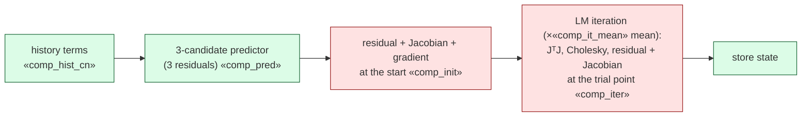

# Improving the off-mesh bank ROM: why it loses on Burgers, and what to try next

**Status (2026-10-20; ideation only, nothing launched; reviewed, see section 6).** This report diagnoses the three limitations of the closed Burgers 2D/3D campaign (K2 fires, H-base fails, generalisation fails) and ranks candidate fixes. It uses saved lane outputs and eight cheap CPU analyses of already-saved data (`analysis/*.py`; seconds to a minute each; the deployed 2D bank is read through the NumPy evaluator vendored in jcp-regimes). **Every measured number** is filled in by `make_report.py` from `values.py`, which reads it from a lane output, the final campaign report, LAB-LOG.md or this folder's analysis JSONs; `VALUES.json` lists each with its source. Design constants (r, M = 4r, Δt, step counts, registered bars), planning budgets and proposed kill thresholds are written directly and are choices, not results. **Labels that travel with the numbers:** campaign errors are conditional E0 estimates; H-base comparisons are developmental, in-sample and unadjusted, with the 2D tuning-budget band unresolved; regime errors on C1/C2 come from numerically unqualified configurations. The new floor analyses use the quadrature-study `refdv` references, which are the project's **first-order** FOM (sign-upwind + backward Euler) at $8192^2$ and $\Delta t = 3.125\times10^{-4}$; the E0 lane found such references off the second-order ones by up to «refdv_off_2d» in 2D. Floors compare bases on the same fields, so the comparisons are internally consistent, and the bank floors agree closely with the campaign's E0 floors; but the tiny sine floors and spectral tails are statements about these numerical fields, not the continuum solutions, until re-run on E0 references. **Every gain in sections 3–4 is a back-of-envelope estimate**, labelled so. File naming: the user asked for `report.md` inside this dated folder; that departs from the CLAUDE.md rule of one dated file name per report, and the date and slug are carried by the folder instead (as in the campaign's `final/report.md`).

## 1. In brief

- **K2 is unlikely to be reversed on the box by any fix inside the method.** On the median in-range case a plain Laplacian-ordered sine basis is *more* compressive than the learned bank: the first «ratio_med_384»$\,r$ sines already match the r = 384 bank floor. The bank's advantage is on the worst case only, about «worst_ratio_384»× fewer unknowns than sines. The spectral FOM turns that small gap into a win through cheaper unknowns: fast transforms, an exactly integrated Laplacian, explicit steps (10–20 against our 50), and a cheap output synthesis. With the current dense decode, even a zero-cost evolution would cap the r = 384 speed-up at 4096² full field at about «smax_R384» (illustrative cross-job estimate).
- **H-base is a per-step cost gap plus a worst-case span limit.** On the same solver and about one iteration per step, the r = 384 POD-ECSW pick takes «hrb_R384_base_step» per step against our «hrb_R384_ours_step»; our excess is about two dense $M\times r$ Jacobian assemblies per step. On worst error the evidence is descriptive: the one converged Galerkin endpoint that jcp-budget computed in the r = 384 span sits at a worst distance of «bud_LCNR384_dyn_worst» from the projected reference (256²), while the pick's total worst error is «hrb_pick_worst_R384» (1024²); a matched total-error comparison has not been made. Only the floor («bud_LCNR384_eP_worst» worst) bounds every reduced form in this span, and it sits just below the pick.
- **Generalisation fails through the span and the reduced dynamics together.** On C1/C2 the bank floor is «floor_C1_384» / «floor_C2_384», and the part of the error inside the span (distance to the projected reference, computed per case and time, then the median) is as large or larger («inspan_C1» / «inspan_C2»); those configurations also fail quadrature qualification. Widening the bank prefix from 384 to 512 barely moves the C1 floor (C1 «C1_floor_r_gain»).
- **Ranking.** Pursue: F1 (exponential/IMEX Galerkin step, for the time error and the Newton loop), F11 (retrained bank: fidelity and coverage arms, plus a boundary-compatible bank, F16), F2/F3 (the hyper-reduction cost lever for H-base, tested together) and F14b (full-cost multi-mesh break-even with a continuous-POD control). The out-of-regime indicator (F12) is demoted: on saved data a parameter-only check $s = a/\nu$ separates bad cases as well as rule doubling (AUC «oodA_s_auc» against «oodA_dist_qp_auc»). **None of the fixes is expected to beat the spectral FOM on the box;** the best estimates stay below parity.

## 2. Diagnosis

Per-step flow of the deployed 2D LSPG query, with the measured cost of each part for r = 384, CN-R, 1024² (H200, jcp-p1-scaling component run, one case):

Red boxes build the Jacobian $\partial N/\partial c=\Psi^\top[\operatorname{diag}(Dc)\,B+\operatorname{diag}(Bc)\,D]$ of size $M\times r$ from $m$ quadrature points, $2mMr$ flops (r = 384: «flops_J_384»). The LM code evaluates it at the start and at every trial point, so at least twice per step (`t2core.make_lm`). The component model sums to «model_cur_step» per step against «step_R384» from the P1 evolution time / 50 steps; the H-base job's «hrb_R384_ours_step» is the full query time / 50 (query-amortised, including initialisation and decode).

### 2.1 K2: why a coarse sine pseudo-spectral FOM wins

**What each solver carries (2D).**

| quantity | spectral FOM N = 24 | spectral FOM N = 48 | ROM r = 128 | ROM r = 384 |
|---|---|---|---|---|
| unknowns | «ps_N24_modes» sine modes | «ps_N48_modes» sine modes | 128 | 384 |
| tests $M$ | – | – | 512 | 1536 |
| nonlinear-term points | $35^2$ (3/2-padded grid interior) | $71^2$ (3/2-padded grid interior) | $m=4181$ (Fibonacci) | $m=16384$ (Gauss $128^2$) |
| $m/M$, $m/r$ | – | – | «m_over_M_128», «m_over_r_128» | «m_over_M_384», «m_over_r_384» |
| time steps to $T=0.25$ | 10 (ETDRK4, explicit) | 20 (ETDRK4, explicit) | 50 at $\Delta t_0$ (implicit, LM) | 50 at $\Delta t_0$ (implicit, LM) |
| median / worst error (1024²) | «ps_N24_med» / «ps_N24_worst» | «ps_N48_med» / «ps_N48_worst» | «p1_R128BE_med» / «p1_R128BE_worst» (BE) | «p1_R384CNR_med» / «p1_R384CNR_worst» (CN-R) |
| query time, 4096² full field | «t4k_ps24» | «t4k_ps48» | «t4k_R128» (BE) | «t4k_R384» (CN-R) |

ROM errors are the P1 1024² rows (conditional E0); times are jcp-fom2d's stage-2 4096² medians (H200). Our r = 384 rule uses «m_over_ps48»× more nonlinear-term points than the N = 48 solver's padded grid.

**Data: on the median case the learned bank is not more compressive than sines.** Floors of the 38 dev6 + val32 `refdv` fields (max over the five output times, relative to $\lVert u(t_0)\rVert$; `analysis/sine_floor.py`, `analysis/bank_vs_sine.py`):

| basis | unknowns | median floor | worst floor |
|---|---|---|---|
| bank | 128 | «bank128_med» | «bank128_worst» |
| bank | 384 | «bank384_med» | «bank384_worst» |
| bank | 512 | «bank512_med» | «bank512_worst» |
| first sines by $k_1^2+k_2^2$ | 384 | «sine_lap384_med» | «sine_lap384_worst» |
| first sines by $k_1^2+k_2^2$ | 1536 | «sine_lap1536_med» | «sine_lap1536_worst» |
| all sines with $k_1,k_2\le 24$ | 576 | «sine_block24_med» | «sine_block24_worst» |
| all sines with $k_1,k_2\le 48$ | 2304 | «sine_block48_med» | «sine_block48_worst» |
| bank 384 + first 512 sines | 896 | «hyb512_med» | «hyb512_worst» |

(The solvers keep one mode fewer per axis than the block rows; the bank-384 row is close to the campaign's E0 values, «bud_LCNR384_eP» median and «bud_LCNR384_eP_worst» worst.)

- Per case, the exact smallest Laplacian-ordered sine prefix that matches the bank floor is a median «ratio_med_384»$\,r$ at r = 384 (up to «ratio_max_384»$\,r$) and «ratio_med_128»$\,r$ at r = 128.
- To match the bank's *worst* floor the sine prefix needs «sineK_worst_384» modes at r = 384 («worst_ratio_384»×) and «sineK_worst_128» at r = 128 («worst_ratio_128»×).
- A data-driven yardstick (`analysis/pod_control.py`, leave-one-case-out POD from the other 37 cases' snapshots, rank ≤ 222): at rank 128 POD reaches «loo_pod_128_med» / «loo_pod_128_max», the bank «loo_bank_128_med» / «loo_bank_128_max», sines «loo_sine_128_med» / «loo_sine_128_max» (median / worst). This POD is data-starved, so it says only that the bank is not obviously mis-trained; it does not settle whether a better-trained basis would beat sines.
- The bank-plus-sines hybrid at 896 unknowns has a lower worst floor than the 2304-mode sine block. That is the one place the learned functions clearly add value (F15).

**Data: the ROM's cost per unknown is much higher.**
- *Steps.* 10–20 explicit spectral steps against 50 implicit ROM steps. Larger ROM steps help directly: the r = 384 CN-R union speed-up rises from «k2_S_R384CNR005» at $\Delta t_0$ to «k2_S_R384CNR001» at $2\Delta t_0$ and «k2_S_R384CNR0125» at $2.5\Delta t_0$, while the time error T dominates every LSPG member (jcp-budget).
- *Dense Jacobians.* About «comp_it_mean» LM iterations per step, each with an $mMr$ Jacobian; measured steps «step_R384» (r = 384) and «step_R128» (r = 128).
- *Decode.* The full-field decode reads the stored bank on the output mesh: «t_dec_R384_4k» (r = 384) and «t_dec_R128_4k» (r = 128) at 4096², against a whole spectral-FOM query of «t4k_ps48».

**Derived, illustrative (current dense decode).** With zero evolution cost the 4096² full-field speed-up over the matched spectral FOM would be at most about «smax_R384» at r = 384, «smax_R128» at r = 128 (vs N = 48) and «smax_R128_N24» at r = 128 (vs N = 24). These are ratios of medians from two H200 jobs. The registered K2 bar is 2×. So, for the measured decoder, this workload and the existing accuracy targets, solver or quadrature changes alone would not reach 2× at r = 384; a cheaper decode (separable or low-rank bank storage, or the lattice contract; single precision is excluded by the project's f64 rule) would also be needed. A more accurate ROM could be matched to a costlier FOM, so this is not a bound; a within-job ceiling would be needed for one. On the lattice contract the decode is small, but the evolution must then beat the spectral FOM's whole lattice query («ps_N48_cost») by 2×; the F1 estimates below give $S\approx$ «est_S_lat_quad»–«est_S_lat_gal». 3D is further away: union speed-ups «k2_3d_range» (final report).

**Hypotheses (not tested).**
- The box, the Dirichlet walls and smooth diffusive solutions are what a sine series is built for, and the spectral FOM's speed comes from the same structure. Our literature pass (searches for ROM-vs-pseudo-spectral comparisons on periodic or box domains) found no projection ROM beating a tuned pseudo-spectral solver at equal accuracy; this is absence of evidence. Published ROM speed-ups (CROM, SNF-ROM, GNAT) are against grid FOMs.
- The bank's boundary envelope (npbank.py) gives, for $u=16x(1-x)y(1-y)\,n$, $u_{xx}(0,y)=32y(1-y)\,[n_x(0,y)-n(0,y)]$: it *permits* nonzero wall curvature, whereas Burgers solutions with $u=0$ on the wall have $\Delta u=0$ there. If the trained fields do carry wall curvature, their odd extension is less smooth than the solutions', which could explain their sine tail (F7) and part of the large $m$. Unmeasured; F16 starts by measuring it.

### 2.2 H-base: why tuned POD + ECSW / Q-DEIM dominates

**Data (2D 1024², H200, same job; medians recomputed from the stage-B timing triples; developmental, in-sample, unadjusted).**

| | ours (time) | baseline pick (time) | baseline / ours | sampled points |
|---|---|---|---|---|
| r = 384 CN-R vs ECSW r = 384, κ = 8, CN-R | «hrb_R384_ours» | «hrb_R384_base» | «hrb_R384_ratio» | ECSW «pts_e384k8» nodes vs our $m = 16384$ |
| r = 128 BE vs Q-DEIM r = 256, p = 512, CN-R | «hrb_R128_ours» | «hrb_R128_base» | «hrb_R128_ratio» | Q-DEIM «pts_q256» vs our $m = 4181$ |
| r = 512 BE vs Q-DEIM r = 256, p = 512, CN-R | «hrb_R512_ours» | «hrb_R512_base» | «hrb_R512_ratio» | Q-DEIM «pts_q256» vs our $m = 36864$ |

- **Same solver, similar iterations.** Every pick uses our LM solver ("common"); with the baseline's native Gauss–Newton–QR solver the ECSW r = 384 κ = 8 query takes «tq_native_e384k8» instead of «tq_e384k8». The pick needs «base_it_step» LM iterations per step over its cases (stage-B certificates); ours «comp_it_mean» (P1 component run). The gap is per-iteration work.
- **Per step.** «hrb_R384_base_step» (baseline) against «hrb_R384_ours_step» (ours) at r = 384. The baseline's screening times barely change with its point count (r = 384: «tq_e384k4» at «pts_e384k4» nodes, «tq_e384k8» at «pts_e384k8»), so it sits near the GPU latency floor. Our r = 384 Jacobian kernel alone takes «nom_J_384» and runs at least twice per step.
- **Points against tests.** Our rule uses $m/M$ = «m_over_M_128»–«m_over_M_384» and $m/r$ = «m_over_r_128»–«m_over_r_384»; ECSW samples 4–8 nodes per unknown (κ), each with a 5-point stencil. Reducing $M$ does not obviously help: in jcp-dims A4, r = 384 needs $m^\*$ = «a4_384_512» at $M = 512$ and «a4_384_768» at 768, but «a4_384_1536» at 1536 and «a4_384_2048» at 2048 (and «a4_384_384» at $M = r$), so $m\cdot M$ hardly falls; fewer tests make the solve less tolerant of quadrature error (conditioning and qualification, not bandwidth alone).
- **Worst error.** jcp-budget's ideal end (Galerkin with $M = 2048$ sine tests, Gauss $320^2$, BDF2 at $\Delta t_0/8$, tight solve; 256², 38 cases) differs from the projected reference by $e_{\rm dyn}^\*$ with worst case «bud_LCNR384_dyn_worst» at r = 384, above the pick's «hrb_pick_worst_R384» (1024²). Our deployed worst is «ours_worst_R384CNR». The floor («bud_LCNR384_eP_worst» worst) is the only bound for every reduced form in this span and lies just below the pick. **Reading (descriptive):** the converged endpoint (which also changes the tests, rule and initialisation) is not below the pick's worst error on these numbers. A finite-step trajectory is not bounded by it (errors can cancel), and the two numbers are different quantities on different meshes, so no conclusion about closing the gap follows until a matched total-error comparison is made. A different projection (closure, space-time or windowed LSPG), a better span (F11, F15, F16) or r = 512 (worst floor «bank512_worst», on the first-order `refdv` fields) are the candidates. The two numbers are different quantities (distance to the projected reference vs total error), from different meshes, and conditional E0 estimates; a same-mesh, same-case comparison of total errors is needed.
- **Scheme.** All 2D picks are CN-R. At r = 384 and $\Delta t_0$ our LSPG CN-R time error is «bud_T_ratio» our Galerkin CN time error (median T «bud_LCNR384_T» vs «bud_GAL384_T»). This is one observed member, not a general LSPG penalty. Carlberg, Barone & Antil (2017) prove LSPG and Galerkin coincide for explicit schemes and show LSPG error can be smallest at an intermediate step.
- **Hypothesis.** The POD basis came from central-difference snapshots on the target mesh, the bank from upwind 256² data, so POD may hold steep cases better. Untested: no per-case POD floors on the same references exist.
- **Descriptive note.** The POD-ECSW picks' own 1024² query times («tq_e128k8» at r = 128 up to «tq_e512k8» at r = 512) are of the same order as the spectral FOM's 4096² full-field query («t4k_ps48»), so the standard baseline would probably not pass K2 either; it was never matched against the FOM ladder.

### 2.3 Generalisation: steeper fronts, the stiff corner, and the head

**Data (jcp-regimes; floor = best fit by the first r bank functions, median over the regime's cases; C1/C2 ROM errors are from configurations that fail Q1/Q2).**

| regime | floor r = 128 | floor r = 384 | floor r = 512 | ROM median (r = 384 LSPG-CN-R) | ROM / floor | in-span part |
|---|---|---|---|---|---|---|
| val32 (in range) | «floor_val32_128» | «floor_val32_384» | «floor_val32_512» | – | – | – |
| N0s (stiff corner, in range) | «floor_N0s_128» | «floor_N0s_384» | «floor_N0s_512» | «reg_med_N0s» | «reg_ratio_N0s» | «inspan_N0s» |
| A− (ν below range) | «floor_Am_128» | «floor_Am_384» | «floor_Am_512» | – | – | – |
| C1 (steeper) | «floor_C1_128» | «floor_C1_384» | «floor_C1_512» | «reg_med_C1» | «reg_ratio_C1» | «inspan_C1» |
| C2 (steepest) | «floor_C2_128» | «floor_C2_384» | «floor_C2_512» | «reg_med_C2» | «reg_ratio_C2» | «inspan_C2» |

For a ROM field $v$ in the span and the orthogonal projection $P$ onto it, $\lVert v-u\rVert^2=\lVert(I-P)u\rVert^2+\lVert v-Pu\rVert^2$: the floor is the part outside the span and the rest, the distance to the projected reference, lies inside it. "In-span part" is $\max_t\lVert v-Pu\rVert/\lVert u_0\rVert$ per case, then the median (`analysis/inspan_decomp.py`, decoding the saved r = 384 LSPG-CN-R outputs; its total errors reproduce the lane's to round-off). It mixes reduced-model, initialisation and numerical errors.

- **Span and in-span error contribute comparably.** On C1/C2 the floor is large, but the in-span part is larger, and those configurations fail Q1/Q2. Fixing generalisation therefore needs both a better span (F11, F15, F16) and converged numerics for steep states (F13); since a new span changes the dynamics, the size of either gain cannot be read off these medians.
- **Width within this bank does not help.** The floor barely improves from the 384-prefix to the 512-prefix (C1 «C1_floor_r_gain»). This concerns prefixes of one frozen bank; a wider bank trained on steeper data is untested.
- **The stiff corner inside the training box is under-represented:** the N0s floor is «N0s_over_val32» the val32 floor at r = 384.
- **Hypothesis: training-data fidelity.**
  - The 2D bank was trained on sign-upwind + BE solutions on 256 nodes per axis including the walls, $h = 1/255$ (jcp-smooth-bank DESIGN.md).
  - Upwinding adds a numerical viscosity of about $a h/2$, so the effective viscosity is roughly $\nu(1+q)$ with $q = a h/(2\nu)$. $q$ reaches «q_worst» on the worst-floor in-range case, val32|19, which is also the worst case of several Q1 failures (median «q_med»). Effective training steepness would be $s/(1+q)$, about a quarter lower at the steep end.
  - A nearby upwind FOM (jcp-fom2d `fd|UB|L256|0.005`, 256 intervals, BE $\Delta t = 0.005$) errs by «ub256_med» median and «ub256_worst» worst against E0, mixing spatial smearing and BE time error.
  - The floor-steepness correlation is **not** evidence for this: per-case Spearman with $s$ is «sp_bank_s» for the bank floor but «sp_sine_s» for a fixed 384-sine basis, so any basis shows it (`analysis/pod_control.py`). F11's fidelity-only arm is the test.
- **The head cannot help where it was tested.** In range the linear floor is far below the error (T dominates). At equal online cost the linear r = 128 span reaches «lin_r128_med» against the K = 16 head's «head_K16_med» at «lin_r128_cost» the head's cost (jcp-heads, exploratory). The head maps into the frozen bank's span, so it cannot beat that span's floor on steep regimes either. A nonlinear manifold could only help with a new decoder (F14f).

## 3. Ranked candidate fixes

| id | fix | targets | estimated effect (back-of-envelope) | cost (planning) | rank |
|---|---|---|---|---|---|
| F1 | exponential / IMEX Galerkin step (explicit advection, exact diffusion), with offline precontraction of the test projection | T error, Newton loop; not K2 | evolution «est_etd_gain_quad» faster than r = 384 CN-R at $\Delta t_0$ (current rule; up to «est_etd_gain_gal» if the bank-tested kernel reaches the latency floor, unmeasured); K2 at 4096² still ≈ «est_S_etd_quad»–«est_S_etd_gal» | 2–4 GPU-h, ~1 week | **pursue** |
| F11 | retrain the bank: fidelity-only and coverage-only arms | generalisation, worst-case floor | unknown; the kill test decides | 6–12 GPU-h, ~1 week | **pursue** |
| F16 | boundary-compatible bank (output odd and 2-periodic by construction) | quadrature cost, spectral tail, floors | unknown; tested as an arm of the F11 retrain | +3 GPU-h | **pursue (with F11)** |
| F2 + F3 | bank-tested Galerkin and continuous ECSW / EQ weights on our own points | H-base per-step gap | advection evaluation «flops_N_sine_384» → «flops_N_bank_384» flops (2×), Jacobian 4×; points 16384 → κr = «est_F3_pts» («est_F3_ratio»), latency-bound kernels give less | 3–5 GPU-h | **pursue (one combined test)** |
| F14b | full-cost multi-mesh break-even against per-mesh POD-ECSW, with a continuous-POD control | framing | decides whether mesh independence is an advantage at all | 5–8 GPU-h | **pursue** |
| F15 | sine-enriched (hybrid) bank | generalisation, worst error | bank 384 + 512 sines: worst floor «hyb512_worst» against «bank384_worst» (first-order `refdv` fields) | CPU, then with F11 | maybe (cheap CPU check first) |
| F12 | out-of-regime indicator (rule doubling) with fallback | generalisation (safety) | rule doubling AUC «oodA_dist_qp_auc», but parameter-only $s$ AUC «oodA_s_auc»; on the box the ROM alone already costs more than the FOM | CPU + ≤ 2 GPU-h | maybe (only where OOD is not parameterised, or with F14a) |
| F13 | adaptive time step and adaptive quadrature | generalisation, step waste | needed for steep states that fail Q2 | with F1 / F11 | maybe (folded into W2) |
| F4 | exact or CP-compressed quadratic tensor assembled from the rule; operator inference | H-base | LSPG tensor at r = 384 «bytes_T_lspg_384», read ≥ «tread_T_lspg_384» against the current Jacobian «nom_J_384»; Galerkin tensor «bytes_T_gal_384» (≥ «tread_T_gal_384») | ≤ 1 GPU-h | maybe |
| F5 | one Newton pass (linearised Galerkin CN), Jacobian reuse, predictors | H-base, K2 | one Jacobian and one LU per step instead of two Jacobians, an LM loop and a predictor; size to be measured | control arm in W1 | maybe |
| F17 | closure, space-time or windowed LSPG | worst error (in-span part) | aims to cut the distance to the projected reference; total error must be reported too | 3–6 GPU-h | maybe |
| F18 | coarse spectral solver with a learned correction | K2 (on the FOM's own ground) | a different method; competes with the spectral FOM directly | weeks | maybe (separate project) |
| F7 | fast sine synthesis decode / DST projection | K2 | tail «dec_tail_384_4096_med» median, «dec_tail_384_4096_max» worst beyond 4096 sines, small next to ROM error | CPU | maybe (CPU check now) |
| F14a | non-box geometry without a sine-transform FOM | K2 (changes the problem) | removes the sine-series solver; multigrid, spectral-element and FE comparators remain | weeks | maybe |
| F14d | many-query batching | K2 | throughput gain «batch_W768» at B = 16 for one speed3d configuration (later found quadrature-unqualified); the FOM batches too | ≤ 1 GPU-h | maybe |
| F14f | steep, low-viscosity regime with a new nonlinear decoder | K2, head | FOM cost grows as $\nu\to0$; a low-dimensional manifold might not | 15–30 GPU-h | maybe (high risk) |
| F6 | fewer tests ($M<4r$) or low-mixed-frequency tests | H-base | square $M=r$: «b6_square» qualify; A4: below $M=1152$ $m^\*$ grows; $M=1152$ keeps $m^\*$ and cuts $m^\*M$ by «mM_1152_vs_1536»; low-mixed-frequency set needs «lmf_gauss» Gauss points | in W1 | drop, except an $M=1152$ timing control (and sketching as an option) |
| F8 | transport / shift-aware bank | generalisation | failures are amplitude/steepness at matched geometry; coordinate dilation and local banks remain options | – | deprioritise (scoped to this problem) |
| F9 | repair the head in range | head | linear span wins at equal cost; head limited by the frozen span | – | drop |
| F10 | ROM-aware (rollout-loss) bank training | all | in range T, not the floor, binds for LSPG; revisit after F1 | – | deprioritise |
| F14c | arbitrary-point outputs as a headline | framing | the spectral FOM is also evaluable anywhere on the box | – | drop |
| F14e | NS 2D/3D on periodic boxes | framing | same spectral-FOM structure; one earlier NS 3D pilot was «ns3d_pod» less accurate than per-mesh POD-64 | – | deprioritise (wall-bounded: see F14a) |

## 4. The fixes

Each section gives the mechanism, evidence for and against, an estimate, risk and cost, novelty and effect on the claims, and a **kill criterion**: a cheap first experiment with a pre-registrable stop rule.

### F1. Exponential / IMEX Galerkin step, with offline precontraction — pursue

**Mechanism.**
- In test coordinates the Galerkin form is $R_m\dot c=-Q^\top[N(c)+\nu\Lambda Ac]$ with $A=QR_m$. Its linear part $L=-\nu R_m^{-1}Q^\top\Lambda QR_m$ is similar to $-\nu\,Q^\top\Lambda Q$, which is symmetric negative definite.
- Diagonalise $Q^\top\Lambda Q=VDV^\top$ once offline (independent of $\nu$). Per query, the ETDRK4 coefficients are diagonal functions $\varphi_k(-\Delta t\,\nu D)$. ETDRK4 (Cox–Matthews; Kassam–Trefethen 2005) then needs four evaluations of $N$ per step and no Jacobian, Cholesky or Newton loop.
- **F1b, diffusion coordinates (from review).** With $z=V^\top R_m c$ and $B_z=BR_m^{-1}V$, $D_z=DR_m^{-1}V$, $P_z=\Psi QV$ precomputed, $\dot z=-P_z^\top[(B_zz)\odot(D_zz)]-\nu Dz$: the diagonal linear part needs no per-stage coordinate transform, which removes the small-matrix charge assumed in the estimate below.
- **F1a, precontraction (from review).** The Galerkin right-hand side needs only $R_m^{-1}Q^\top\Psi^\top(u\odot s)$. Precompute $\tilde P=\Psi Q R_m^{-\top}$ ($m\times r$) offline. The online projection then costs $2mr$ instead of $2mM+2Mr$, without changing the formulation: advection evaluation falls from «flops_N_sine_384» to «flops_N_pre_384» flops at r = 384.
- Galerkin also had a smaller time error than LSPG in this member («bud_T_ratio» at r = 384), and a fourth-order integrator should reduce T, the dominant LSPG error.

**Evidence for.**
- Proxy (`analysis/explicit_stability.py`): the reduced advection Jacobian $J_a=-R_m^{-1}Q^\top\partial N/\partial c$ at projected reference states (38 cases × 3 times) gives $2.8/\rho(J_a)\ge$ «dta_min_384» at r = 384 and «dta_min_128» at r = 128. The proxy threshold exceeds 0.0125 at every sampled state (fraction «frac0125_384») and 0.025 at a fraction «frac025_384» at r = 384. Explicit RK4 on the diffusion part would need $\Delta t$ of order «dtd_min_384» (same heuristic), hence the exact treatment.
- GAL-CN already leads the 2D median-error front (jcp-qualify).
- IMEX (BDF/EXT) Galerkin ROMs with explicit advection are standard for quadratic flows (Fick, Maday, Patera & Taddei 2018; the NekROM/CPD-ROM line). Kirsten & Simoncini apply exponential integrators in reduced POD-DEIM spaces. Carlberg, Barone & Antil (2017) show LSPG equals Galerkin for explicit schemes.

**Evidence against.**
- The proxy is weak: it uses continuum sine eigenvalues and quadrature-built $A$ (production uses mesh-projected $A$ and discrete eigenvalues; the selected mode sets differ by a few modes), projected reference states rather than ROM states or stages, and three times only.
- $2.8/\rho$ uses a heuristic constant near RK4's stability intercepts ($2\sqrt2$ on the imaginary axis, about 2.785 on the negative real axis); it is not a stability guarantee for non-normal operators or ETDRK4 splitting.
- $J_a$ has eigenvalues with positive real part (up to «maxre_384»). Their cause (compressive regions, the projection, or the quadrature) is not diagnosed; if explicit stepping proves fragile, an energy-conserving (skew-symmetric) advection form or ECSW-style structure preservation is the standard remedy.
- Galerkin does not lead the worst-error front. Novelty is low; the point is cost and accuracy, not originality.

**Estimate.**
- Per step: four advection evaluations plus small $r\times r$ products.
- With the measured nominal $N$ kernel at r = 384 («nom_N_384») plus one latency-floor $r\times r$ operation («floor_JTJ32») per stage: «est_etd_step_quad» per step. 20 steps at $\Delta t=0.0125$ take «est_etd_ev_quad», against «t_ev_R384» today (50 CN-R steps): **about «est_etd_gain_quad»**.
- If the precontracted kernel ran at the smallest measured kernel time («floor_N32»), the step would be «est_etd_step_gal» and the gain «est_etd_gain_gal». That is optimistic and unmeasured.
- Neither figure counts $\varphi$ products, stage combinations or loop overhead.
- These are assumptions about kernel times, not a measured interval.
- Against the spectral FOM at 4096² full field, adding init and decode: $S\approx$ «est_S_etd_quad»–«est_S_etd_gal». **F1 is not a K2 fix.**
- For H-base the outcome is open: POD-ECSW can use the same IMEX/ETD step (its Galerkin operator is also $r\times r$), so the fair test times both with it and reports the result rather than predicting it.

**Risk, effort, cost.** Moderate risk (stiff-corner stability, $\varphi$-function evaluation). About 1–2 days of code on the vendored stepper (the GAL form exists), audits, then one H200 job of 2–4 GPU-h.

**Kill criterion.**
- dev6 + val32 at 1024², r ∈ {128, 384}, in one job: arms (i) current LSPG CN-R at $\Delta t_0$; (ii) precontracted sine-tested GAL-CN at $\Delta t_0$ (separates the projection change from the integrator change); (iii) the same with ETDRK4 at $\Delta t\in\{0.0125, 0.025\}$; (iv) one-pass linearised Galerkin CN (F5); (v) POD-ECSW r = 384 κ = 8 with the same ETDRK4 step. Complete matched queries are timed in the same job.
- Error against E0 and a $\Delta t/2$ refinement per arm (to measure how much T is reduced, not to claim it removed); solver/quadrature checks within each formulation.
- **Stop if** any arm-(iii) run is invalid or unstable at $\Delta t=0.0125$, **or** its r = 384 worst error exceeds arm (i)'s, **or** its r = 384 evolution is less than 3× faster than arm (i).
- Report arm (v) against (iii) for H-base, as a result.

### F2 + F3. Hyper-reduction cost: bank-tested Galerkin and continuous ECSW on our points — pursue as one test

**Mechanism.**
- *F2:* use the bank itself as test space,
$$\mathcal M\dot c=-\sum_q w_q\,G(x_q)^\top u_q\,(\partial_x u+\partial_y u)_q-\nu\mathcal K c,$$
with $\mathcal M=\int G^\top G$ and $\mathcal K=\int\nabla G^\top\nabla G$ computed offline. Advection evaluation costs $6mr$ instead of $2m(2r+M)$ (2×); a Jacobian $2mr^2$ instead of $2mMr$ (4×). ETD then needs the generalised eigenproblem $\mathcal KV=\mathcal MVD$ (offline, $\nu$-independent).
- *F3:* treat our Gauss/lattice points as a continuous candidate pool and fit sparse non-negative weights (ECSW-style NNLS on Galerkin-projected contributions, or EQP's LP) to cut $m$ to about $\kappa r$. Closest prior art: CECM (Hernández et al. 2024), which moves cubature points continuously; ours has exact autodiff integrands instead of per-element fits.

**Evidence for.**
- After a shared solver, the remaining per-step gap to ECSW is $m$ (16384 against «pts_e384k8») and $M$.
- The bank Gram matrix is well conditioned: $\operatorname{cond}(\mathcal M)$ = «condM_128» / «condM_384» / «condM_512» at r = 128 / 384 / 512, against $\operatorname{cond}(A)^2$ = «condA2_128» / «condA2_384» / «condA2_512» for the sine-tested $A$ (`analysis/pod_control.py`). The bank is Dirichlet-exact through its envelope.

**Evidence against.**
- jcp-dims A4: fewer tests needed *more* quadrature points ($m^\*$ rises from 16384 to 36864 at r = 384 when $M$ falls from 1536 to 768), and no square $M=r$ sine configuration qualified. Bank tests ($r$ of them) may need a large $m$ or may not qualify. The 2× / 4× saving can vanish.
- Our history with fitted quadratures: they won only at coarse $m$ and were checkpoint-dependent (2026-08-25/26). Rules are already bank- and seed-specific (jcp-robust E2).
- F3 moves the paper away from "classical quadrature replaces empirical hyper-reduction".

**Estimate.** Points «est_F3_ratio» fewer (descriptive: ECSW uses stencil gathers and a different operator). Kernel times fall less, because the kernels are near the latency floor (fixed-$m$ $N$: «floor_N32» at r = 32 vs «nom_N_384» at r = 384).

**Kill criterion.**
- One job (≤ 3 GPU-h), r = 384, with the projection and the rule crossed in separate arms: (a) bank-tested Galerkin with Gauss rules 64²–192² (classical); (b) sine-tested precontracted Galerkin with ECSW-type weights on Gauss 128² candidates (fitted); (c) both changes together. Weights are fitted on decoder-output snapshots of training trajectories only (dev6 and val32 excluded), κ ∈ {4, 8, 16}, as the project's fitting rule requires.
- Every arm: full Q2 contract (successor rollout distance, reached-state $\rho$, successor validity, check-rule convergence), solver qualification within its form, E0 error on dev6 + val32, paired end-to-end timing against F1's precontracted arm, setup cost recorded.
- **Stop F2 if** its $m^\*$ exceeds 16384 (then $6mr$ is no cheaper than F1's precontracted «flops_N_pre_384» flops; at the A4 worst case it would be «flops_N_bank_a4worst»), or its worst error exceeds F1's, or it is not faster end to end.
- **Stop F3 if** no κ ≤ 16 passes the full Q2 contract with worst error no worse than the classical rule and a ≥ 1.5× end-to-end gain.

### F4. Exact or CP-compressed quadratic tensor; operator inference — maybe

**Mechanism.**
- For a quadratic term the rule defines $T_{kij}=\sum_q P_{qk}B_{qi}D_{qj}$. Assembled offline it reproduces the rule's $N(c)$ (to round-off), so qualification carries over.
- An $m$-point rule is a CP format of rank at most $m$. A lower-rank CP fit (Tsai, Fischer & Solomonik 2023; skew-symmetry preserving) compresses further without snapshots, but needs its own accuracy and stability checks.
- Operator inference (Peherstorfer & Willcox 2016) is the non-intrusive cousin for exactly quadratic Burgers.

**For.** At r = 128 the LSPG tensor is «bytes_T_lspg_128» (read ≥ «tread_T_lspg_128»).

**Against.**
- At r = 384 the LSPG tensor is «bytes_T_lspg_384» («bytes_T_lspg_384_sym» stored symmetric in the quadratic pair; Galerkin «bytes_T_gal_384_sym»): a bandwidth-only read of the full tensor ≥ «tread_T_lspg_384» (assumed H200 bandwidth; attainable bandwidth and arithmetic make it slower) against «nom_J_384» for today's kernel. These are screening numbers, not achieved query speeds.
- An earlier 3D measurement found the tensor contraction bandwidth-bound and slower than the quadrature GEMM («tensor_bw_3d», LAB-LOG 2026-10-01).
- The 3D width-1024 LSPG tensor is the «tensor_34gb» the off-mesh paper argues against.

**Kill criterion.** Microbenchmark (≤ 1 GPU-h) of value, Jacobian and full ETD query at r ∈ {128, 384}, Galerkin form. **Stop if** the full query is not ≥ 1.5× faster than F1's quadrature version.

### F5. One Newton pass, Jacobian reuse, predictors — maybe (control arm in W1)

**Mechanism.**
- Iterations are already about one per step («comp_it_mean»), so the waste is the 3-residual predictor («comp_pred») and the second Jacobian.
- A defined one-pass method on the square Galerkin ODE $\dot c=-f(c)$, $f(c)=R_m^{-1}Q^\top[N(c)+\nu\Lambda Ac]$ (the mass already inverted, as in `t2core.py`): the linearised trapezoidal (Rosenbrock-type) step $(I+\tfrac{\Delta t}{2}J_f(c_n))\,\delta=-\Delta t\,f(c_n)$, $c_{n+1}=c_n+\delta$, with the exact $J_f$ at $c_n$, one LU factorisation of the nonsymmetric $r\times r$ matrix, and the first step taken the same way. It is second order for this ODE. Applied to the rectangular LSPG residual by least squares it is **not** second order in general (review round 2 gave a counterexample).
- Operation inventory per step (precontracted, r = 384, m = 16384): $J_f$ by $\tilde P^\top$ applied to the $m\times r$ tangent block ($2mr^2$ flops), one LU ($\tfrac23r^3$), one right-hand side ($6mr$), two triangular solves. The earlier LSPG kernel sum («est_onepass_step») does not transfer to this square solve; its time has to be measured.
- Jacobian reuse was tried in 3D: the registered test QN ≤ 0.6× FS-K2 gave «qn_h14» (speed3d H1.4).

**Kill criterion.** In W1 (arm iv): **stop if** its observed order against a converged reduced reference of the same ODE (three levels $\Delta t_0$, $\Delta t_0/2$, $\Delta t_0/4$) is below 1.8, or its E0 worst error exceeds arm (ii)'s at the same $\Delta t$, or its end-to-end gain over arm (ii) is below 1.3×.

### F6. Fewer or low-mixed-frequency tests — drop, except one bounded control

- Square $M=r$: «b6_square» configurations pass Q1 (jcp-dims B6).
- A4: lowering $M$ raises $m^\*$ (section 2.2).
- The low-mixed-frequency set needed «lmf_gauss» Gauss points (LMF vs default) with inconclusive accuracy.
- Intermediate $r<M<4r$ is not ruled out: A4 has r = 384 at $M = 1152$ with $m^\*$ = «a4_384_1152», the same as at 1536, so $m^\*M$ is «mM_1152_vs_1536» lower. Keep it as a cheap same-integrator timing control in W1. A different route to fewer test rows keeps the same test space and sketches the LSPG residual randomly (Balabanov & Nouy, minimal-residual sketching with verification); it belongs in W3 as a control arm if budget allows.

### F7. Fast sine synthesis decode, DST projection — maybe (CPU check now)

- Truncating the bank's fields to their first 4096 Laplacian sines leaves a tail of «dec_tail_384_4096_med» median and «dec_tail_384_4096_max» worst (`analysis/decode_spectral.py`, on lattice projections of the references). The references themselves leave «sine_lap4096_med» / «sine_lap4096_worst».
- Since $\lVert P\hat u-u\rVert^2\le\lVert\hat u-u\rVert^2+\lVert(I-P)u\rVert^2$ for an orthogonal sine projection $P$, the tail adds little to the ROM's own error. The earlier "drop" was wrong.
- The tail may come from the boundary envelope (section 2.1 hypothesis, unmeasured); if so, a boundary-compatible bank (F16) would shrink it.
- *Screen (CPU, now):* decode the saved jcp-regimes ROM coefficient outputs (`R_*.npz`), truncate to K ∈ {2304, 4096, 9216} sines, score against the 257² references (the only resolution stored). **Stop if** the worst error rises by more than 0.1 percentage points at K = 9216.
- *Timing gate (GPU, ≤ 0.5 GPU-h):* the synthesis time at each passing K against the dense decode at 4096². **Drop F7 if** no passing K is faster. Accuracy beyond the 257² lattice would need denser references, which do not exist and are not budgeted. A matrix-oriented (two-sided, separable) representation of the bank, in the spirit of Kirsten & Simoncini's matrix-oriented POD-DEIM, is the other route to a cheap decode.

### F8. Transport- or shift-aware bank — deprioritise for this problem

Shifted POD, registration (Taddei 2020; Mirhoseini & Zahr 2023) and manifold LSPG (Lee & Carlberg 2020) address slow n-width from transport. On the paired A−/C1 contrast the regime effect is amplitude/steepness at matched geometry (final report §3.12). Coordinate *dilation* (front-width scaling) and local banks with local hyper-reduction (localized DEIM, Peherstorfer et al. 2014; local bases with Petrov–Galerkin ECSW, Grimberg et al.) remain plausible for steep fronts. They are the natural comparison for F11's coverage arm; deferred to after W2 for budget, not on evidence.

### F9. Repair the head in range — drop

In range the linear r = 128 span beats the K = 16 head at «lin_r128_cost» its cost; the head is confined to the frozen span. See F14f.

### F10. ROM-aware (rollout-loss) bank training — deprioritise

- In range, T binds for LSPG, not the floor (jcp-budget).
- Earlier banks lowered the floor without a matching ROM gain: the wide bank («wide_floor», worst span floor on «wide_n_cases» native-grid bank-validation cases × six snapshots including $t=0$, each snapshot normalised by its own norm, so not this report's convention) and the Sobolev bank (median floor −«smooth_floor», rollout error «smooth_roll» against first-order references).
- Trajectory-aware training is established in the literature (Otto, Padovan & Rowley 2022; NiTROM, Padovan, Vollmer & Bodony 2024, including nonlinear CGL and cavity flow), so this is a priority call, not a refutation. Revisit after F1 reduces T.

### F11 (+F16, F13). Retrain the bank: fidelity, coverage, boundary compatibility — pursue

**Mechanism.** Three arms, each one change from the incumbent recipe:
- (a) **fidelity only:** same family, training data from a second-order or spectral solver on a fine mesh;
- (b) **coverage only:** upwind data as now, family widened to $s$ up to 1000 (C2's range) at the same state count;
- (c) **boundary-compatible** (F16): incumbent data, and an output that is odd and 2-periodic in each variable by construction, e.g. $u=n(x,y)-n(-x,y)-n(x,-y)+n(-x,-y)$ with $n$ a network of 2-periodic Fourier features. Its odd extension is then as smooth as $n$. An envelope alone does not guarantee this: with $u=e\,n$, $u''=e''n+2e'n'+en''$ keeps $2e'n'$ at the wall even when $e=e''=0$.

Every arm and two controls — the archived bank, and an **incumbent-recipe retrain with a new seed** (to separate the data or architecture change from retraining variation) — get the same rule doubling and adaptive steps for steep states (F13), so a C1 improvement can be attributed to the bank rather than the numerics.

**For.** The floor is a large share of C1/C2 and N0s error; the prefix 384 → 512 barely helps; the hybrid bank+sines result (F15) shows missing content can be added.

**Against.**
- The in-span part is larger than the floor on C1/C2, so floors alone overstate the gain.
- A wider family raises the n-width at fixed r, which may worsen in-range accuracy.
- Each bank fit costs about «bank_fit_h» (A100), and every rule must be re-qualified (rules are bank-specific, jcp-robust E2).

**Kill criterion.**
- *Step 0 (CPU, minutes; a diagnostic, not a gate).* Run the incumbent's upwind generator on val32|19 and the five worst-floor cases; compare (floor of the reference)/(floor of the upwind field) for the bank and for a sine basis of the same size. A bank ratio well above the sine ratio is consistent with smearing; generator matching and BE time error remain alternative explanations.
- *Step 1 (≤ 15 GPU-h).* Three arms and the retrain control, the same seed for every arm, scored on fresh in-range, N0s, C1 and C2 cases (E0-style references, cohorts frozen before training; median over cases of the per-case max over $t_1..t_5$; r = 384 prefix; rule search Gauss 64²–192²).
- Separate primary endpoints, each judged against the retrain control and each with the same guard (stop if the in-range worst floor is more than 2× the control's): **fidelity arm** — stop if the N0s floor is not ≥ 3× below the control's; **coverage arm** — stop if the C1 ROM median error (re-qualified rule) is not ≥ 2× below the control's; **boundary arm** — stop if the qualifying $m^\*$ is not ≥ 2× smaller **and** the 4096-sine tail of decoded fields is not ≥ 3× smaller (it continues if either improves).
- Before Step 1, measure the wall curvature of decoded ROM trajectories and the convergence of their sine tail (CPU) to decide whether the boundary arm is worth running.

### F12. Out-of-regime indicator with fallback — maybe

**Mechanism.** Run the successor rule (rule doubling) alongside the query; flag the query when the rollout distance `dist_qp` exceeds a threshold calibrated in range, and fall back. This is a Richardson-type a posteriori indicator (ROMES, Drohmann & Carlberg 2015, is a regression surrogate over such indicators). Riffaud et al. (2024) switch FOM/ROM within time windows and update the ROM online. AADEIM (Peherstorfer 2020) adapts the basis instead of falling back.

**Evidence (saved data, `analysis/ood_indicator.py`; «ood_n» rows per configuration after excluding the cases with an ineligible reference («ood_excl»); invalid ROM runs are kept, counted as bad and alarmed, «ood_n_invalid» such rows in all).**

| indicator | kind | AUC, target A | detection / false alarm, A | AUC, target B | detection / false alarm, B |
|---|---|---|---|---|---|
| `dist_qp` (rule doubling) | online, second rollout | «oodA_dist_qp_auc» | «oodA_dist_qp_detection» / «oodA_dist_qp_false_alarm» | «oodB_dist_qp_auc» | «oodB_dist_qp_detection» / «oodB_dist_qp_false_alarm» |
| $\rho_{\max}$ | online, cheap | «oodA_rho_max_auc» | «oodA_rho_max_detection» / «oodA_rho_max_false_alarm» | «oodB_rho_max_auc» | «oodB_rho_max_detection» / «oodB_rho_max_false_alarm» |
| $s=a/\nu$ | parameter only, free | «oodA_s_auc» | «oodA_s_detection» / «oodA_s_false_alarm» | «oodB_s_auc» | «oodB_s_detection» / «oodB_s_false_alarm» |
| box distance $d_\nu+d_s$ | parameter only, free | «oodA_d_box_auc» | «oodA_d_box_detection» / «oodA_d_box_false_alarm» | «oodB_d_box_auc» | «oodB_d_box_detection» / «oodB_d_box_false_alarm» |

Target A: error above 2× the configuration's in-range median (the threshold differs per configuration). Target B: error above 1 %. The alarm threshold is the in-range 95th percentile (in-sample), and the online indicators were compared after the fact. Ranges are over the nine configurations; per-configuration values are in the JSON. Per regime, the rule-doubling alarm rate for r = 384 LSPG-CN-R is: dev6 «alarm_dev6», val32 «alarm_val32», N0 «alarm_N0», N0s «alarm_N0s», A− «alarm_Am», A+ «alarm_Ap», B1 «alarm_B1», B2 «alarm_B2», C1 «alarm_C1», C2 «alarm_C2».

**Reading.**
- In this regime family, steepness is a known input, and the free parameter check $s$ is as good as rule doubling. The online indicator earns its cost only where out-of-regime inputs are *not* visible in the parameters (new IC shapes, forcing, geometry).
- On the box the ROM alone already costs more than the matched spectral FOM (r = 384: «t4k_R384» against «t4k_ps48» at 4096²), so ROM + indicator + fallback cannot beat FOM-alone. F12 is a safety feature, not a speed one.

**Kill criterion.** Freeze the indicator, its threshold and the error target on dev6 + val32 + N0; score a fresh cohort of 64 cases (half in range, half new IC families such as multi-bump and signed configurations at new seeds, where $s$ is not the whole story), with invalid runs counted as alarms. New families: the two-bump same-sign and signed-pair generators of jcp-regimes (B1, B2 layouts) at new seeds, frozen before scoring. **Keep only if** the one-sided 95 % Clopper–Pearson lower bound of detection is ≥ 0.7, the one-sided 95 % Clopper–Pearson upper bound of false alarm is ≤ 0.1, and the AUC exceeds the parameter-only control's by ≥ 0.1 at the lower end of a paired, regime-stratified bootstrap interval; with fewer than 30 good or 20 bad cases under either target the result is inconclusive, not a pass (with zero false alarms, the Clopper–Pearson upper bound first drops below 0.1 at 29 good cases). Bootstrap level and controller settings are frozen before scoring.

### F13. Adaptive time step and quadrature — maybe (folded into W2)

- *Time:* a robust exponential Runge–Kutta (4,3) embedded pair (Zoto & Bowman 2023) with a standard PI step controller, tolerance chosen on dev6, rejected steps recomputed; compared with the best fixed-step ETDRK4 that reaches the same worst error.
- *Quadrature:* a policy that doubles the rule on states whose successor-rule $\rho$ exceeds the Q2 bar, with Q2 then checked on the full rollout of the adaptive policy.
- Separate time-only, quadrature-only and combined arms inside W2. **Stop the time arm if** its complete query time (stages, rejected steps, coefficient recomputation included) is not ≥ 1.5× below the tuned fixed-step comparator's at equal worst error in range; **stop the quadrature arm if** C1 does not become Q2-qualified.

### F14. Settings where the method could have a structural edge

- **F14a Non-box geometry — maybe.**
  - *For:* no sine-series FOM, so the comparator becomes FE, spectral-element or multigrid FD on the domain, where ROM speed-ups in the literature live (CROM, LiCROM, SNF-ROM).
  - *Against:* fast solvers still exist (multigrid, spectral elements, FFT-embedded methods); the method needs F2 tests, boundary-conforming banks and domain quadrature; POD-ECSW also works on any mesh.
  - *Kill:* a 2D L-shaped-domain pilot (Dirichlet walls, the same Gaussian IC family), r = 128, against an accuracy-matched ladder of a tuned high-order FE or spectral-element FOM and a POD-ECSW control, at the FOM resolution that reaches the ROM's worst error. **Stop if** the matched FOM or POD-ECSW is faster there.
- **F14b Multi-mesh deployment, full-cost break-even — pursue.**
  - *For:* one bank and one rule serve every mesh; evolution cost is flat in the mesh (H-cost-N). POD-ECSW needs snapshots and an NNLS fit per mesh (the baseline's 2D construction is «hrb_build_2d», jcp-hr-baselines).
  - *Against:* the full-field decode grows with the mesh. The comparable per-mesh setup cost of the bank was not measured. A continuous POD (one basis interpolated by DST to other meshes, ECSW refit only) is also mesh-transferable.
  - *Kill:* register total cost (data, training, validation, rule selection, operator preparation, compilation, memory, queries) on fixed workloads: 1, 2 and 3 meshes (256², 1024², 4096²) × 10, 100 and 1000 queries per mesh. Comparators: per-mesh POD-ECSW, and continuous POD with (i) one ECSW rule refit per mesh and (ii) one rule reused across meshes where it qualifies. **Stop the multi-mesh claim if** the best continuous-POD arm costs no more than ours on every registered workload at equal or better worst error.
- **F14c Arbitrary-point outputs — drop as a headline.** The spectral FOM's sine series is also evaluable anywhere on the box.
- **F14d Many-query batching — maybe.**
  - The «batch_W768» throughput gain at B = 16 is for one speed3d configuration that later failed quadrature qualification.
  - *Kill:* batched throughput **and** single-query latency against an accuracy-matched batched spectral FOM (≤ 1 GPU-h). **Stop if** batched throughput is not ≥ 2× the batched FOM's.
- **F14e Navier–Stokes on periodic boxes — deprioritise.** The same spectral-FOM structure applies; one earlier NS 3D bank pilot was «ns3d_pod» less accurate than per-mesh POD-64 (LAB-LOG 2026-10-01), a single limited pilot. Wall-bounded flows belong to F14a.
- **F14f Steep, low-viscosity regime with a new nonlinear decoder — maybe, high risk.**
  - *For:* as $\nu\to0$ the spectral FOM needs more modes and smaller explicit steps; a nonlinear manifold may stay low-dimensional (Lee & Carlberg 2020; Barnett & Farhat 2022).
  - *Against:* a head on the frozen bank cannot beat that span's floor (C2 r = 512 floor «floor_C2_512»); heads failed qualification at K = 4, 8 even in range; nonlinear-manifold hyper-reduction costs (Kim et al. 2022 report modest speed-ups on Burgers against grid FOMs).
  - *Screening gate only:* jointly retrain decoder and K = 16 head on C2-like data (≤ 4 GPU-h), against a linear bank of width 384 trained on the same data with matched capacity, steps and optimiser settings; compare held-out oracle errors, with a fixed oracle budget (8 restarts of the latent solve, a fixed iteration limit and tolerance) and failed solves counted at their final error. **Stop if** the manifold is not ≥ 3× lower. A pass says only that the representation helps; online hyper-reduced performance needs its own test.

### F15. Sine-enriched (hybrid) bank — maybe, cheap CPU check first

**Mechanism.** Augment the learned span with low sine modes. The learned functions carry the worst-case content; the sines carry the smooth bulk, which they represent better than the bank on the median case.

**For.** Bank 384 + 512 sines: worst floor «hyb512_worst», median «hyb512_med», against bank 384 alone («bank384_worst», «bank384_med») and the 2304-mode sine block («sine_block48_worst») — on the first-order `refdv` fields, to be repeated on E0 references.

**Against.** More unknowns (896), all the per-unknown costs of section 2.1, and no evidence yet on the steep regimes.

**Kill criterion.** CPU, on the regime references stored locally in jcp-regimes (`store/2d`): a hybrid of bank 512 + 512 Laplacian sines (1024 unknowns) against an equal-dimension control (1024 Laplacian sines alone) and the largest available bank (512, an unmatched baseline). **Stop if** the hybrid's C1 worst floor is not ≥ 2× below the sine control and below the bank-512 floor; a matched 1024-function bank would need a retrain (W2).

### F17. Closure, space-time or windowed LSPG — maybe

The distance from the reduced trajectory to the projected reference ($e_{\rm dyn}^\*$ for the converged Galerkin endpoint; ideal value zero) is reduced-dynamics error, the target of closure models (Mori–Zwanzig; data-driven closure, Xie & Iliescu) and of space-time or windowed LSPG (Choi & Carlberg 2019; Parish & Carlberg). *Kill:* separate closure and windowed-LSPG arms on the 256² budget cases at r = 384, scored by the same quantity as $e_{\rm dyn}^\*$ (distance to the projected reference, per case and time, worst over both), paired against the converged Galerkin endpoint. **Stop an arm if** its worst distance is not ≥ 15 % below the endpoint's on the same cases, or its online cost exceeds 2× F1's.

### F18. Coarse spectral solver with a learned correction — maybe (separate project)

Instead of a reduced model that competes with the spectral FOM, learn a correction for a coarse spectral solver (Kochkov et al. 2021; solver-in-the-loop, Um et al. 2020). This attacks K2 on the FOM's own ground but is a different paper.

## 5. Recommended first wave

Four experiments. Budgets are planning estimates, not results. Each experiment freezes its arms, comparators, accuracy tolerances, failure handling and timing summaries before submission.

| # | experiment | fixes | budget | kill criterion |
|---|---|---|---|---|
| W1 | Five arms in one job: current LSPG CN-R; precontracted Galerkin CN; the same with ETDRK4; one-pass linearised Galerkin CN; POD-ECSW with the same ETDRK4 step; an $M = 1152$ LSPG CN-R timing control; r ∈ {128, 384}; dev6 + val32; 1024² and 4096² | F1, F5, F6 control (F4 microbenchmark optional) | 2–4 GPU-h, ~1 week incl. audits | ETDRK4 arm invalid or unstable at $\Delta t = 0.0125$, or worse worst error than CN-R, or < 3× faster evolution at r = 384 |
| W2 | CPU diagnostics (smearing test with a sine control, wall curvature of decoded fields, F7 truncation screen, F15 hybrid floors with controls); then three single-change bank retrains (fidelity, coverage, boundary-compatible) and an incumbent-recipe retrain control, all with the same adaptive rule and steps, scored on fresh in-range, N0s, C1, C2 cases | F11, F16, F13, F7, F15 | CPU + ≤ 15 GPU-h, ~1–2 weeks | per arm, against the retrain control: fidelity — N0s floor not ≥ 3× lower; coverage — C1 ROM median not ≥ 2× lower; boundary — $m^\*$ not ≥ 2× smaller **and** tail not ≥ 3× smaller; any arm — in-range worst floor > 2× the control's |
| W3 | Hyper-reduction cost, projection and rule crossed: bank-tested Galerkin with classical rules, precontracted sine-tested Galerkin with fitted weights, both together; full Q2 contract, E0 errors, paired timing against W1's precontracted arm; r = 384 | F2, F3 (sketching control optional) | ≤ 3 GPU-h, ~1 week | F2: $m^\*$ > 16384, or worse worst error, or not faster; F3: no κ ≤ 16 passes Q2 with equal worst error and ≥ 1.5× gain |
| W4 | Full-cost multi-mesh break-even on registered workloads (1–3 meshes × 10–1000 queries), against per-mesh POD-ECSW and continuous POD with refit and reused rules | F14b | 5–8 GPU-h, ~1 week | best continuous-POD arm costs no more than ours on every workload at equal or better worst error |

**What the paper could claim if these succeed:**
- a Newton-free, mesh-independent ROM, with the time error reduced and the per-step gap to POD-ECSW measured under a shared integrator;
- an honest K2 section: the compression comparison and the cost-per-unknown and decode analysis explain why the box favours the spectral FOM;
- a better span for steep and stiff inputs (or a clear statement that coverage, not the method, limits it);
- a multi-mesh cost argument with a fair control.

**If W1 fails,** the cost story stays as it is. **If W4's control succeeds,** the paper should withdraw a *comparative cost* advantage for multi-mesh deployment; mesh-independent evolution and mesh-free evaluation remain properties of the method.

## 6. Review record: what was retracted or corrected

«REVIEW_RECORD»

## 7. Glossary

- **r, M, m.** r = number of bank coefficients solved for; M = number of sine test functions (M = 4r in the deployed configurations); m = number of quadrature points for the nonlinear term.
- **bank, span, floor ($e_P$).** The bank is the frozen set of coordinate-network functions $G(x)$, Dirichlet-exact through the envelope $16x(1-x)y(1-y)$; its span is all fields $G(x)c$. The (projection) floor is the error of the best fit of a reference by the first r bank functions: no coefficients in that span do better.
- **$e_{\rm dyn}^\*$ (ideal-dynamics error).** jcp-budget's distance of one converged Galerkin trajectory (M = 2048 sine tests, Gauss 320², BDF2 at $\Delta t_0/8$, tight solve) from the projected reference: the error of that reduced dynamics, not a bound for other projections.
- **E0, refdv.** E0 = the campaign's second-order references (central differences + Crank–Nicolson, Richardson-checked), against which campaign errors are scored. `refdv` = the older first-order references (upwind + BE at 8192², $\Delta t/16$) used by this report's floor analyses.
- **dev6, val32.** The development (6) and validation (32) 2D cases used for all selection; 38 cases together.
- **regimes N0, N0s, A±, B1, B2, C1, C2.** jcp-regimes cohorts: fresh in-range cases; the stiff corner of the training box; viscosity above/below range; two-bump IC families; and two steeper-than-training regimes ($s$ in [250, 500] and [500, 1000]).
- **$s$, $q$, $d_\nu$, $d_s$.** Nominal steepness $a/\nu$; $q=(a h/2)/\nu$, the upwind numerical viscosity of the 256-node training generator relative to $\nu$; $d_\nu$, $d_s$ = log-distances of $\nu$ and $s$ outside the training box (zero inside).
- **sine floor, Laplacian order, block.** Error of the best fit by sine modes $\sin(k_1\pi x)\sin(k_2\pi y)$: the first K modes in order of $k_1^2+k_2^2$ ("Laplacian order"), or all modes with $k_1,k_2\le N$ ("block"). A spectral solver labelled N keeps modes 1 to N−1 per axis.
- **spectral FOM.** The sine pseudo-spectral full-order solver with ETDRK4 time stepping and 3/2-padded products.
- **K2.** The plan's kill criterion: no ROM reaches 2× speed-up over the best accuracy-matched full-order solver at the largest mesh.
- **union speed-up S.** Full-order time divided by ROM time for the cheapest full-order solver of any family that matches the ROM on median and worst error; below 1 the full-order solver is faster.
- **full-field vs lattice contract.** Outputs on the whole ROM mesh (e.g. 4096²) vs on the 257² scoring lattice.
- **H-base, dominate.** The hypothesis that a tuned POD ROM does not dominate ours; dominate = faster and lower worst error.
- **POD, ECSW, Q-DEIM, NNLS, κ, p.** Proper orthogonal decomposition; energy-conserving sampling and weighting (node weights fitted by non-negative least squares, NNLS; κ·r sampled nodes); Q-DEIM interpolation (p sampled points, chosen by pivoted QR).
- **EQ, EQP, CECM.** Empirical quadrature (fitted weights); the empirical quadrature procedure (LP-based, Yano & Patera); continuous empirical cubature (points moved continuously).
- **LSPG, Galerkin, bank-tested Galerkin, precontraction.** LSPG minimises the tested residual over M tests; Galerkin sets its projection to zero; bank-tested Galerkin uses the bank functions as tests; precontraction multiplies the fixed projection matrices offline so that online work scales with r, not M.
- **BE, CN-R, BDF2, ETDRK4, IMEX, φ-functions.** Backward Euler; Crank–Nicolson with backward-Euler start-up; second-order backward differentiation; the fourth-order exponential Runge–Kutta scheme; implicit–explicit splitting; the matrix functions that integrate the linear part exactly in exponential schemes.
- **LM, Jacobian, JᵀJ, Cholesky.** Levenberg–Marquardt, the per-step nonlinear solver; the derivative of the reduced residual; the normal matrix; its factorisation.
- **T, Q (error ingredients).** T = time-discretisation error; Q = quadrature error (jcp-budget).
- **Q1, Q2, qualified, $m^\*$.** Solver and quadrature qualification checks; qualified = both pass; $m^\*$ = smallest qualifying rule size.
- **rule doubling, `dist_qp`, $\rho_{\max}$.** Re-running with the next finer quadrature rule; `dist_qp` = rollout distance between the two; $\rho_{\max}$ = largest relative change of the tested advection between them on the run's own states.
- **AUC, detection, false alarm.** Area under the ROC curve (1 = perfect, 0.5 = chance); fraction of bad cases flagged; fraction of good cases flagged.
- **latency floor.** The time of the smallest timed GPU kernel; small operations cost about this much regardless of size.
- **CP format / rank.** A sum of rank-one tensor terms; an m-point quadrature rule for a quadratic term is a CP format of rank at most m.
- **ROMES, AADEIM.** Regression-based ROM error surrogates (Drohmann & Carlberg 2015); adaptive DEIM with online basis updates from sparse samples (Peherstorfer 2020).
- **n-width.** Kolmogorov n-width: the best possible worst-case error of any n-dimensional linear space for a set of solutions; slow decay means linear ROMs need many modes.
- **CROM, LiCROM, SNF-ROM, GNAT, CGL.** Continuous (neural-field) reduced-order models; a linear-span variant; smooth-neural-field ROM; Gauss–Newton with approximated tensors (a hyper-reduced LSPG method); the complex Ginzburg–Landau equation (a test problem in the NiTROM paper).
- **developmental, in-sample, unadjusted.** Tuned and scored on the same cases, with no held-out confirmation and no multiplicity correction.
