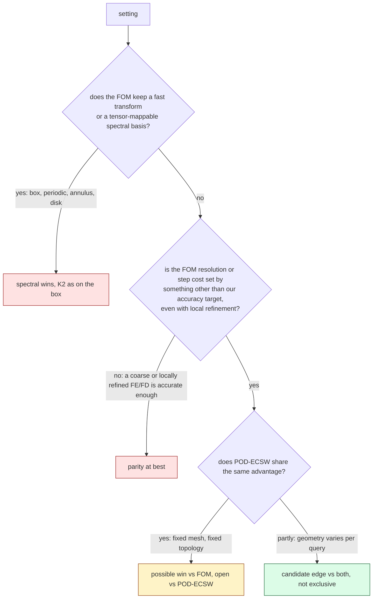

# Where the off-mesh bank ROM could beat spectral and other strong full-order solvers

**Status (2026-10-20; analysis only, nothing launched; Codex-reviewed over the rounds recorded in section 9).** This report lists the settings in which spectral and fast-transform solvers lose their advantage, asks for each whether *our* method would then win, and ranks three flagship experiments. It uses a cost model built from measured campaign constants, three small CPU analyses (`analysis/*.py`, about two minutes in total), a code inventory and a literature pass. Measured numbers are filled in by `make_report.py` from `values.py`, which reads them from lane outputs, committed reports or this folder's analysis JSONs; the source of each is in `VALUES.json`. **Every predicted speed-up here is a scenario or sensitivity estimate, not a measurement**, and is labelled with its assumptions where it appears. Measured accuracy numbers inherited from the Burgers campaign are conditional E0 estimates on the campaign's development and validation cohorts. Literature figures are as reported by the cited papers, not reproduced here. The filename `report.md` (rather than a dated slug) was set by the task brief; the folder name carries the date and topic.

## 1. In brief

- **What decides a win.** Our online cost does not depend on the mesh, but on the box the matched full-order solver (FOM) is *coarse*, because its resolution is set by our accuracy. A sine pseudo-spectral FOM at $N = 24$–$48$ matches us in «t4k_ps24»–«t4k_ps48» against our «t4k_R128»–«t4k_R384» (2D, $4096^2$ full field, $r = 128$–$384$ at $\Delta t = 0.005$; H200 stage-2 timings on the dev6 workload). Mesh independence can pay only where something other than our accuracy target forces the FOM to be fine or slow.
- **Removing the sine transform is not enough by itself.** On the box, the second-order central + CN-R finite-difference family (CC), which uses a fast transform only as a preconditioner, gives matched speed-ups $S$ of «S_CC_lo»–«S_CC_hi» over «S_CC_n» qualified LSPG configurations (upper bounds; some point estimates exceed 1). On a new domain $S_{\rm new}=S_{\rm box}\,f_{\rm FOM}/f_{\rm ROM}$, where $f_{\rm FOM}$ and $f_{\rm ROM}$ are the two slowdowns there; even with $f_{\rm ROM}=1$ a 2× win needs $f_{\rm FOM}$ = «fgeo2_lo»–«fgeo2_hi», and more against a better FOM than CC.
- **POD + ECSW/Q-DEIM is the competitor in every setting** and benefits from geometry, contrast and many-query as we do. Being mesh-free (one bank for many meshes; geometry changes without a common mesh) and using training-free classical quadrature are our only candidate edges over it, and neither is exclusive (LiCROM-type continuous subspaces, extended or background-mesh POD and component reduced bases exist). Every flagship carries POD-ECSW as a mandatory arm.
- **Ranking** (a subjective research priority by potential scientific value; the numbers below are arithmetic illustrations, not forecasts, and the execution order is different, section 7):
  1. **3D domain with small holes, uniform-resolution scenario.** At fixed $\Delta t$ the 3D FD FOM grows as about $L^{«p3_CC»}$ («t3_CC_L128» at $L = 128$, «t3_CC_L256» at 256), while the qualified 3D ROM (C_old, worst «e3_Cold_worst») takes «t3_Cold_rng» across meshes (approximately mesh-independent). An arithmetic illustration with mismatched outputs (ROM: scoring lattice; FOM: full field), not a performance forecast: against a *uniform-grid* FD FOM whose $L$ is set by 8 holes, the ratio would be «S3geo_H8a_L128» at $L = 128$ and «S3geo_H8a_L256» at 256, falling to «S3geo_H8bw_L128» and «S3geo_H8bw_L256» if each hole needs 4× more quadrature points and the bank doubles. Against locally refined or curved high-order FE there is no estimate.
  2. **2D geometry that varies per query** (holes whose number, size and position change). The FOM must remesh or use an embedded method, POD needs a reference map or a background mesh, and penalised FFT needs about «pen_N_1e2» points per unit length for 1 % (extrapolated from one test problem). Risk: n-width across geometries, per-query setup on both sides, and LiCROM-type prior art.
  3. **Smooth high-contrast variable coefficient on the box.** It removes the spectral FOM's exactly integrated diffusion; what that costs a real FOM trajectory is unknown. Synthetic CPU counts range from «nit_warm» CG iterations per solve (warm start, loose tolerance) to «nit_noisy» (pessimistic) at contrast 100, which bracket the illustrative best / median / count ≥ 2× from «Svc_warm_65» to «Svc_noisy_65» at an assumed «tit_65» per iteration. Kept as the cheapest falsification of the "exact diffusion" mechanism behind K2.
- **Dropped or demoted:** annulus, disk and other tensor-mappable domains (Chebyshev–Fourier is spectral there); the L-shape by itself; localized fronts (we already fail on steeper fronts); long-time integration; high-dimensional parameters; periodic NS 3D; arbitrary-point outputs as a headline.
- **Illustrative partial-cost crossovers are large.** With the 2D bank-fit time («bank_fit_h») as an illustrative offline cost (a 3D pipeline may cost more), the 8-hole 3D scenario breaks even after about «Qstar_3d128» queries at $L = 128$ and «Qstar_3d256» at $L = 256$; the variable-coefficient case breaks even after «Qstar_vc_noisy» queries in the pessimistic case and «Qstar_vc_warm» in the warm one.

## 2. The ranked table

| rank | setting (concrete PDE, geometry) | strongest competitors | predicted outcome (provisional scenario) | kill criterion (short) | budget (planning) |
|---|---|---|---|---|---|
| 1 | 3D viscous Burgers in $(0,1)^3$ with $H$ small spherical holes (radius ≤ 1/32), zero Dirichlet on all walls | locally refined or adaptive (octree, cut-cell) embedded-boundary FD with multigrid; curved high-order FE / SEM (MFEM, deal.II, NekRS class); active-penalty or corrected immersed-interface FFT; Fourier continuation; POD-ECSW on the FE mesh | no forecast; arithmetic illustration vs a uniform-grid FD FOM with mismatched outputs: «S3geo_H8bw_L128»–«S3geo_H8a_L128» at $L = 128$, «S3geo_H8bw_L256»–«S3geo_H8a_L256» at 256 (8 holes); vs locally refined FE: unknown; vs POD-ECSW: likely loses or ties online | no qualified ROM ≥ 2× faster than the union of tested FOMs (including a locally refined one) at equal median and worst error; or bank floor above 2 % at $r \le 1024$ | 40–80 GPU-h, 5–8 weeks |
| 2 | 2D viscous Burgers in the box with 1–6 circular holes whose number, radii and centres vary per query; UQ of field, gradient and wall-flux outputs | embedded-boundary FD + multigrid on a fixed grid; active-penalty or corrected immersed-interface Fourier; Fourier continuation; per-geometry FE + multigrid with meshing time; POD on a reference map or background mesh + ECSW; component reduced bases; LiCROM-type continuous linear subspace | unknown: no cost model exists for per-query setup on either side; to be measured | held-out-geometry worst error > 3× the in-family worst error; or any tested competitor is faster at matched field, gradient and flux error, per-query setup included | 20–40 GPU-h, 4–6 weeks |
| 3 | 2D viscous Burgers on the box with $\nabla\cdot(\kappa(x;\mu)\nabla u)$, contrast 10–1000 | sine pseudo-spectral IMEX with warm-started, tolerance-tuned DST-preconditioned CG; full-operator exponential integrators (Krylov/KIOPS, Leja); reused sparse factorisations; ETD on $\bar\kappa$ with a semi-implicit remainder; FD + coefficient-aware multigrid; POD-ECSW | trajectory cost unknown; synthetic sensitivity at contrast 100: «Svc_warm_65» (warm) to «Svc_noisy_65» (pessimistic), each as best / median / count ≥ 2×; no change from H-base against POD-ECSW | at contrast 100 no qualified configuration ≥ 2× against the union of the variable-coefficient FOM ladder | 8–15 GPU-h, 2–3 weeks |

Budgets are planning estimates (the Burgers campaign spent «campaign_gpuh» over ten lanes).

## 3. Cost model and measured constants

**The ROM query.** One query costs

$$t_{\rm ROM} = t_{\rm init} + n_{\rm steps}\, t_{\rm step}(r, M, m) + t_{\rm dec}(n_{\rm out}),$$

with $r$ the bank width, $M$ the number of tests and $m$ the number of quadrature points. Measured on an H200 at $1024^2$:
- **Per step:** «step_R128» at r = 128 ($m = 4181$, $M = 512$, BE) and «step_R384» at r = 384 ($m = 16384$, $M = 1536$, CN-R). A straight line through these two points, $t_{\rm step}\approx a + b\,mMr$, has $a$ = «stepmodel_a» and $b$ = «stepmodel_b»; the two points also differ in time scheme, so $a$ is not a measured fixed overhead. The dense Jacobian kernel runs at about «thr_J».
- **Elasticities:** the descriptive 2D full-query elasticities (jcp-dims) are «el_r» in $r$, «el_M» in $M$ and «el_m» in $m$. **Assumption:** in the 3D scenarios below they are transported to 3D and used to charge extra quadrature points ($\beta_m$) and a wider bank ($\beta_r$, $\beta_M$). No controlled 3D experiment supports this.
- **Decode** to a $4096^2$ field: «t_dec_R128_4k» (r = 128) and «t_dec_R384_4k» (r = 384); it grows with the number of output points.
- **3D (H200, speed3d m1 panel, scoring-lattice output):** the quadrature-qualified C_old takes «t3_Cold_rng» across $L$ = 64–384 («t3_Cold» at $L = 128$) (median / worst error «e3_Cold_med» / «e3_Cold_worst»). The faster W_C_W768 («t3_W768», «e3_W768_med» / «e3_W768_worst») fails the quadrature check (Q2 status: «q2_note»), so it appears only as an unqualified optimistic bound; so does its batched figure, «t3_batch64» per query at batch 64.

**The FOM on the box** (measured, H200):
- 2D, $4096^2$ full field (stage-2, dev6): PS N = 24 «t4k_ps24» (median / worst «ps_N24_med» / «ps_N24_worst»), N = 48 «t4k_ps48» («ps_N48_med» / «ps_N48_worst»).
- 2D, CC on the $257^2$ scoring lattice (screening cost, dev6 cases 0–1): $L = 64$ «cc2_L64_cost» («cc2_L64_med» / «cc2_L64_worst»); $L = 128$ «cc2_L128_cost» («cc2_L128_med» / «cc2_L128_worst»).
- 3D: PS N = 16 «t3_PS» and CC $L = 64$ «t3_CC64» (worst «t3_CC64_worst»), both screening costs. Same-mesh CC at fixed $\Delta t = 0.01$ in the m1 panel: «t3_CC_L128» at $L = 128$, «t3_CC_L256» at 256, «t3_CC_L384» at 384 (full $L^3$ field). These are more accurate than our ROM; they show what a *uniform-grid* FOM costs if geometry forces that resolution.

**Matched speed-ups on the box** ($S = t_{\rm FOM}/t_{\rm ROM}$ at equal median and worst error, $4096^2$, «S_PS_n» qualified LSPG configurations; upper bounds on the ROM speed-up, screening-selected comparators):

| FOM family | needs a fast transform? | $S$ range | $f_{\rm FOM}$ needed for a 2× ROM win (with $f_{\rm ROM}=1$) |
|---|---|---|---|
| sine pseudo-spectral (PS) | yes (DST) | «S_PS_lo»–«S_PS_hi» | «fps2_lo»–«fps2_hi» |
| central + CN-R FD (CC) | only as a preconditioner | «S_CC_lo»–«S_CC_hi» | «fgeo2_lo»–«fgeo2_hi» |
| upwind + BE FD (UB) | only as a preconditioner | «S_UB_lo»–«S_UB_hi» | – (first order; not a strong FOM) |

**Reading.** Without the sine transform the binding comparator becomes CC or its multigrid or FE equivalent, not a slow solver. The thresholds above are necessary conditions under restrictive assumptions ($f_{\rm ROM}=1$, CC as the best non-spectral FOM), not evidence of a win: a better FOM raises them, and any extra quadrature, tests or bank width the geometry needs raises $f_{\rm ROM}$. A multigrid preconditioner in place of the exact DST inverse plausibly costs 1–3× at these latency-bound sizes (assumption). A clear win therefore needs the FOM's *resolution* to be forced up, and to stay forced up after local refinement.

**3D scenario: uniform-grid FOM, resolution set by holes (an incomplete algebraic scenario).** Assume a uniform-grid FD FOM must run at $L$ to resolve holes of radius about $4/L$–$8/L$ and costs per step what the box CC costs ($f_{\rm FOM} = 1$). On our side assume $p$ extra shell-rule points per hole added to C_old's Gauss $32^3$ rule, and optionally a bank (and test set) twice as wide. Then

$$S_{\rm geo} = \frac{S_{\rm same}(L)}{\bigl((32768 + pH)/32768\bigr)^{\beta_m}\,w^{\beta_r+\beta_M}},$$

with $S_{\rm same}(L)$ the registered paired same-mesh ratio of C_old against CC («S3_same_L128» at $L = 128$, «S3_same_L256» at 256, «S3_same_L384» at 384) and $w\in\{1,2\}$ the bank-width factor.

| holes $H$ | $p$ per hole | ROM slowdown ($w=1$) | $S$, $L = 128$, $w = 1$ / 2 | $S$, $L = 256$, $w = 1$ / 2 |
|---|---|---|---|---|
| 1 | 4096 | «g3_H1a»× | «S3geo_H1a_L128» / «S3geo_H1aw_L128» | «S3geo_H1a_L256» / «S3geo_H1aw_L256» |
| 1 | 16384 | «g3_H1b»× | «S3geo_H1b_L128» / «S3geo_H1bw_L128» | «S3geo_H1b_L256» / «S3geo_H1bw_L256» |
| 8 | 4096 | «g3_H8a»× | «S3geo_H8a_L128» / «S3geo_H8aw_L128» | «S3geo_H8a_L256» / «S3geo_H8aw_L256» |
| 8 | 16384 | «g3_H8b»× | «S3geo_H8b_L128» / «S3geo_H8bw_L128» | «S3geo_H8b_L256» / «S3geo_H8bw_L256» |
| 27 | 4096 | «g3_H27a»× | «S3geo_H27a_L128» / «S3geo_H27aw_L128» | «S3geo_H27a_L256» / «S3geo_H27aw_L256» |
| 27 | 16384 | «g3_H27b»× | «S3geo_H27b_L128» / «S3geo_H27bw_L128» | «S3geo_H27b_L256» / «S3geo_H27bw_L256» |

**Caveats.** (i) This is a uniform-grid scenario: local refinement, octrees, cut cells and curved high-order elements need far fewer unknowns than a global $L^3$ grid, and no estimate is made against them. (ii) The ROM's 3D worst error («e3_Cold_worst») is larger than CC's at every $L$; the table assumes geometry, not accuracy, sets $L$, and the cells-per-radius requirement is assumed, not accuracy-tested. (iii) The ROM output is the scoring lattice, the FOM's the full field. (iv) The wider W1024 bank costs «r3_W1024» C_old in the same panel (not a controlled width comparison); holes may need more than $w = 2$. (v) Nonlinear iteration counts, conditioning, time-step needs and initialisation are not varied; the endpoints are not an evidence-based performance range. A common output contract (same delivered field) and separate evolution and output costs are required before any payoff estimate.

**2D variable coefficient (sensitivity).** With $\kappa = \nu e^{s g(x)}$ (contrast $e^s$), CG on the Crank–Nicolson stage, preconditioned by the constant-coefficient DST inverse, needs the iteration counts below (`analysis/varcoef_pcg.py`; N = 48, $\Delta t$ = 0.005–0.0125; second-order FD operator, not the spectral operator, and synthetic right-hand sides, so indicative only):

| contrast | noisy RHS, zero start, $10^{-10}$ | smooth RHS, zero start, $10^{-10}$ | smooth, warm start, $10^{-4}$ |
|---|---|---|---|
| 1.0001 (nearly constant) | «pcg48_1» | – | – |
| 10 | «pcg_noisy_10» | «pcg_smooth_10» | «pcgl_warm_10» |
| 100 | «pcg_noisy_100» | «pcg_smooth_100» | «pcgl_warm_100» |
| 1000 | «pcg_noisy_1000» | «pcg_smooth_1000» | «pcgl_warm_1000» |

At N = 128 and contrast 100 the noisy $10^{-10}$ count is «pcg128_100»; explicit diffusion would need $\Delta t\lesssim$ «dtexp48_100» at N = 48. Adding $n_{\rm steps}\,n_{\rm it}\,t_{\rm it}$ to each configuration's measured comparator latency, for contrast 100 ($n_{\rm it}$ = «nit_warm» warm, «nit_smooth» smooth, «nit_noisy» noisy) and hypothetical per-iteration costs $t_{\rm it}$, gives (best / median / configurations ≥ 2× of 21):

| $t_{\rm it}$ (assumed) | warm | smooth | noisy |
|---|---|---|---|
| «tit_20» | «Svc_warm_20» | «Svc_smooth_20» | «Svc_noisy_20» |
| «tit_65» | «Svc_warm_65» | «Svc_smooth_65» | «Svc_noisy_65» |
| «tit_200» | «Svc_warm_200» | «Svc_smooth_200» | «Svc_noisy_200» |

All three columns are synthetic: the warm column changes smoothness, initial guess and tolerance at once, and its "previous state" is not a Burgers time step. Read across the table, no column predicts a ≥ 2× win for the median configuration except the most expensive solves, and the warm column predicts no ≥ 2× win for any configuration (its best exceeds 1× only at the largest assumed iteration cost). The cost model also keeps the inherited ETDRK4 step count and adds one solve per step; a real IMEX or exponential replacement has its own stage count and time step. Realistic counts need actual trajectories with error-tuned tolerances. This assumes the ROM's cost and accuracy are unchanged; the reduced diffusion operator $\sum_q w_q\kappa(x_q)\nabla G_q^\top\nabla\Psi_q$ is assembled once per query (about $2mMr$ flops), but small-$\kappa$ regions steepen the solution and may widen the bank. The N = 48 counts overstate the cost for N = 24 comparators, which favours us.

**Partial-cost crossovers (illustrative, not deployment break-even estimates).** $Q^\* = C_{\rm off}/(t_{\rm FOM}-t_{\rm ROM})$, reported as "no break-even" when the saving is not positive. The offline cost used is the 2D bank fit («bank_fit_h»), borrowed for illustration; it is not a lower bound for a new 3D pipeline, and training data, rule selection and qualification are excluded. For the 8-hole 3D scenario ($p = 4096$, $w = 1$): «Qstar_3d128» at $L = 128$, «Qstar_3d256» at $L = 256$. For the variable-coefficient best configuration («vc_best») at $t_{\rm it}$ = «tit_65»: «Qstar_vc_warm» (warm), «Qstar_vc_noisy» (noisy). On the measured fixed box, POD-ECSW's 2D construction took «hrb_build_2d» against our «bank_fit_h» and its online query is cheaper («hrb_R384_base» against our «hrb_R384_ours» at r = 384, developmental, in-sample), so in that setting it breaks even first. Many-query comparisons must batch the FOM too.

## 4. The candidate settings

Measured inputs are the box campaign's (H200, conditional E0); everything else is a judgement or a section-3 scenario. For each setting: does the spectral or fast-transform FOM lose there, what is the strongest competitor, and do our structural advantages (mesh-free quadrature, exact derivatives, built-in boundary conditions, the accuracy dial, mesh-independent online cost) help?

| setting | spectral loses? | strongest competitor | our edge vs FOM | our edge vs POD-ECSW | verdict |
|---|---|---|---|---|---|
| complex or curved geometry, 2D | yes for box sines; not for tensor-mappable domains | hp-FEM / SEM with multigrid; embedded-boundary FD | small unless resolution is geometry-forced (needs $f_{\rm geo}\ge$ «fgeo2_lo») | none (any mesh) | part of #1, #2 |
| complex geometry, 3D, small features | yes | locally refined or curved high-order FE / SEM; adaptive embedded-boundary multigrid FD | large only if features force a fine *uniform* resolution (section 3 scenario); unknown against local refinement | none online | **#1** |
| annulus, disk, spherical shell | no (Chebyshev–Fourier; Dedalus curvilinear bases) | spectral in polar coordinates | none | none | drop |
| L-shape (re-entrant corner) | yes | graded hp-FEM; even uniform FD in $L^2$ | small (section 4.1) | none | drop as flagship; keep as development domain |
| flow past a cylinder or obstacles (NS) | yes | SEM (NekRS); IB-FFT; POD-Galerkin, the classic ROM benchmark | possible, many-query | none for fixed geometry | needs off-mesh NS code; later |
| perforated domains | yes | FE + AMG (algebraic multigrid); component RB (SCRBE); GMsFEM | as #1 (3D) or #2 (varying holes) | only if the holes vary, and not exclusively | #1, #2 |
| mixed or inflow–outflow BCs | partly (Chebyshev handles non-periodic boxes) | Chebyshev / ultraspherical; SEM | none yet: the envelope supports only zero Dirichlet | none | prerequisite, not a flagship |
| smooth variable coefficients | partly: exact ETD diffusion is lost | spectral IMEX + warm-started preconditioned CG; FD + multigrid | probably none («Svc_warm_65» best / median / count with warm starts) | none | **#3** (falsification) |
| discontinuous coefficients | yes (Gibbs) | interface-fitted FE / DG | weak: a smooth bank and Gauss rules both need interface-aware construction | none | drop |
| non-polynomial nonlinearity ($e^u$, $u^3$) | barely (collocation still works) | pseudo-spectral; POD-DEIM | none vs spectral | small: no DEIM basis for $N(u)$ needed | generality check (plan E6a), not a win |
| localized sharp features | partly (Gibbs) | adaptive FE / DG with limiting | negative: we fail on steeper fronts (bank floors «floor_C1_384» / «floor_C2_384» on C1 / C2) | negative | drop |
| parametrized geometry (smooth map) | yes | RB/POD on a reference domain with EIM or ECSW | many-query only | small: a classical rule in pulled-back coordinates needs no geometry EIM | inside #2 |
| varying topology (holes appear, move) | yes | embedded-boundary FD on a fixed grid; background-mesh or extended POD; component RB; LiCROM | per-query remeshing avoided, but per-query setup remains | candidate, not exclusive | **#2** |
| many-query, real-time | n/a | POD-ECSW; multifidelity Monte Carlo with the FOM; batched FOMs | depends on $Q^\*$ (section 3) | negative on the box | a condition on #1–#3 |
| multi-resolution, multi-mesh | n/a | per-mesh POD-ECSW; continuous (interpolated) POD | none online | untested amortisation hypothesis (ideation F14b), not exclusive: continuous POD transfers too | keep F14b as companion |
| outputs at points or derivatives | no (a sine series evaluates anywhere) | spectral; FE post-processing | small | small: exact derivatives of an approximate bank, so derivative accuracy must be checked separately | drop as headline |
| inverse problems, gradients | no (spectral FOMs are differentiable in JAX) | adjoint FOM; ROM-in-the-loop MCMC | many-query only | none | a condition on #1–#3 |
| high-dimensional parameters | n/a | sparse-grid or multifidelity; POD with greedy sampling | negative risk (n-width) | none | drop |
| long-time integration | no | spectral | negative risk (ROM drift); stable to $T = 1$ in 2D only | none | drop |
| 3D at high resolution (box) | no: the matched FOM is coarse | PS N = 16 at «t3_PS» | none (K2 fired: «k2_3d_range») | none | drop on the box |
| periodic NS 3D | no | pseudo-spectral CNAB2 | mesh ROM «ns96_x» at 96³, but worst «ns96_worst» vs CNAB2's «ns96_cmp_worst», and per-mesh POD-64 about «ns3d_pod» more accurate | none | drop |

### 4.1 The L-shape: why it is not a flagship by itself

For the manufactured singular solution $u = r^{2/3}\sin(2\theta/3)$ (harmonic, with exact non-homogeneous Dirichlet data) on the L-shaped domain, five-point FD (`analysis/lshape_fd.py`) converges at order «ls_order_max» in the max norm and «ls_order_l2» in relative $L^2$ (smooth control: «ls_order_smooth»), so the singularity slows convergence in every norm. Even so, on *this* example it reaches «ls64_err» relative $L^2$ at $N = 64$ («ls64_dof» unknowns; «ls64_t» for one CPU sparse LU factorisation and solve, assembly excluded), and the extrapolated $N$ for 0.2 % and 0.01 % are about «ls_N_2e3» and «ls_N_1e4». The earlier L-shaped Poisson lane's ratios against CG on the same grid («lsh_256_x» at $256^2$, worst «lsh_256_worst»; «lsh_2048_x» at $2048^2$, worst «lsh_2048_worst») are scored against same-grid FD, not against the continuum, so they are not accuracy-matched; whether a coarser FOM reaches the lane's ROM error on the lane's own cases needs a coarse-FOM ladder on those cases and a continuum reference (not run). Graded hp-FEM restores exponential convergence. The L-shape adds geometry without clearly forcing resolution, so it is a development domain for the geometry machinery (envelope, tests, quadrature), not a flagship.

### 4.2 Immersed and penalised FFT: a plain penalty is not a cheap competitor; better variants remain open

A Fourier pseudo-spectral solver with binary-mask Brinkman penalisation on a box with one circular hole (`analysis/penalized_spectral.py`; Poisson, manufactured solution, $\eta = (h/\pi)^2$) converges at order «pen_order». At 512 points per unit length it errs by «pen_err_1024» relative $L^2$ (measured); about «pen_N_1e2» points per unit length for 1 % and «pen_N_2e3» for 0.2 % are *extrapolations* for this problem and scaling. Higher-order active-penalty methods that keep a Fourier discretisation (Shirokoff & Nave, arXiv:1303.5681), corrected immersed-interface methods and Fourier continuation (Bruno & Lyon, JCP 2010) are not represented and stay in the competitor set for flagships 1 and 2.

## 5. Feasibility against our code

| component | exists | where | needed for |
|---|---|---|---|
| off-mesh classical quadrature, 2D and 3D, autodiff gradients | yes, box only | `nmrom` (quadrature-study external package: `quadrature.py`, `rom.py`, `dim3.py`); vendored `experiments/jcp-*/vendor/quad2d`, `quad3d` | all |
| boundary envelope | box only: `dirichlet_factor` $\prod_j 4x_j(1-x_j)$ in `nmrom/bank.py`; $16x(1-x)y(1-y)$ in `npbank.py` | – | general SDF / R-function envelope (#1, #2) |
| L-shape geometry: mask, R-function and signed-distance factors, corner-singular enrichment | yes, 2D linear Poisson only | branch `exp/2026-09-17-lshape`, `experiments/lshape/lsh_core.py`; high-resolution copy in `worktrees/2026-09-20-hires-poisson` | template for the #1, #2 envelopes |
| tests on non-box domains | no: sine tests everywhere; the L-shape used masked-FD eigenvectors | – | envelope × sine tests, or bank tests (ideation F2) |
| domain quadrature with holes or curved boundaries | no | – | shell / annular Gauss rules with a smooth partition of unity, or moment-fitted cut-cell rules (#1, #2) |
| geometry FOM (embedded-boundary FD + multigrid, or FE) | no: every FOM uses a DST preconditioner | `jcp-fom2d/refcore.py` (BiCGStab + DST inverse) | #1, #2 (FE through a library, or a JAX multigrid) |
| variable-coefficient diffusion | no: scalar $\nu$ per case (`nmrom/pdes.py`) | – | #3 (small change: quadrature-assembled reduced operator; PCG in the FOM) |
| non-polynomial terms | steady Bratu $e^u$, Hamilton–Jacobi $\lvert\nabla u\rvert^2$, Allen–Cahn (CPU) | `nmrom/pdes.py` | plan E6a generality, not a flagship |
| one bank read out on many meshes | yes | `experiments/{multiresolution-*, mr-*}`; ns3d-coordnet; the L-shape test lane | F14b companion |
| POD-ECSW and Q-DEIM baselines | yes, box | `jcp-hr-baselines` | every flagship (#1, #2 need an FE-mesh version) |
| NS 3D coordinate-network bank | yes: periodic, mesh ROM, no off-mesh NS | `exp/2026-10-01-ns3d-coordnet-bank` («ns3d_src») | not used |

**Effort (planning estimates).**
- **#3**, about 2–3 weeks and 8–15 GPU-h: variable-coefficient data and bank refit; the quadrature-assembled reduced diffusion; a FOM ladder (spectral IMEX + PCG, ETD splitting, FD + DST-PCG, FD + multigrid); qualification and the matched panel; a POD-ECSW arm.
- **#2**, about 4–6 weeks and 20–40 GPU-h: in 2D, an embedded-boundary FD + multigrid FOM with local refinement, an SDF / R-function envelope, envelope × sine tests, domain quadrature with holes, a mesh generator plus an FE FOM (Firedrake or MFEM, or a JAX P2 FE with multigrid), a geometry-parameterised bank and held-out geometries.
- **#1**, about 5–8 weeks and 40–80 GPU-h: #2's machinery lifted to 3D, a 3D embedded-boundary multigrid FOM or matrix-free FE, and a bank-width study. The 2D L-shape and holes work of #2 is its development path.

## 6. Literature

**ROMs on complex geometry and parametrised domains.**
- POD-Galerkin cylinder-wake models are the classic complex-geometry ROM (Noack et al., JFM 2003, doi:10.1017/S0022112003006694). Finite-volume versions: Lorenzi, Cammi, Luzzi & Rozza (CMAME 2016); Stabile & Rozza (Comput. Fluids 2018, arXiv:1710.11580).
- Affinely parametrised geometry is reduced-basis home ground (Rozza, Huynh & Patera, ARCME 2008, doi:10.1007/s11831-008-9019-9). Manzoni, Quarteroni & Rozza add free-form-deformed shapes (IJNMF 2012).
- Perforated or modular domains: component-based RB, SCRBE (Huynh, Knezevic & Patera, M2AN 2013), with optimal port spaces (Smetana & Patera, SISC 2016, doi:10.1137/15M1009603); GMsFEM (Efendiev, Galvis & Hou, JCP 2013, doi:10.1016/j.jcp.2013.04.045).
- DG-based RB with empirical quadrature (Yano, Adv. Comput. Math. 2019, doi:10.1007/s10444-019-09710-z). Domain-decomposed nonlinear-manifold ROMs (Diaz, Choi & Heinkenschloss, CMAME 2024, arXiv:2305.15163).

**Hyper-reduction.**
- DEIM (Chaturantabut & Sorensen, SISC 2010, doi:10.1137/090766498); Q-DEIM (Drmač & Gugercin, SISC 2016).
- ECSW (Farhat et al., IJNME 2014; 2015, doi:10.1002/nme.4820), «lit_ecsw» CPU reduction on structural FE models; ECM (Hernández, Caicedo & Ferrer, CMAME 2017, doi:10.1016/j.cma.2016.10.022); LP-EQP (Yano & Patera, CMAME 2019).
- GNAT (Carlberg et al., JCP 2013, arXiv:1207.1349): «lit_gnat» in core-hours on the Ahmed body against a parallel finite-volume code; the wall-clock gain is smaller. LSPG against Galerkin: Carlberg, Barone & Antil (JCP 2017, doi:10.1016/j.jcp.2016.10.033).
- Nonlinear-manifold hyper-reduction: Kim, Choi, Widemann & Zohdi (JCP 2022, arXiv:2009.11990), «lit_kim1» (1D) and «lit_kim2» (2D) on Burgers against their own implicit FD FOM; Romor, Stabile & Rozza (J. Sci. Comput. 2023, doi:10.1007/s10915-023-02128-2).

**Continuous and neural-field ROMs.**
- CROM (Chen et al., ICLR 2023, arXiv:2206.02607): «lit_crom_cpu» CPU and «lit_crom_gpu» GPU wall-clock against the unreduced solver.
- LiCROM (Chang et al., SIGGRAPH Asia 2023, arXiv:2310.15907): a linear neural-field subspace independent of the mesh, handling mixed meshes, cutting and hole punching, and one-shot transfer to new geometry. It is the closest prior art to flagship #2 and must be cited and, ideally, compared.
- SNF-ROM (Puri et al., JCP 2025, arXiv:2405.14890), up to «lit_snf» against its FOM; Neural Galerkin (Bruna, Peherstorfer & Vanden-Eijnden, JCP 2024, arXiv:2203.01360; Berman & Peherstorfer, NeurIPS 2023, arXiv:2310.04867); DINo (Yin et al., ICLR 2023); neural implicit flow (Pan, Brunton & Kutz, JMLR 2023, arXiv:2204.03216).
- Lee & Carlberg (JCP 2020, arXiv:1812.08373), the foundational manifold LSPG paper, has no hyper-reduction and no wall-clock win.

**Benchmarks and baselines.**
- McGreivy & Hakim (Nat. Mach. Intell. 2024, arXiv:2407.07218): «lit_mcg» of ML-for-PDE papers claiming wins used weak baselines.
- Kochkov et al. (PNAS 2021, doi:10.1073/pnas.2101784118): «lit_koch» against a finite-volume DNS, not a spectral solver.
- Operator inference on a combustor: «lit_opinf» with only "acceptable" extrapolation (McQuarrie, Huang & Willcox, J. R. Soc. NZ 2021, doi:10.1080/03036758.2020.1863237). Peherstorfer (Notices AMS 2022) frames online cost as the bottleneck of nonlinear ROMs.
- None of the published speed-ups we found is against a tuned spectral or matrix-free high-order solver at equal accuracy. The credible wins are many-query with amortised offline cost (Benner, Gugercin & Willcox, SIAM Rev. 2015, doi:10.1137/130932715).

**Many-query use.** Multifidelity estimators keep the FOM and use the ROM as a control variate (Peherstorfer, Willcox & Gunzburger, SIAM Rev. 2018, doi:10.1137/16M1082469); ROM-in-the-loop MCMC (Cui, Marzouk & Willcox, IJNME 2015, arXiv:1403.4290); progressive ROMs for optimisation (Zahr & Farhat, IJNME 2015, arXiv:1407.7618); real-time MPC with surrogates (Bieker et al., TCFD 2020, doi:10.1007/s00162-020-00520-4).

**Competitor solvers on complex geometry.** NekRS spectral elements on GPUs (Fischer et al., Parallel Comput. 2022, arXiv:2104.05829); nodal DG (Hesthaven & Warburton 2008, doi:10.1007/978-0-387-72067-8); matrix-free sum factorisation (Kronbichler & Kormann, Comput. Fluids 2012, doi:10.1016/j.compfluid.2012.04.012), MFEM (CAMWA 2021, doi:10.1016/j.camwa.2020.06.009) and Firedrake (ACM TOMS 2016, arXiv:1501.01809); immersed boundaries (Peskin, Acta Numer. 2002, doi:10.1017/S0962492902000077; Taira & Colonius, JCP 2007, doi:10.1016/j.jcp.2007.03.005, and the fast nullspace variant, Colonius & Taira, CMAME 2008); ultraspherical spectral methods (Olver & Townsend, SIAM Rev. 2013, doi:10.1137/120865458) and Dedalus with curvilinear disk, ball and shell bases (Burns et al., PRR 2020, doi:10.1103/PhysRevResearch.2.023068); higher-order active-penalty Fourier methods (Shirokoff & Nave, arXiv:1303.5681); Fourier continuation for general smooth domains (Bruno & Lyon, JCP 2010), a spectral-class FOM for curved boundaries that belongs in the competitor discussion for #1 and #2.

The citations were checked against publisher, DOI or arXiv pages during this study; the exact title of the Manzoni–Quarteroni–Rozza IJNMF 2012 paper and the exact GNAT wall-clock figure were not confirmed.

## 7. Flagship experiments

**Execution order differs from the ranking.** Run #3 first, starting as a FOM-only trajectory benchmark (cheapest; it decides whether losing exact diffusion matters at all), then the 2D geometry pilot of #2, which must pass matched-output, adaptive-FOM and qualification gates before variable-topology training, which is also the development path of #1, and the 3D flagship only if the 2D pilot passes its floor and qualification gates. Ideation item F14b (multi-mesh break-even) runs alongside, because it tests the one candidate edge over POD-ECSW that needs no new physics.

### 7.1 Flagship 1: a 3D domain with small holes

- **PDE and geometry.** Viscous Burgers $u_t + u\,(\partial_x+\partial_y+\partial_z)u = \nu\Delta u$ in $\Omega = (0,1)^3\setminus\bigcup_{h=1}^{H}B(c_h,\rho)$, with $H\in\{1, 8\}$ and $\rho\in\{1/16, 1/32\}$, zero Dirichlet on every wall and hole; the campaign's Gaussian initial-condition family and in-range $\nu$ box. Developed in 2D first (an L-shape, then a box with holes).
- **Method changes.** Envelope $E(x) = E_{\rm box}(x)\prod_h \phi_h(x)$ with smooth R-function hole factors; tests $\psi_k = E\,\sin(k\cdot\pi x)$, or bank tests; quadrature = box Gauss inside a smooth partition of unity away from the holes plus a spherical-shell Gauss product rule around each hole, qualified by successor agreement (Q2) as in the campaign.
- **Competitors.** (a) embedded-boundary second-order FD (Shortley–Weller) with geometric multigrid, uniform and with local (octree or patch) refinement near holes, on ladders of resolution and $\Delta t$; (b) curved high-order FE or SEM (MFEM or deal.II class) on a body-fitted, locally refined mesh, meshing time reported separately; (c) an active-penalty or corrected immersed-interface Fourier method, and plain penalisation as a weak control; (d) POD-ECSW on the FE mesh, tuned with the jcp-hr-baselines protocol; (e) Fourier continuation, discussed, and run if an implementation is at hand. Report DOFs, steps and output error for every FOM.
- **Prediction.** None. The section-3 numbers are an arithmetic illustration with mismatched outputs; against locally refined (a) and (b) nothing is known until matched-error cost curves exist, and measuring them is the experiment's purpose. Against (d) we expect ≤ 1× online.
- **Objectives, kept separate.** (O1) FOM superiority: beat the fastest accuracy-admissible tested FOM among (a)–(c), (e). (O2) POD superiority: beat (d). (O3) Method: demonstrate mesh-free geometry handling with qualified quadrature. Failing O1 ends the speed claim; failing O2 alone limits the paper to O1 and O3.
- **Kill criterion.** Stop if the 2D holes pilot's worst-case bank floor at $r \le 512$ exceeds 2 %; or if no 3D configuration passes Q1 and Q2 at $r \le 1024$; or if (for O1) the best qualified ROM is not ≥ 2× faster, on a common output contract, than the fastest accuracy-admissible tested FOM among (a)–(c) and (e), local refinement included, at equal median and worst error. O2 is reported as a result, not a gate. Claims are limited to the tested set.
- **Budget.** 40–80 GPU-h and 5–8 weeks; the 2D pilot is about 5 GPU-h.

### 7.2 Flagship 2: geometry that varies per query

- **PDE and geometry.** 2D viscous Burgers in $(0,1)^2$ minus $K\in\{1,\dots,6\}$ disks, with $K$, the radii and the centres drawn per query (non-overlapping, away from the walls); zero Dirichlet. Outputs: the field and its gradient on the scoring lattice and a wall-flux functional on the hole boundaries, each with its own accuracy check (exact autodiff of an approximate bank does not certify derivatives).
- **Method changes.** A bank that takes a geometry descriptor (or an SDF feature) as input; the R-function envelope of the drawn holes; classical quadrature built per query from the geometry (box Gauss plus annular rules), with no per-geometry training. Per-query costs charged to the ROM: rule construction, bank and gradient evaluation at the new points, reduced-operator assembly and initialisation.
- **Competitors.** (a) embedded-boundary FD + multigrid on a fixed grid (no remeshing), with local refinement; (b) P2 FE with multigrid, meshing per query included; (f) an active-penalty or corrected immersed-interface Fourier method, and Fourier continuation if an implementation is at hand; (c) POD + ECSW on a background mesh or extended domain (varying $K$), and on a reference map at fixed $K = 1$; (d) component reduced bases; (e) a LiCROM-style continuous linear subspace with the same quadrature, which isolates the bank from the test and solver choices. Batched FOMs and batched ROMs for the UQ workload.
- **Prediction.** Unknown. No cost model exists for the ROM's per-query setup or for the competitors' meshing and solves on this workload; the pilot's purpose is to measure them. No break-even estimate is given.
- **Kill criterion.** Register separate field, gradient and wall-flux tolerances and references (flux including boundary-integration error), with worst case over a held-out geometry cohort as the statistic. Stop if the held-out-geometry worst field error exceeds 3× the in-family worst error; or if the worst field projection floor exceeds 2 % at $r \le 512$ (and separately check the gradient and flux floors); or if any tested competitor among (a)–(f) is faster while meeting all three output tolerances, per-query setup included. Claims are limited to the tested competitor set.
- **Budget.** 20–40 GPU-h and 4–6 weeks; it shares the envelope and quadrature code with flagship 1.

### 7.3 Flagship 3: a high-contrast variable coefficient on the box (falsification)

- **PDE.** Viscous Burgers with $\nabla\cdot(\kappa(x;\mu)\nabla u)$, $\kappa = \nu e^{s g(x;\mu)}$, $g$ a smooth random field with a few Karhunen–Loève (KL) modes, rescaled per draw to $\max g-\min g = 1$ so that the contrast $\kappa_{\max}/\kappa_{\min} = e^{s}\in\{10, 100, 1000\}$ (realised extrema recorded); the same box and initial-condition family.
- **Method changes.** The reduced diffusion operator is assembled once per query by the existing quadrature; a new bank is trained on variable-$\kappa$ data; all other code is reused.
- **First step: a FOM-only trajectory benchmark** (no ROM training): actual Burgers trajectories, error-tuned tolerances, complete GPU step costs for each integrator; the ROM part runs only if the *fastest* accuracy-admissible tested FOM at contrast 100, on a common output contract, costs ≥ 2× the ROM's box cost.
- **Competitors.** (a) sine pseudo-spectral IMEX/CN with warm-started DST-preconditioned CG, tolerance tuned to accuracy, and the actual spectral operator benchmarked on the GPU; (a') full-operator exponential integrators (Krylov/KIOPS or Leja interpolation; Deka, Tokman & Einkemmer, arXiv:2211.08948); (a'') a reused sparse factorisation of the fixed per-query CN operator; (b) ETD on $\bar\kappa$ with a semi-implicit remainder; (c) FD + CN with DST-preconditioned BiCGStab (the CC family) and with coefficient-aware geometric multigrid; (d) POD-ECSW.
- **Prediction.** Trajectory cost unknown; in the synthetic warm-start column, best / median / count ≥ 2× at contrast 100 is «Svc_warm_65» (section 3, assumed $t_{\rm it}$); a win appears only if the FOM's solves stay expensive. No change from H-base against (d).
- **Kill criterion.** Stop after the FOM-only benchmark if the fastest accuracy-admissible tested FOM is not ≥ 2× slower than the ROM's box cost; otherwise stop if, at contrast 100, no qualified configuration reaches $S\ge 2$ against the union of (a), (a'), (a''), (b) and (c) at equal median and worst error, or if the bank floor rises above 2× the constant-$\kappa$ floor.
- **Budget.** 8–15 GPU-h and 2–3 weeks.

## 8. What would make these predictions wrong

- **The FOM is faster than assumed.** Local refinement, cut-cell or curved high-order discretisations may need far fewer unknowns than a uniform $L^3$ grid, and a tuned matrix-free multigrid or SEM on a GPU may be as fast per unknown as the DST-preconditioned box FD.
- **The bank does not stay narrow.** Holes, interfaces and contrast add local structure, and r may have to grow (W1024 in 3D costs «r3_W1024» C_old).
- **Quadrature on curved domains needs more points than budgeted.** Lattice rules already lost accuracy at the walls through algebraic convergence.
- **The 3D ROM's accuracy is the problem.** The qualified 3D ROM's worst error («e3_Cold_worst») is above every CC configuration's; a geometry FOM matched to it could be coarse.
- **POD-ECSW keeps winning.** It shares every advantage except mesh-freeness, and even that is not exclusive. Unless F14b or flagship 2 shows a measured edge, the paper's comparative claim stays against FOMs only.

## 9. Review record

«REVIEW_RECORD»

## 10. Glossary

- **ROM, FOM:** reduced-order model (ours); full-order model (a conventional solver on a grid or mesh).
- **bank, r:** the ordered set of learned coordinate-network functions $G(x)$, and the number of them used (the coefficients solved for).
- **M, m:** the number of test functions in the weak form; the number of quadrature points used for the nonlinear term.
- **envelope:** a factor that vanishes on the boundary and multiplies the bank, so the Dirichlet conditions hold exactly.
- **LSPG, Galerkin:** two ways of forming the reduced equations. Galerkin makes the residual orthogonal to the trial space itself (test space = trial space); LSPG minimises the norm of the residual tested against a larger set of $M > r$ test functions.
- **BE, CN-R, BDF2, ETDRK4, IMEX, CNAB2:** backward Euler; Crank–Nicolson started with a few backward-Euler substeps (the Rannacher start, which damps start-up oscillations); second-order backward differences; a fourth-order exponential Runge–Kutta scheme; implicit–explicit stepping; Crank–Nicolson / Adams–Bashforth.
- **PS, CC, UB:** the FOM families: sine pseudo-spectral + ETDRK4; central differences + CN-R; sign-upwind + BE.
- **S (speed-up):** FOM time divided by ROM time at equal median and worst error, unless labelled "same-mesh" (equal grid, not equal accuracy). Above 1 means the ROM is faster.
- **median, worst:** the median and the largest error over the cases of a cohort; errors are relative $L^2$ maxima over output times.
- **K2:** the campaign's kill criterion "a matched FOM reaches the ROM's accuracy faster"; it fired on the box in 2D and 3D.
- **H-base:** the campaign hypothesis that we beat tuned POD hyper-reduction; it failed.
- **POD, ECSW, Q-DEIM, DEIM, EIM:** proper orthogonal decomposition (a linear basis from snapshots); energy-conserving sampling and weighting, and (discrete) empirical interpolation, ways of evaluating nonlinear or non-affine terms at a few sampled points.
- **qualified, Q1, Q2:** passes the solver check (Q1) and the quadrature successor-agreement check (Q2).
- **floor:** the best error the bank's span can achieve (orthogonal projection of the reference).
- **C_old, W_C_W768:** 3D ROM configurations of the speed3d lane (r = 512; Gauss $32^3$ with BE, and Gauss $24^3$ with quasi-Newton CN); C_old passes the quadrature check, W_C_W768 does not.
- **DST, FFT:** discrete sine transform; fast Fourier transform.
- **AMG:** algebraic multigrid.
- **RHS:** right-hand side of a linear system.
- **DOFs:** degrees of freedom (unknowns) of a discretisation.
- **KIOPS, Leja:** algorithms that apply a matrix exponential (or related functions) to a vector without diagonalising the matrix.
- **UQ:** uncertainty quantification (many queries over random inputs).
- **KL modes:** Karhunen–Loève modes, the leading eigenfunctions used to parameterise a random field.
- **active penalty, immersed interface, Fourier continuation:** higher-order ways of keeping a Fourier or Cartesian solver on a non-box domain.
- **$S_{\rm same}$:** the registered paired same-mesh speed-up of a ROM against a FOM on the same grid (not equal accuracy).
- **$f_{\rm FOM}$, $f_{\rm ROM}$:** the slowdowns of the FOM and of the ROM when moving from the box to a new setting.
- **$\beta_m$:** the measured descriptive elasticity of query time in m, used to charge extra quadrature points.
- **contrast:** $\kappa_{\max}/\kappa_{\min}$ for a variable diffusion coefficient.
- **PCG:** preconditioned conjugate gradients, here preconditioned by the constant-coefficient DST inverse.
- **break-even $Q^\*$:** the number of queries after which a ROM's offline cost is repaid by its online saving.
- **R-function, SDF:** smooth combinations of distance-like functions that vanish exactly on a composite boundary; signed distance function.
- **n-width:** how fast the best linear approximation error of a solution family falls with the dimension; slow decay means many modes.
- **SEM, DG, hp-FEM, IB, SCRBE, GMsFEM, LiCROM, CROM:** spectral element method; discontinuous Galerkin; finite elements refined in mesh size and degree; immersed boundary; static-condensation reduced-basis element method; generalised multiscale FE; linear-subspace and continuous neural-field ROMs.
- **conditional E0 estimate:** an error measured against the campaign's second-order references, whose uncertainty is a Richardson estimate, not a bound.
