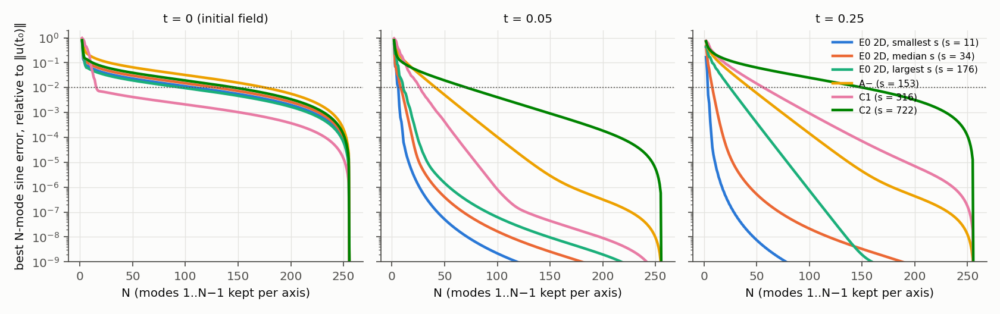
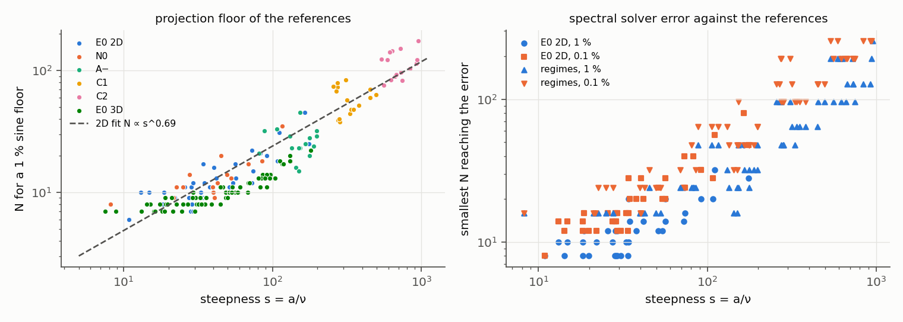
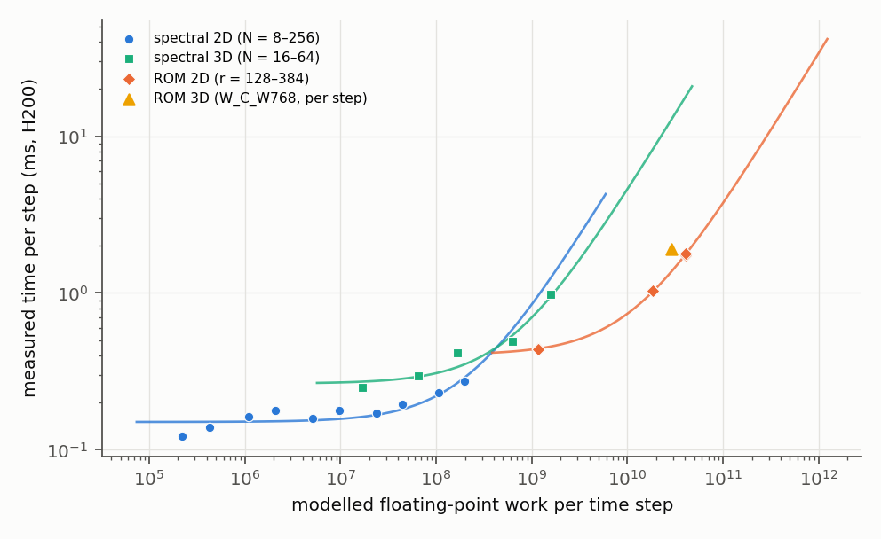
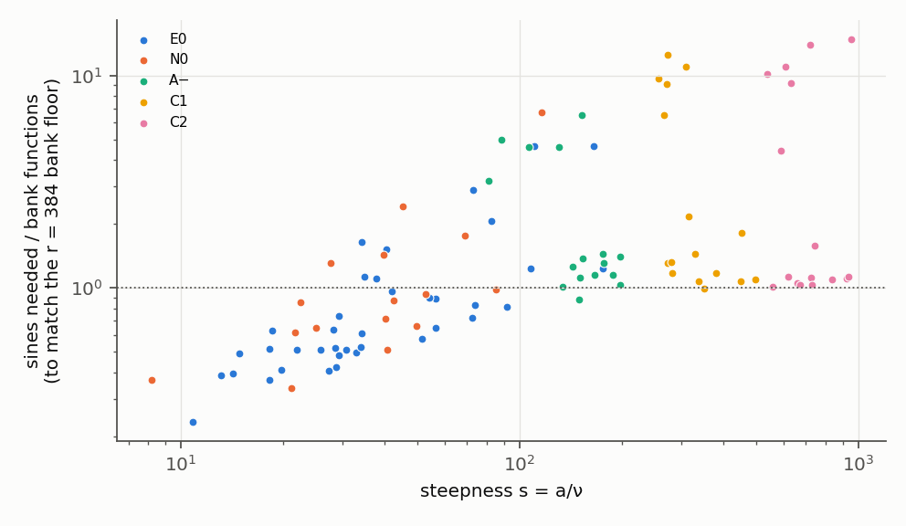
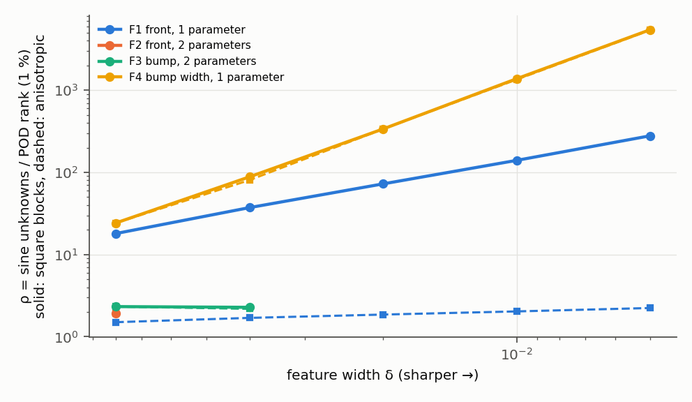
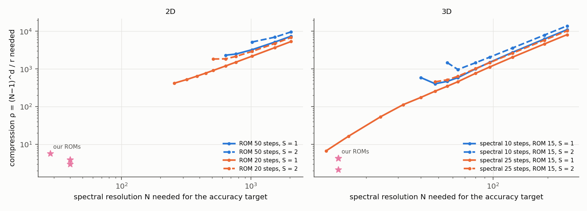

# Why a coarse sine spectral solver beats our reduced model on the Dirichlet box

**Status (2026-10-20; analysis of saved data plus CPU reruns; nothing launched on the cluster; reviewed, see section 6).** This report explains, with numbers, why the campaign's kill criterion K2 fired in 2D and 3D: a sine pseudo-spectral full-order solver with $N=16$–$48$ modes per axis matches our reduced-order model's (ROM's) accuracy faster (published union speed-ups: 2D 0.0493–0.706, 3D 0.00786–0.158; a value below 1 means the full solver is faster). It also predicts when that would stop. Every number is computed by `values.py` from this folder's analysis JSONs or from lane outputs, and `make_report.py` fills it in; `VALUES.json` gives the source of each.

- **Measured here.**
  - The sine spectra of the second-order E0 and jcp-regimes references (CPU, read-only).
  - The spectral solver's error against those references, for each case and each $N$. These are CPU reruns of E0's own solver; they reproduce the H200 in-job scores to 9.8e-13 in 2D and 2.3e-11 in 3D.
  - The solver's boundedness on steep fronts, in sampled step brackets.
  - Bank-versus-sine floors on the second-order references.
  - One synthetic experiment.
- **Taken as published from the lanes** (H200, f64, `jax_backend=gpu`): every wall time and every ROM error.
- **Modelled, and labelled so where it appears:** operation counts, the cost model, and the crossover predictions. The predictions extrapolate beyond the measured $N$ and steepness.
- **Labels that travel with the numbers.**
  - All errors are conditional E0 estimates (Richardson; E0 A10).
  - The 3D speed3d configurations are not quadrature-qualified (jcp-qualify).
  - The regime ROM errors on C1 and C2 come from unqualified configurations.
  - The local GB10 run is used only for a ratio; its outputs were checked against CPU to 2.9e-16.

## 0. In brief

- **Why the spectral solver wins (measured): it needs few modes, and each mode is very cheap.**
  - *The references are smooth after the first output time.* Their sine coefficients decay approximately exponentially over the fitted range. A 1 % best-approximation floor needs a median $N=$ 11 per axis in 2D (max 45) and 9 in 3D (max 22).
  - *Few modes reach the ROM's accuracy.*
    - 2D: at the 20-step setting that the cost comparison charges ($\Delta t=0.0125$), the solver itself reaches every qualified ROM's median *and* worst error at $N=$ 24–40. That is at most 1521 modes. With a small step the range is $N=$ 24–40.
    - 3D: at 10 steps ($\Delta t=0.025$) it reaches every selected ROM's errors at $N=$ 14; with a small step, at $N=$ 14 (2197 modes).
  - *A ROM unknown costs far more than a spectral mode.*
    - Work: 1.07e8 flops per unknown per step at $r=384$, against 2.32e3 per mode at $N=48$.
    - Hardware: the spectral step runs at the GPU's launch-latency floor (0.155 ms per step, 0.033 TFLOP/s).
    - Steps: the spectral solver takes 20 explicit steps; the ROM takes 50 implicit ones at $\Delta t_0$.
- **What the learned bank buys (measured).**
  - In range, plain sines in Laplacian order match the $r=384$ bank floor with a median 0.63 $r$ (max 4.7). This reproduces the ideation's first-order figure (0.64).
  - The ratio grows with steepness (Spearman 0.67).
  - But on the steep cohorts the bank reaches a 3 % floor within 512 functions on only 7 of 32 cases.
- **Cost model.** It is fitted to measured times and lies within 0.79–1.1 of every checked query.
  - Per step, a spectral solver costs $\tau_0+W_{PS}/P$, with $W_{PS}\propto N^d\log N$.
  - A dense hyper-reduced ROM costs $\tau_0'+W_R/P'$, with $W_R\propto r^3$.
  - The fitted ROM intercept, $\tau_0'=$ 0.403 ms per step, is above the spectral one (0.15 ms in 2D). It is a property of the present implementation, fitted on $r=128$–$384$; it is not a hardware bound.
- **Predicted crossover (model scenarios for the present implementation, extrapolated).**
  - *Free unknowns.* If its unknowns cost nothing but each step still cost the fitted intercept, a 50-step ROM would be 2× faster than a 20-step spectral solver only when the spectral solver needs $N\approx$ 828–876 in 2D, or $N\approx$ 100–102 in 3D.
  - *Real unknowns.* A real ROM also needs $\rho=(N-1)^d/r\gtrsim10^3$ there (table in section 4). Our ROMs have $\rho\approx$ 2.1–5.7.
  - *Steep fronts.* They raise the spectral solver's step count (empirical step law $\Delta t\approx$ 1.41$/s$, from sampled boundedness brackets). With the ROM still taking a small, fixed number of steps, the free-unknown and $\rho=1000$ scenarios cross around $s\approx$ 2.3e2–1.1e3; some $\rho=100$ scenarios also cross.
  - *Equal steps.* If the ROM needs as many steps as the spectral solver, only free-unknown scenarios cross over; none of the tested finite-$\rho$ equal-step scenarios crosses over in the scanned range.
- **The principle.**
  - On a box with smooth, diffusive solutions, the sine basis was about as compact as our learned bank on the median case (more compact at $r=384$), and it is nearly free to apply.
  - In the model scenarios we scanned (section 4), crossovers came from three ingredients:
    - a solution family with far fewer degrees of freedom than its spatial resolution needs, so that $\rho$ reaches $10^2$–$10^3$ (on our synthetic families: sharp features at fixed positions, not freely moving ones);
    - a spectral solver forced to large $N$ or many explicit steps (steep fronts);
    - a ROM whose step count stays small. With equal step counts, only scenarios with free unknowns crossed over.
  - With dense reduced operators, the per-unknown cost grows like $r^2$ and the total like $r^3$. At fixed $N$, step counts and model constants, increasing $r$ only increases the ROM's run time.
  - These are scenario results for this model and implementation, not proven necessary conditions. In our Burgers cohorts, $\rho\approx$ 2.1–5.7 and the spectral solver needs few modes and steps.

## 1. Spectral convergence on our data

**Method.**
- *References.* E0's second-order fields; for the steep cohorts, jcp-regimes' fields, made by the same procedure.
- *Best $N$-mode error.* On the scoring lattice, the orthonormal DST-I is the discrete sine series, so the best $N$-mode error is a tail sum (Parseval):
$$\mathrm{tail}_k(N)=\frac{\lVert u(t_k)-P_Nu(t_k)\rVert}{\lVert u(t_0)\rVert},\qquad N_{proj}(\varepsilon)=\min\{N:\max_{k\ge1}\mathrm{tail}_k(N)\le\varepsilon\},$$
where $P_N$ keeps modes $1..N-1$ per axis, the solver's convention.
- *Decay rate.* $\sigma$ comes from a least-squares fit of $\log\mathrm{tail}(N)\approx c-\sigma N$ over the range $10^{-6}\le\mathrm{tail}\le10^{-2}$ (`a1_spectra.py`).
- *Lattice limit.* $N$ is at most 256 in 2D and 64 in 3D.

| cohort | cases | $s=a/\nu$ | $N_{proj}(1\%)$ median / max | $N_{proj}(0.1\%)$ median / max | $\sigma$ at $t=0.05$ | $\sigma$ at $t=0.25$ |
|---|---|---|---|---|---|---|
| E0 2D (dev6 + val32) | 38 | 10.9–176 | 11 / 45 | 16 / 76 | 0.27 | 0.381 |
| regimes N0 (in range) | 16 | 8.19–116 | 11.5 / 35 | 18.5 / 59 | 0.276 | 0.385 |
| regimes A− ($\nu$ below range) | 16 | 80.8–198 | 24.5 / 45 | 41 / 77 | 0.153 | 0.131 |
| regimes C1 (steeper) | 16 | 257–495 | 58.5 / 84 | 104 / 149 | 0.0985 | 0.0574 |
| regimes C2 (steepest) | 16 | 538–953 | 108 / 175 | 206 / 238 | 0.0457 | 0.0387 |
| E0 3D (dev4 + val64) | 68 | 7.53–180 | 9 / 22 | 13.5 / 39 | 0.453 | 0.375 |

In 3D, $s=A/\nu$ uses the peak amplitude $A$. The C2 numbers at 0.1 % sit close to the 2D lattice limit, so they describe the lattice more than the continuum.

*Figure 1.* Best $N$-mode sine error of six references at $t=0$, $0.05$ and $0.25$ (dotted line: 1 %).

**Against time (measured).**
- *At $t=0$, the 2D initial field is not smooth in the sine sense.* The Gaussian does not vanish on the walls, but the wall nodes are set to zero (E0 DESIGN §2).
  - The tail therefore decays only algebraically. The median slope of $\log\mathrm{tail}$ against $\log N$ between $N=16$ and $128$ is -0.89.
  - The fitted exponential rate is 0.0289.
- *By the first output time, diffusion has removed this.* The decay is approximately exponential over the fitted range. The median $N$ for a 1 % tail is 11 at $t=0.05$ and 8 at $t=0.25$ (worst cases 37 and 27).
- *So the wall incompatibility costs the spectral solver almost nothing,* because the metric scores only $t\ge0.05$. Its one recorded trace: on two 2D cases, E0 observed first-order spectral self-convergence, with self-differences of order $10^{-9}$ (E0 DESIGN A10).

**Against viscosity and steepness (measured; 2D, 102 cases from E0 and the four regime cohorts).**
- *Steepness controls the required resolution (in these cohorts, at the fixed horizon $T=0.25$).*
  - Spearman correlations of $N_{proj}(1\%)$: 0.95 with $s$, -0.91 with $\nu$, 0.37 with $a$, and -0.14 with the bump width $w$.
  - A multiple regression gives exponents 0.71 on $a$ and -0.7 on $\nu$. These are equal and opposite, so the variable is $s$. The exponent on $w$ is 0.085.
- *Power laws:* $N_{proj}(1\%)\approx$ 0.98$\,s^{0.69}$ and $N_{proj}(0.1\%)\approx$ 1.2$\,s^{0.75}$.
- *Decay rate:* $\sigma$ falls with steepness (Spearman of $\sigma(t=0.25)$ with $s$: -0.92).
- *Front width:* with the measured front width $\delta=\max|u|/\max|\nabla u|$, the product $N_{proj}(1\%)\cdot\min_t\delta$ has median 1.1 (interquartile range 0.9–1.3). The sharpest front sets the resolution.

*Hypothesis (not tested here).*
- The exponent is below 1, whereas the textbook viscous shock gives $N\propto s$. A possible reason: by $t=0.25$ most bumps may not have steepened to the equilibrium width $\sim\nu/a$.
- The analyticity-strip argument (Boyd 2001, Thm. 5; Sulem, Sulem & Frisch 1983) predicts $\sigma\propto\nu/a$ for a fully formed front. We did not check whether the fronts are fully formed.

*Figure 2.* Left: $N$ for a 1 % projection floor against $s$, all cohorts (2D fit dashed). Right: smallest $N$ at which E0's spectral solver itself reaches 1 % and 0.1 % error against the reference.

**The spectral solver's own error (measured; CPU; small steps, $\Delta t=0.0025$ in 2D and $0.01$ in 3D, chosen so that the time error is small; at the charged steps of 20 and 10 the matching $N$ below is unchanged).**

| $N$ (2D) | 16 | 24 | 32 | 48 | 64 | 96 | 128 |
|---|---|---|---|---|---|---|---|
| median | 0.0938 % | 0.00651 % | 0.00217 % | 5.45e-4 % | 4.29e-4 % | 3.78e-4 % | 3.86e-4 % |
| worst | 14 % | 6.4 % | 3.14 % | 0.843 % | 0.243 % | 0.0224 % | 0.00251 % |

| $N$ (3D) | 8 | 10 | 12 | 14 | 16 | 24 | 32 |
|---|---|---|---|---|---|---|---|
| median | 1.65 % | 0.522 % | 0.179 % | 0.0585 % | 0.02 % | 0.00272 % | 0.00253 % |
| worst | 10.5 % | 6.84 % | 5.04 % | 3.7 % | 2.64 % | 0.773 % | 0.258 % |

The plateau near 3.78e-4 % is consistent with a reference-limited floor (E0's $\epsilon_{ref}$ is of order $10^{-6}$); it was not decomposed further.

**Which $N$ reaches our ROM's accuracy (measured).**
- *ROM errors:* jcp-qualify's FRONT-2D per-case values at $1024^2$, for all 33 qualified configurations.
- *$N_{joint}$:* the smallest $N$ whose spectral median *and* worst both tie or beat the ROM's (the campaign's matching rule).
- *$N^*$:* the per-case smallest $N$ with $e_{PS}\le e_{ROM}$.
- *Two step sizes.* "small step" uses $\Delta t=0.0025$ (spatial error only). "20 steps" uses the $\Delta t=0.0125$ that the cost comparison charges, so accuracy and cost refer to the same configuration.
- *Result:* over all configurations, $N_{joint}=$ 24–40 at the small step and 24–40 at 20 steps. The per-case median $N^*$ (small step) is 10–20.

| configuration ($1024^2$; r, form, scheme, step factor) | ROM median | ROM worst | $N_{joint}$, small step | $N_{joint}$, 20 steps | modes $(N_{joint}-1)^2$, small step | $N^*$ median | $N^*$ max |
|---|---|---|---|---|---|---|---|
| R128 LSPG BE 1 | 1.1 % | 4.84 % | 28 | 28 | 729 | 12 | 32 |
| R128 LSPG CNR 1 | 0.45 % | 5.2 % | 28 | 28 | 729 | 14 | 32 |
| R256 LSPG BE 1 | 0.983 % | 3.32 % | 32 | 32 | 961 | 12 | 40 |
| R384 LSPG BE 1 | 0.978 % | 3.01 % | 40 | 40 | 1521 | 12 | 40 |
| R384 LSPG CNR 1 | 0.198 % | 1.78 % | 40 | 40 | 1521 | 16 | 48 |
| R384 GAL CN 1 | 0.0495 % | 1.85 % | 40 | 40 | 1521 | 20 | 48 |
| R512 LSPG CNR 1 | 0.199 % | 2.17 % | 40 | 40 | 1521 | 16 | 48 |
| R512 GAL CN 1 | 0.0753 % | 2.35 % | 40 | 40 | 1521 | 20 | 48 |
| R128 LSPG BE 2.5 | 2.36 % | 6.73 % | 24 | 24 | 529 | 10 | 28 |

- The worst case sets the joint match.
  - For $r=384$ LSPG-CN-R, the per-case $N^*$ correlates with steepness (Spearman 0.84).
  - The hardest case is val32|5 ($s=$ 165).
- In 3D, every selected speed3d ROM is matched at $N=$ 14 with a small step ($\Delta t=0.01$), below the lanes' smallest tested $N=16$, and at $N=$ 14 at 10 steps ($\Delta t=0.025$). The ROMs are scored at $L=384$, with median and worst over val64.

| 3D ROM | median | worst | $N_{joint}$, small step | $N_{joint}$, 10 steps | modes, small step |
|---|---|---|---|---|---|
| C_W1024 | 1.53 % | 4.45 % | 14 | 14 | 2197 |
| C_old | 1.57 % | 4.43 % | 14 | 14 | 2197 |
| W_C_W768 | 0.327 % | 4.46 % | 14 | 14 | 2197 |
| W_C_old | 0.632 % | 4.25 % | 14 | 14 | 2197 |

**Steep regimes (measured; CPU; small steps: $\Delta t=0.0025$ for N0 and A−, $0.002$ for C1, $0.001$ for C2).** Both methods are scored on the same cases: those the regimes lane marks eligible and valid for the ROM.

| regime | cases | $s$ | ROM median / worst | $N_{joint}$ | $N^*(1\%)$ median / max | $N^*(0.1\%)$ median / max |
|---|---|---|---|---|---|---|
| N0 | 14 of 16 | 8.19–116 | 0.119 % / 0.617 % | 48 | 16 / 48 | 24 / 64 |
| A− | 16 of 16 | 80.8–198 | 0.883 % / 3.44 % | 32 | 32 / 48 | 48 / 96 |
| C1 | 16 of 16 | 257–495 | 5.68 % / 10.8 % | 32 | 64 / 96 | 128 / 192 |
| C2 | 16 of 16 | 538–953 | 16.6 % / 30.4 % | 32 | 128 / 256 | 256 / >256 (4 cases) |

- *Columns.* "ROM" is $r=384$ LSPG-CN-R on that regime (jcp-regimes per-case errors; C1 and C2 are not qualified). $N_{joint}$ is the smallest $N$ matching that median and worst jointly. $N^*$ is the per-case smallest $N$ reaching 1 % or 0.1 %.
- *Fit over E0 2D and the regimes, at the step the steepness model charges* (per case $\Delta t=\min(0.0125,\,0.05/\lceil0.05\,s/c\rceil)$, section 4): the spectral solver's own $N^*(1\%)\approx$ 1$\,s^{0.73}$ (102 resolved cases).

## 2. Cost per unit accuracy

**Per step: measured times and modelled work.**
- *Spectral step.* Four ETDRK4 stages. Each stage uses $T=7$ (2D) or $T=12$ (3D) sine/cosine transforms on the 3/2-padded grid, so $W_{PS}=4T(M-1)^{d-1}\cdot2.5(2M)\log_2(2M)$ with $M=3N/2$.
- *ROM step.* Dominated by $n_J=$ 2.12 assemblies per step (one initial Jacobian plus one per Levenberg–Marquardt iteration; the mean iteration count is borrowed from one $r=384$ CN-R component run and applied to all widths) of the $M\times r$ Jacobian $\Psi^\top[\operatorname{diag}(Dc)B+\operatorname{diag}(Bc)D]$ from $m$ quadrature points, so $W_R=n_J\cdot2mMr$, with $M=4r$ and $m/r=$ 33–64.

| | spectral 2D $N=24$ | spectral 2D $N=48$ | spectral 2D $N=256$ | ROM 2D $r=128$ | ROM 2D $r=256$ | ROM 2D $r=384$ |
|---|---|---|---|---|---|---|
| work per step (flop) | 1.09e6 | 5.13e6 | 1.97e8 | 1.16e9 | 1.82e10 | 4.10e10 |
| flop per unknown per step | 2.06e3 | 2.32e3 | 3.04e3 | 9.08e6 | 7.11e7 | 1.07e8 |
| measured time per step | 0.161 ms | 0.155 ms | 0.272 ms | 0.441 ms | 1.03 ms | 1.77 ms |
| dominant-term-equivalent rate (TFLOP/s, model flop / measured time) | – | 0.033 | 0.73 | 2.64 | 17.7 | 23.1 |
| largest admissible step | 0.025 | 0.0125 | 0.0125 | 0.005 ($\Delta t_0$; implicit) | 0.005 | 0.005 |
| f64 table footprint read per Jacobian (MB, estimate, not measured traffic) | – | – | – | 25.7 | 201 | 302 |
| per-query overhead, lattice output | 2.04 ms | 2.09 ms | 4.45 ms | init 0.161 ms + decode 0.135 ms | init 0.186 ms + decode 0.155 ms | init 0.197 ms + decode 0.177 ms |
| per-query overhead, $4096^2$ output | 7.52 ms | 7.5 ms | 9.7 ms | decode 5.74 ms | decode 10 ms | decode 14.3 ms |

*Sources.*
- Spectral time per step and overhead: a regression of jcp-fom2d's per-configuration costs on the number of steps (cost $=\alpha+n\tau$).
- Admissible step: fom2d's, over 38 cases.
- ROM: jcp-p1-scaling's evolution time over 50 steps, plus its init and decode times. At $1024^2$ the evolution takes 22 ms at $r=128$ and 88.7 ms at $r=384$.

**Query decomposition (measured).**
- *2D, $4096^2$ full field (jcp-fom2d stage 2, one job).*
  - The $r=384$ LSPG-CN-R query takes 97.1 ms; its matched spectral comparator takes 11.7 ms ($S=$ 0.121).
  - For $r=128$ BE: 24.9 ms against 11.7 ms ($S=$ 0.471).
- *Where the time goes (jcp-p1-scaling component profile, a separate job; its components need not sum to the stage-2 total).*
  - ROM at $4096^2$: init 0.197 ms, evolution 88.7 ms (measured at $1024^2$; evolution is mesh-independent), decode 14.3 ms. Evolution is 86 % of the $r=384$ CN-R profile and 78 % of the $r=128$ BE profile.
  - Spectral solver: 20 steps of 0.155 ms each. The rest is set-up and output synthesis: 2.09 ms on the lattice, 7.5 ms at $4096^2$.
- *3D (speed3d, mesh-free path).*
  - W_C_W768 takes 29.3 ms = project 0.464 ms + evolve 28.5 ms + decode 0.421 ms. That is 1.9 ms per step over 15 steps.
  - The 3D spectral step costs 0.25 ms, 0.417 ms and 0.977 ms at $N=16$, $32$ and $64$, with overheads 1.54 ms, 1.52 ms and 10.1 ms.

**Why each ROM unknown costs so much more than a spectral mode (ratios measured; mechanism partly modelled).**
1. *Dense coupling.*
   - Every reduced unknown is coupled to every test function through every quadrature point, so forming the Jacobian costs $2mMr=2\kappa\cdot4\,r^3$ flop ($\kappa=$ 42.7 at $r=384$).
   - A sine mode is coupled to the others only through FFTs, at $O(\log N)$ cost per mode.
   - Result: 1.07e8 against 2.32e3 flop per unknown per step, a factor of 4.6e4.
2. *Hardware regime.*
   - The ROM's dense kernels run at a dominant-term-equivalent 23.1 TFLOP/s at $r=384$ (a large fraction of the H200's f64 throughput).
   - The spectral step is latency-bound: 0.033 TFLOP/s at $N=48$. Its time per step stays nearly flat, 0.141 ms–0.172 ms, from $N=16$ to $96$.
   - So time per unknown differs by less than the flop count: 4.62 µs against 0.0704 µs per unknown per step. Going from $N=48$ to $N=256$ multiplies the modes by 29 but the time per step only by 1.7.
3. *Implicit nonlinear solve.*
   - The ROM takes a Levenberg–Marquardt step: one Jacobian at the start and one per iteration (2.12 on average in the measured run), and one normal-matrix Cholesky solve per iteration.
   - The spectral solver integrates diffusion exactly (diagonal $\varphi$-functions) and advection explicitly, with no Jacobian.
4. *Fewer, higher-order steps.*
   - ETDRK4 is fourth order and stable at $\Delta t=0.0125$ in range (20 steps).
   - Our LSPG schemes take 50 steps at $\Delta t_0$, and their time error already dominates (jcp-budget; final report).
5. *Memory traffic.*
   - One ROM Jacobian reads tables with a footprint of about 302 MB of f64 at $r=384$ (an estimate, not measured device traffic).
   - A padded $N=48$ spectral field is 40 kB and stays in cache.
6. *Full-field output.*
   - The ROM decodes to $4096^2$ by reading the stored bank on the output mesh (14.3 ms).
   - The spectral solver synthesises its output by FFT. Its whole $4096^2$ overhead, set-up included, is 7.5 ms.

*Figure 3.* Measured time per step against modelled work per step (H200); lines are $\tau_0+W/P$ fits. The ROM is the more hardware-efficient code. It loses because it does $10^3$–$10^4$ times more work per step.

## 3. Representation: how much does the learned bank buy?

**On the references (measured; `a3_bank.py`).**
- *Bases.* The deployed 2D bank, against sines in Laplacian order.
- *Floors.* Orthogonal projections on the scoring lattice, maximised over $t_1..t_5$.
- *$K_{match}/r$.* The smallest sine prefix that reaches the bank's floor at width $r$, divided by $r$. Below 1, the sines are more compressive.

| cohort | cases | $s$ | bank floor $r=384$ (median) | $K_{match}/r$ at $r=128$: median (max) | at $r=384$ | at $r=512$ |
|---|---|---|---|---|---|---|
| E0 | 38 | 10.9–176 | 0.0282 % | 1 (5.4) | 0.63 (4.7) | 0.49 (3.8) |
| N0 | 16 | 8.19–116 | 0.0392 % | 1.2 (5.6) | 0.86 (6.7) | 0.65 (5.4) |
| A− | 16 | 80.8–198 | 0.585 % | 1.3 (6.4) | 1.3 (6.5) | 1.1 (5.2) |
| C1 | 16 | 257–495 | 3.47 % | 1.4 (9.5) | 1.4 (13) | 1.3 (11) |
| C2 | 16 | 538–953 | 9.88 % | 1.2 (13) | 1.1 (15) | 1 (13) |

- *In range, sines beat the bank on the median case:* 0.63 $r$ sines match the $r=384$ floor. The bank wins on the worst cases, by up to 4.7×.
- *At a fixed 1 % floor,* the sine-to-bank size ratio has median 1.1 (max 5.2; 37 cases).
- *The bank's advantage grows with steepness,* with Spearman 0.67 between $K_{match}/r$ at $r=384$ and $s$.
- *But on C1 and C2 the bank floor itself is several per cent.*
  - Only 7 of 32 cases reach a 3 % floor within 512 functions; sines need a median 2.07e3 modes for the same floor.
  - So the ratio is large exactly where the bank is too inaccurate to use.

*Figure 4.* Sines needed to match the $r=384$ bank floor, divided by 384, against steepness.

**When would a learned basis need far fewer coefficients? (Synthetic, `a5_synthetic.py`; not Burgers.)**
- *Families.* Four parametric families on the same lattice.
- *Learned basis.* POD of 800 training fields: the standard data-driven linear basis (optimal in mean square on the training set, not for the held-out worst case), a stand-in for a learned linear bank.
- *Sines.* Square blocks (the spectral solver's set) and the best anisotropic block $(N_x-1)(N_y-1)$ (a direction-aware spectral solver).
- *Entries.* POD rank / square-block sine modes / anisotropic-block sine modes needed for a 1 % worst error over 200 held-out fields, with $\rho$ against each sine set in brackets. >400" means POD did not reach 1 % within rank 400, the reliability cutoff we chose for 800 snapshots (censored: no $\rho$ is inferred).

| family | δ = 0.08 | δ = 0.04 | δ = 0.02 | δ = 0.01 | δ = 0.005 |
|---|---|---|---|---|---|
| F1 front, 1 parameter | 8 / 144 / 12 (18×, 1.5×) | 13 / 484 / 22 (37×, 1.7×) | 21 / 1521 / 39 (72×, 1.9×) | 34 / 4761 / 69 (1.4e2×, 2×) | 56 / 15625 / 125 (2.8e2×, 2.2×) |
| F2 front, 2 parameters | 75 / 144 / 144 (1.9×, 1.9×) | >400 / 484 / 462 | >400 / 1444 / 1444 | >400 / 4761 / 4692 | >400 / 15129 / 15006 |
| F3 bump, 2 parameters | 62 / 144 / 144 (2.3×, 2.3×) | 253 / 576 / 552 (2.3×, 2.2×) | >400 / 2116 / 2115 | >400 / 8464 / 8372 | >400 / 33489 / 33485 |
| F4 bump width, 1 parameter | 5 / 121 / 121 (24×, 24×) | 6 / 529 / 483 (88×, 80×) | 6 / 2025 / 2021 (3.4e2×, 3.4e2×) | 6 / 8281 / 8099 (1.4e3×, 1.3e3×) | 6 / 32761 / 32399 (5.5e3×, 5.4e3×) |

*Figure 5.* $\rho$ against feature width for the four families: solid against square sine blocks, dashed against the best anisotropic block. A missing point means the POD rank exceeded 400.

**Conditions (observed on these sampled families and tested ranks only; consistent with the n-width literature).**
- *A linear learned basis won big only for the fixed-position family* (F4: a bump at a fixed centre with varying width). There $\rho$ was 24–5.5e3 against square blocks and 24–5.4e3 against the best anisotropic block, growing as $\delta$ shrinks.
- *The one-direction moving front (F1) looked like a large win against square blocks* ($\rho$ up to 2.8e2), *but not against a direction-aware sine block* ($\rho=$ 1.5–2.2). Its apparent advantage came from isotropic blocks wasting modes in the direction the front does not vary.
- *It won little or nothing when the sharp feature translated freely* (F2, F3).
  - Where POD reached 1 %, $\rho=$ 2.3 for F3. At sharper $\delta$ POD needed more than 400 modes, beyond the rank cutoff we chose; we infer nothing there, and a sample-size convergence study would be needed to say more.
  - This is consistent with the Kolmogorov-width barrier of transport (Ohlberger & Rave 2016; Arbes, Greif & Urban 2025).
- *Our Burgers cohorts resemble F3 more than F1 or F4.* The bump centre varies in 2 (or 3) directions, along with width, amplitude and viscosity, and the measured in-range $\rho$ is of order 1.
- *Where a learned basis can pay off.*
  - Features at *known* positions (boundary layers, fixed obstacles) can need orders of magnitude fewer coefficients (F4). Low-dimensional motion alone was not enough in F1 once the sine set was direction-aware.
  - For free motion, the literature's routes are nonlinear or transport-aware decoders (registration, shifted POD, autoencoders); we did not test them.

## 4. The general principle and a cost model

**Model (lattice output, mesh-free contract; a description of the present implementations, not of the method class).**
$$T_{PS}(N)=n_{PS}\Big(\tau_0+\frac{W_{PS}(N)}{P}\Big)+\alpha_{PS}(N),\qquad T_{ROM}(r)=n_{ROM}\Big(\tau_0'+\frac{n_J\,2\kappa r\cdot4r\cdot r}{P'}\Big)+\alpha_{ROM},$$
with $\kappa=m/r$ fixed at 42.7 (the $r=384$ rule) in every prediction.

- *Fitted constants* (H200, relative least squares):
  - spectral 2D: $\tau_0=$ 0.15 ms, $P=$ 1.44 TFLOP/s (largest relative residual 24 %);
  - spectral 3D: $\tau_0=$ 0.265 ms, $P=$ 2.31 TFLOP/s (residual 19 %);
  - ROM 2D: $\tau_0'=$ 0.403 ms, $P'=$ 29.8 TFLOP/s (residual 2.5 %), from six runs at only three widths ($r=128$, 256, 384). The intercept $\tau_0'$ is an extrapolation to zero work of this implementation (history terms, predictor, Levenberg–Marquardt control flow, kernel launches). A different solver, quadrature or kernel design could lower it; nothing here bounds it from below.
  - ROM 3D: the 2D intercept, plus a cubic-in-$r$ term anchored on the one measured 3D configuration (W_C_W768, quasi-Newton with Jacobian reuse). No 3D width sweep exists, so this is the weakest part of the model.
- *Overhead $\alpha_{PS}(N)$:* interpolated from the measured overheads, and held at the largest measured value beyond them (a growth variant is in the sensitivity table).
- *Second throughput variant:* $P$ taken from the largest measured $N$, giving 1.63 (2D) and 2.17 (3D) TFLOP/s. The two fits are scenarios, not bounds.
- *Shape check on another GPU* (local GB10; absolute times not comparable). Above the latency floor, the spectral step scales with $W_{PS}$, as the model assumes:
  - 2D: $\tau(1024)/\tau(256)=$ 20.8, against a work ratio of 19.4;
  - 3D: $\tau(128)/\tau(64)=$ 8.74, against 9.15.
- *Spectral step count.* In range, $n_{PS}=20$ (2D) or 10 (3D); section 1 gives the accuracy reached at those steps.
- *Stability on steep fronts* (measured in 2D on N0, C1 and C2, at $N=64$, 128, 256 and $\Delta t\in\{0.0125, 0.00625, 0.003125\}$; "stable" = finite with $\max|u|\le1.5\max|u_0|$, which is boundedness, not accuracy).
  - N0: all 16 cases are stable at 0.0125.
  - C1: 3 of 16 cases are.
  - C2: 0 of 16 cases are, and 3 C2 cases have no stable tested step at some $N$.
  - The largest stable tested step is a lower end of a bracket, not an exact limit. Over the cases whose bracket closes inside the tested range, $\Delta t_{max}\cdot s$ has minimum $c=$ 1.41 and median 2.07; the model uses $\Delta t_{max}=c/s$ with the minimum; the median enters only a cost-only sensitivity.
  - Cases with no stable tested step at some $N$ only give upper limits: C2|8 (s = 922: c < 2.88); C2|9 (s = 953: c < 2.98); C2|13 (s = 836: c < 2.61). These do not show whether their $c$ lies above or below 1.41; they are unresolved.
  - The law is an empirical 2D description of these cohorts at $T=0.25$. Its use in 3D is an assumption. Rescaling time by the amplitude shows that $aT$ is a second parameter; it varies across cases but is not independently controlled here.

**Check against measured query times** (model / measured; in-sample: the fits used these same runs, except the PS3 and ROM3 anchors, which are reproduced by construction):

| query | model (as used in predictions, $\kappa$ fixed) | model with the configuration's own $m/r$ | measured | ratio (first model) |
|---|---|---|---|---|
| PS2 N16 n20 | 5.11 ms | – | 5.01 ms | 1.02 |
| PS2 N24 n20 | 5.06 ms | – | 5.29 ms | 0.957 |
| PS2 N48 n20 | 5.17 ms | – | 5.18 ms | 0.999 |
| PS2 N96 n20 | 5.48 ms | – | 5.61 ms | 0.978 |
| PS2 N128 n20 | 5.71 ms | – | 6.14 ms | 0.93 |
| PS2 N256 n20 | 10.2 ms | – | 9.84 ms | 1.04 |
| PS3 N16 n25 | 8.34 ms | – | 7.78 ms | 1.07 |
| PS3 N32 n25 | 9.96 ms | – | 12 ms | 0.833 |
| PS3 N64 n25 | 33.8 ms | – | 34.6 ms | 0.977 |
| ROM2 R128 BE frozen lattice | 23 ms | 22.5 ms | 22.3 ms | 1.03 |
| ROM2 R256 BE frozen lattice | 40.9 ms | 51 ms | 51.9 ms | 0.787 |
| ROM2 R384 CNR frozen lattice | 89.2 ms | 89.2 ms | 89.1 ms | 1 |
| ROM3 W_C_W768 | 29.4 ms | – | 29.3 ms | 1 |

With $N_{joint}$ at 20 steps, the model gives lattice-contract speed-ups of 0.057 ($r=384$ CN-R) and 0.22 ($r=128$ BE). Both lie inside the published K2 range.

**Scenario 1: unknowns at zero cost.**
- The ROM time is then $n_{ROM}\tau_0'+\alpha_{ROM}$, the fitted intercept of this implementation.
- The table gives the smallest $N$ at which the spectral solver becomes $S\times$ slower than that. Ranges span the two throughput fits.

| dim | spectral steps | ROM steps | bar | ROM time at zero work | crossover $N$ |
|---|---|---|---|---|---|
| 2D | 20 | 50 | 1× | 20.5 ms | 532–564 |
| 2D | 20 | 50 | 2× | 20.5 ms | 828–876 |
| 2D | 20 | 20 | 1× | 8.42 ms | 228–232 |
| 2D | 20 | 20 | 2× | 8.42 ms | 456–484 |
| 2D | 20 | 10 | 1× | 4.4 ms | ≤ 8 (any N) |
| 2D | 20 | 10 | 2× | 4.4 ms | 232–240 |
| 2D | 40 | 50 | 1× | 20.5 ms | 340–360 |
| 2D | 40 | 50 | 2× | 20.5 ms | 572–608 |
| 2D | 40 | 20 | 1× | 8.42 ms | 72–76 |
| 2D | 40 | 20 | 2× | 8.42 ms | 276–292 |
| 2D | 40 | 10 | 1× | 4.4 ms | ≤ 8 (any N) |
| 2D | 40 | 10 | 2× | 4.4 ms | 96–100 |
| 2D | 80 | 50 | 1× | 20.5 ms | 200–204 |
| 2D | 80 | 50 | 2× | 20.5 ms | 372–396 |
| 2D | 80 | 20 | 1× | 8.42 ms | ≤ 8 (any N) |
| 2D | 80 | 20 | 2× | 8.42 ms | 136–144 |
| 2D | 80 | 10 | 1× | 4.4 ms | ≤ 8 (any N) |
| 2D | 80 | 10 | 2× | 4.4 ms | ≤ 8 (any N) |
| 3D | 10 | 50 | 1× | 21 ms | 68 |
| 3D | 10 | 50 | 2× | 21 ms | 100–102 |
| 3D | 10 | 20 | 1× | 8.94 ms | 46 |
| 3D | 10 | 20 | 2× | 8.94 ms | 62 |
| 3D | 10 | 10 | 1× | 4.91 ms | 34 |
| 3D | 10 | 10 | 2× | 4.91 ms | 50 |
| 3D | 25 | 50 | 1× | 21 ms | 52 |
| 3D | 25 | 50 | 2× | 21 ms | 72–74 |
| 3D | 25 | 20 | 1× | 8.94 ms | 26–28 |
| 3D | 25 | 20 | 2× | 8.94 ms | 50 |
| 3D | 25 | 10 | 1× | 4.91 ms | ≤ 8 (any N) |
| 3D | 25 | 10 | 2× | 4.91 ms | 32–34 |
| 3D | 50 | 50 | 1× | 21 ms | 38 |
| 3D | 50 | 50 | 2× | 21 ms | 56 |
| 3D | 50 | 20 | 1× | 8.94 ms | ≤ 8 (any N) |
| 3D | 50 | 20 | 2× | 8.94 ms | 32 |
| 3D | 50 | 10 | 1× | 4.91 ms | ≤ 8 (any N) |
| 3D | 50 | 10 | 2× | 4.91 ms | ≤ 8 (any N) |

*Sensitivity of the 2× zero-cost crossover $N$* to the weakest constants: ROM intercept halved; spectral throughput doubled; spectral overhead growing like $(N-1)^d$ beyond the measured $N$.

| dim | spectral steps | ROM steps | base | $\tau_0'/2$ | $2P$ | growing $\alpha_{PS}$ |
|---|---|---|---|---|---|---|
| 2D | 20 | 50 | 828 | 540 | 1144 | 576 |
| 2D | 20 | 20 | 456 | 232 | 628 | 352 |
| 3D | 10 | 50 | 102 | 72 | 126 | 84 |
| 3D | 10 | 20 | 62 | 50 | 74 | 62 |

**Scenario 2: compression needed** for a real ROM with $r=(N-1)^d/\rho$ unknowns. Model values from both throughput fits; a single value means the two agree.

| dim | $N$ | sine modes | spectral steps | ROM steps | $T_{PS}$ | $\rho$ for $S=1$ | $\rho$ for $S=2$ | largest $r$ for $S=1$ |
|---|---|---|---|---|---|---|---|---|
| 2D | 256 | 65025 | 20 | 50 | 10.2 ms | none (ROM floor too slow) | none (ROM floor too slow) | – |
| 2D | 512 | 261121 | 20 | 50 | 19.6 ms | none (ROM floor too slow) | none (ROM floor too slow) | – |
| 2D | 768 | 588289 | 20 | 50 | 36.3 ms | 2.5e3–2.7e3 | none (ROM floor too slow) | 235 |
| 2D | 1024 | 1046529 | 20 | 50 | 60.7 ms | 3.3e3–3.5e3 | 5.2e3–5.9e3 | 321 |
| 2D | 2048 | 4190209 | 20 | 50 | 239 ms | 7.4e3–7.8e3 | 9.7e3–1e4 | 565 |
| 2D | 256 | 65025 | 20 | 20 | 10.2 ms | 4.2e2–4.5e2 | none (ROM floor too slow) | 154 |
| 2D | 512 | 261121 | 20 | 20 | 19.6 ms | 9.2e2–9.6e2 | 1.8e3–2.4e3 | 285 |
| 2D | 768 | 588289 | 20 | 20 | 36.3 ms | 1.5e3–1.6e3 | 2.2e3–2.3e3 | 386 |
| 2D | 1024 | 1046529 | 20 | 20 | 60.7 ms | 2.2e3–2.3e3 | 2.9e3–3.1e3 | 476 |
| 2D | 2048 | 4190209 | 20 | 20 | 239 ms | 5.4e3–5.6e3 | 6.9e3–7.2e3 | 780 |
| 3D | 16 | 3375 | 10 | 15 | 4.26 ms | none (ROM floor too slow) | none (ROM floor too slow) | – |
| 3D | 32 | 29791 | 10 | 15 | 4.9 ms | none (ROM floor too slow) | none (ROM floor too slow) | – |
| 3D | 48 | 103823 | 10 | 15 | 9.73 ms | 4.1e2 | none (ROM floor too slow) | 256 |
| 3D | 64 | 250047 | 10 | 15 | 19.6 ms | 5.9e2–5.9e2 | 9.5e2–9.7e2 | 423 |
| 3D | 96 | 857375 | 10 | 15 | 37.8 ms | 1.5e3–1.5e3 | 2e3–2.1e3 | 569 |
| 3D | 128 | 2048383 | 10 | 15 | 75.3 ms | 2.7e3–2.8e3 | 3.5e3–3.6e3 | 742 |
| 3D | 256 | 16581375 | 10 | 15 | 575 ms | 1.1e4–1.1e4 | 1.4e4–1.4e4 | 1.5e3 |
| 3D | 16 | 3375 | 25 | 15 | 8.34 ms | 17–18 | none (ROM floor too slow) | 204 |
| 3D | 32 | 29791 | 25 | 15 | 9.96 ms | 1.1e2–1.2e2 | none (ROM floor too slow) | 262 |
| 3D | 48 | 103823 | 25 | 15 | 17.8 ms | 2.6e2 | 4.6e2–4.6e2 | 401 |
| 3D | 64 | 250047 | 25 | 15 | 33.8 ms | 4.6e2–4.6e2 | 6.3e2–6.4e2 | 543 |
| 3D | 96 | 857375 | 25 | 15 | 79.3 ms | 1.1e3–1.1e3 | 1.5e3–1.5e3 | 756 |
| 3D | 128 | 2048383 | 25 | 15 | 173 ms | 2e3–2.1e3 | 2.6e3–2.6e3 | 997 |
| 3D | 256 | 16581375 | 25 | 15 | 1.42e3 ms | 8e3–8.1e3 | 1e4–1e4 | 2.04e3 |

**Where our configurations sit,** with $N_{joint}$ at 20 steps (2D) or 10 steps (3D) and $\rho=(N_{joint}-1)^d/r$:

| configuration | $N_{joint}$ | modes | $r$ | $\rho$ |
|---|---|---|---|---|
| 1024 R128 LSPG BE 1 | 28 | 729 | 128 | 5.7 |
| 1024 R384 LSPG CNR 1 | 40 | 1521 | 384 | 4 |
| 1024 R512 LSPG CNR 1 | 40 | 1521 | 512 | 3 |
| 1024 R384 GAL CN 1 | 40 | 1521 | 384 | 4 |
| 3D C_W1024 | 14 | 2197 | 1024 | 2.1 |
| 3D C_old | 14 | 2197 | 512 | 4.3 |
| 3D W_C_W768 | 14 | 2197 | 512 | 4.3 |
| 3D W_C_old | 14 | 2197 | 512 | 4.3 |

*Figure 6.* Compression $\rho$ needed for $S=1$ (solid) and $S=2$ (dashed), against the spectral resolution required (model, present implementations). A missing curve means no $r>0$ suffices: the ROM's fitted per-step intercept alone is too slow. Stars mark our ROMs.

**Scenario 3: crossover in steepness (model; extrapolated beyond the measured $s$).**
- *Accuracy relation.* The fit $N^*_{PS}(\varepsilon)=c\,s^\alpha$ over the cases that reach $\varepsilon$. In 2D it is measured at exactly the step the model charges (per case $\Delta t=\min(0.0125,\,0.05/\lceil0.05\,s/c\rceil)$, aligned to the output interval; `a2_ps.py stab`). In 3D it is measured at $\Delta t=0.025$ on in-range cases only, so 3D accuracy at larger $s$ is unmeasured.
  - 2D, 1 %: 1$\,s^{0.73}$ (102 cases, 0 censored, largest resolved $s=$ 953). 0.1 %: 1.5$\,s^{0.75}$ (4 censored).
  - 3D, 1 %: 3$\,s^{0.33}$ (2 censored, in-range only up to $s=$ 132: weak). 0.1 %: 19 censored.
  - The fit is a typical case. The "envelope" rows multiply it by the largest ratio $N_i/\mathrm{fit}(s_i)$ over *resolved* cases only; censored cases (no tested $N$ reached $\varepsilon$) are not covered, so this is not a cohort-wide worst case: 2 (2D, 1 %), 2 (2D, 0.1 %), 1.4 (3D, 1 %), 1.3 (3D, 0.1 %).
- *Steps.* $n_{PS}=\max(n_0,\,5\lceil0.05\,s/c\rceil)$ (whole steps per output interval). In 2D the accuracy at those steps is measured up to the regimes' largest $s$; beyond it, both are extrapolated.
- *ROM.* Three assumptions about its step count; the unknowns cost as in the model with compression $\rho$.
- *Table.* The first $s$ at which the spectral solver is 2× slower (with $c=$ 1.41).
- *Cost-only sensitivity.* With $c=$ 2.07, fewer spectral steps are charged and the fixed-step crossovers move to $s\approx$ 2.9e2–1.4e3. The accuracy and stability at those larger steps were not measured, and Codex's round-3 check found one sampled C2 case non-finite at such a step (`codex-review-3.md`). Treat this range as unvalidated.

| dim | $\varepsilon$ | $N(s)$ | ROM step count | $\rho=\infty$ | $\rho=1000$ | $\rho=100$ | $\rho=5$ |
|---|---|---|---|---|---|---|---|
| 2D | 0.01 | fit | ROM 50 steps | 1.1e3 (N = 164, 195 steps) | 1.1e3 (N = 164, 195 steps) | none | none |
| 2D | 0.01 | fit | ROM 20 steps | 4.8e2 (N = 91, 90 steps) | 4.8e2 (N = 91, 90 steps) | 5.1e2 (N = 95, 95 steps) | none |
| 2D | 0.01 | fit | ROM steps = spectral steps | 5.5e3 (N = 534, 985 steps) | none | none | none |
| 2D | 0.01 | envelope | ROM 50 steps | 7.5e2 (N = 245, 135 steps) | 7.7e2 (N = 249, 140 steps) | none | none |
| 2D | 0.01 | envelope | ROM 20 steps | 4.1e2 (N = 157, 75 steps) | 4.1e2 (N = 157, 75 steps) | none | none |
| 2D | 0.01 | envelope | ROM steps = spectral steps | 2.2e3 (N = 529, 390 steps) | none | none | none |
| 2D | 0.001 | fit | ROM 50 steps | 8.5e2 (N = 225, 155 steps) | 8.5e2 (N = 225, 155 steps) | none | none |
| 2D | 0.001 | fit | ROM 20 steps | 4.3e2 (N = 136, 80 steps) | 4.3e2 (N = 136, 80 steps) | none | none |
| 2D | 0.001 | fit | ROM steps = spectral steps | 2.7e3 (N = 528, 475 steps) | none | none | none |
| 2D | 0.001 | envelope | ROM 50 steps | 5.4e2 (N = 322, 100 steps) | 5.7e2 (N = 332, 105 steps) | none | none |
| 2D | 0.001 | envelope | ROM 20 steps | 3.1e2 (N = 214, 60 steps) | 3.1e2 (N = 214, 60 steps) | none | none |
| 2D | 0.001 | envelope | ROM steps = spectral steps | 1e3 (N = 524, 190 steps) | none | none | none |
| 3D | 0.01 | fit | ROM 50 steps | 7.4e2 (N = 28, 135 steps) | 7.4e2 (N = 28, 135 steps) | 1.2e3 (N = 32, 210 steps) | none |
| 3D | 0.01 | fit | ROM 20 steps | 3.1e2 (N = 21, 60 steps) | 3.1e2 (N = 21, 60 steps) | 3.1e2 (N = 21, 60 steps) | none |
| 3D | 0.01 | fit | ROM steps = spectral steps | 7.4e3 (N = 60, 1310 steps) | none | none | none |
| 3D | 0.01 | envelope | ROM 50 steps | 6e2 (N = 36, 110 steps) | 6e2 (N = 36, 110 steps) | none | none |
| 3D | 0.01 | envelope | ROM 20 steps | 2.8e2 (N = 28, 55 steps) | 2.8e2 (N = 28, 55 steps) | 4.5e2 (N = 32, 85 steps) | none |
| 3D | 0.01 | envelope | ROM steps = spectral steps | 2.8e3 (N = 60, 505 steps) | none | none | none |
| 3D | 0.001 | fit | ROM 50 steps | 5.8e2 (N = 37, 105 steps) | 6e2 (N = 37, 110 steps) | none | none |
| 3D | 0.001 | fit | ROM 20 steps | 2.8e2 (N = 29, 55 steps) | 2.8e2 (N = 29, 55 steps) | none | none |
| 3D | 0.001 | fit | ROM steps = spectral steps | 2.5e3 (N = 60, 440 steps) | none | none | none |
| 3D | 0.001 | envelope | ROM 50 steps | 4.5e2 (N = 44, 85 steps) | 4.5e2 (N = 44, 85 steps) | none | none |
| 3D | 0.001 | envelope | ROM 20 steps | 2.3e2 (N = 35, 45 steps) | 2.3e2 (N = 35, 45 steps) | none | none |
| 3D | 0.001 | envelope | ROM steps = spectral steps | 1.1e3 (N = 59, 195 steps) | none | none | none |

**Reading: the regime boundary (scenario results for these implementations).**
1. *Smooth, moderately steep problems on a box.*
   - The deployed ROMs lose in range (measured, K2), and their steep-regime configurations fail qualification.
   - Our ROMs have $\rho\approx$ 2.1–5.7. Even at zero work, a step of this implementation costs $\tau_0'=$ 0.403 ms, against a spectral step floor of 0.15 ms (2D) or 0.265 ms (3D). The spectral solver also takes 20 steps against our 50 in 2D, and 10 against 15 in 3D.
   - Below the zero-cost crossover $N$ of scenario 1, changing $r$, the quadrature or the bank alone cannot reverse this in the model. Lowering the per-step intercept and the step count can (sensitivity table).
2. *Resolution.*
   - With zero-cost unknowns, a 50-step ROM is 2× faster only once the spectral solver needs $N\approx$ 828–876 (2D) or 100–102 (3D). With 20 ROM steps, $N\approx$ 456–484 or 62.
   - Higher dimension helps the ROM: spectral work grows like $N^d$, while a parametric ROM's need not.
3. *Compression.*
   - At those $N$, a real ROM needs $\rho$ of order 5.2e3 (at $N=1024$, 20 spectral and 50 ROM steps) (2D) or 1.5e3 (at $N=56$, 10 spectral and 15 ROM steps) (3D) for $S=2$ (scenario 2).
   - On the sampled synthetic families, $\rho$ that large appeared only for the fixed-position family (F4). It did not appear for freely moving features (F2, F3), which our cohorts resemble, nor for the one-direction front once the sine set is direction-aware (F1).
4. *Steepness.*
   - Steep fronts raise both $N$ and, more strongly, the spectral solver's explicit step count.
   - The model then crosses over at $s\approx$ 2.3e2–1.1e3 (fit or envelope, $\rho=\infty$ or 1000), *if* the ROM keeps 20–50 steps there. With $\rho=100$ only some rows cross over (table).
   - If the ROM must take as many steps as the spectral solver, the free-unknown crossover moves to $s\approx$ 1e3–7.4e3; and none of the tested finite-$\rho$ equal-step scenarios crosses over in the scanned range.
   - Untested: whether a ROM can step across a front much faster than the front's own time scale ($\delta/a\sim\nu/a^2$) at equal accuracy. Our LSPG ROMs are already time-error dominated in range, and they fail qualification on C1 and C2.
5. *Viscosity.* In these cohorts, at the fixed horizon, the resolution depended on $a$ and $\nu$ through $s$ (regression exponents equal and opposite, section 1). This is an empirical statement, not a scaling law: $aT$ is a second parameter that we did not control independently.

**Prediction (conditional).**
- Measured: the deployed linear-span ROMs with dense hyper-reduction lose to the spectral solver everywhere they were compared, and on the steeper-than-training regimes C1 and C2 ($s$ up to 953) they are not qualified.
- Model, for these implementations (dense reduced operators, cubic work in $r$ throughout):
  1. *Resolution.* With free unknowns, a 2× crossover needs the spectral solver at about $N\approx$ 456–484 (2D, 20 ROM steps) to 828–876 (2D, 50 ROM steps), or 62 to 100–102 in 3D, at 20 (2D) or 10 (3D) spectral steps; or many more explicit spectral steps (steep fronts).
  2. *Compression.* With real unknowns, the crossovers we found needed $\rho$ of order $10^3$; a few rows cross at $\rho=100$, none at $\rho=5$.
  3. *Steps.* Holding the ROM's step count fixed while the spectral one grows makes the steepness crossover far earlier. With equal step counts, only the free-unknown scenarios cross over; none of the tested finite-$\rho$ equal-step scenarios crosses over in the scanned range.
- These are scenario results, not proven necessary conditions for any reduced model. The first is a property of the problem; the second and third are properties the method would have to acquire, and the model is least reliable exactly there (extrapolated $N$, $s$ and ROM intercept).

## 5. Literature

Every source below was checked by a literature subagent. [V] marks sources whose full text was read for the point cited; [A] marks sources checked only by abstract or bibliographic record.

**Comparisons against weak baselines.** In the fluid-related ML-for-PDE papers that claim to beat standard solvers, the baseline is usually weak (McGreivy & Hakim). The projection-ROM speed-ups listed below are quoted against the authors' own full solvers.
- McGreivy & Hakim (2024, *Nature Machine Intelligence* 6, doi:10.1038/s42256-024-00897-5) [V].
  - Of 76 ML-for-PDE papers claiming to beat a standard solver, 60 compared against a weak baseline.
  - They require comparisons at equal accuracy against an efficient solver. For smooth advection-dominated problems, they note that pseudo-spectral methods are usually the state of the art.
  - When they reran 10 papers with a stronger baseline, the baseline beat the ML solver in 7.
- Kochkov et al. (2021, *PNAS*) [A] reported 40–80× against a finite-volume baseline. McGreivy & Hakim report that a pseudo-spectral baseline is over 80× faster than that baseline on GPU.
- Dresdner et al. (2023, arXiv:2207.00556) [A] corrected a spectral solver with ML. Against a spectral baseline at the same resolution, they report 2–4× better accuracy at about 2× the cost.
- Published hyper-reduced Burgers ROMs report speed-ups against their own implicit grid solvers: Kim et al. (2022, *JCP* 451, 110841) [A], 2.6× in 1D and 11.7× in 2D; GNAT (Carlberg et al. 2013, *JCP* 242) [A].
- We found no projection ROM benchmarked against a coarse pseudo-spectral solver at equal accuracy. That is absence of evidence. Our campaign is such a benchmark, and it agrees with McGreivy & Hakim.

**n-width: transport against diffusion.**
- Ohlberger & Rave (2016, arXiv:1511.02021) [V] prove $d_N\ge\tfrac12N^{-1/2}$ for linear advection of a jump.
- Greif & Urban (2019, *Appl. Math. Lett.* 96) [A]: $O(e^{-\beta N})$ for certain parametrized coercive problems, against $O(N^{-1/2})$ for waves with discontinuous data.
- Arbes, Greif & Urban (2025, *Adv. Comput. Math.* 51:13, arXiv:2305.00066) [V] represent the n-width of a linear transport problem exactly through Fourier analysis.
  - Under their assumptions (including a half-wave symmetry of the data), the optimal spaces are built from sorted trigonometric functions. The decay depends on the regularity of the data: specific nonsmooth examples have algebraic rates, and analytic data give exponential decay. We do not extend these results to Burgers.
- Peherstorfer (2022, *Notices AMS* 69(5)) [V] reviews the Kolmogorov barrier.
- Maday, Patera & Turinici (2002, *J. Sci. Comput.* 17) [A] prove exponential convergence for parametric elliptic problems.
- Our synthetic F2/F3 rows are transport-like; F4 is diffusion-like. They illustrate, and do not prove, these results.

**Spectral convergence.**
- Boyd (2001, *Chebyshev and Fourier Spectral Methods*, Dover) [V].
  - Thm. 5: coefficients decay like $e^{-\rho n}$, where $\rho$ is the width of the strip of analyticity.
  - Thm. 4: decay is algebraic when boundary compatibility fails. For a sine series, that means an even derivative that does not vanish at the wall.
  - §11 treats Burgers fronts.
- Sulem, Sulem & Frisch (1983, *JCP* 50) [A] read the strip width from the slope of the spectrum.
- Trefethen (2000, *Spectral Methods in MATLAB*, ch. 4) and Canuto et al. (2006) are standard background, not separately checked.
- ETDRK4: Cox & Matthews (2002, *JCP* 176) [A]; Kassam & Trefethen (2005, *SIAM J. Sci. Comput.* 26) [A].

**Transport-aware and nonlinear reduced models** (routes around the barrier; in the texts and abstracts we checked, we found no wall-clock comparison against a coarse spectral or similarly tuned full solver):
- Lee & Carlberg (2020, *JCP* 404) [V]: autoencoder manifolds, without hyper-reduction, so no speed-up is reported.
- Shifted POD: Reiss et al. (2018, *SIAM J. Sci. Comput.* 40) [A].
- Transport reversal: Rim, Moe & LeVeque (2018, *SIAM/ASA JUQ* 6) [A].
- Registration: Taddei (2020, *SIAM J. Sci. Comput.* 42) [A].
- Black, Schulze & Unger (2020, *ESAIM M2AN* 54) [A].
- Survey: Hesthaven, Peherstorfer & Unger (2026, *Acta Numerica*, arXiv:2602.01397) [A].

**Cost per reduced unknown.**
- Yano & Patera (2019, *CMAME* 344) [V] count $O(N^2K)$ per Newton step for the hyper-reduced residual and Jacobian with $K$ quadrature points, plus a dense $O(N^3)$ solve. A sparse or FFT solver costs $O(1)$ to $O(\log n)$ per unknown.
- DEIM: Chaturantabut & Sorensen (2010, *SIAM J. Sci. Comput.* 32) [A]. Q-DEIM: Drmač & Gugercin (2016) [A]. ECSW: Farhat et al. (2014, 2015) [A].
- Our $W_R=n_J\,2mMr$ is this count, with $K=m$ and $M$ tests.

## 6. Review

Codex (`codex exec -s read-only`) reviewed this report adversarially; each round's full output is in this folder as `codex-review-<n>.md`.

- **Round 1: NEEDS-FIX.** All 264 values traced; no DST, tail-index or bank-QR error found; one CPU spectral solve reproduced. Findings and fixes:
  - The fitted ROM intercept had been presented as a lower bound. It is now labelled a property of the present implementation, the 3D part as the weakest, and a sensitivity table was added.
  - The steepness fit dropped unresolved cases silently and ignored the worst case. Censored counts are now reported, and a worst-case envelope variant was added.
  - Accuracy (small step) and cost (20 or 10 steps) referred to different configurations. The solver was rerun at the charged steps, and the matching N is unchanged.
  - The stability law had been over-generalised. It is now reported with its bracket and exclusions, with c minimum and median, restricted to 2D, and the aT parameter is noted.
  - The synthetic conclusions overreached. They are now limited to the sampled families, and an anisotropic sine comparator was added; it removes F1's apparent advantage.
  - The Arbes–Greif–Urban statement was wrong; it was corrected and narrowed.
  - The query decomposition mixed jobs; total and profile are now separated.
  - The model check now uses the prediction model itself, and the check is labelled in-sample.
  - Wording: n_J borrowed; dominant-term rate; table footprint; approximately exponential; A10 self-differences.
  - Table delimiters fixed; "cannot win" claims made conditional; literature headings narrowed.
- **Round 2: NEEDS-FIX.** All 292 values traced; independent checks of DST tails, the bank projection, a charged-step rerun and the F1 synthetic row all agreed. Findings and fixes:
  - The steepness scenario charged fewer spectral steps than its accuracy runs used. A new run (`a2_ps.py stab`) measures every 2D case at exactly the executable step the model charges; the model now uses aligned step counts.
  - The worst-case envelope ignored censored cases. It is relabelled an envelope of resolved cases only, with the censored counts stated.
  - The N0 row mixed a pooled ROM baseline with N0-only spectral runs. Both are now computed on the same eligible case IDs (N_joint moves from 32 to 48).
  - The claimed bias direction of the stability exclusions was unsupported. It was removed; the excluded cases' upper limits are now listed.
  - Summary values pooled two scenarios. Each is now generated from the scenario its sentence names, with N and step counts printed.
  - "Every crossover needs fixed ROM steps" contradicted the tables. It is restated to cover what the scan found.
  - Synthetic censoring is described as our rank cutoff.
  - The Arbes–Greif–Urban decay statement and the literature headings were narrowed.
  - "Spatial error only", "near-optimal" and "aT not varied" were replaced; a stale provenance string was fixed.
- **Round 3 (final): NEEDS-FIX, with two MEDIUM findings and no HIGH.** All 293 values traced; DST tails, the bank projection and a new charged-step run were reproduced independently. Findings and fixes:
  - The median-c sensitivity reused accuracy measured at the minimum-c steps, and one sampled C2 case diverged at the larger step. It is now labelled a cost-only, unvalidated sensitivity.
  - The opening sentence said the steepness crossover happens "only if ρ ≳ 1000", contradicting its own table. Corrected: some ρ = 100 rows also cross.
  - Minor wording: "stability limit" changed to "empirical step law from sampled boundedness brackets"; "a large r never helps" made precise; the scope of the Greif–Urban result narrowed; a stale docstring fixed.
  - This round's fixes were not re-reviewed: the three-round limit was reached.
- **Codex's closing view:** the measured result survives review. The cost model supports conditional scenarios, not a validated regime boundary.

## 7. Files

- `common.py`: paths and read-only loaders. E0 references go through `refstore.py` (sha256-verified); regime references come from the lane store.
- Analyses:
  - `a1_spectra.py`: reference spectra.
  - `a2_ps.py`: spectral-solver accuracy by $N$, with the reproduction gates.
  - `a2b_stab.py`: stability on steep fronts.
  - `a3_bank.py`: bank against sines.
  - `a4_match.py`: the $N$ that matches the ROM.
  - `a5_synthetic.py`: the synthetic families.
  - `a6_cost.py`: measured costs and fits.
  - `a7_model.py`: the cost model, its check and the crossovers.
  - `g1_ps_scaling.py`: the GB10 shape check and its CPU cross-check.
- Outputs: `analysis/*.json`.
- Report build: `values.py`, `make_figs.py`, `report_template.py`, `make_report.py`.
- Running: everything runs on CPU with `JAX_PLATFORMS=cpu /home/tahmid/Dev/.venv/bin/python <script>`, except the GPU half of G1, which runs under `jaxrun`.

## Glossary

**The two methods**
- **ROM (reduced-order model).** Our method. It writes the solution as a combination $u\approx\sum_{j\le r}c_jG_j$ of $r$ learned functions (the **bank**) and evolves the coefficients $c_j$ by a projected equation.
- **$r$.** The number of bank functions used, which is the number of ROM unknowns.
- **$M$ (test functions).** The number of sine test functions the residual is projected on; here $M=4r$.
- **$m$ (quadrature points).** The number of points where the nonlinear term is evaluated. "gauss128" is a $128^2$ Gauss rule; "fib4181" is a 4181-point Fibonacci lattice.
- **LSPG, GAL.** Least-squares Petrov–Galerkin and Galerkin projection.
- **BE, CN-R, CN.** Backward Euler; Crank–Nicolson with a Rannacher start; Crank–Nicolson.
- **Step factor.** The time step in units of $\Delta t_0=0.005$.
- **LM.** Levenberg–Marquardt, the ROM's nonlinear solver.
- **Spectral FOM (PS).** The full-order sine pseudo-spectral solver. $N$ means it keeps sine modes $1..N-1$ per axis, so it has $(N-1)^d$ unknowns. It integrates diffusion exactly and computes products on a 3/2-padded grid.
- **ETDRK4.** A fourth-order exponential Runge–Kutta time stepper, used by the spectral FOM.

**Accuracy**
- **E0 references.** The project's second-order reference solutions (central differences + Crank–Nicolson), with a Richardson error estimate $\epsilon_{ref}$. "Conditional" means that estimate assumes the asymptotic regime.
- **Error $e$.** $\max_{k=1..5}\lVert u(t_k)-R(t_k)\rVert/\lVert R(t_0)\rVert$, where $t_k=0.05k$ and the norm is over the scoring lattice: $257^2$ in 2D, $63^3$ in 3D. **Median** and **worst** are taken over a cohort's cases.
- **Floor / tail.** The best error any combination of the given basis functions can reach (an orthogonal projection), in the same metric. $N_{proj}(\varepsilon)$ is the smallest $N$ whose sine floor is at most $\varepsilon$.
- **$\sigma$.** The exponential decay rate of the sine tail as $N$ grows.
- **$s=a/\nu$ (steepness).** Amplitude over viscosity. In 3D it is $A/\nu$, with $A$ the peak amplitude.
- **$\delta$.** Measured front width, $\max|u|/\max|\nabla u|$.
- **Cohorts.** dev6 and val32: 2D validation cases. dev4 and val64: 3D validation cases. N0: fresh in-range cases. A−: viscosity below the training range. C1 and C2: steeper than the training range.
- **$N_{joint}$.** The smallest $N$ whose spectral median and worst errors both tie or beat the ROM's. **$N^*$** is the same test applied to one case.
- **Qualified.** Passed the campaign's numerical checks of solver convergence and quadrature (Q1/Q2).

**Speed**
- **$S$ (speed-up).** Spectral time divided by ROM time at matched accuracy. Below 1, the spectral solver is faster. The **2× bar** is the campaign's registered threshold.
- **K2.** The campaign's kill criterion: "a full-order solver matches the ROM's accuracy faster".
- **Union.** The cheapest matched solver over all solver families.
- **Lattice contract / full field.** Outputs only on the scoring lattice, or on every node of a $4096^2$ mesh.
- **$\tau$, $\alpha$.** Time per step, and per-query overhead (set-up, input, output synthesis or decode).
- **$\tau_0$, $P$.** Latency floor per step and effective throughput, from the fit $\tau=\tau_0+W/P$.
- **$W$.** Modelled floating-point work per step.
- **$n_J$.** Jacobian assemblies per ROM step.
- **$\kappa=m/r$.** Quadrature points per unknown.
- **Crossover.** The problem size or steepness at which the ROM becomes $S\times$ faster than the spectral solver.
- **H200, GB10.** The H200 is the cluster GPU used for every timing. The GB10 is the local GPU, used here only for a ratio.

**Representation**
- **$K_{match}/r$.** The size of the sine prefix that reaches the bank's floor, divided by $r$.
- **$\rho$ (compression).** Sine modes needed divided by reduced unknowns needed, at the same accuracy.
- **POD.** The optimal linear basis computed from snapshots by SVD.
- **n-width (Kolmogorov).** The best worst-case error any $n$-dimensional linear space can achieve on a set of solutions.
