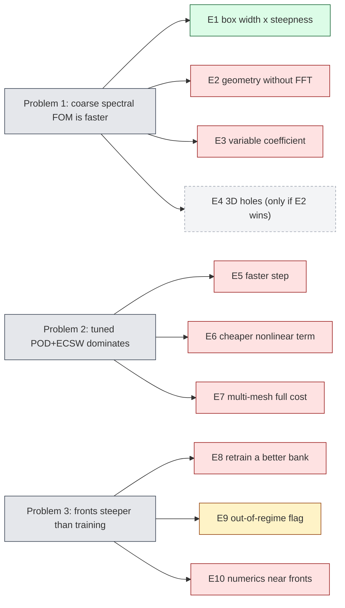
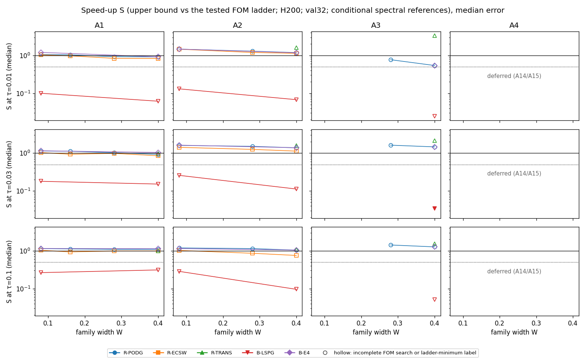
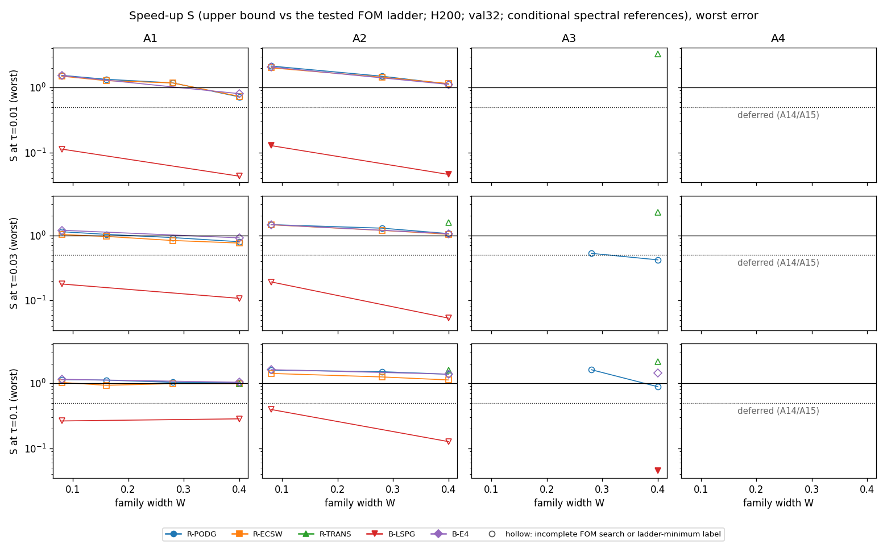
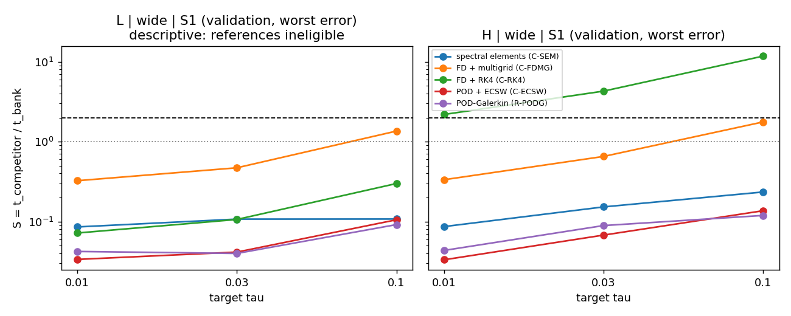
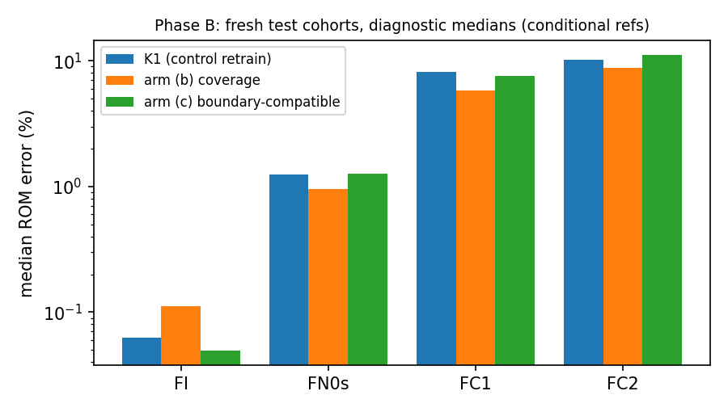
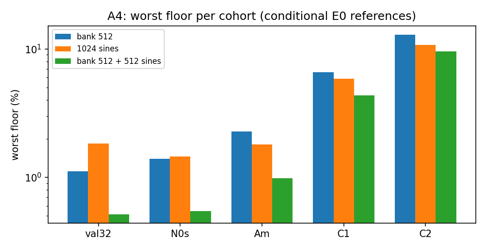
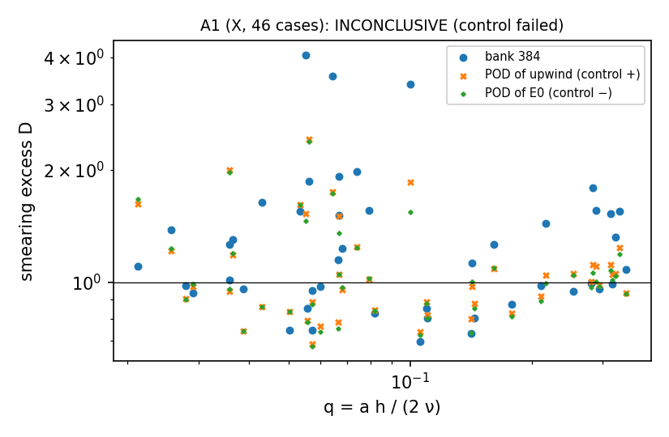
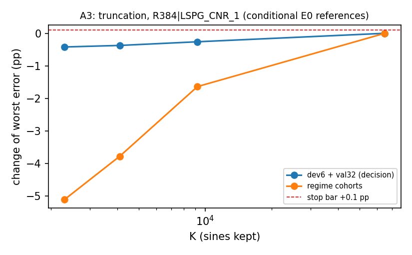

# Improvement campaign (2026-10-21): can the three known weaknesses of the off-mesh bank ROM be fixed?

**Status (compiled 2026-10-23 06:51 UTC by `make_final.py`):** **final** for every lane. E4 was not run. Accuracy numbers are conditional estimates against second-order (E0 ST) or lane spectral references (conditional Richardson $\varepsilon_{\rm ref}$; the E0 A10 and combined A10/A11/A15 labels carry forward). POD comparisons are developmental and unadjusted: in-sample on dev6 + val32 in E5–E7; in E1 selected on val32 with the frozen pairs checked once on a fresh test32 cohort; every speed-up against a tuned ladder is an upper bound "against the strongest tested competitor". Every number below is read from a lane output and registered in `PROVENANCE.json`; bars such as 2×, 3×, 0.5 are registered constants of the plan.

*Red: negative or unsupported outcome under the reported rules (E3: FAIL under the post-hoc A10 rule, UNRESOLVED under the registered rule; E2: H withdrawn, L descriptive only). Green: partly (E1: $S\ge2$ in a few cells, under conditions). Amber: pending or descriptive only. Dashed: not run.*

## 1. In one paragraph

Problem 1 is only partly addressed, and Problems 2 and 3 are not fixed. **Problem 1** (spectral FOM faster): without a fast transform (E2) the bank is still slower than the strongest tested competitor on both geometries (largest validation $S$ = 0.216, bar 2), and on a high-contrast variable coefficient (E3) the fastest tuned FOM already costs only 0.859–0.923 of our box ROM (bar: ≥ 2× slower), so no ROM was trained; E4 was not run; on the box (E1) a reduced model beats the dense spectral FOM by $S\ge2$ only in a few cells: our bank only with the ETDRK4 step on the narrow, low-steepness family, where POD arms do as well, and on the wide family only the translation model (our deployed LSPG bank stays at 0.0244–0.396). **Problem 2** (POD + ECSW dominates): a precontracted Galerkin ETDRK4 step makes the $r=384$ evolution 14.3–24.1× faster than LSPG CN-R but its worst error is slightly higher, so E5 fails its rule; neither bank tests nor fitted weights make the nonlinear term cheaper (E6, best fitted-weight gain 1.24×, none Q2-qualified); and a continuous POD built once matches us on 126/126 multi-mesh workload pairs at 0.0991–0.131 of our cost (E7), so the comparative multi-mesh cost claim is dropped. **Problem 3** (steep fronts): neither the coverage retrain (FC1 median 1.40× lower, bar 2×) nor the boundary-compatible bank nor a finer time step (E10-s) qualifies a single FC1 case; the binding failure is time-step certification on steep states, not quadrature (E10-q).

## 2. Problem 1 — a coarse spectral solver is faster at equal accuracy · verdict: **partly fixed (box only, under conditions; see E1)**

### E1 — box: family width × steepness (imp-box)

Burgers 2D on the unit box; family width $W$ (0.08 narrow … 0.40 wide; the stop rule judges the wide family, $W\ge0.28$) × steepness level A1–A4 (A4 steepest). Arms: the tuned sine pseudo-spectral FOM (fixed or adaptive ETDRK4, FFT or dense transform; every $S$ is against the faster, which was the dense transform, A11), our bank with the deployed LSPG stepper (B-LSPG) and with the Galerkin ETDRK4 step from E5 (B-E4), POD-Galerkin (R-PODG, the pilot stand-in), POD + ECSW (R-ECSW) and a translation model (R-TRANS). $S$ = FOM time / reduced-model time at matched median or worst error $\tau\in\{1,3,10\}\,\%$, val32 selection. **Provisional throughout:** errors are against conditional spectral references (lane deviation A2.2, accepted by the coordinator); every $S$ is an upper bound against the tested FOM ladder; ladders were not extended below their minima, and entries sitting at a minimum are labelled (accepted by the coordinator).

Cells collected: W08_A1, W08_A2, W16_A1, W28_A1, W28_A2, W28_A3, W40_A1, W40_A2, W40_A3. Deferred (coordinator ruling, cap): W08_A3 (deferred: A15 (cap)), W08_A4 (deferred: A14 / A15), W16_A2 (deferred: A15 (cap; defer order: W = 0.16)), W16_A3 (deferred: A15 (cap)), W16_A4 (deferred: A14 / A15), W28_A4 (deferred: A14 (defer order: A4)), W40_A4 (deferred: A14 (defer order: A4)).

Stop rules: SPEED-STOP **NOT FIRED** (largest matched wide-family $S$ = 2.14 over 95 matched comparisons), scoped reading NOT FIRED, BANK-STOP NOT FIRED.

Entries with $S\ge2$ and a complete FOM search (validation; test-once $S$ of the same frozen pair):

| cell | arm | target | $S$ val | $S$ test | FOM finalist | labels |
|---|---|---|---|---|---|---|
| W40_A3 | R-TRANS (translation model) | 3 % median | 2.14 | 2.2 | `spec\|N24\|dense\|nt10` | reduced model truncated at the ladder minimum |
| W40_A3 | R-TRANS (translation model) | 10 % worst | 2.14 | 2.16 | `spec\|N24\|dense\|nt10` | reduced model truncated at the ladder minimum |
| W08_A2 | R-PODG (POD-Galerkin) | 1 % worst | 2.14 | 2.05 | `spec\|N48\|dense\|nt10` | reduced model truncated at the ladder minimum |
| W08_A2 | R-ECSW (POD + ECSW) | 1 % worst | 2.01 | 2 | `spec\|N48\|dense\|nt10` | reduced model truncated at the ladder minimum |
| W08_A2 | B-E4 (our bank, Galerkin ETDRK4) | 1 % worst | 2.07 | 2.04 | `spec\|N48\|dense\|nt10` | reduced model truncated at the ladder minimum |

Larger values with an **incomplete** adaptive-FOM search (a faster FOM may exist, so these are weaker upper bounds): W40_A3 R-TRANS (translation model) 0.01\|median: 3.32 (test 3.3); W40_A3 R-TRANS (translation model) 0.01\|worst: 3.27 (test 3.24); W40_A3 R-TRANS (translation model) 0.03\|worst: 2.26 (test 2.27).

Reading: the bank reaches $S\ge2$ only with the ETDRK4 step and only in W08_A2 (narrow family $W=0.08$, low steepness), at one target (0.01\|worst), where the POD arms do as well (the same cell and target: R-PODG (POD-Galerkin) 2.14, R-ECSW (POD + ECSW) 2.01, B-E4 (our bank, Galerkin ETDRK4) 2.07). On the wide family the bank with ETDRK4 reaches at most $S$ = 1.46. The bank with its deployed LSPG stepper stays at $S$ = 0.0244–0.396 over its 28 matched entries. The only wide-family arm at $S\ge2$ is R-TRANS (translation model), which is not our method. 5 of the 5 complete-search $S\ge2$ entries carry the reduced-model ladder-minimum label (a smaller, possibly faster reduced configuration was not tried). "Complete" means both the fixed-step and the adaptive FOM searches returned a finalist; within each six-candidate screening batch the ordering is recorded only for the attempted candidates, so superiority over unattempted batch members cannot be independently reconstructed (lane search limitation). Timing caveat (A16): some cells were timed with constants hoisted as arguments and others embedded in the compiled program; the dense-FOM hoisted/embedded time ratio is 0.898–0.906, so comparisons of $S$ across cells timed differently (including the width plots) carry this uncertainty; within-cell comparisons do not. GPU-hours 48.97 of 87.

*Figure (imp-box): S against family width, median-error targets*

*Figure (imp-box): S against family width, worst-error targets*

### E2 — geometry without a fast transform (imp-geometry)

Burgers 2D on an L-shape (L) and a box with a circular hole (H), wide family, steepness level S1 only. Competitors: spectral elements (SEM), finite differences with multigrid (FD+MG), FD-RK4, POD-Galerkin and POD + ECSW. Win rule: $S\ge2$ against the best competitor on the wide family; otherwise withdraw the geometry claim.

| cell (conditional references; upper bounds) | $S$ validation (min–max) | $S$ test (min–max; empty cells) | vs SEM alone, worst targets | vs FD+MG, worst, τ = 3 % / 10 % | best competitor | decision labels (τ = 1 / 3 / 10 %) |
|---|---|---|---|---|---|---|
| L\|wide\|S1 | 0.0147–0.214 | 0.0128–0.0903 (2 empty) | 0.0856–0.108 | 0.471 / 1.36 | ecsw, podg | no evidence (reference) / no evidence (reference) / no evidence (reference) |
| H\|wide\|S1 | 0.0292–0.216 | 0.0306–0.12 (1 empty) | 0.0865–0.234 | 0.653 / 1.77 | ecsw, podg | loss / loss / loss |

Outcome (registered A10 readout): **not supported at S1; S2 untested**. Geometry H: **WITHDRAWN (measured loss)**. Geometry L: S1-only, wide family; WIN not decidable without S2 and box controls — 4 of 32 validation references fail the Richardson order gate, so L is descriptive only, although every measured $S$ is below 2. $S$ is an upper bound against the strongest tested competitor (finite ladders; static condensation and multi-domain Chebyshev were not built). Against FD+MG alone the bank is faster only at the looser targets ($S>1$ at: L 0.1|worst, 0.1|median; H 0.03|median, 0.1|worst, 0.1|median; target|statistic). Competitors are admitted on validity and accuracy only; their Q1 is reported, not gated (DESIGN A4.2), which can only lower $S$. Narrow family, S2 and the box controls were not run. GPU-hours 30.68 of 62.

*Figure (imp-geometry): speed ratio S of the bank against each competitor family, per target*

### E3 — variable coefficient (imp-varcoef)

FOM-only benchmark at contrast $C=100$; a ROM is trained only if the fastest tuned FOM is ≥ 2× slower than our (constant-coefficient) box ROM. $G$ = fastest FOM cost / ROM cost at matched worst error.

| worst-error target | ROM (constant κ), worst error (conditional, dev+val) | fastest FOM | $G$ [95 % CI] | outcome |
|---|---|---|---|---|
| 1 % | – | – | – | inconclusive (no ROM qualified) |
| 3 % | 2.71 % | `etd\|N48\|0.003125\|mid@C100` | 0.859 [0.799, 0.9] | fail |
| 10 % | 6.73 % | `etd\|N48\|0.0125\|mid@C100` | 0.923 [0.877, 0.943] | fail |

Gate: **FAIL** under the post-hoc A10 reference cross-check rule; **UNRESOLVED** under the registered A5.5 rule (references not decidable). Both readings mean no ROM is trained, so the conclusion does not depend on the rule. Provisional: the ROM denominator is the inherited constant-κ configuration (an optimistic comparator; a variable-κ ROM is unmeasured), and $G$ is against the strongest tested FOM (Krylov exponentials, AMG and POD-ECSW not built), so a stronger FOM only lowers it. The gate is a development/validation result; on the 14 eligible of 16 test-once cases (2 references not accepted; their registered A8.3 fallback was not run) the frozen 10 % winner reaches 11.7 % worst error (above its target) and the 3 % winner 2.04 %. Deferred: $C=10$ timing and validation ladder, CCv at $L=512$; reused factorisations not built. GPU-hours 2.04 of 15.

*Figure (imp-varcoef): gate ratio G per target with bootstrap interval*

*Figure (imp-varcoef): FOM cost against worst error, variable coefficient*

### E4 — 3D cube with small spherical holes

Not run: it was conditional on an E2 win, and E2 did not win. Its reserve was released unspent.

## 3. Problem 2 — tuned POD + ECSW dominates · verdict: **not fixed**

### E5 — a faster reduced time step (imp-faststep)

Stop if any run is unstable or invalid, its worst error is above the incumbent LSPG CN-R (arm 1), or the $r=384$ evolution is < 3× faster. Errors: worst over dev6 + val32 (38 cases), conditional E0 estimates.

| mesh | arm | worst error $r=384$, conditional E0 (arm 1) | cases better / worse than arm 1 | evolve speed-up | conditions fired | qualified |
|---|---|---|---|---|---|---|
| 1024² | Galerkin CN (precontracted) | 1.85 % (1.78 %) | 36 / 2 | 0.726× | worst_error, speed | yes |
| 1024² | Galerkin ETDRK4, Δt 0.0125 | 1.82 % (1.78 %) | 36 / 2 | 14.3× | worst_error | yes |
| 1024² | Galerkin ETDRK4, Δt 0.025 | 1.91 % (1.78 %) | 34 / 4 | 22.8× | worst_error | yes |
| 1024² | one-pass linearised Galerkin CN | 1.93 % (1.78 %) | 36 / 2 | 1.58× | worst_error, speed | yes |
| 4096² | Galerkin CN (precontracted) | 1.85 % (1.77 %) | 36 / 2 | 0.733× | worst_error, speed | yes |
| 4096² | Galerkin ETDRK4, Δt 0.0125 | 1.81 % (1.77 %) | 36 / 2 | 15× | worst_error | yes |
| 4096² | Galerkin ETDRK4, Δt 0.025 | 1.91 % (1.77 %) | 34 / 4 | 24.1× | worst_error | yes |
| 4096² | one-pass linearised Galerkin CN | 1.93 % (1.77 %) | 36 / 2 | 1.59× | worst_error, speed | yes |

E5 fixed on the completed scope: 1024² no, 4096² no. No run was unstable or invalid (none fired the stability condition); the Galerkin arms are more accurate on most cases, but on the hardest case the worst error exceeds arm 1, so the worst-error condition fires for every arm. The ETDRK4 speed-ups are evolution-only against the incumbent. Frozen dev6 best-stepper selection: 1024² None; 4096² `G-E4a|384`, reported as a failed frozen selection because its 38-case worst error exceeds arm 1. Against the matched POD + ECSW with the same ETDRK4 step (1024², in-sample, upper bound), the competitor full query takes 0.623 (`pod-ecsw|384|k4|ETDRK4|0.0125`) and 0.796 (`pod-ecsw|384|k4|ETDRK4|0.025`) of our ETDRK4 query time (< 1: the competitor is faster; both competitors Q1-qualified but Q2-POD label HR-unqualified / HR-unqualified), and 0.0363 of the incumbent LSPG query time. Deferred at 4096²: $r=128$ and the $M=1152$ control (cap). GPU-hours 1.41 of 4.

*Figure (imp-faststep): worst error against median evolution time per arm and rank*

### E6 — a cheaper nonlinear term (imp-hrcost)

F2: bank-tested Galerkin with classical rules (stop if $m^*>16384$, accuracy worse, or not faster). F3: sine-tested Galerkin with fitted ECSW-style weights (stop if no $\kappa\le16$ passes Q2 at equal worst error with ≥ 1.5× gain). Speed-ups are paired, same-job, end-to-end ratios against the lane reference arm R (an internal ablation, in-sample, selection-unadjusted).

| arm | nodes $m$ | worst error (conditional E0) | end-to-end gain vs R (in-sample) | Q2 |
|---|---|---|---|---|
| R (sine tests, Gauss 128²) | 16384 | 1.851 % | 1 (reference) | pass |
| F2, $m^*$: gauss96 | 9216 | 2.131 % | 1.02× | pass |
| F3a_k4 | 1536 | 1.859 % | 1.24× | fail |
| F3a_k8 | 3072 | 1.889 % | 1.18× | fail |
| F3a_k16 | 6144 | 1.851 % | 1.15× | fail |
| F3b_k4 | 1536 | 5.951 % | 1.24× | fail |
| F3b_k8 | 3072 | 1.851 % | 1.18× | fail |
| F3b_k16 | 6144 | 1.853 % | 1.15× | fail |
| F2F3_k16 (fastest qualified) | 6144 | 2.131 % | 1.07× | pass |

F2: `fired (tested failure): m* = gauss96, no_worse=False, faster=False`. F3: **fired (tested failure)** (0 of 6 fitted-weight arms pass Q2; best gain 1.24×, F3b_k4). Point work scales sub-linearly: the step-Jacobian microbenchmark costs 1.37× for 2× the points and 2.14× for 4×, so fewer points buy little. GPU-hours 1.46 of 3.

*Figure (imp-hrcost): worst error against end-to-end gain per arm*

*Figure (imp-hrcost): F2 classical-rule ladder and its Q2 distances*

### E7 — multi-mesh full cost (imp-multimesh)

21 workloads (every non-empty subset of {256², 1024², 4096²} × 10/100/1000 queries per mesh) × 6 qualified configurations of ours, against per-mesh POD + ECSW and the fair control: a continuous POD built once and reused. Rule: if the control matches us (no more cost at equal or better worst error) on every workload, drop the comparative multi-mesh cost claim.

| accuracy criterion (A_dep accounting) | MATCH | NO-MATCH | of which no admissible competitor |
|---|---|---|---|
| worst (primary) | 126 | 0 | 0 |
| worst_eps | 126 | 0 | 0 |
| worst_median | 126 | 0 | 0 |
| casewise | 84 | 42 | 42 |
| rollout | 0 | 126 | 126 |

Primary outcome: **FIRES** — the continuous POD matches us on 126 of 126 (workload, configuration) pairs at 0.0991–0.131 of our cost (median 0.105); the same under the A100 (126) and no-head (126) accountings. The casewise and rollout sensitivities do not fire, but every one of their NO-MATCH cells has no accuracy-admissible competitor at all (cost advantage undetermined), not a cost win. Costs are the measured items only (bank rotation and rule selection uncosted, which favours us); our bank-fit time is a phase-wise projection from measured H200 rates, and every cost verdict is conditional on compilation projections; developmental, in-sample. GPU-hours 3.16 of 8.

*Figure (imp-multimesh): full cost against number of queries, ours vs continuous POD*

## 4. Problem 3 — fails on fronts steeper than training · verdict: **not fixed**

### E8 — retrain a better bank (imp-fronts)

Phase A (CPU diagnostics, 0 GPU-h): A1 smearing test **INCONCLUSIVE (control failed)**; A2 wall curvature → arm (c) **RUN**; A3 truncation screen **CPU truncation screen passed; F7 timing gate deferred**; A4 hybrid floors **STOP F15**.

Phase B: single-change retrains against the control retrain K1 of the incumbent recipe; arm (a) data fidelity was deferred (both retrain arms would exceed the 15 GPU-h cap), arm (b) and then arm (c) were released.

| arm | registered bar | measured (diagnostic errors: conditional, qualification ignored) | in-range guard (worst representation floor vs K1, bar ≤ 2×) | verdict |
|---|---|---|---|---|
| (a) data fidelity | N0s floor ≥ 3× below K1 | not run | – | NOT RUN |
| (b) steep / low-ν coverage | FC1 ROM median ≥ 2× lower | 1.40× lower (5.81 % vs K1 8.12 %); 0/8 FC1 cases numerically qualified | PASS (0.94×) | STOP (endpoint) |
| (c) boundary-compatible bank | stop if $m^*$ is not ≥ 2× smaller **and** the tail is not ≥ 3× smaller (either improvement continues) | $m^*$ = gauss128 = 16384 nodes (bar ≤ 12800); tail 1.48× smaller; FC1 median 7.55 % | PASS (1.27×) | STOP (endpoint) |

GPU-hours (E8 bucket) 10.55 of 15.

*Figure (imp-fronts): Phase B diagnostic medians per cohort, arms vs control K1*

*Figure (imp-fronts): A4 hybrid (sine-enriched) floors*

*Figure (imp-fronts): A1 smearing test*

*Figure (imp-fronts): A3 truncation screen*

### E9 — out-of-regime indicator (folded into E8)

Flag queries with $s=a/\nu>\tau_s$, $\tau_s$ = 113 (frozen before test). On 24 test cases it flags 79.2 % (in-range FI cohort 16.7 %). Target A (bad = conditional error above 0.383 %): AUC 1, detection 1, false alarms 0 (19 bad / 5 good); target B (bad = error above 1 %): AUC 1, false alarms 0.286. Label: **inconclusive (F12 minimum 30 good / 20 bad not met)** — descriptive only. $s$ is a known input on this family, so the indicator is a safety feature, not a speed one; the FOM-fallback cost is unmeasured.

### E10 — numerics near fronts (activated because E8 fell short)

- **E10-s** (time step refined to 1/8, single change on K1): FC1 median 8.29 % (diagnostic, conditional E0-style error; qualification ignored for the medians) against the bar 4.06 % (half of K1's 8.12 %); 0/8 FC1 cases qualified, 0 step-converged → **STOP**.
- **E10-q** (state-triggered quadrature escalation): its trigger never fires — $\max\rho$ = 0.0386 over 17600 accepted step states (0 over the bar) → **STOP** without a job: quadrature is not the binding failure.

E10 reused the Phase B test cases (not test-once for E10). GPU-hours (E10 bucket) 0.20 of 10.

## 5. Every experiment and its stop-rule outcome

| exp | problem | lane | registered stop / win rule | outcome | fixed? |
|---|---|---|---|---|---|
| E1 | 1 | imp-box | stop if every reduced model has $S<0.5$ at every target on the wide family | NOT FIRED | partly (see §2) |
| E2 | 1 | imp-geometry | win: $S\ge2$ vs best competitor on the wide family, else withdraw | not supported at S1; S2 untested; H WITHDRAWN (measured loss); L not decidable | no |
| E3 | 1 | imp-varcoef | train a ROM only if the fastest FOM is ≥ 2× slower | gate FAIL (A10 rule) / UNRESOLVED (registered); $G$ = 0.859, 0.923 | no |
| E4 | 1 | – | only if E2 wins | not run | – |
| E5 | 2 | imp-faststep | stop if unstable/invalid, worst error above arm 1, or < 3× faster | fired (worst error) for every arm | no |
| E6 | 2 | imp-hrcost | F2: $m^*\le16384$, no worse, faster; F3: κ ≤ 16 Q2-qualified with ≥ 1.5× | F2 fired (tested failure); F3 fired (tested failure) | no |
| E7 | 2 | imp-multimesh | drop the claim if continuous POD matches us on every workload | FIRES (126/126) | no (claim dropped) |
| E8 | 3 | imp-fronts | (a) N0s ≥ 3×; (b) C1 median ≥ 2×; (c) stop if neither $m^*$ ≥ 2× nor tail ≥ 3×; floor guard ≤ 2× | (a) NOT RUN; (b) STOP (endpoint); (c) STOP (endpoint) | no |
| E9 | 3 | imp-fronts | report coverage and false alarms (no stop rule) | inconclusive (F12 minimum 30 good / 20 bad not met) | descriptive |
| E10 | 3 | imp-fronts | only if E8 falls short; single changes vs K1 | E10-s STOP; E10-q STOP | no |

## 6. What this means for the paper's claims

**Withdrawn or not made:**

- Geometry without a fast transform (E2): withdrawn for the holed box (measured loss); not supported on the L-shape (S1 only, references not decidable). The 3D holes case (E4) is not claimed.
- Variable coefficient (E3): no ROM advantage is claimed; the tuned FOM is already about as cheap as the box ROM.
- Comparative multi-mesh cost (E7): dropped. Mesh-independent evolution and mesh-free evaluation remain stated as properties of the method, not as comparative advantages over a continuous POD.
- "A faster step closes the gap to POD + ECSW" (E5) and "a cheaper nonlinear term" (E6): not claimed; the deployed stepper remains LSPG CN-R with the frozen quadrature.
- Robustness to fronts steeper than training (E8, E10): not claimed; it stays a stated limitation, with $s=a/\nu$ as a descriptive out-of-regime flag (E9) and FOM fallback.

**Kept (unchanged by this campaign):** the properties established before it — mesh-independent evolution cost and mesh-free evaluation (E7 keeps them as properties); the incumbent configuration and its accuracy as previously reported (E5 arm 1 is the incumbent LSPG CN-R; E6 reproduces E5's precontracted Galerkin CN arm as its reference R). The finding that tuned POD + ECSW dominates our solve cost stands and should be reported, with the E5 Galerkin ETDRK4 evolution speed-up as a mechanism result that does not change the comparison.

**Problem 1 on the box (E1), narrowed:** the paper may say that on the box a reduced model beats the tuned dense spectral FOM by $S\ge2$ only in the cells and targets listed in §2 (upper bounds, conditional references, ladder-minimum labels); that our bank does so only with the Galerkin ETDRK4 step, only on the narrow, low-steepness family, where POD-Galerkin and POD + ECSW do as well; and that the deployed LSPG bank stays at $S$ = 0.0244–0.396. A general "faster than a spectral solver" claim is not supported.

## 7. Retractions and deviations

**Procedure deviations (disclosed):**

- **E6 smoke submitted against a DO-NOT-SUBMIT job audit** (`imp-hrcost/audits/codex-job-smk1-1.md`); the lane argued the computation was unaffected (`audits/response-job-smk1-1.md`) and fixed the offline-acceptance gaps before acceptance; accepted by the coordinator as a smoke-only deviation.
- **E8 SM-c admission breach** (lane ledger note, verbatim): `submitted although resources.admit returned "SM-c is not a smoke of the plan" (selected plan S3; S3C not yet certified because SM-c itself measures train_c). Amendment-5 arithmetic holds: spent 6.327 + SM-c 0.45 + remaining arm-c ceilings 5.5 = 12.28 <= 15. Procedural deviation, disclosed.` The results audit marks it WRONG as a procedure breach.
- **E3 post-hoc A10 cross-check rule:** adopted after the reference data but before any solver result; carried as a post-hoc label. Both outcomes are reported (FAIL / UNRESOLVED); neither trains a ROM.
- **E2 geometry chosen after inspecting smoke rows:** the first geometry showed no bump–feature interaction and was redesigned (v4a); the claim that no solver or ROM result existed at selection time was retracted (A3.1): the redesign was diagnostic-guided problem development, not outcome-blind.
- **E2 smoke overrun:** the 1 GPU-h smoke allowance was exceeded by 0.07 GPU-h (smoke5 ran to its limit during a usage-limit pause).
- **E2 scope reduced:** the first L cell timed out in the ladder stage; registered reductions (A9) were applied and the cell resumed; the narrow family, S2 and box controls were deferred under the 62 GPU-h cap.
- **E7 / E5 shared-scratchpad collision:** imp-multimesh overwrote a shared prompt file, so E5 design audit 3 ran with a partly foreign prompt; it audited the right design (DESIGN note 2026-10-22) and audits 4–5 re-covered it.
- **E5 pkill incident:** a `pkill -f codex-design-4.md` may have terminated another lane's Codex audit (`imp-faststep/audits/NOTE-pkill-incident.txt`); dead audits were re-run by rule; lanes use private work dirs since.
- **E1 spectral conditional references** (lane deviation A2.2 from the E0 second-order recipe): accepted by the coordinator as a labelled deviation. **No downward ladder extension:** FOM and reduced ladders were not extended below their minima; entries at a minimum are labelled as truncated (coordinator ruling). A dense-transform FOM of the same discretisation was added as the fair competitor (A11); H200 FFT runs at $N=12$ gave non-finite values and were excluded (A10). Query timing changed mid-lane from embedded to hoisted constants (A16); cross-cell $S$ comparisons carry the measured ratio (§2).
- **E8 released early:** Phase B retrains started before the other wave-1 lanes handed back (independent, capped).
- **E10 reused Phase B test cases** (not test-once for E10).
- **Interruptions:** two account usage-limit stops halted every lane agent (2026-10-21 ~19:30 UTC and 2026-10-22 ~01:00 UTC; resumed after reset); GitHub credentials expired 2026-10-21 ~23:40 UTC, so mirrors were not pushed until the user restored them (2026-10-22 ~19:45 UTC), when every lane was re-synced. Self-matching `pgrep` waiters and a dead detached waiter were killed or replaced (INTERVENTIONS.md).

**Retractions and corrections inside lanes** (most before any verdict; the E8 wall-residual finding and the E7 resampling correction came from results audits):

- E6: an unattainable mass/stiffness bar replaced before verdict data (A5); a projected-ρ gate justification withdrawn and the tested-vector gate restored (A2.1); defective P5 fixtures replaced (A6); a timer control that did not fire at real size replaced by C5′ (A9).
- E8: the original A2 curvature control was retracted (it fired on only part of the in-range cases where it had to fire); draft A3/A4 debugging outputs were seen and discarded before Amendment 1; the bank-values check was respecified (Amendments 6–7).
- E8 arm (c) identity: on the trained columns the wall residual reaches 1.03e-13 of the column RMS against the registered bar 1e-14 (round-off of $\sin(\pi x)$ at $x=1$; the bar was tested on the initial bank; scoring zeroes wall nodes).
- E6: F2 changes both the test space and the diffusion discretisation, so it is not a pure quadrature change.
- E7: the single-rate bank-fit cost model was corrected to a phase-wise projection, and resampling-cost accounting was corrected.
- E5: design audit 2 audited the wrong lane and was voided; F5 secondary criteria rejected arm 4.
- E3: none within the lane; some timed subjects did not reproduce their ladder error (G-FR False) and are excluded from the gate (none is a decisive winner).

**Provisional labels carried in this report:** conditional E0 references (and E1's spectral conditional references); in-sample, unadjusted POD comparisons; upper-bound speed-ups against finite ladders; E7 conditional on compilation projections; E3 ROM denominator is constant-κ.

## 8. Deferred items

- E1: cells W08_A3 (deferred: A15 (cap)), W08_A4 (deferred: A14 / A15), W16_A2 (deferred: A15 (cap; defer order: W = 0.16)), W16_A3 (deferred: A15 (cap)), W16_A4 (deferred: A14 / A15), W28_A4 (deferred: A14 (defer order: A4)), W40_A4 (deferred: A14 (defer order: A4)) (coordinator ruling: the A4 cells, W16_A2/A3 and W08_A3 deferred under the cap); the second training-data size; no downward ladder extension below the ladder minima.
- E2: narrow family, S2 steepness, box attribution controls; static condensation and multi-domain Chebyshev competitors.
- E3: a variable-κ ROM (never trained: gate failed); Krylov/Leja exponentials, reused factorisations, AMG and POD-ECSW FOM competitors; $C=10$ timing and validation ladder; CCv at $L=512$; the A8.3 test-reference fallback.
- E4: not run (conditional on E2).
- E5: $r=128$ and the $M=1152$ control at 4096² (cap).
- E7: bank rotation and quadrature-rule selection costs (uncosted, favour us).
- E8/E9/E10: arm (a) fidelity retrain — S1 over the 15 GPU-h cap (Amendments 11-14); coordinator release was S3 only.
- E8/E9/E10: K2/K3 ROM policy scoring — Amendment 8 defer order; floors only.
- E8/E9/E10: E9 paired FOM-fallback timing — Amendment 12; fallback cost unmeasured.
- E8/E9/E10: F7 GPU timing gate — not in the lane brief.
- E8/E9/E10: E10-q quadrature escalation job — resolved from every-step evidence without a job (E10-DESIGN §10): STOP.
- Problem 3 next step (not a single change, so not released): an embedded adaptive integrator or a shift/local-basis bank — open for the paper or a later campaign.

## 9. GPU-hour ledger

| lane | experiments | cap (GPU-h) | spent (GPU-h) | status |
|---|---|---|---|---|
| imp-box | E1 | 87 | 48.97 | final |
| imp-geometry | E2 | 62 | 30.68 | final |
| imp-varcoef | E3 | 15 | 2.04 | final |
| imp-faststep | E5 | 4 | 1.41 | final |
| imp-hrcost | E6 | 3 | 1.46 | final |
| imp-multimesh | E7 | 8 | 3.16 | final |
| imp-fronts | E8, E9, E10 | 25 | 10.74 (E8 10.55 of 15, E10 0.20 of 10) | final |
| **total** | | 204 | 98.46 | |

E4 (cap 80) was not run and its reserve was not spent. Sources: each lane's `runs/GPU-LEDGER.json`.

## 10. Lanes, branches and mirrors

| lane | branch | last local commit | GitHub mirror (`origin/codeonly/<branch>`) | status |
|---|---|---|---|---|
| imp-box (E1) | `exp/2026-10-22-imp-box` | `9c35fdd83` (2026-10-23T02:40 -04:00) | `17e4876d6` | done |
| imp-geometry (E2) | `exp/2026-10-21-imp-geometry` | `0dc801d2b` (2026-10-22T20:27 -04:00) | `b89dbd615` | done |
| imp-varcoef (E3) | `exp/2026-10-21-imp-varcoef` | `e8d39fa1a` (2026-10-22T00:21 -04:00) | `6a98c018a` | done |
| imp-faststep (E5) | `exp/2026-10-21-imp-faststep` | `a3e417b1e` (2026-10-21T23:40 -04:00) | `ed52f5477` | done |
| imp-hrcost (E6) | `exp/2026-10-21-imp-hrcost` | `cf351b62a` (2026-10-21T22:04 -04:00) | `c891ee4cc` | done |
| imp-multimesh (E7) | `exp/2026-10-21-imp-multimesh` | `dd4cd7fc4` (2026-10-21T23:38 -04:00) | `4ade95d16` | done |
| imp-fronts (E8, E9, E10) | `exp/2026-10-21-imp-fronts` | `506dbd3a5` (2026-10-22T08:19 -04:00) | `a2f64ebda` | done |

Mirror heads were read with `git ls-remote origin` when this report was compiled (an auditor without network access can corroborate them against the local `refs/remotes/origin/codeonly/...` refs). Mirror commits are code-only filtered copies, so their hashes differ from the local commits by design. **Branches awaiting the user's merge decision:** all seven lane branches above (no branch was merged in this campaign).

## 11. Glossary

- **ROM / FOM**: reduced-order model (our fast surrogate) / full-order model (the accurate, expensive solver).
- **bank, $r$**: the ordered set of learned coordinate-network basis functions; $r$ is how many are used (the number of unknowns solved for).
- **off-mesh quadrature, $m$**: the set of $m$ sample points where the nonlinear term is evaluated, independent of any mesh.
- **POD, POD + ECSW, POD-Galerkin**: the classical competitor: a basis from snapshots on a mesh (POD), with a small set of weighted mesh points for the nonlinear term (ECSW).
- **continuous POD (CPR/CPU)**: a POD basis built once and resampled to other meshes; the fair multi-mesh control in E7.
- **LSPG CN-R**: the deployed time stepper: least-squares residual minimisation with Crank–Nicolson and two backward-Euler start steps.
- **Galerkin, precontracted, ETDRK4**: projection-based stepping with matrices multiplied together offline; ETDRK4 is a 4th-order exponential integrator.
- **arm**: one configuration being compared; arm 1 / R / K1 are the reference arms of E5 / E6 / E8.
- **$S$**: speed-up: competitor time divided by ROM time at matched error; $S>1$ means we are faster. Always an upper bound against a finite tested ladder.
- **$G$**: E3 gate ratio: fastest FOM cost divided by ROM cost; $G\ge2$ was needed to train a ROM.
- **worst / median error**: the largest / median, over the evaluated cohort (dev6 + val32 for E5–E7, the stated cohort elsewhere), of the relative field error.
- **$C$, CCv**: E3: contrast of the variable diffusion coefficient; CCv = the E0 scheme (CN-R, Newton–BiCGStab) used as one FOM family.
- **$\tau$ (target)**: an error level (1 %, 3 %, 10 %) at which speeds are matched.
- **conditional E0 / Richardson $\varepsilon_{\rm ref}$**: errors are measured against reference solutions whose own error is estimated, not bounded; numbers are conditional on that estimate.
- **Q1 / Q2, qualified**: numerical qualification (every run valid and step-certified) / quadrature qualification (a finer rule changes nothing beyond the bar).
- **in-sample, unadjusted**: measured on the cases used for selection, without correcting for having picked the best of several.
- **dev6, val32, test-once**: development, validation and once-only test case cohorts.
- **MATCH / NO-MATCH**: E7: the control is at least as accurate and no more costly / it is not.
- **FI, FN0s, FC1, FC2**: E8 test cohorts: in-range; the stiff corner inside the training range (low viscosity, high amplitude); and two steeper-than-training cohorts.
- **$s=a/\nu$**: steepness: advection amplitude over viscosity; large $s$ means sharp fronts.
- **AUC, false alarm**: E9 indicator quality: area under the ROC curve; fraction of good queries flagged.
- **$m^*$, tail**: E8(c)/E6: smallest certified quadrature size; the high-frequency remainder of decoded fields.
- **guard, representation floor**: E8: an arm also stops if its in-range worst representation floor (best error the bank can represent, by projection) is more than 2× the control's.
- **SEM, FD+MG, FD-RK4**: spectral elements; finite differences with multigrid; finite differences with explicit Runge–Kutta.
- **S1 / S2, wide / narrow**: E2 steepness levels and parameter-family widths.
- **A10, A3.1, A9 …**: numbered design amendments in each lane's DESIGN.md.
- **A_dep / A_100 / A_nohead**: E7 cost accountings: H200-measured offline cost with projected bank fit / historical A100 bank fit and head / head excluded.
- **worst, worst_eps, worst_median, casewise, rollout**: E7 accuracy criteria: aggregate worst error no worse; the same within $2\max\varepsilon_{\rm ref}$; worst and pooled median; every case within $2\varepsilon_{\rm ref}$; worst restricted to competitors whose $\kappa=4$ and $\kappa=8$ rollouts agree.
- **CPR-$s$ / CPU-$s$**: continuous POD from source mesh $s$ with the ECSW rule refitted on each mesh / with the source rule reused on finer nested meshes.
- **$M$**: number of test functions in LSPG (E5 control $M=1152$).
- **$\kappa$**: overloaded: in E6/E7, nodes per unknown in a fitted (ECSW-style) rule, $m=\kappa r$ (k4/k8/k16 in arm names); in E3, the diffusion coefficient (constant-κ vs variable-κ).
- **F2, F3a / F3b, F2F3**: E6 arms: classical rules with bank tests; fitted ECSW-style weights with sine tests, non-negative (NNLS) weights fitted on the Gauss 128² points to the projected (F3a) or the full tested (F3b) advection; fitted weights with bank tests.
- **$\rho$**: E10-q quadrature indicator: relative change of the nonlinear term under a finer rule; escalation triggers above a registered bar.
- **CI**: 95 % bootstrap confidence interval.
- **GPU-h, cap**: GPU-hours charged by the cluster; the budget a lane may not exceed.
- **$W$, A1–A4 (E1)**: E1 family width (bump centres drawn in a square of side $W$; 0.08 narrow, 0.40 wide) and steepness levels (viscosity bands a factor 3 apart; A4 steepest); a cell is one (W, level) pair, e.g. W08_A2.
- **B-LSPG / B-E4, R-PODG / R-ECSW / R-TRANS**: E1 arms: our bank with the deployed LSPG stepper / with the Galerkin ETDRK4 step; POD-Galerkin; POD + ECSW; static translation model (POD of centred bumps decoded at the true centre).
- **dense transform, FOM finalist**: E1: the spectral FOM implemented with a dense transform matrix instead of an FFT (faster here); the fastest qualified FOM configuration (`spec|N…|dense|nt…`: modes, transform, time steps).
- **ladder minimum, search-incomplete**: the selected configuration is the smallest one tried, so a cheaper one may exist; the adaptive-FOM search hit its attempt cap before finishing.
- **mirror (codeonly)**: the filtered GitHub backup branch of a lane, without large archive files.

