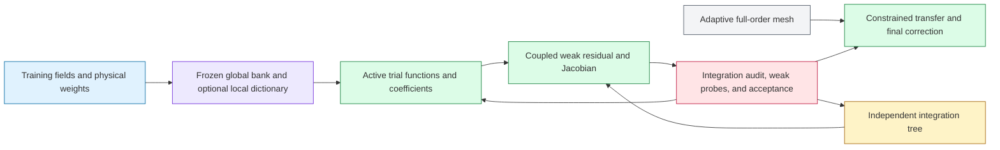

# Adaptive trees can localize coordinate ROMs

Quadtrees and octrees can make this architecture useful by allocating integration and approximation effort to difficult regions while retaining a global coarse field. This report synthesizes the project's accepted findings and primary literature into a proposed, unvalidated design; no new experiments, performance measurements, or numerical results are reported.

**The recommendation is to test local approximation headroom on saved data, then build a small adaptive-diffusion interface whose first application is a reduced weak-solve warm start for a validated finite-element solver.** Keep the full-order mesh, integration tree, and active trial-space tree separate. If the diagnostics justify local representation, retain the global coordinate bank and add smoothly windowed, ordered local detail without changing existing columns. Use positive classical composite quadrature first, and distinguish integration checks from independent weak residual probes and actual error certification. The tree's useful contribution would be selective work, reusable local features, and compatible access to adaptive discretizations; it does not by itself establish a neural advantage, resolve a qualification failure by itself, or defeat continuous POD. The decisive comparison gives continuous and local POD the same integration, adaptation, warm-start, and acceptance machinery.

## What has actually been done with quadtrees and octrees — October 27, 2026

**Yes: literal spatial quadtrees and octrees have already been combined with classical PDE solvers, reduced models, weak neural PDE optimization, and neural prediction.** The important distinction is what the tree controls. A tree can compress stored snapshots, accelerate one operation inside a solver, choose integration points, or determine the actual solution space. Evidence for one role does not establish the others. Our opportunity is therefore narrower than adding a tree: test whether a reusable learned local dictionary reduces the cost of accepted solutions beyond a strong conventional adaptive solver and an equally equipped local-POD model.

The table identifies direct spatial examples. “Block tree” means that each leaf holds a small structured grid; it is a genuine spatial hierarchy, but differs from treating each individual cell as a leaf. The source labels link original papers, and the final column limits what we can infer.

| Source | Spatial tree and its role | What the method actually does | What it establishes, and its limit |
|---|---|---|---|
| Popinet, *Gerris: a tree-based adaptive solver for the incompressible Euler equations in complex geometries* (2003) ([paper](https://gerris.dalembert.upmc.fr/gerris.pdf)) | Literal quadtree/octree; adaptive PDE mesh and pressure hierarchy | Conventional online fluid solve, including coarse/fine coupling and multilevel pressure solution | Adaptive spatial physics is established; its vorticity refinement indicator is not a general solution-error certificate. |
| Kazhdan and Hoppe, *An adaptive multigrid solver for applications in computer graphics* (2019) ([paper](https://hhoppe.com/adaptivemultigrid.pdf)) | Quadtree/octree supporting continuous local B-splines | Weak finite-element assembly and multigrid solution of Poisson-like systems | Trees, continuous functions, weak forms, and solved coefficients already coexist without neural features; scope is not arbitrary nonlinear dynamics. |
| Gerszewski et al., *Basis Enrichment and Solid-fluid Coupling for Model-reduced Fluid Simulation* (2014) ([paper](https://users.cs.utah.edu/~ladislav/gerszewski14basis/gerszewski14basis.pdf)) | Literal quadtree over the background grid; accelerates obstacle feedback | Actual online reduced fluid simulation with enriched global modes | A quadtree already operates inside a ROM; it does not select local trial spaces, and demonstrations are planar. |
| Krah et al., *Wavelet adaptive proper orthogonal decomposition for large-scale flow data* (2022) ([paper](https://arxiv.org/pdf/2011.05016)) | Dyadic spatial block tree/forest; adaptive storage of snapshots and modes | POD decomposition and reconstruction of compressed flow data | Spatial tree-based POD is established; an adaptive online POD-Galerkin solver is future work in this paper. |
| Geise et al., *An octree-based sampling algorithm for analyzing big simulation data* (2026; preprint 2025) ([paper](https://arxiv.org/html/2511.21352v1)) | Explicit quadtree/octree; time-invariant sparse sampling hierarchy | Interpolates existing simulation data and supports POD/SVD analysis | Compression and modal analysis, not an online reduced governing-equation solve. |
| Lu et al., *Accelerated full-waveform time-domain electromagnetic forward modeling in underground full-space using an octree mesh and model order reduction* (2026) ([article](https://academic.oup.com/jge/article/23/3/1078/8566305)); Zhou et al., *Source decoupling and model order reduction for 3D full-time TEM modeling* (2024) ([abstract](https://www.emiw.org/fileadmin/emiw2024/abstracts/2.0_source_decoupling_and_mod_zhou_01.pdf)) | Literal octree finite-volume discretization | Actual reduced electromagnetic solve using source decoupling and a global Krylov basis | Octree plus solved reduced physics already exists. Lu was inspected at abstract/introduction scope; Zhou's complete source is a short workshop abstract. |
| Rodopoulos et al., *Variational PINNs with tree-based integration and boundary element data in the modeling of multi-phase architected materials* (2025) ([paper](https://arxiv.org/html/2506.23357v1)) | Explicit quadtree; Gauss integration in leaf cells follows material/boundary geometry | Per-problem neural optimization of weak elasticity equations | Direct precedent for quadtree weak neural integration; not a frozen family-trained bank or demonstrated octree solution method. |
| Xu et al., *AMR-Transformer: Enabling Efficient Long-range Interaction for Complex Neural Fluid Simulation* (CVPR 2025) ([paper](https://arxiv.org/html/2503.10257v1)) | Explicit quadtree; adaptive tokens for planar flow fields | Supervised neural forecasting | Demonstrates reduced attention work in its comparisons, not online weak physics solves; accuracy and baseline comparisons are mixed. |

These examples prevent several tempting novelty claims. “Neural networks plus a quadtree,” “POD plus an octree,” and “weak integration on a quadtree” are established combinations. The electromagnetic papers are especially important: they go beyond compressing pictures of solutions and actually solve projected governing equations on an octree discretization. Conversely, the sampling and wavelet-POD papers must not be cited as if they already validate adaptive reduced dynamics. The reduced-fluid paper supplies another useful distinction: the tree speeds a feedback operation while the reduced basis remains global.

Recent work broadens the inventory but does not change those conclusions. Zhuang, Zambrano, and Duraisamy's *Dynamic Quadtree Tokenization and Transformer for Adaptive Mesh PDE Forecasting* is an October 2026 **preprint** with changing quadtree topology during prediction; its examples are planar and regridding overhead can erase advantages over some controls. Kasumba and Katende's PINN-guided refinement preprint includes an “octree-style” higher-dimensional **proxy test**, not a demonstrated complete three-dimensional adaptive fluid solver. Karki et al.'s *Direct flow simulations with implicit neural representation of complex geometry* uses actual octree infrastructure and three-dimensional flow, but the neural network represents geometry; classical finite elements solve the flow. These are relevant neighbors, not interchangeable demonstrations of our method. ([WAMRViT](https://arxiv.org/html/2610.04044v1), [PINN refinement](https://arxiv.org/html/2606.02475v1), [neural geometry](https://arxiv.org/html/2503.08724v2))

### The potential advantage is reusable compression beyond ordinary adaptivity

Think of a conventional adaptive solver as placing more local mathematical functions where the solution needs detail. Our proposal would offer it a library of shapes learned from related solutions, then solve for the weights of selected shapes. **Both approaches solve coefficients.** Ordinary finite elements already offer continuous evaluation and appropriate derivatives; splines already offer smooth local shapes; multigrid already connects coarse and fine corrections. The proposed advantage is that a useful learned shape could replace several ordinary functions for a recurring feature. That is a hypothesis about the approximation family, not an automatic property of the tree. The B-spline multigrid and Dendro papers make these classical capabilities concrete. ([Kazhdan–Hoppe](https://hhoppe.com/adaptivemultigrid.pdf), [Dendro](https://users.cs.utah.edu/~hari/files/pubs/sc08.pdf))

| Question | Strong regular adaptive method | Proposed learned-bank addition | Benefit condition and tradeoff |
|---|---|---|---|
| Where is detail needed? | Refines cells, degree, or local basis using an indicator | Selects local patches and ordered feature prefixes | Helps only if a reliable selector avoids activating most of the dictionary; localization itself is shared. |
| How is detail represented? | Polynomial, spline, wavelet, or local-POD functions | Family-trained coordinate features with solved coefficients | Must reach the same physical error with sufficiently less active work than these alternatives. |
| What is reused between problems? | Mesh/setup, geometry, factors, preconditioners, previous solutions, or reduced spaces | Learned features, ordering, cached evaluations, and integration preparation | Training and cache costs must amortize beyond the reuse already available to the baseline. |
| What dominates the solve? | Usually sparse assembled or matrix-free work, with multigrid where suitable | Smaller but potentially dense reduced residuals and linear algebra | Fewer unknowns help only if dense rank cost, assembly, conditioning, and checks do not consume the saving. |
| How are difficult cases handled? | Further refinement and a validated numerical solve | Enrich locally or fall back to the conventional solver | Distribution changes, moving fronts, and many active regions can remove compression; fallback still costs time. |

The clearest initial application remains a learned reduced warm start followed by a conventional accepted solve. It offers a concrete comparison: does constructing, transferring, and checking the guess save more conventional iterations than it costs? A direct reduced solver makes a stronger claim and must independently establish physical accuracy, integration adequacy, and stable adaptation. Neither route eliminates the cost of producing a requested full field. A favorable forecast-token comparison cannot predict our result because attention work and reduced-system algebra have different cost structures.

### Three comparisons can identify what actually helps

**First, hold the bank fixed and vary only integration.** Compare the existing rule with a classical composite tree rule at the same integration accuracy, including tree construction, new evaluations, and independent checks. This isolates whether local integration difficulty is a material bottleneck. A smaller point count is insufficient if reduced dense algebra still dominates.

**Second, hold the tree, windows, tests, and acceptance rules fixed and vary the local representation.** Compare polynomials or splines, local POD, and learned features, retaining the same global coarse component. Begin with projection of saved fields under the same physical weights. Truth-assisted patch selection is a best-case diagnostic, not an online algorithm. Unless the selection is actually optimized globally, it provides no certified optimal-selection error bound; a feasible greedy search can miss a better subset. Count the stored dictionary as well as active coefficients.

**Third, compare complete accepted solves at matched physical error and identical output.** Include training/setup amortization, cold start, adaptation, assembly, history transfer, checks, failed cases, and fallback. Give the conventional solver its existing reuse and tuned multigrid/preconditioning, and give POD the same adaptive machinery. A feature that wins only against a uniformly fine mesh or an unnecessarily expensive integration rule has not demonstrated an advantage over strong regular methods.

The exact joint contribution—family-trained frozen ordered local features, support-preserving enrichment, useful online selection, and reliable weak off-mesh solves—is **unestablished within this search**. Absence of an exact match among reviewed papers is not proof of first use. The defensible research question is whether a specific new selection or enrichment method produces a robust improvement over matched-tree classical and local-POD alternatives, with an explanation of when it fails. No tree experiment in this repository yet answers that question.

The complete source classifications and retrieval limits are preserved in [classical tree solvers](</home/tahmid/Dev/Tunable-NM-ROM-Claude/research_notes/Quadtree and octree PDE comparisons/classical_tree_solvers.md>), [tree ROMs](</home/tahmid/Dev/Tunable-NM-ROM-Claude/research_notes/Quadtree and octree PDE comparisons/tree_roms.md>), and [neural tree PDEs](</home/tahmid/Dev/Tunable-NM-ROM-Claude/research_notes/Quadtree and octree PDE comparisons/neural_tree_pdes.md>).

## The tree must target a demonstrated bottleneck

**Repository evidence.** The accepted strengths are mesh-independent reduced evolution cost, continuous field evaluation, and reduced storage in the studied settings. The cited completed improvement campaign does not establish a general speed advantage over the best full-order model or tuned POD with hyper-reduction. Continuous POD removed the comparative multi-mesh cost claim; geometry and the tested variable coefficient did not establish a new bank advantage. These findings remain binding when choosing an adaptive application. The earlier tree discussions are design proposals, not qualification evidence. ([Canonical log and tree discussions](/home/tahmid/Dev/Tunable-NM-ROM-Claude/LAB-LOG.md), [generated campaign report](/home/tahmid/Dev/Tunable-NM-ROM-Claude/reports/2026-10-21-improvement-campaign/final/report.md:28))

**October 27 scope update.** The bounded three-dimensional Burgers refinement campaign is now complete. It establishes no broad bank speed advantage; unsampled POD passed the registered admission checks, while qualified hyper-reduced POD remains unestablished within the tested policies. That latter limitation is not evidence that the bank wins. These current findings do not alter the historical scope of the October 23 E6/E10 results below, and this report supplies no new measured tree result. ([Generated completed refinement report](/home/tahmid/Dev/Tunable-NM-ROM-Claude/reports/2026-10-26-burgers3d-refinement/2026-10-27-burgers3d-refinement.md))

Two negative results directly constrain the integration proposal. E6 reduced point work without obtaining the required cheaper, qualified nonlinear term; its step-Jacobian microbenchmarks already scale sublinearly with point count, so complete-query gains cannot be inferred from node reduction. E10's state-triggered quadrature escalation did not fire under its registered criterion. **Missing time-step certification on steep states is not a measurement of the magnitude of temporal error.** Neither result proves that quadrature can never matter, but neither supports another tree-quadrature campaign on the same Burgers box without new evidence of a material integration defect. ([E6](/home/tahmid/Dev/Tunable-NM-ROM-Claude/reports/2026-10-21-improvement-campaign/final/report.md:128), [E10](/home/tahmid/Dev/Tunable-NM-ROM-Claude/reports/2026-10-21-improvement-campaign/final/report.md:208), [precise qualification statement](/home/tahmid/Dev/Tunable-NM-ROM-Claude/worktrees/2026-10-21-imp-fronts/experiments/imp-fronts/E10-DESIGN.md:8))

The three hierarchies have different responsibilities. They can share spatial identifiers without sharing refinement decisions.

| Hierarchy | What refinement changes | What it can buy | What it cannot establish |
|---|---|---|---|
| Full-order mesh | The reference or correcting PDE discretization | Resolution of physical features; controlled discretization error when the estimator is valid | A cheaper reduced representation |
| Integration tree | Points and weights used to integrate a fixed weak model | Concentrated integration effort; geometry/coefficient handling; reusable assembly | A lower best-approximation floor for an unchanged bank |
| Active trial-space tree | Which local basis functions and ranks enter the solution | State-dependent local detail, sparse evaluation, component reuse | Accurate selection, stability, or speed without measurement |

**Inference.** The strongest opportunity is a problem whose coarse approximation leaves geographically concentrated, reusable detail, and whose best conventional solve remains costly enough to pay for reduced-model overhead. Heterogeneous scalar diffusion is a defensible candidate because it supports clear weak forms, mature adaptive solvers, and meaningful error analysis. Localized forcing alone does not imply localized solution response: elliptic coupling remains global. Irregular geometry or coefficient contrast alone is also insufficient, as the repository already demonstrates.

The cheapest decisive next action is therefore a **saved-data projection and localization diagnostic**, not a new neural training run. On an independently accurate physical integration rule, project saved training/development fields into the current bank; map the remaining field and, where derivative data are reliable, energy error. Compare global weighted POD, fixed windowed local residual POD, hierarchical polynomial detail, and state-dependent local selection from a larger dictionary. Include shifted or registered POD when translation is the main source of variation. Feature alignment already has primary-literature support for improving transport compression; it is a credible alternative to covering every possible feature position with a stationary tree. ([Shifted POD](https://arxiv.org/pdf/1512.01985), [registration-based compression](https://arxiv.org/pdf/1906.11008), [space-time registration](https://www.numdam.org/articles/10.1051/m2an/2020073/))

The adaptive selection diagnostic may use the target snapshot to choose patches, but must be labelled a **truth-assisted best-case diagnostic**. It investigates headroom within the tested dictionary, not an online algorithm, a generalization result, or deployable timing. Only an actual optimum supplies the corresponding oracle error bound; a feasible greedy selection is not certified optimal, and its failure does not prove that every selection fails. Construct bases using training data, choose settings using development data, and reserve held-out locations/scales for later assessment. A positive result only licenses work on a selector that uses information actually available online.

## Add local detail without destroying tunability or locality

**Proposed scalar architecture.** Retain the global coarse bank and add local functions on selected tree nodes:

$$
u_{\mathcal A,r}(x;c)=u_{\rm bc}(x)+B_0(x)c_0+
\sum_{K\in\mathcal A}\chi_K(x)
\widehat B_{\theta,\tau_K}(T_K^{-1}x)_{1:r_K}c_K,
\qquad T_K(\xi)=x_K+H_K\xi.
$$

Here $u_{\rm bc}$ satisfies prescribed boundary data, $B_0$ supplies global communication, $\chi_K$ is a fixed smooth window, and $r_K$ selects an ordered local prefix. The archetype label $\tau_K$ can distinguish interior, boundary, corner, material-interface, or scale regimes. Train local banks on detail left after coarse approximation. A local network should earn its place by representing that detail efficiently, rather than repeatedly fitting the whole field.

This proposal has substantial prior art. Localized reduced models already assemble overlapping component spaces and enrich them using residual information; optimal local approximation spaces for rough-coefficient elliptic problems have a rigorous theory under their stated assumptions. Those results support investigating localization, not transferring their convergence guarantees to arbitrary learned banks. ([Localized training and enrichment](https://arxiv.org/pdf/2202.09872), [optimal local approximation spaces](https://arxiv.org/pdf/1004.3041))

**A fixed local linear space cannot beat global weighted POD's optimal training mean-square projection at the same total dimension and physical weights.** If $X$ contains the training snapshots and $W_x$ defines their positive spatial weights, the POD space minimizes

$$
\min_{\dim V=r}\sum_s\min_{v\in V}\|X_s-v\|_{W_x}^{2}.
$$

This statement does not optimize worst-case or held-out error, derivatives, nonlinear manifold approximation, storage, or operator cost. An adaptive dictionary chooses a different subspace for each state, creating a union of spaces; it can have a smaller active dimension than the total stored dimension. Report both, together with selection and assembly costs. Comparing an adaptively selected subset against a fixed global space while hiding the larger dictionary would misstate the mechanism. ([POD/SVD discussion](https://arxiv.org/pdf/1512.01985))

Preserve three distinct controls. Increasing $r_K$ retains the old local columns. Refining the trial tree adds child detail while retaining parent columns. Refining the integration tree changes neither. With fixed old columns, zero coefficients for new children preserve the physical field exactly, including every stored time-history state. Replacing the parent by learned children does not guarantee nesting: the child functions need not span its restrictions.

Fresh partition-of-unity normalization is a particularly easy way to break this property. If the old windows are $w_i/S$, with $S=\sum_iw_i$, adding a child bump $w_c$ and renormalizing the old windows gives

$$
u'_{\rm detail}=\frac{S}{S+w_c}u_{\rm detail}
$$

when the new coefficient is zero. The field has changed. Use fixed-window additive detail, or explicitly transform/project the coefficients and verify the physical transfer error. Coarsening, changing windows, or reordering across supports likewise requires weighted projection of all needed histories. If tests change, recompute their mass and nonlinear history arrays even when the physical fields are unchanged.

Physical derivatives must include the map and the window:

$$
\nabla_x[\chi_K\widehat b(T_K^{-1}x)]
=(\nabla_x\chi_K)\widehat b
+\chi_KH_K^{-T}\nabla_\xi\widehat b.
$$

Small patches amplify derivatives, so field reconstruction alone is an insufficient training/validation target. Smooth overlap permits a conforming field, but the coefficients still participate in a coupled global weak solve. Disjoint leaf indicators instead require a deliberately designed discontinuous formulation with interface terms. Giving every disjoint patch zero boundary values would force the coarse bank to carry all interface traces. Local reduced-basis element methods explicitly handle those couplings. ([Discontinuous Galerkin reduced-basis elements](https://www.numdam.org/articles/10.1051/m2an/2015045/))

Keep ordering local to a common support. The current dense rotation is suitable for a global bank, but mixing columns from different patches destroys compact support. Order or whiten within support groups, use support-preserving column selection to remove dependence, and monitor the assembled weighted trial matrix and tested Jacobian. Subtracting a global projection from each local function can also spread its support. Stable generalized finite elements show why enriched spaces require explicit conditioning care; their construction-specific guarantees do not automatically cover this bank. ([Current rotation and gradients](/home/tahmid/Dev/Tunable-NM-ROM-Claude/worktrees/2026-10-20-jcp-consolidated/experiments/jcp-combined/vendor/quad2d/qcore.py:120), [SGFEM](https://arxiv.org/pdf/1104.0960))

Before training shared local features, compare pooled reference-patch POD, per-patch POD, and a small archetype library on the actual assembled windowed basis. Reproject globally; adding independent local truncation errors is not the assembled error. Hold out both location and physical scale. Coordinate normalization does not preserve diffusion/advection balance, material patterns, or boundary traces. Sharing reduces network parameters and can simplify batching, but each active patch still needs coefficients. This diagnostic determines whether a shared neural bank is credible or whether local physics requires separate archetypes.

For a later incompressible extension, localize the vector potential before taking curl:

$$
u=u_0+\sum_K\nabla_x\times[\chi_K(x)\widehat A_K(T_K^{-1}x)a_K],
\qquad
\nabla\times(\chi A)=\chi\nabla\times A+\nabla\chi\times A.
$$

Windowing a divergence-free velocity directly generally introduces divergence. The potential construction preserves continuous incompressibility under suitable smoothness, but does not establish discrete flux compatibility, wall conditions, or the required global mean/topological modes. The existing NS bank already distinguishes continuous curl from subsequent discrete projection. Mesh/history transfer must preserve the chosen discrete constraints; arbitrary geometric maps require appropriate vector transformations. This is a later research task, not a scalar prototype option. ([NS bank and discrete projection](/home/tahmid/Dev/Tunable-NM-ROM-Claude/worktrees/2026-10-20-jcp-consolidated/experiments/ns3d-coordnet/coordnet.py:52), [Curl-Flow, abstract-supported interpolation precedent](https://arxiv.org/abs/2104.00867))

## Integrate adaptively while keeping error checks distinct

**Proposed assembly.** Start with mapped positive Gauss rules on disjoint integration leaves. Replace a parent's integral by its children's sum; retaining parent trial functions does not mean retaining parent integration contributions. For smooth solve tests $\psi_i$ and trial columns $b_j$, use general physical assembly:

$$
A_{ij}=\int_\Omega\psi_i b_j\,dx,
\qquad
K_{ij}(\mu)=\int_\Omega\nabla\psi_i^T\kappa(x;\mu)\nabla b_j\,dx,
\qquad
w_{Kq}=|\det DT_K|\widehat w_q.
$$

Keep source, lifting, and physical boundary terms explicit. The overdetermined weak least-squares solve requires comfortably more independent tests than solved coordinates; that count alone does not guarantee observability or good conditioning. The box-specific sine-eigenvalue diffusion simplification and its residual scaling do not survive arbitrary tests, geometry, or coefficients. The geometry lane already contains general evaluated-bank mass/stiffness assembly, making it a useful implementation reference rather than evidence that adaptive local banks work. ([Box stepper](/home/tahmid/Dev/Tunable-NM-ROM-Claude/worktrees/2026-10-20-jcp-consolidated/experiments/jcp-combined/t2core.py:109), [general assembly](/home/tahmid/Dev/Tunable-NM-ROM-Claude/worktrees/2026-10-21-imp-geometry/experiments/imp-geometry/bank.py:171))

The operator identity must be explicit. The current kernel distinguishes stencil-based and continuous point/flux variants. A tree integrating the FOM-exact Burgers upwind target must preserve its actual stencil/face dependencies; replacing them with continuum derivatives is a separate model change. Pure integration-tree boundaries inside a smooth global trial field introduce no artificial PDE interface. Physical material interfaces, cut geometry, finite-volume faces, or discontinuous trial spaces require their own correct treatment. ([Operator paths](/home/tahmid/Dev/Tunable-NM-ROM-Claude/worktrees/2026-10-20-jcp-consolidated/experiments/jcp-combined/vendor/quad2d/qcore.py:230), [repository method rules](/home/tahmid/Dev/Tunable-NM-ROM-Claude/AGENTS.md))

For fixed geometry and an affine coefficient expansion, preassemble the reduced stiffness components and combine them online. In that case a tree can help offline accuracy or portability without accelerating evolution. Nonaffine coefficients, moving difficult integrands, cut geometry, or activated local supports give stronger reasons for online integration. Higher-order fixed quadrature and an offline union tree remain controls: adaptive subdivision is not automatically the cheapest option for smooth integrands. ([Cubature methods and scope](https://github.com/stevengj/cubature), [array-valued adaptive cubature](https://docs.scipy.org/doc/scipy/reference/generated/scipy.integrate.cubature.html))

An integration audit should inspect **both residual and Jacobian at the same candidate and accepted histories**. Let $g$ be the complete weak time-discrete residual integrand, $Q_K$ a leaf rule, and $Q_K^+$ its child composite. A proposed local score is

$$
d_K^R=(Q_K^+-Q_K)g,\qquad
d_K^J=(Q_K^+-Q_K)\partial_cg,
$$
$$
\eta_K^Q=\|W_Vd_K^R\|_2+
\Delta_{\rm trust}\|W_Vd_K^JS_c\|_F.
$$

Here $W_V=L_V^{-1}$ comes from an independently accurate test Gram matrix $G_V=L_VL_V^T$, while $S_c=L_c^{-T}$ comes from a coefficient metric $G_c=L_cL_c^T$. These make the score depend on declared physical norms rather than arbitrary coefficient/test scaling. The Frobenius term is conservative relative to its matrix operator norm but can be expensive; a few normalized Jacobian-vector directions are a cheaper heuristic requiring separate audits. Sum local score magnitudes to avoid cancellation between cells in the *rule-difference estimate*. Use absolute plus relative tolerances tied to stable mass/history/forcing scales, with the time-step convention stated explicitly.

**Rule agreement is not a full integration certificate.** Narrow features or cancellation can fool parent and child rules together. Minimum spatial coverage and independent higher-order rules help detect this; a Richardson denominator requires verified asymptotic behavior. Nor does a well-integrated tested residual imply that the test space sees all important defects. Quadrature-error estimation has known failure modes, and empirical dual-norm methods explicitly separate integration error from omitted test-space content. ([Quadrature error estimation](https://arxiv.org/html/1003.4629v2), [empirical test spaces and dual norms](https://arxiv.org/html/1805.08100v2))

Use independent smooth local weak probes, including neighbor-spanning tests, to decide where representation needs attention. For probe residual vector $r_K$ and its physical test Gram matrix $G_K$, the indicator is

$$
\eta_K^V=(r_K^TG_K^{-1}r_K)^{1/2}.
$$

Evaluate the complete PDE/time-discrete defect with a separately qualified rule. Interior bubbles alone can miss interface imbalance; correlated tests require a genuine Gram factorization, not just individual normalization. Finite probes still miss directions. Combining local indicators into a rigorous global bound requires suitable overlap, stability, and omitted-component control; the localized-ROM literature supplies such analysis only under specified settings. ([Localized residual analysis](https://arxiv.org/pdf/2202.09872))

For linear coercive diffusion, the relevant theoretical statement is

$$
a(v,v)\ge\alpha_{\rm LB}\|v\|_V^2\quad\text{for all }v\in V,
\qquad\alpha_{\rm LB}>0
\quad\Longrightarrow\quad
\|u-u_r\|_V\le
\frac{\|\mathcal R(u_r)\|_{V'}}{\alpha_{\rm LB}}.
$$

The numerator is the full dual residual norm, not a finite probe score. Substitution requires bounds on missing directions and integration error. A discrete FE residual controls error relative to that FE system under its assumptions; continuum accuracy additionally requires trustworthy discretization, geometry, and data estimates. Nonlinear or transient guarantees need further stability and propagation analysis. Existing parabolic localized-ROM estimates illustrate that separation, but do not certify this Burgers solver. ([Parabolic error control](https://arxiv.org/pdf/1606.09216))

The controller should freeze basis, tests, metrics, rule, and parameters inside each nonlinear solve. Save accepted physical states first; solve and check fresh-Jacobian stationarity; then audit integration. If it fails, refine, rebuild affected operator and history caches, and retry the same step from the saved accepted state. If integration passes but independent spatial probes fail, enrich the trial space or fall back. A temporal failure invokes a separately valid time-step policy. Accept only after the relevant checks pass. Quadrature changes leave physical coefficients unchanged but alter tested histories; trial enrichment appends zeros to every history; coarsening requires checked projection. The existing constant-step multistep coefficients cannot simply receive an arbitrary new step size. ([History construction](/home/tahmid/Dev/Tunable-NM-ROM-Claude/worktrees/2026-10-20-jcp-consolidated/experiments/jcp-combined/t2core.py:165))

Empirical quadrature belongs after profiling demonstrates a need. Follow this project's decoder-output snapshot fitting rule, require volume/constant reproduction, and validate weak operators and Jacobians on held-out reachable states and perturbations. Changed supports, banks, tests, coefficients, or ranks require revalidation/refitting; learned parent weights cannot simply be split among children. Positive weights alone do not transfer another method's energy/stability guarantee. State-dependent weights would also contribute derivatives to the Jacobian or require an explicitly defined outer iteration. ([Positive empirical quadrature](https://arrow.utias.utoronto.ca/~myano/papers/py_2017_eqp.pdf), [Petrov–Galerkin ECSW](https://arxiv.org/abs/2008.02891), [manifold-adaptive weights, recent preprint](https://arxiv.org/abs/2609.03068))

## Use a validated adaptive solver to make the first benefit concrete

**First application proposal.** Use repeated quasi-steady heterogeneous diffusion with localized material/source changes on a fixed geometry. Start in two dimensions, establish a strongest-FOM cost gate, and vary material and forcing separately before combining them. The bank's proposed role is to produce a useful initial guess; a conventional adaptive FE solver completes the requested solve and decides acceptance. This can produce a final solution beyond the bank's approximation floor. It is a lower-risk use of a solution-trained bank than assuming it supplies an effective preconditioner throughout an iterative solve. Reduced-basis warm starts and iterative correction already exist, so the contribution must be measured for this bank and workload. ([Reduced-basis warm starts](https://arxiv.org/html/2311.13862v3), [reduced-basis iterative solvers](https://arxiv.org/pdf/1804.06363))

This transfers the **architecture**, not Burgers-trained weights. A Burgers saved-data screen can diagnose locality in that family but cannot establish usefulness for heterogeneous diffusion. The diffusion pilot needs appropriate accurate snapshots, a matching bank fit, held-out material/source coverage, and explicit accounting for those preparation costs. If suitable data are absent, acquiring a small qualified diffusion dataset is a separate pilot gate before any application claim.

Do not hide coefficient generation behind the word “predict.” The initial default is a **cheap overdetermined reduced weak least-squares solve**, with sampled load/coefficient assembly and a physical boundary lift. Solve for the retained global-bank coefficients, then map the resulting field into the constrained FE space. A Galerkin reduced linear solve is a separately labelled alternative arm. A parameter-to-coefficient regressor would be another trained and unvalidated component, not an existing capability. The whole construction, FE mapping, and true FOM residual check must cost less than the full-order work they save.

Compare zero/standard starts, previous or nearest-parameter solutions, continuous global POD, local/adaptive POD, and the coordinate bank with equal final FE acceptance and requested outputs. If the operator is fixed across many right-hand sides, reused factorizations, multigrid setup, block solves, and recycled Krylov methods are essential controls. Changing operators reduces some reuse but also makes reduced assembly and checking more expensive. Localized reduced-basis multiscale methods are further serious competition for heterogeneous diffusion. ([Reduced-basis localized orthogonal decomposition](https://arxiv.org/abs/1410.3253))

Use **MFEM first** for the elliptic FE prototype. Its nonconforming mesh machinery supplies hanging-node constraints and the true-system relation $P^TAPx=P^Tb$; evaluate/project into valid true degrees of freedom and recover the constrained field with $P$. Direct neural values at every hanging node need not satisfy FE interpolation constraints. MFEM's Poisson adaptive example is a starting point, not automatic validation of a heterogeneous-problem estimator. ([MFEM nonconforming meshes](https://mfem.org/howto/ncmesh/), [MFEM examples](https://mfem.org/examples/))

Use **AMReX when conservative finite-volume evolution becomes the target**. Its coarse/fine flux registers and multilevel solvers address tasks a hand-built tree does not. A coarse face must receive the sum of consistent oriented fine-subface fluxes, including matching time integration. Refluxing corrects flux mismatch; it does not repair an inaccurate flux reconstruction. Exclude covered coarse cells from domain integrals. Use **p4est only when a custom distributed forest is needed**: it manages refinement, partitioning, and topology, not the PDE operator or solver. ([AMReX AMR interfaces](https://amrex-codes.github.io/amrex/docs_html/AmrCore.html), [AMReX linear solvers](https://amrex-codes.github.io/amrex/docs_html/LinearSolvers.html), [p4est forest workflow](https://p4est.github.io/api/p4est-latest/forest.html))

Training and validation must respect the observation type. For finite-volume data, compare decoder cell averages with cell averages and weight errors by physical volume. For FE data, integrate the FE field and decoder consistently. Uniform leaf sampling otherwise overweights refined regions. The continuous weak ROM and the bank mapped into a discrete FE/FV operator are distinct models; identify which one every comparison uses. The historical sibling's T-junction and fine-leaf masking issues are warnings about discretization, not evidence for a transferable adaptive advantage. ([Historical architecture record](/home/tahmid/Dev/Octree-Refine-Net/QuadtreeAE-NMROM/final/PROGRESS.md))

The first implementation should be a small interface around existing kernels, with these boundaries:

| Proposed module | Responsibility | Existing anchor or external contract |
|---|---|---|
| `mesh_adapter` and `field_transfer` | Physical cell maps, volumes, boundary labels, FE constraints, conservative averages, checked history transfer | MFEM true-space interface; later AMReX face/flux conventions |
| `tree_rule` and `weak_assembly` | Positive leaf rules, parent replacement, values/gradients, mass/stiffness/load caches, residual/Jacobian audit | [off-mesh cache](/home/tahmid/Dev/Tunable-NM-ROM-Claude/worktrees/2026-10-20-jcp-consolidated/experiments/jcp-combined/vendor/quad2d/qcore.py:209); [general assembly](/home/tahmid/Dev/Tunable-NM-ROM-Claude/worktrees/2026-10-21-imp-geometry/experiments/imp-geometry/bank.py:171) |
| `bank_catalog` | Global bank first; optional fixed windows, local prefixes, support graph and archetypes later | [bank evaluation](/home/tahmid/Dev/Tunable-NM-ROM-Claude/worktrees/2026-10-20-jcp-consolidated/experiments/jcp-combined/vendor/quad2d/qcore.py:141) |
| `adapt_controller` and `hybrid_solver` | Separate integration, representation, temporal, and FOM-estimator decisions; retry/fallback; weak-solve initial guess | [existing step/history logic](/home/tahmid/Dev/Tunable-NM-ROM-Claude/worktrees/2026-10-20-jcp-consolidated/experiments/jcp-combined/t2core.py:109) |
| `audit_metrics` | Independent checks, same-invocation cost/accuracy, setup/transfer/output/fallback accounting and provenance | [measurement rules](/home/tahmid/Dev/Tunable-NM-ROM-Claude/AGENTS.md) |

Keep tree mutation outside compiled JAX inner solves. Use packed arrays and a modest ladder of padded capacities, recording active and allocated sizes. New shapes can trigger compilation; tiny per-cell launches and experimental sparse arrays are not promised speedups. Padded values must remain finite even when their weights are zero. Cache by bank, support, geometry, rank, and rule version, passing large arrays explicitly. Neural derivatives at new nodes, allocation, transfer, and cache invalidation are adaptation costs. Local support produces sparse coupling only if the tests and contractions preserve it; a zero-filled dense matrix still pays dense costs. ([JAX control flow](https://docs.jax.dev/en/latest/control-flow.html), [JAX shape constraints](https://docs.jax.dev/en/latest/notebooks/Common_Gotchas_in_JAX.html), [experimental sparse scope](https://docs.jax.dev/en/latest/jax.experimental.sparse.html))

A later coarse-correction arm requires its own justification. For an SPD constrained full-order operator $A$ and bank matrix $Z$, $Q=Z(Z^TAZ)^{-1}Z^T$ is low rank, not a complete preconditioner. One candidate to investigate is

$$
M^{-1}=Q+(I-QA)M_0^{-1}(I-AQ),
$$

with an SPD conventional preconditioner $M_0^{-1}$ and verified solver compatibility. This is a proposed construction, not an implemented result. Dense restriction/prolongation and rebuilding the coarse matrix can outweigh saved iterations. Solution snapshots need not span late iterative errors; compare correction/error-trained spaces, POD, and recycled Krylov controls. Changing the basis or inner solver during Krylov iterations requires a compatible method rather than assuming ordinary PCG remains valid.

## Continue only when the complete workload wins

The full cost identity is

$$
T_{\rm query}=T_{\rm input}+T_{\rm tree}+T_{\rm transfer}
+T_{\rm assembly}+T_{\rm reduced}+T_{\rm checks}
+T_{\rm output}+T_{\rm fallback}.
$$

For a warm start, compare construction, mapping, checking, and remaining FOM work against the complete ordinary FOM solve. Count failed guesses and fallbacks. For a direct ROM, fewer quadrature points leave dense reduced contractions/factorizations, tests, and output costs intact. If the measured reducible integration fraction is $f$, even eliminating it completely gives only the optimistic ceiling $1/(1-f)$ before tree overhead. Point counts cannot supply $f$. Full-field output scales with the requested output size; scanning arbitrary input coefficients or every leaf can likewise restore mesh-dependent work.

Report offline data, training, ordering, rule construction, compilation, and cache costs separately, then include them in the intended repeated workload. Compare matched physical accuracy and identical output, not equal rank or leaves. First freeze mesh paths to isolate algebraic warm-start effects; then include actual adaptation and estimator costs, with no oracle mesh supplied for free. Tune the conventional solver's mesh, polynomial degree, tolerance, and preconditioner under a declared budget. Use the project's precision and same-device timing protocol, save repetitions, and report medians, tails, outliers, and fallback rates. A realistic query count must amortize any added offline work.

| Stage | Concrete test | Continue evidence | Stop or redirect evidence |
|---|---|---|---|
| Saved-data gate | Weighted projection maps; global/local POD and polynomial controls; truth-assisted selection; shared versus per-patch compression | Residual detail is locally compressible; small active budget; held-out location/scale transfer is credible | Existing projection already below the target; tested selections gain little; almost all patches needed; alignment is simpler |
| Scalar correctness | Manufactured diffusion on uniform and graded trees; boundary/material interfaces; physical derivatives; parent replacement; transfer and Jacobian checks | Convergent accuracy, correct volume/constraints, stable assembled rank, exact nested injection | Fine-leaf residual masking needed; interface/geometry errors; poor conditioning; transfer damage |
| Integration replay | Saved states and perturbations; fixed Gauss, higher order, offline union tree, adaptive tree | Material integration defect is localized and corrected with favorable total audit/assembly cost | Global refinement; passing quadrature leaves other error unchanged; dense/padding/audit costs erase savings |
| Hybrid application | Reduced weak-solve guesses followed by identical FE acceptance; all simple/POD/reuse controls | Complete accepted solve is cheaper at the intended workload, including bad starts | Guess/mapping costs exceed saved work; conventional or POD starts dominate; amortization implausible |
| Local representation | Same coarse bank with local POD, polynomial, and justified neural detail; available-information selector | Better complete cost/accuracy, reliable probes, manageable dictionary and active set | Oracle benefit disappears online; support coupling dense; neural detail loses to local POD/polynomials |
| Transient and scale-up | Moving scalar transient with qualified time method and history transfer; then useful three-dimensional case | Earlier advantage survives time, adaptation, and matched-output checks | Relaxed time qualification required; active work follows mesh size; advantage disappears against strongest controls |

These stages do not authorize a fleet of experiments. They identify the next smallest decision and its stopping evidence. The first prototype can be valuable even if the bank loses: it yields a correct adaptive-ROM interface and a defensible answer about where the neural representation adds nothing. A three-dimensional run is justified by a surviving application mechanism, not by dimensionality alone.

The research contribution, if one emerges, must be narrower than “neural networks plus trees.” Global-plus-local neural windows already appear in multilevel FBPINNs; fixed neural features with solved linear coefficients appear in ELM-FBPINNs. Tree-based refinement of ROM basis vectors also predates this proposal. A defensible new result would demonstrate reusable learned detail with support-preserving ordered prefixes, reliable active selection, and weak integration at a better complete cost/accuracy frontier than the corresponding classical spaces. The reviewed work does not establish that result for this project. ([Multilevel FBPINNs](https://arxiv.org/abs/2306.05486), [ELM-FBPINNs](https://arxiv.org/html/2409.01949v3), [adaptive ROM h-refinement](https://arxiv.org/pdf/1404.0442))

**Novelty clarification, October 27.** Local ordering/filtering is also close to existing work: van Beek, Dolean, and Moseley use local block rank-revealing QR, a factorization that identifies near-dependent columns, to remove redundant neural features and construct a sparsity-preserving global right preconditioner. Their filtering acts on local blocks of a PDE-collocation least-squares matrix with frozen random features and linear PDE/boundary operators; this differs from snapshot-informed reusable learned ordering for a nonlinear weak ROM, but substituting learned features or a different criterion alone is a modest distinction. ([Local Feature Filtering](https://arxiv.org/html/2506.17626v2)) A candidate contribution would be a specifically new, stable algorithm choosing spatial refinement, additional local rank, or quadrature effort using error and cost information, for family-trained frozen ordered banks under weak off-mesh solves, with preserved histories and separately validated indicators. The exact joint novelty is **not established**: combining known ingredients, or obtaining a performance gain, does not by itself establish algorithmic novelty. A contribution would need a new method or theory, or a robust distinct scientific result, supported by ablations and fair adaptive local-POD and classical controls.

## Evidence inventory and limits

The report separates **repository evidence** (accepted reports and inspected implementation), **literature evidence** (the source's own formulation and scoped results), and **proposals/inferences** (the equations, controller, comparison plan, and recommendation for this architecture). No reviewed source demonstrates the complete adaptive learned-bank, weak least-squares, hyper-reduced transient combination. No new benchmark or engineering-time estimate is supplied. Existing campaign qualifications and retractions remain unchanged.

| Source family | Primary sources used | What they establish here |
|---|---|---|
| Project record and implementation | [Canonical log](/home/tahmid/Dev/Tunable-NM-ROM-Claude/LAB-LOG.md), [generated final report](/home/tahmid/Dev/Tunable-NM-ROM-Claude/reports/2026-10-21-improvement-campaign/final/report.md), code links above | Accepted strengths, negative findings, operator/cache/history contracts; no measured tree benefit |
| Local approximation and conditioning | [Babuška–Lipton](https://arxiv.org/pdf/1004.3041), [Smetana–Taddei](https://arxiv.org/pdf/2202.09872), [SGFEM](https://arxiv.org/pdf/1104.0960), [DG reduced-basis elements](https://www.numdam.org/articles/10.1051/m2an/2015045/), [Local Feature Filtering](https://arxiv.org/abs/2506.17626) | Scoped elliptic/localized methods, interface and conditioning precedents; local neural-feature filtering and sparsity-preserving preconditioning prior art |
| Neural/tree/transport prior art | [Multilevel FBPINNs](https://arxiv.org/abs/2306.05486), [ELM-FBPINNs](https://arxiv.org/html/2409.01949v3), [Carlberg](https://arxiv.org/pdf/1404.0442), [shifted POD](https://arxiv.org/pdf/1512.01985), [registration](https://arxiv.org/pdf/1906.11008), [space-time registration](https://www.numdam.org/articles/10.1051/m2an/2020073/), [Curl-Flow](https://arxiv.org/abs/2104.00867) | Prior mechanisms; no inherited speed, novelty, or NS-ROM guarantee; Curl-Flow used at abstract scope |
| Integration and residual checks | [Gonnet](https://arxiv.org/html/1003.4629v2), [Patera–Yano](https://arrow.utias.utoronto.ca/~myano/papers/py_2017_eqp.pdf), [Taddei dual norms](https://arxiv.org/html/1805.08100v2), [PG ECSW](https://arxiv.org/abs/2008.02891), [parabolic control](https://arxiv.org/pdf/1606.09216), [adaptive-weight preprint](https://arxiv.org/abs/2609.03068) | Rule/error distinctions and scoped analyses; adaptive-weight work is recent preprint prior art |
| Hybrid solvers and multiscale controls | [Warm-start solver](https://arxiv.org/html/2311.13862v3), [RB iterative solver](https://arxiv.org/pdf/1804.06363), [RB-LOD](https://arxiv.org/abs/1410.3253) | Established hybrid/localized alternatives; not evidence for this bank's superiority |
| Engineering contracts | Official [MFEM](https://mfem.org/howto/ncmesh/), [AMReX](https://amrex-codes.github.io/amrex/docs_html/AmrCore.html), [p4est](https://p4est.github.io/api/p4est-latest/forest.html), [JAX](https://docs.jax.dev/en/latest/control-flow.html), [Cubature](https://github.com/stevengj/cubature), [SciPy](https://docs.scipy.org/doc/scipy/reference/generated/scipy.integrate.cubature.html) | Capabilities and constraints; actual backend release, interoperability, and performance remain untested |

Complete research notes, including retrieval limits and additional source-specific qualifications, are preserved in [local bases](</home/tahmid/Dev/Tunable-NM-ROM-Claude/research_notes/Adaptive trees for coordinate ROMs/local_bases.md>), [tree quadrature](</home/tahmid/Dev/Tunable-NM-ROM-Claude/research_notes/Adaptive trees for coordinate ROMs/tree_quadrature.md>), and [AMR systems](</home/tahmid/Dev/Tunable-NM-ROM-Claude/research_notes/Adaptive trees for coordinate ROMs/amr_systems.md>). Source-derived discussion is concise; proposed mathematics and design choices are project-specific analysis. The report uses qualitative repository findings rather than manually transcribing measured results.

## Plain-language glossary

**Table columns.** In the direct-source table, “Source” identifies the paper; “Spatial tree and its role” specifies the actual hierarchy; “What the method actually does” distinguishes data compression, governing-equation solution, and prediction; “What it establishes, and its limit” bounds the evidence. In the benefit table, “Question” identifies a capability, “Strong regular adaptive method” gives the conventional baseline, “Proposed learned-bank addition” names the hypothesis, and “Benefit condition and tradeoff” states what must be demonstrated. “Hierarchy” names the independent object being adapted; “What refinement changes” identifies its actual modification; “What it can buy” states a possible mechanism, not a measured benefit; “What it cannot establish” marks the inference limit. “Proposed module” is an unimplemented software boundary; “Responsibility” is its intended work; “Existing anchor or external contract” points to reusable code or an interface specification. “Stage” names a decision gate; “Concrete test” describes the experiment; “Continue evidence” and “Stop or redirect evidence” state what would justify the next decision. “Source family” groups references; “Primary sources used” links original work or official documentation; “What they establish here” limits their use in this report.

**Models and spaces.** A full-order model (FOM) is the conventional spatially discretized PDE solver. A reduced-order model (ROM) solves fewer unknowns; an NM-ROM uses a nonlinear manifold, a curved family of allowable fields. The coordinate bank is a frozen collection of functions evaluable at physical locations. A prefix takes the first functions in an ordered bank. Rank/dimension counts independent solved coordinates; active dimension counts those used for one query, while dictionary size includes all stored candidates. A trial space contains allowable solutions; a test space contains functions used to inspect the PDE residual. POD, or proper orthogonal decomposition, supplies the best fixed linear training approximation in its declared mean-square norm. Local POD applies compression to regional detail. An archetype is a reusable patch category. A union of spaces allows different subspaces for different states. A projection floor is the smallest error possible in the chosen space before solving the dynamics.

**Trees and spatial physics.** A quadtree subdivides planar cells into four children; an octree subdivides spatial cells into eight. A leaf has no active children; a parent is the cell above them. Adaptive mesh refinement (AMR) varies spatial resolution. A window smoothly limits a function's support, the region where it is nonzero. A partition of unity is a set of windows summing to one. Nested enrichment retains every previously representable field. A boundary lift is a field satisfying prescribed boundary values. A trace is a field's boundary/interface value. A hanging node lies on a coarse neighbor's face and needs interpolation constraints in a conforming FE mesh. FE means finite element; FV means finite volume. A cell average is an integral divided by volume. Refluxing reconciles coarse/fine flux mismatch. A cut cell intersects a physical boundary. Conforming fields have the required inter-element continuity; discontinuous Galerkin (DG) methods deliberately allow jumps and couple them through interface terms.

**Equations and numerical checks.** A weak residual measures PDE imbalance after testing/integration; strong-form collocation measures it at selected points. Quadrature approximates an integral with weighted samples; composite quadrature combines cell rules. Hyper-reduction reduces operator/integration work; empirical quadrature fits a rule using data. ECSW means energy-conserving sampling and weighting, whose guarantees depend on its formulation. A Jacobian differentiates the residual with respect to unknowns; a Jacobian-vector product checks one direction. A Gram matrix records inner products and supplies physical normalization. A dual norm measures the largest residual action over unit-norm tests; finite probes inspect only selected directions. Coercivity supplies a positive energy lower bound; SPD means symmetric positive definite. An energy norm weights derivatives through the PDE's material/operator structure. Conditioning describes sensitivity to small perturbations; singular values diagnose near dependence. A trust region limits a proposed solver change. Stationarity means the optimization's local first-order condition is small. Qualification is a declared empirical check; certification here requires a justified error bound and all its assumptions.

**Additional mathematical conventions.** A PDE is a partial differential equation. Discretization replaces a continuous equation by finitely many unknowns; algebraic error is the remaining error in solving that finite system. Elliptic diffusion couples the whole domain; quasi-steady treats each instance as an equilibrium problem. Physical weights represent actual area/volume or the declared physical inner product. Gauss quadrature is a classical polynomial integration rule; higher order increases its polynomial exactness. An offline union tree covers the refined regions needed across a prepared collection of states. The Frobenius norm is the square root of summed squared matrix entries; the operator norm measures the largest output from a unit input. A Richardson estimate infers error from refinement under an assumed asymptotic order. True degrees of freedom are the independent FE unknowns after constraints. Nonaffine parameters cannot be represented by the stated reusable affine expansion. A stencil specifies neighboring data used by a discrete operator; upwind uses propagation direction when constructing transport fluxes. A reference solution is the comparison field, whose own error must be qualified.

**Time, solvers, and implementation.** A rollout evolves a field over time. Multistep methods use earlier physical-time states, so history transfer must preserve them. BDF denotes backward differentiation formula; PCG denotes preconditioned conjugate gradients. A preconditioner makes an iterative linear solve easier; multigrid connects coarse and fine corrections; AMG builds that hierarchy algebraically. Krylov recycling reuses information across linear solves. A coarse correction removes error represented by a small global space. A warm start supplies an initial guess, then the conventional solver finishes. An affine coefficient expansion separates parameter factors from reusable spatial functions. An oracle uses unavailable target information and is diagnostic only. Held-out data were not used for fitting/tuning the decision being assessed. Registration aligns moving features by coordinate maps. A manufactured solution is a chosen exact field with matching forcing used to test correctness. JAX compiles array computations; padding reserves fixed capacities to reduce shape changes. Offline costs prepare reusable objects; online costs occur per query; amortization spreads preparation across actual uses. A fallback invokes a validated alternative when the proposed path fails.

**Vector fields and prior-art names.** Curl constructs a divergence-free field from a sufficiently smooth vector potential; divergence measures local expansion or compression. Navier–Stokes (NS) describes fluid motion, with additional pressure, boundary, and incompressibility constraints. Mean/harmonic modes represent global components not necessarily supplied by periodic curls. GFEM/SGFEM mean generalized/stable generalized finite elements. FBPINNs are finite-basis physics-informed neural networks; ELM-FBPINNs use fixed neural features with solved coefficients. RB-LOD combines reduced bases with localized orthogonal decomposition. MFEM supplies finite-element infrastructure; AMReX supplies block-structured adaptive-mesh infrastructure; p4est manages distributed forests of adaptive trees. None of these names implies a measured benefit for the proposed coordinate-bank extension.

**Additional literature terms.** A block tree stores a structured group of cells at each leaf. A B-spline is a smooth, locally supported polynomial basis function. SVD is singular value decomposition, the matrix factorization commonly used to compute POD. A Krylov basis is built from a governing operator and source information; TEM means transient electromagnetics. A VPINN is a neural PDE method optimized using a weak formulation. A supervised predictor learns outputs from example pairs instead of solving the governing equations anew for each query. A token is a field chunk processed by a transformer; regridding transfers values between changing meshes. A proxy test measures a partial mechanism rather than a complete solver. A truth-assisted best-case diagnostic uses target information unavailable online; only a certified optimum supports an optimal-selection bound. A signed-distance representation describes geometry, not necessarily the solution field.
