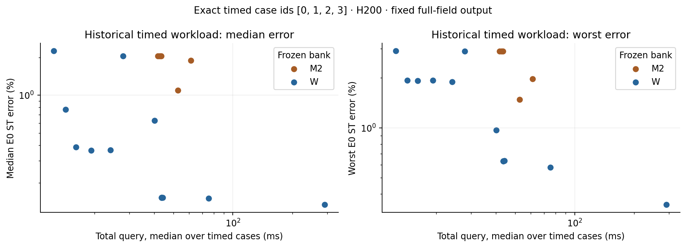
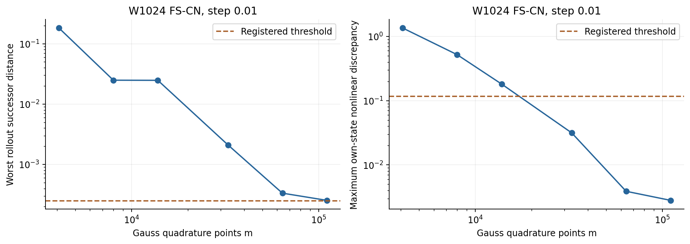
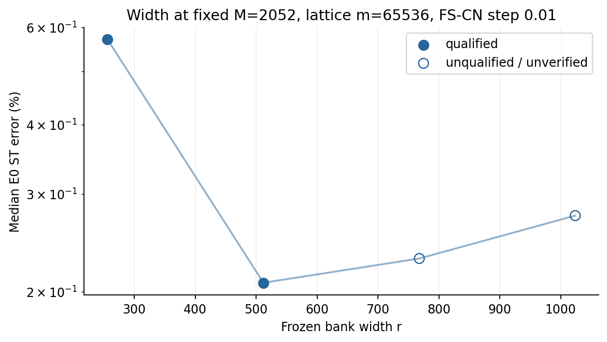
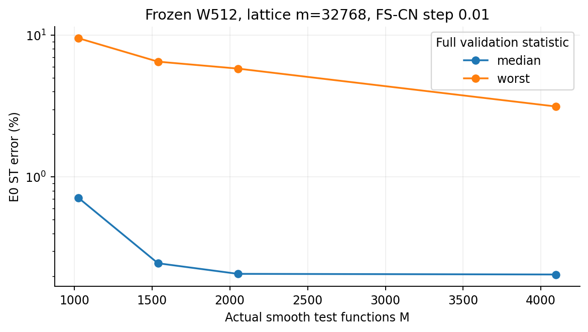
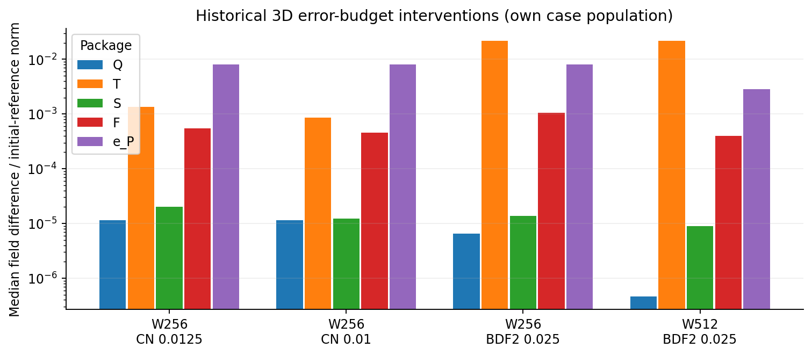
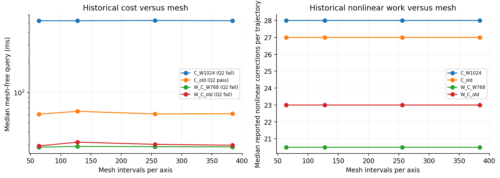
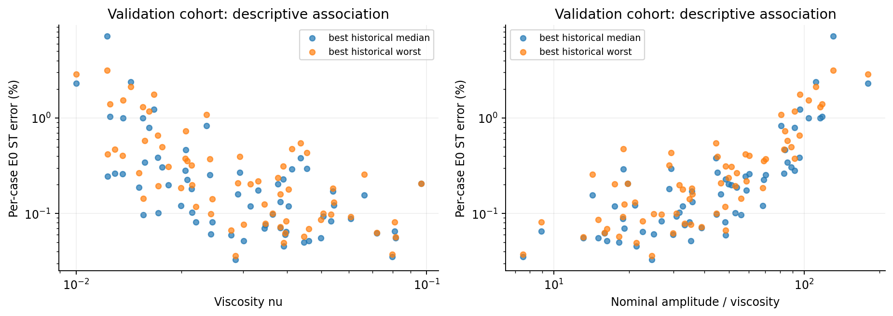
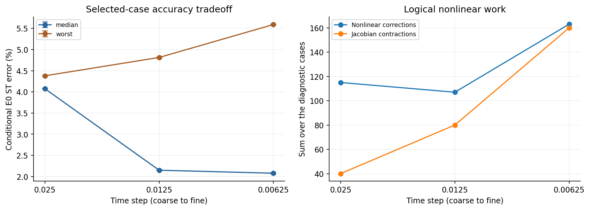

# Burgers 3D refinement: recovered evidence, numerical gaps and controlled replays

This report reconciles existing evidence and the bounded refinement campaign. The historical
numbers are conditional estimates against approved E0 ST references; new numerical results
are accepted only with their independent audit status. This generated version does not
promote missing or subset evidence into full-validation qualification.

## Problem and experimental controls

The problem is scalar viscous Burgers flow on the unit cube with zero boundary values.
The existing initial fields contain smooth Gaussian bumps with varying positions, widths,
amplitudes and viscosity. The frozen spatial bank represents the field using a short vector
of coefficients; these comparisons use linear bank prefixes, not a deployed nonlinear head.
The solver minimises the PDE residual tested against smooth spatial functions.

The independent controls separate bank width, test-space size, quadrature, nonlinear work
and time integration. They reuse existing trained banks and valid trajectories. Numerical
design, code/small controls, exact job manifests and interpretation pass separate independent
review gates. Failed controls remain in the ledger. The output contract and exact population
travel with each result; the common scoring schedule has
6 fields through time 0.25
on the 63^3 interior, x slowest lattice.

### Which equations are actually being measured

The inherited bank kernel combines analytic continuum advection with mesh-dependent discrete
diffusion and discrete test moments. In the quadrature term,

$$
\mathcal{N}_q(c)=P_q^\top\big[(B_qc)\odot(D_qc)\big],\qquad
(\Lambda_N)_{\mathbf{k},\mathbf{k}}=
4(N-1)^2\sum_{d=1}^{3}\sin^2\!\left(\frac{\pi k_d}{2(N-1)}\right).
$$

Here $B_q$ evaluates the frozen bank, $D_q$ its analytic directional derivative, $P_q$ the
weighted tests, and $\Lambda_N$ supplies the discrete diffusion eigenvalues. The weak residual
uses $\mathcal{N}_q(c)+\nu\Lambda_NA_Nc$, with $A_N$ the mesh-derived test moments. $N$ denotes
nodes per axis here; historical plots using intervals have $L=N-1$.

This archived formulation deviates from the general FOM-exact upwind rule in `AGENTS.md`.
The campaign preserves it to reconcile the actual historical method; it does not silently
substitute an upwind operator. POD's central finite-difference residual and the spectral full
solver use different discretizations. Their common E0 ST error permits an empirical accuracy–cost
comparison, but not a claim of identical discrete equations. Q1/Q2 certify the stated reduced
solve and its quadrature, not PDE or spatial consistency. Changing $N$ also changes test moments,
projection, Gram matrices and normalization; a composite mesh replay cannot isolate diffusion
or advection bias by itself. Any alternative operator is a separately named diagnostic control.

## Recovered state

The current experimental base is `93f399faad67f94ea2b56fe25f13003143e64694`. The inventory contains
684 speed-screening summary records, 390 detailed dimension-study records
and 62 later quadrature-round records, plus 2930 scored
observations and 143571 per-case records. These are different record types,
not a count of independent trained models or newly run experiments.

The nominal-width export reports 83 qualified entries;
the detailed configuration map contains 93; its broader qualified union
contains 101. Explicit test-space variants and later round-only
candidates explain why a single unlabelled count loses evidence. Raw score/coefficient case
ids are checked; intended registered populations are not reconstructed for every old schema.
The inventory exposes unknown fields and unsupported supporting schemas explicitly.

### Reference population and uncertainty

| Cohort | ST eligible / stored | Conditional uncertainty range | Selection allowed |
| --- | --- | --- | --- |
| dev4 | 4/4 | 1.37861e-05–9.15484e-05 | True |
| test32 | 32/32 | 1.15645e-05–0.000102639 | False |
| val64 | 64/64 | 8.91068e-06–0.000115885 | True |

Only development and validation populations can inform selection. Historical test observations
remain replication evidence. Sealed and reserved out-of-distribution cohorts remain closed.
Reference uncertainty is a conditional Richardson estimate, not a rigorous error bound.

### There is no single strongest bank configuration

| Purpose | Qualified historical setting | Median error (%) | Worst error (%) |
| --- | --- | --- | --- |
| Best observed median | `W768\|gl40\|fs\|CN\|0.01\|K1` | 0.157965 | 7.16593 |
| Best observed worst | `W512k8\|lat16384\|fs\|CN\|0.01\|K1` | 0.205405 | 3.13723 |

These full-validation figures select different objectives. A low median can coexist with a
large error on a difficult case. The test-space-expanded setting retains its explicit name;
it is not silently pooled with a nominal test-space configuration.

## Historical cost and accuracy on the exact saved timing workload

The timing-job coefficients were re-decoded directly with a NumPy evaluator and scored
against the approved reference fields. Its exact case ids are [0, 1, 2, 3]; it is
a historical workload, not the full validation population. All original timing repetitions,
payload identity links and source hashes are retained. Its timing source is job
`6056422` on `NVIDIA H200`. Costs include mesh input projection, reduced
evolution and full-field output under that job's query contract; diagnostic certification
and offline setup are not query work.

| Setting | Median full query (ms) | Median error (%) | Worst error (%) | Cases above 1% error |
| --- | --- | --- | --- | --- |
| `W256\|lat8192\|qn\|BDF2\|0.025\|k4` | 12.46 | 2.2531 | 2.9126 | 4 |
| `W256\|gl24\|qn\|CN\|0.025\|k4` | 14.26 | 0.76661 | 1.9338 | 1 |
| `W256\|gl24\|fs\|CN\|0.0125\|K1` | 16.11 | 0.38643 | 1.9268 | 1 |
| `W256\|gl24\|fs\|CN\|0.01\|K1` | 19.22 | 0.36431 | 1.934 | 1 |
| `W256M2052\|lat16384\|fs\|CN\|0.01\|K1` | 24.05 | 0.3649 | 1.8979 | 1 |
| `W512\|lat16384\|qn\|BDF2\|0.025\|k4` | 27.88 | 2.0546 | 2.9023 | 4 |
| `W512\|lat32768\|qn\|CN\|0.025\|k4` | 40.23 | 0.62926 | 0.97058 | 0 |
| `M2_512\|gl32\|qn\|BDF2\|0.025\|k4` | 41.8 | 2.0546 | 2.9024 | 4 |
| `M2_512\|lat32768\|qn\|BDF2\|0.025\|k4` | 42.66 | 2.0546 | 2.9024 | 4 |
| `M2_512\|gl32\|qn\|BDF2\|0.025\|kinf` | 43.42 | 2.0546 | 2.9024 | 4 |
| `W512\|lat16384s2\|fs\|CN\|0.01\|K1` | 43.56 | 0.15233 | 0.63143 | 0 |
| `W512\|lat16384s1\|fs\|CN\|0.01\|K1` | 43.6 | 0.15233 | 0.63029 | 0 |
| `W512\|lat16384s4\|fs\|CN\|0.01\|K1` | 43.62 | 0.15233 | 0.63079 | 0 |
| `W512\|lat16384s3\|fs\|CN\|0.01\|K1` | 44.11 | 0.15233 | 0.6329 | 0 |
| `M2_512\|gl32\|qn\|BDF2\|0.016666667\|k4` | 52.71 | 1.093 | 1.4818 | 3 |
| `M2_512\|gl32\|fs\|BE\|0.01\|K1` | 61.35 | 1.8884 | 1.9768 | 4 |
| `W512k8\|lat16384\|fs\|CN\|0.01\|K1` | 75.35 | 0.15095 | 0.57893 | 0 |
| `W768\|gl40\|fs\|CN\|0.01\|K1` | 291 | 0.13441 | 0.3448 | 0 |

The full-validation accuracy and this timed subset are displayed separately. Combining the
former with the latter would hide the population difference and is not used as a new frontier.

## What the existing controls already distinguish

Wide-bank fixed-sweep CN can pass nonlinear qualification while failing quadrature successor
agreement. Wide-bank large-step QN-BDF2 can instead pass quadrature but fail every-case
distance to a verified tight solve. Pooled stationarity alone can miss a small number of
important failed steps. Trust clipping is an observed counter; it is not by itself a cause.

A failed numerical certificate does not establish the dominant physical error source.
For example, the historical wide-bank Gauss rule above has successor distance
0.0002534882 while its worst conditional
E0 error is 5.565055 percent. Closing that
certificate alone need not remove the much larger physical error. The reported Jacobian
condition number below concerns one failed step, not the conditioning of the whole family.

Restarting from coefficient history resets the historical QN cache. Fresh-restart controls
are labelled separately; full-trajectory one-factor controls assess refresh-policy changes.
The completed quadrature trajectories are reused, and only missing successor evidence is run.

Open markers retain failed or unverified qualification. A decreasing raw error is not enough
to claim a qualified width dial. The square test-space control failed historically, so the
original registered causal test-space verdict remains blocked even where expansion helped.

| Setting | Actual M | Quadrature m | Q1 | Q2 | Median error (%) | Worst error (%) |
| --- | --- | --- | --- | --- | --- | --- |
| `W512k2\|lat32768\|fs\|CN\|0.01\|K1` | 1027 | 32768 | True | pass | 0.712108 | 9.50395 |
| `W512k3\|lat32768\|fs\|CN\|0.01\|K1` | 1538 | 32768 | True | pass | 0.246515 | 6.49841 |
| `W512\|lat32768\|fs\|CN\|0.01\|K1` | 2052 | 32768 | True | pass | 0.207557 | 5.80448 |
| `W512k8\|lat32768\|fs\|CN\|0.01\|K1` | 4097 | 32768 | True | pass | 0.205405 | 3.13769 |

This is a descriptive comparison of existing qualified settings at fixed bank width,
quadrature and integration. Increasing the test space changes worst-case error much more
than the median in the upper part of this tested range. It does not change the earlier
registered verdict whose square-system control failed, and it does not claim that still
larger test spaces must improve the result.

Each bar is a median intervention distance on that member's own cases. The packages interact;
these bars are not additive contributions to total error. The representation floor and
time-discretisation package bind in different settings. The archived cohort limits remain.

## Mesh and input-regime dependence

This mesh panel uses the mesh-free input/scoring-lattice contract and the historical deployment
mode policy, which may change the test list with the mesh. It establishes neither fixed-M
cost nor full-field output cost. Only the appropriately qualified curves support numerical
claims at their tested reference mesh; there is no all-mesh Q2 join here. Failed curves remain visible. Full output and arbitrary mesh-sampled input
must be measured separately. Historical Jacobian counts are not reconstructed from iteration
counts where the original counter is absent.

The regime plot uses only the existing validation population and the same E0 reference.
Amplitude divided by viscosity is a nominal steepness proxy. These associations are not
one-factor causal tests and do not qualify new steep-front or viscosity-extrapolation regimes.
The earlier two-dimensional steep-front failures cannot be silently promoted to 3D results.

| Qualified historical setting | Spearman(error, viscosity) | Spearman(error, nominal steepness) | Cases above 1% error | Largest-error case ids |
| --- | --- | --- | --- | --- |
| `W768\|gl40\|fs\|CN\|0.01\|K1` | -0.601 | 0.7763 | 5 | 5, 30, 43 |
| `W512k8\|lat16384\|fs\|CN\|0.01\|K1` | -0.6665 | 0.7732 | 9 | 5, 43, 30 |

These rank correlations are descriptive on the same validation cases, without a family-wise
inference claim. Viscosity, amplitude and family shape vary together, so they do not identify
a separate causal effect of viscosity or front steepness.

## Three different comparisons

The historical confirmed ROM-to-ROM comparisons are:

The common selected winner is `M2_512|gl32|qn|BDF2|0.016666667|k4`. Its confirmation timing
source is job `6071041` on `NVIDIA H200`:
case ids [0, 1, 2, 3, 4, 5, 6, 7], 3 repetitions per case,
under the full-field mesh-path query at the historical reference mesh. These are historical
paired workload ratios, not the four-case re-scored timing curve or new full-validation times.

| Earlier comparator | Speed ratio | Comparator Q2 | Qualification scope |
| --- | --- | --- | --- |
| C_old | 1.1491 | pass | qualified vs qualified comparator |
| C_W768 | 2.9528 | pass | qualified vs qualified comparator |
| C_W1024 | 9.8741 | fail | qualified configuration vs the deployed (unqualified) comparator |

They do not establish improvement over POD or a full solver. The historical POD headline
of 7/9 dominated pooled 5
diagnostic bank rows with 4 qualified bank rows. In the qualified subset,
2/4 were dominated and
2 neutral conclusions were withheld. Its hyper-reduction convergence was reported
rather than gated. Its measured accuracy/cost evidence is retained, with this qualification
gap stated explicitly. The new comparator lane tests the saved supports against the complete
unsampled reduced objective before any qualified comparison.

The earlier spectral result remains evidence against a general bank speed advantage on the
box. No new speed ratio versus a spectral or finite-difference solver is inferred from these
different jobs, outputs or populations. A repaired solver must face the same accuracy,
output and hardware contract, and POD receives the same numerical improvements.

## New bounded experiment results

### Solver lane

Audit/status: `diagnostic subset; consult per-job independent audit verdicts`. Scope: validation diagnostics; no new frontier or comparator win claim.

| Job | Bank/policy | Case ids | Uncertified steps | Corrections | Median/worst error (%) | Max distance to tight | Raw median query (ms) |
| --- | --- | --- | --- | --- | --- | --- | --- |
| 6525183 | W1024/baseline | 30 | 1 | 54 | 3.90066/3.90066 | not measured | 218.96 |
| 6525183 | W1024/extra | 30 | 0 | 90 | 3.90066/3.90066 | not measured | 290.64 |
| 6525183 | W1024/refresh | 30 | 0 | 29 | 3.90068/3.90068 | not measured | 227.05 |
| 6525183 | W1024/strict | 30 | 0 | 89 | 3.90067/3.90067 | not measured | 300.03 |
| 6525183 | W1024/trust | 30 | 1 | 52 | 3.90066/3.90066 | not measured | 216.1 |
| 6525518 | W1024/baseline | 0, 5, 30, 43 | 2 | 212 | 4.07438/4.37566 | 0.00352637 | 221.33 |
| 6525518 | W1024/extra | 0, 5, 30, 43 | 0 | 258 | 4.07439/4.3741 | 0.00027021 | 235.35 |
| 6525518 | W1024/refresh | 0, 5, 30, 43 | 0 | 115 | 4.07483/4.38171 | 0.000127613 | 227.43 |
| 6525518 | W1024/strict | 0, 5, 30, 43 | 0 | 315 | 4.07491/4.38128 | 1.23448e-06 | 299.39 |
| 6525518 | W1024/trust | 0, 5, 30, 43 | 2 | 207 | 4.0742/4.37316 | 0.00839284 | 216.85 |
| 6525518 | W768/baseline | 0, 5, 30, 43 | 4 | 213 | 4.12199/4.98934 | 0.0020291 | 153.37 |
| 6525518 | W768/extra | 0, 5, 30, 43 | 0 | 274 | 4.11957/4.99185 | 0.000171652 | 183.6 |
| 6525518 | W768/refresh | 0, 5, 30, 43 | 0 | 107 | 4.11866/5.00211 | 0.000112688 | 147.77 |
| 6525518 | W768/strict | 0, 5, 30, 43 | 0 | 312 | 4.11925/4.99804 | 6.51417e-08 | 208.29 |
| 6525518 | W768/trust | 0, 5, 30, 43 | 6 | 213 | 4.12118/4.98574 | 0.00270987 | 153.42 |

These are selected-case diagnostics. A repaired certificate is not a full-trajectory Q1 pass or a physical-accuracy improvement. Raw timings do not establish comparative speed without the declared paired acceptance checks.

At `W1024|case30|step7`, the returned Jacobian condition number is 10.8825. The fresh tight solve uses 3 iterations with reported stationarity 3.02833e-09; its field distance to the returned baseline step is 0.00344831. Independent anchor usable: True. This is a fresh restart from identical coefficient history, not restoration of the original cached solver state.

At `W768|case0|step4`, the returned Jacobian condition number is 8.59155. The fresh tight solve uses 3 iterations with reported stationarity 9.22023e-11; its field distance to the returned baseline step is 1.41901e-05. Independent anchor usable: True. This is a fresh restart from identical coefficient history, not restoration of the original cached solver state.

At `W768|case5|step3`, the returned Jacobian condition number is 9.00884. The fresh tight solve uses 3 iterations with reported stationarity 7.94904e-10; its field distance to the returned baseline step is 0.00202411. Independent anchor usable: True. This is a fresh restart from identical coefficient history, not restoration of the original cached solver state.

At `W768|case30|step3`, the returned Jacobian condition number is 8.58907. The fresh tight solve uses 3 iterations with reported stationarity 6.157e-10; its field distance to the returned baseline step is 0.0006801. Independent anchor usable: True. This is a fresh restart from identical coefficient history, not restoration of the original cached solver state.

At `W768|case43|step6`, the returned Jacobian condition number is 8.67436. The fresh tight solve uses 3 iterations with reported stationarity 4.21553e-08; its field distance to the returned baseline step is 0.000789213. Independent anchor usable: True. This is a fresh restart from identical coefficient history, not restoration of the original cached solver state.

At `W768|case43|step9`, the returned Jacobian condition number is 8.43733. The fresh tight solve uses 4 iterations with reported stationarity 1.04262e-09; its field distance to the returned baseline step is 0.00065403. Independent anchor usable: True. This is a fresh restart from identical coefficient history, not restoration of the original cached solver state.

At `W1024|case0|step6`, the returned Jacobian condition number is 10.8041. The fresh tight solve uses 3 iterations with reported stationarity 2.04597e-10; its field distance to the returned baseline step is 3.32992e-05. Independent anchor usable: True. This is a fresh restart from identical coefficient history, not restoration of the original cached solver state.

At `W1024|case5|step7`, the returned Jacobian condition number is 11.7011. The fresh tight solve uses 3 iterations with reported stationarity 1.41204e-08; its field distance to the returned baseline step is 0.000175342. Independent anchor usable: True. This is a fresh restart from identical coefficient history, not restoration of the original cached solver state.

At `W1024|case30|step7`, the returned Jacobian condition number is 10.8825. The fresh tight solve uses 3 iterations with reported stationarity 3.02833e-09; its field distance to the returned baseline step is 0.00344831. Independent anchor usable: True. This is a fresh restart from identical coefficient history, not restoration of the original cached solver state.

At `W1024|case43|step3`, the returned Jacobian condition number is 12.2756. The fresh tight solve uses 3 iterations with reported stationarity 9.45622e-10; its field distance to the returned baseline step is 0.000120146. Independent anchor usable: True. This is a fresh restart from identical coefficient history, not restoration of the original cached solver state.

The following re-analysis reuses saved full-validation trajectories. Quadrature discrepancies persist with verified tight nonlinear solves, so fixed-sweep work alone does not explain them.

| Nonlinear solve | Quadrature transition | Cases | Median distance | Maximum distance | Largest case | Cases over registered threshold |
| --- | --- | --- | --- | --- | --- | --- |
| fs\|CN\|0.01\|K1 | gl40 to gl48 | 64 | 3.824666e-07 | 0.0003336785 | 5 | 1 |
| fs\|CN\|0.01\|K1 | gl48 to gl56 | 64 | 2.417363e-08 | 0.0002534882 | 5 | 1 |
| fs\|CN\|0.01\|K1 | gl56 to gl64 | 64 | 2.005211e-09 | 0.0001683932 | 5 | 0 |
| ad\|LSPG\|CN\|0.01\|tight | gl40 to gl48 | 64 | 3.82482e-07 | 0.0003297562 | 5 | 1 |
| ad\|LSPG\|CN\|0.01\|tight | gl48 to gl56 | 64 | 2.439895e-08 | 0.0002506383 | 5 | 1 |
| ad\|LSPG\|CN\|0.01\|tight | gl56 to gl64 | 64 | 1.999782e-09 | 0.0001666505 | 5 | 0 |

The missing inherited finer-rule check now covers the original case ids [0, 1, 2, 3, 4, 5, 6, 7], with maximum successor distance 4.017088e-05, maximum own-state rho 0.000455362, and 1/200 fresh uncertified fine-rule steps. The independently approved join to the saved complete-population target/successor evidence closes the legacy `W1024|gl56|fs|CN|0.01|K1` qualification. It does not qualify the finest rule as a new deployment or improve physical accuracy. Historical inventory status counts above retain their original pre-campaign scope.

#### Time refinement: median and worst trade off

These selected-case diagnostics hold bank, test space and target quadrature fixed. All displayed settings pass their subset nonlinear and own-state quadrature controls. Finer steps improve the median while worsening the worst case; neither a general accuracy improvement nor a general failure describes this tradeoff. The intervals are propagated conditional reference uncertainties, not statistical confidence intervals.

| Step size | Case ids | Median error (%) | Conditional median interval (%) | Worst error (%) | Corrections (sum) | Jacobian contractions (sum) | Uncertified steps | Subset controls pass |
| --- | --- | --- | --- | --- | --- | --- | --- | --- |
| 0.025 | 0, 5, 30, 43 | 4.07488 | 4.065171–4.084589 | 4.379058 | 115 | 40 | 0/40 | True |
| 0.0125 | 0, 5, 30, 43 | 2.149897 | 2.140188–2.159607 | 4.812683 | 107 | 80 | 0/80 | True |
| 0.00625 | 0, 5, 30, 43 | 2.079269 | 2.06956–2.088979 | 5.59007 | 163 | 160 | 0/160 | True |

Endpoint selection is explicitly post-diagnostic: coarse0.025 repaired policy plus finest0.00625 best-tested-median representative, each conditional on own full64 Q1/Q2. Median and worst trade off. These two final temporal endpoints do not exhaust the tested diagnostic tradeoff or the temporal frontier. No warmed production timings in D-T. First-compile anchor seconds are not deployment costs. The earlier proposed worst-only rejection rule was not in the staged design and was abandoned. Error cancellation is a hypothesis; this time-step control alone does not identify a spatial, operator or representation cause.

Machine export and hashed raw evidence: `/home/tahmid/Dev/Tunable-NM-ROM-Claude/worktrees/2026-10-26-b3d-refine/reports/2026-10-26-burgers3d-refinement/data/lane-solver-export.json`. No cross-job speed-up is inferred.

### Pod lane

Audit/status: `READY_FOR_DIAGNOSTIC_PUBLICATION`. Scope: diagnostic selected validation subset; not a full-population accuracy/cost frontier.

| Frozen support | Maximum full-gradient discrepancy | Full-objective uncertified steps | New HR admission |
| --- | --- | --- | --- |
| k8 | 0.01542368 | 60/60 | False |
| k16 | 0.001233156 | 6/60 | False |

| Validation case | k8 to k16 distance | k16 to no-HR distance | k8 to no-HR distance |
| --- | --- | --- | --- |
| 0 | 0.001788379 | 0.000132795 | 0.001785279 |
| 5 | 0.003440759 | 0.0003461965 | 0.00366978 |
| 30 | 0.0028835 | 0.0002130666 | 0.002896786 |
| 43 | 0.002307133 | 0.0001234245 | 0.002315305 |

These failures disqualify the frozen supports under the new conservative whole-objective contract. They do not establish that the bank beats POD. The post-completion printing failure and recovered checkpoint are retained in the execution record.

The unsampled POD fallback has audit status `READY_QUALIFIED_FULL_RESIDUAL_POD_NOT_HR` on 64 validation cases: Q1=True, 0/960 uncertified steps, 1.095917% median and 3.220848% worst conditional E0 error, with 36 cases above one percent. Maximum production-to-tight distance 0.0002255415. It is a qualified full-residual reduced model, not a qualified hyper-reduced model. Its separate allocation is not used for cross-method timing ratios; the common frontier gives POD the same integration improvements.

The sole larger-support construction has audit status `READY_FAILED_FROZEN_FIT`. It stopped with 13673 active points against its fixed target 16384; the off-support optimality gradient was 2.155729e-07 against tolerance 1.017052e-08, and 3.35388% of candidate points were banned against a 1% cap. The allocation completed normally after 3312 seconds (0.92 GPU-hours); this was not a time-budget exhaustion. No larger support was admitted, and no rollout validation of it ran. The permitted greedy path exhausted admissible choices under its fixed policy; this does not prove that no valid larger support exists. The frozen stop rule ends the support search. Qualified hyper-reduced POD comparison remains open; the construction failure is not evidence that POD loses.

Machine export and hashed raw evidence: `/home/tahmid/Dev/Tunable-NM-ROM-Claude/worktrees/2026-10-26-b3d-refine/reports/2026-10-26-burgers3d-refinement/data/lane-pod-export.json`. No cross-job speed-up is inferred.

## Completed, failed, deferred and open

- Completed recovery: canonical fork, separate historical populations/references, explicit
  qualification scopes, source hashes, saved coefficients and timing repetition evidence.
- Completed analysis: exact historical timed-workload re-scoring and generated scientific plots.
- Failed historical controls remain visible: under-resolved quadrature, incomplete nonlinear
  convergence and square test-space controls; post-hoc selections and retracted combined
  selection claims remain labelled in the source inventory.
- Numerical diagnostics and any frozen full-validation follow-up retain independent design,
  code, job and results gates. See lane exports and the job ledger for current completion.
- Deferred until supported: a qualified full-population repaired frontier, qualified POD
  hyper-reduction comparison, paired fastest-full-solver comparisons, fixed-mode scaling of
  a repaired candidate and separate full-field output/offline costs.
- No bank retraining, sealed-cohort opening or branch merge is implied.

## Reproduction and provenance

Run `inventory.py`, `rescore_timing.py`, then `make_report.py` with the repository's absolute
Python environment. These analysis scripts use CPU NumPy and saved trajectories. They do
not rerun the historical solver grid. `data/SOURCES.json` pins historical sources;
`PROVENANCE.json` pins this report's direct inputs, and `VALUES.json` retains extracted
numbers and figure inputs. Compressed inventory and per-case JSON lines are backed up on
the prescribed code-only mirror. Full numerical reruns use each lane's frozen manifest.

## Plain-language glossary

- Bank: frozen spatial functions that turn a short vector into a field; r is their count.
- M: number of smooth functions used to test the PDE; m: number of integration points.
- N / L: nodes per mesh axis / intervals per axis, with $L=N-1$.
- $B_q$, $D_q$, $P_q$: bank values, analytic directional derivatives, and weighted test values at quadrature points.
- $A_N$, $\Lambda_N$, $c$, $\nu$: mesh test moments, discrete diffusion eigenvalues, reduced coefficients, and viscosity.
- W512k8: a width-512 bank with approximately eight tests per coefficient, including mode-shell completion.
- POD k8/k16: support targets of eight/sixteen sampled residual rows per POD coefficient; these are not test-space labels.
- Gauss / gl / lattice / lat: tensor Gauss–Legendre rules / their short label / a rank-one integration point set / its short label.
- Mesh intervals: divisions along each spatial axis; nodes include the two boundary endpoints.
- E0 ST: approved space/time-refined reference; its uncertainty is conditional on convergence assumptions.
- Error: largest output-time field difference divided by the reference initial-field norm.
- Median / worst: middle / largest case error; they answer different accuracy questions.
- Outlier count: number of cases exceeding the table's stated error threshold.
- Full query: input projection, reduced time evolution and requested output decoding.
- Q1: nonlinear-solver validity, stationarity and agreement with tighter solves.
- Q2: quadrature successor and own-state nonlinear agreement, with the finer rule checked too.
- Qualified: satisfies both checks on the required population; unknown evidence is not a pass.
- CN / BDF2 / BE: Crank–Nicolson / second-order backward differentiation / backward Euler.
- FS / QN: fixed full-Jacobian correction sweeps / a solver that reuses its small normal matrix.
- Jacobian: derivative of the reduced residual; stationarity measures whether further correction remains.
- Trust radius / damping: controls on correction size / regularisation of a nonlinear correction.
- Baseline / extra / refresh / trust / strict: original solver / larger correction budget with unchanged slow-refresh trigger / matrix refreshed each step / larger trust radius / tighter internal stopping.
- POD / ECSW: a standard linear reduced basis / weighted sampling of its residual equations.
- Support / active points: integration points whose fitted weights are positive.
- NNLS / optimality check: fitting nonnegative weights / checking whether a permitted weight change could still improve that fit.
- Banned points: candidates excluded by the greedy fit's fixed drop/ban policy; an excessive banned fraction fails its quality check.
- No-HR: evaluate the complete reduced objective without weighted spatial sampling.
- Frontier: settings that no other admissible setting beats in both cost and the chosen error metric.
- Diagnostic subset: selected cases for explaining a failure, not a whole-population performance estimate.
- Post hoc / retracted: selected after observing data / no longer an accepted earlier claim.
- Spearman correlation: association between the ranks of two quantities; not a causal effect.
- Q/T/S/F/e_P: quadrature / time / nonlinear solve / reduced-form intervention / representation floor.
- Mesh-free: use method-specific input and output points; full-field output requests every mesh value.
- Conditional / provisional: valid only with stated numerical assumptions / awaiting required evidence.
