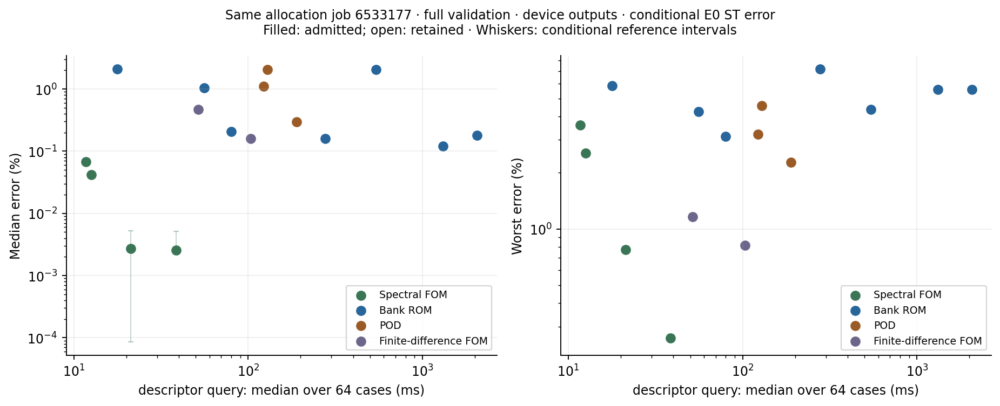
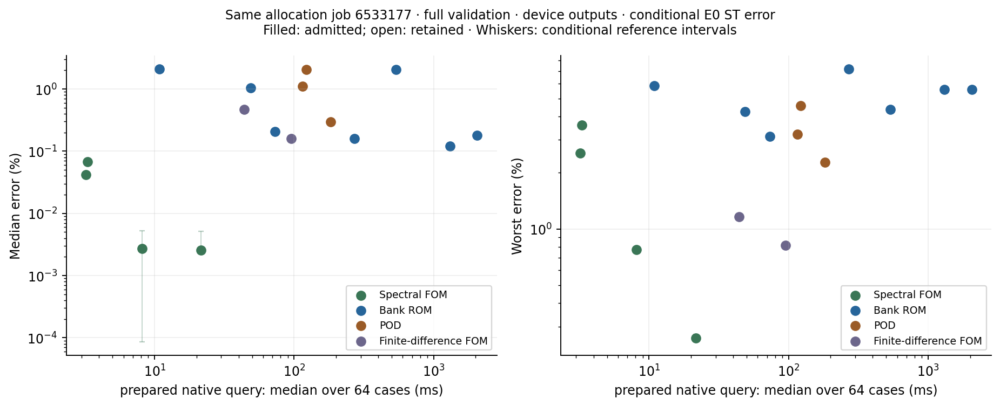
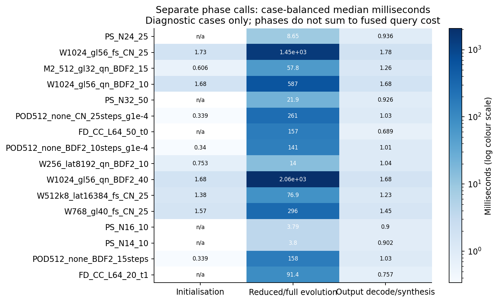
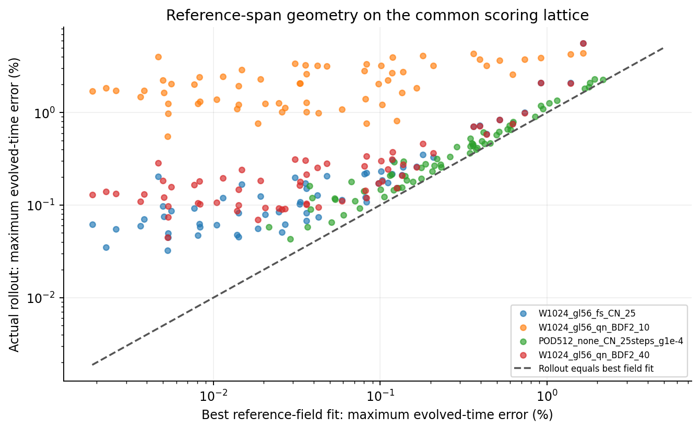
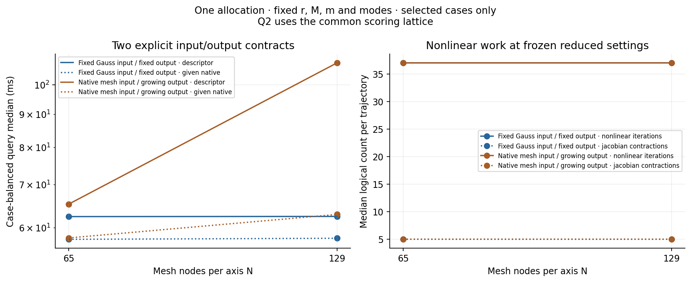
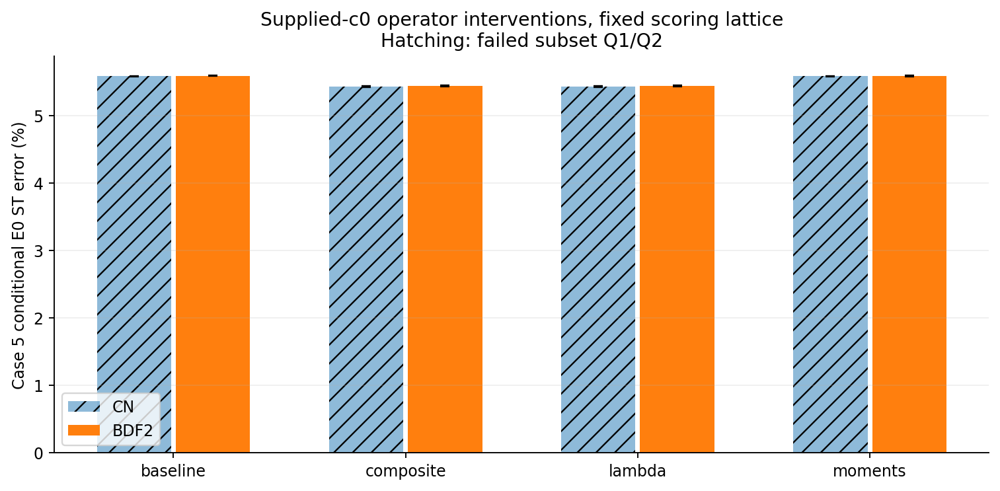
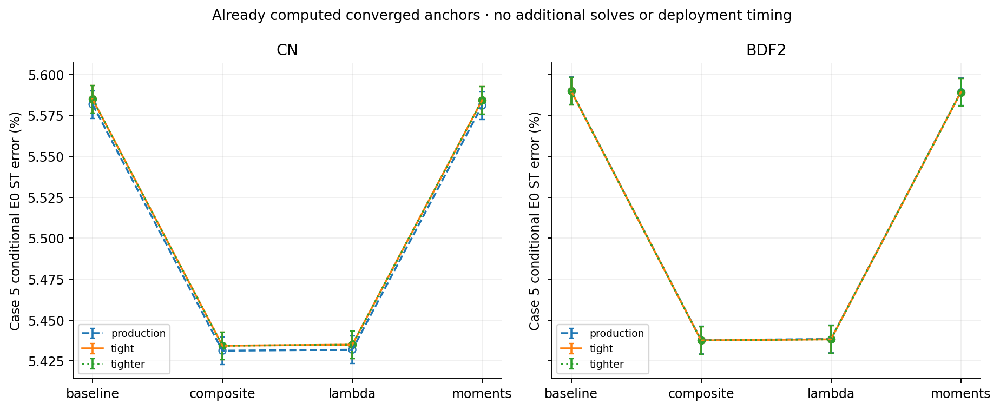

# Burgers 3D refinement: recovered evidence, numerical gaps and controlled replays

Status: Final numerical results for the bounded tested set; remaining scientific gaps are explicitly scoped.
This report reconciles existing evidence and the bounded refinement campaign. The historical
numbers are conditional estimates against approved E0 ST references; new numerical results
are accepted only with their independent audit status. This generated version does not
promote missing or subset evidence into full-validation qualification.

## What the bounded campaign establishes

All 16 admitted subjects below retain complete error and descriptor-cost coverage. Admission certifies the registered numerical checks; it is not a physical-accuracy target.

**Every tested admitted bank setting has a faster jointly accuracy-matching spectral comparator.** Across these 7 bank settings, observed descriptor-query speed ratios range from 1.517 to 176.1. Matching requires both competitor upper conditional median/worst errors to lie below the corresponding bank lower errors. This is a same-allocation result on the frozen box/cohort and finite tested set.

The refreshed-QN endpoints close their declared solver/quadrature checks. Their complete-validation accuracy and cost are:

| Refreshed bank endpoint | Median error (%) | Worst error (%) | Cases above 1% | Descriptor query (ms) |
| --- | --- | --- | --- | --- |
| W1024_gl56_qn_BDF2_10 | 2.037381 | 4.379058 | 58 | 542.4389 |
| W1024_gl56_qn_BDF2_40 | 0.1799691 | 5.59007 | 3 | 2062.755 |

Neither tested endpoint simultaneously improves resolved median error, resolved worst error and measured query cost over any tested earlier bank setting. Refinement improves the median while worsening the worst case and increasing cost. The intermediate time setting has selected-case evidence only and is not silently discarded.

The 3 admitted POD subjects evaluate the unsampled full residual. Their finite-schedule matches are distinct from earlier-bank improvements and from the faster full-solver matches. The unresolved hyper-reduced-POD gate is not evidence of a bank advantage. Detailed matching tables and projection/operator controls follow.

## Problem and experimental controls

The problem is scalar viscous Burgers flow on the unit cube with zero boundary values.
The existing initial fields contain smooth Gaussian bumps with varying positions, widths,
amplitudes and viscosity. The frozen spatial bank represents the field using a short vector
of coefficients; these comparisons use linear bank prefixes, not a deployed nonlinear head.
The bank solver minimises the PDE residual tested against smooth spatial functions.

The controls examine bank width, test-space size, quadrature, nonlinear work
and time integration, with coupled changes stated explicitly. They reuse existing trained banks and valid trajectories. Numerical
design, code/small controls, exact job manifests and interpretation pass separate independent
review gates. Failed controls remain in the ledger. The output contract and exact population
travel with each result; the common scoring schedule has
6 fields through time 0.25
on the 63^3 interior, x slowest lattice.

### Which equations are actually being measured

The inherited bank kernel combines analytic continuum advection with mesh-dependent discrete
diffusion and discrete test moments. In the quadrature term,

$$
\mathcal{N}_q(c)=P_q^\top\big[(B_qc)\odot(D_qc)\big],\qquad
(\Lambda_N)_{\mathbf{k},\mathbf{k}}=
4(N-1)^2\sum_{d=1}^{3}\sin^2\!\left(\frac{\pi k_d}{2(N-1)}\right).
$$

Here $B_q$ evaluates the frozen bank, $D_q$ its analytic directional derivative, $P_q$ the
weighted tests, and $\Lambda_N$ supplies the discrete diffusion eigenvalues. The weak residual
uses $\mathcal{N}_q(c)+\nu\Lambda_NA_Nc$, with $A_N$ the mesh-derived test moments. $N$ denotes
nodes per axis here; historical plots using intervals have $L=N-1$.

The weak least-squares objective also has the inherited diagonal mode weights

$$
S_{\Delta t,\nu,\Lambda}=
\operatorname{diag}\!\left((a_0+\Delta t\,b_0\,\nu\,\lambda_{\mathbf{k}})^{-1}\right),
$$

where $a_0,b_0$ are coefficients of the time scheme. Changing the time step or diffusion
eigenvalues changes these weights as well as the time-discrete residual and test directions.
The measured time-step and eigenvalue interventions are method packages; even verified solves
do not isolate pure temporal truncation or physical diffusion bias from those weighting effects.

This archived formulation deviates from the general FOM-exact upwind rule in `AGENTS.md`.
The campaign preserves it to reconcile the actual historical method; it does not silently
substitute an upwind operator. POD's central finite-difference residual and the spectral full
solver use different discretizations. Their common E0 ST error permits an empirical accuracy–cost
comparison, but not a claim of identical discrete equations. Q1/Q2 certify the stated reduced
solve and its quadrature, not PDE or spatial consistency. Changing $N$ also changes test moments,
projection, Gram matrices and normalization; a composite mesh replay cannot isolate diffusion
or advection bias by itself. Any alternative operator is a separately named diagnostic control.

Unsampled POD restricts the trial state to its frozen span, $u=\Phi c$, and minimises
the full central finite-difference residual norm, $\|R_h(\Phi c)\|^2$. The residual
is not first projected by $\Phi^\top$. ECSW samples and weights that full residual.
Inherited metadata describing a residual projected onto the POD basis should be read with
this correction; the numerical kernels and archived results remain unchanged.

## Recovered state

The current experimental base is `93f399faad67f94ea2b56fe25f13003143e64694`. The inventory contains
684 speed-screening summary records, 390 detailed dimension-study records
and 62 later quadrature-round records, plus 2930 scored
observations and 143571 per-case records. These are different record types,
not a count of independent trained models or newly run experiments.

The nominal-width export reports 83 qualified entries;
the detailed configuration map contains 93; its broader qualified union
contains 101. Explicit test-space variants and later round-only
candidates explain why a single unlabelled count loses evidence. Raw score/coefficient case
ids are checked; intended registered populations are not reconstructed for every old schema.
The inventory exposes unknown fields and unsupported supporting schemas explicitly.

### Reference population and uncertainty

| Cohort | ST eligible / stored | Conditional uncertainty range | Selection allowed |
| --- | --- | --- | --- |
| dev4 | 4/4 | 1.37861e-05–9.15484e-05 | True |
| test32 | 32/32 | 1.15645e-05–0.000102639 | False |
| val64 | 64/64 | 8.91068e-06–0.000115885 | True |

Only development and validation populations can inform selection. Historical test observations
remain replication evidence. Sealed and reserved out-of-distribution cohorts remain closed.
Reference uncertainty is a conditional Richardson estimate, not a rigorous error bound.

The per-case score is the maximum evolved-output field discrepancy on the common scoring
lattice, divided by the fixed reference initial-field norm. Initial reconstruction is retained
separately and is not silently substituted for an evolved-output error.

### There is no single strongest bank configuration

| Purpose | Qualified historical setting | Median error (%) | Worst error (%) |
| --- | --- | --- | --- |
| Best observed median | `W768\|gl40\|fs\|CN\|0.01\|K1` | 0.157965 | 7.16593 |
| Best observed worst | `W512k8\|lat16384\|fs\|CN\|0.01\|K1` | 0.205405 | 3.13723 |

These full-validation figures select different objectives. A low median can coexist with a
large error on a difficult case. The test-space-expanded setting retains its explicit name;
it is not silently pooled with a nominal test-space configuration.

### Same-allocation full-validation frontier

The following dataset uses the complete validation population and scores the fields returned
by the same measured invocations. Query costs are case-balanced medians; timing rejection
cannot silently remove a difficult case. Missing timing coverage remains missing.
Descriptor-total is the primary cross-method contract. Prepared-native costs use different
method-specific supplied data, so those values are shown as decomposition evidence.

Frontier job **6533177**, GPU `['NVIDIA H200, GPU-fd4f0a46-c358-45d3-3aa1-bffac2aeb85e']`, source `8196120c5ade3992bacfc02379799aa00a0cf4a3`. Costs below are compared within this allocation.

| Subject | Method | Qualification status | Registered checks | Method common check | Median E0 error (%) | Worst E0 error (%) | Cases above 1% | Descriptor total (ms) | Prepared native (ms) |
| --- | --- | --- | --- | --- | --- | --- | --- | --- | --- |
| PS_N24_25 | Spectral FOM | qualified | stage-valid=True; Q2=n/a | True | 0.00272036 | 0.772672 | 0 | 21.2488 | 8.11984 |
| W1024_gl56_fs_CN_25 | Bank ROM | qualified | Q1=True; Q2=True | True | 0.120231 | 5.58172 | 4 | 1314.35 | 1308.12 |
| M2_512_gl32_qn_BDF2_15 | Bank ROM | qualified | Q1=True; Q2=True | True | 1.04467 | 4.24121 | 35 | 55.7807 | 48.6657 |
| W1024_gl56_qn_BDF2_10 | Bank ROM | qualified | Q1=True; Q2=True | True | 2.03738 | 4.37906 | 58 | 542.439 | 535.368 |
| PS_N32_50 | Spectral FOM | qualified | stage-valid=True; Q2=n/a | True | 0.0025563 | 0.260652 | 0 | 38.5696 | 21.5664 |
| POD512_none_CN_25steps_g1e-4 | POD | qualified | Q1=True; Q2=n/a | True | 0.294234 | 2.28065 | 9 | 189.718 | 182.858 |
| FD_CC_L64_50_t0 | Finite-difference FOM | qualified | stage-valid=True; Q2=n/a | True | 0.160747 | 0.817141 | 0 | 103.115 | 95.2785 |
| POD512_none_BDF2_10steps_g1e-4 | POD | qualified | Q1=True; Q2=n/a | True | 2.06358 | 4.57837 | 61 | 128.828 | 122.023 |
| W256_lat8192_qn_BDF2_10 | Bank ROM | qualified | Q1=True; Q2=True | True | 2.07876 | 5.85715 | 61 | 17.7778 | 10.857 |
| W1024_gl56_qn_BDF2_40 | Bank ROM | qualified | Q1=True; Q2=True | True | 0.179969 | 5.59007 | 3 | 2062.75 | 2056.51 |
| W512k8_lat16384_fs_CN_25 | Bank ROM | qualified | Q1=True; Q2=True | True | 0.205405 | 3.13723 | 9 | 79.8898 | 73.1825 |
| W768_gl40_fs_CN_25 | Bank ROM | qualified | Q1=True; Q2=True | True | 0.157965 | 7.16593 | 5 | 277.756 | 271.096 |
| PS_N16_10 | Spectral FOM | qualified | stage-valid=True; Q2=n/a | True | 0.0416221 | 2.55336 | 5 | 12.596 | 3.21523 |
| PS_N14_10 | Spectral FOM | qualified | stage-valid=True; Q2=n/a | True | 0.0676794 | 3.60287 | 5 | 11.7152 | 3.3026 |
| POD512_none_BDF2_15steps | POD | qualified | Q1=True; Q2=n/a | True | 1.09592 | 3.22085 | 36 | 122.437 | 115.471 |
| FD_CC_L64_20_t1 | Finite-difference FOM | qualified | stage-valid=True; Q2=n/a | True | 0.467289 | 1.1603 | 3 | 51.6004 | 43.987 |

The actual adapter settings below make the finite comparison explicit. The PS identifier's N is its sine cutoff, retaining indices below N in each axis; it is not the mesh-study node count. Further frozen parameters and source hashes remain in the dataset.

| Subject | Spatial parameters | Time discretization | Solver/work parameters | Prepared-native input shape |
| --- | --- | --- | --- | --- |
| PS_N24_25 | sine cutoff=24; coefficients=12167; oversampling intervals=36 | ETDRK4; dt=0.01 | contour points=32 | [23, 23, 23] |
| W1024_gl56_fs_CN_25 | r=1024; M=4097; m=175616 | CN; dt=0.01 | FS sweeps=1; gtol=0.001; adaptive startup steps=6; startup budget=50; trust=0.005882977 | [250047] |
| M2_512_gl32_qn_BDF2_15 | r=512; M=2052; m=32768 | BDF2; dt=0.01666666667 | QN refresh=4; g_in=0.0005; max corrections=12; trust=0.005882959 | [250047] |
| W1024_gl56_qn_BDF2_10 | r=1024; M=4097; m=175616 | BDF2; dt=0.025 | QN refresh=1; g_in=0.0005; max corrections=12; trust=0.005882977 | [250047] |
| PS_N32_50 | sine cutoff=32; coefficients=29791; oversampling intervals=48 | ETDRK4; dt=0.005 | contour points=32 | [31, 31, 31] |
| POD512_none_CN_25steps_g1e-4 | r=512; full residual at 250047 native points | CN; dt=0.01 | gtol=0.0001; tolf=1e-09; trust=3.097917 | [250047] |
| FD_CC_L64_50_t0 | grid intervals=64; native points=250047 | central advection / CN with Rannacher startup; dt=0.005 | Newton tolerance=1e-08; linear tolerance=1e-09; calibrated level=0 | [250047] |
| POD512_none_BDF2_10steps_g1e-4 | r=512; full residual at 250047 native points | BDF2; dt=0.025 | gtol=0.0001; tolf=1e-09; trust=3.097917 | [250047] |
| W256_lat8192_qn_BDF2_10 | r=256; M=1027; m=8192 | BDF2; dt=0.025 | QN refresh=4; g_in=0.0005; max corrections=12; trust=0.00588279 | [250047] |
| W1024_gl56_qn_BDF2_40 | r=1024; M=4097; m=175616 | BDF2; dt=0.00625 | QN refresh=1; g_in=0.0005; max corrections=12; trust=0.005882977 | [250047] |
| W512k8_lat16384_fs_CN_25 | r=512; M=4097; m=16384 | CN; dt=0.01 | FS sweeps=1; gtol=0.001; adaptive startup steps=6; startup budget=50; trust=0.005882964 | [250047] |
| W768_gl40_fs_CN_25 | r=768; M=3076; m=64000 | CN; dt=0.01 | FS sweeps=1; gtol=0.001; adaptive startup steps=6; startup budget=50; trust=0.005882976 | [250047] |
| PS_N16_10 | sine cutoff=16; coefficients=3375; oversampling intervals=24 | ETDRK4; dt=0.025 | contour points=32 | [15, 15, 15] |
| PS_N14_10 | sine cutoff=14; coefficients=2197; oversampling intervals=21 | ETDRK4; dt=0.025 | contour points=32 | [13, 13, 13] |
| POD512_none_BDF2_15steps | r=512; full residual at 250047 native points | BDF2; dt=0.01666666667 | gtol=0.001; tolf=1e-09; trust=3.097917 | [250047] |
| FD_CC_L64_20_t1 | grid intervals=64; native points=250047 | central advection / CN with Rannacher startup; dt=0.0125 | Newton tolerance=1e-06; linear tolerance=1e-07; calibrated level=1 | [250047] |

| Subject | Qualification scope | Method-specific or supplementary masks (raw) |
| --- | --- | --- |
| PS_N24_25 | full64 exposed validation | {"hyper_reduced": null, "production_valid": true} |
| W1024_gl56_fs_CN_25 | full64 exposed validation | {"hyper_reduced": null, "production_valid": true} |
| M2_512_gl32_qn_BDF2_15 | full64 exposed validation | {"hyper_reduced": null, "production_valid": true} |
| W1024_gl56_qn_BDF2_10 | full64 exposed validation | {"finer_witness_fresh_stationarity": {"finest_bad": 0, "finest_steps": 80, "interpretation": "supplementary assessment retained separately; original Q2 validity/distance predicate unchanged", "next_bad": 0, "next_steps": 640}, "hyper_reduced": null, "production_valid": true} |
| PS_N32_50 | full64 exposed validation | {"hyper_reduced": null, "production_valid": true} |
| POD512_none_CN_25steps_g1e-4 | full64 exposed validation | {"hyper_reduced": false, "production_valid": true} |
| FD_CC_L64_50_t0 | full64 exposed validation | {"hyper_reduced": null, "production_valid": true} |
| POD512_none_BDF2_10steps_g1e-4 | full64 exposed validation | {"hyper_reduced": false, "production_valid": true} |
| W256_lat8192_qn_BDF2_10 | full64 exposed validation | {"hyper_reduced": null, "production_valid": true} |
| W1024_gl56_qn_BDF2_40 | full64 exposed validation | {"finer_witness_fresh_stationarity": {"finest_bad": 0, "finest_steps": 320, "interpretation": "supplementary assessment retained separately; original Q2 validity/distance predicate unchanged", "next_bad": 0, "next_steps": 2560}, "hyper_reduced": null, "production_valid": true} |
| W512k8_lat16384_fs_CN_25 | full64 exposed validation | {"hyper_reduced": null, "production_valid": true} |
| W768_gl40_fs_CN_25 | full64 exposed validation | {"hyper_reduced": null, "production_valid": true} |
| PS_N16_10 | full64 exposed validation | {"hyper_reduced": null, "production_valid": true} |
| PS_N14_10 | full64 exposed validation | {"hyper_reduced": null, "production_valid": true} |
| POD512_none_BDF2_15steps | full64 exposed validation | {"hyper_reduced": false, "production_valid": true} |
| FD_CC_L64_20_t1 | full64 exposed validation | {"hyper_reduced": null, "production_valid": true} |

Filled markers pass their registered admission gates. Open circles pass the common
rollout check but lack registered admission; open squares fail the common rollout check.
Common rollout-consistency checks and method-specific extra checks are separate masks.
The extra POD gradient threshold is not equivalent to the bank advection-rho threshold.
All preregistered verdicts remain unchanged. A POD point that passes the common checks but
fails its extra conservative gate remains visible as descriptive evidence; its exclusion
cannot be used to claim a bank advantage over tuned POD. Unqualified points are retained.
Full solvers use their declared stage-validity/convergence checks; they do not receive ROM
tight/tighter-anchor certification, and quadrature qualification is not applicable to them.
Unsampled POD restricts the trial state to the frozen POD span and minimises the full
central finite-difference residual norm; it does not first Galerkin-project that residual.
Whiskers show conditional reference-error intervals; lower endpoints at zero are omitted
on the logarithmic axis. They are numerical-reference uncertainty, not statistical intervals.

The descriptor includes the canonical initial-condition normalisation scalar. Cohort draw
and canonical descriptor construction are common offline work. All methods return the same
six fields on the fine scoring lattice; input preparation and output synthesis/decoding are
included in the descriptor-total timer. All errors and matches remain developmental and
conditional on the E0 reference uncertainty. Competitor searches cover a finite tested set.

#### Tuned POD and full-solver comparisons

The primary descriptor-total comparison below requires a joint match: both the competitor's
median upper conditional error and worst upper conditional error must be no larger than the
bank/POD subject's corresponding lower errors, on exactly the same eligible cases. The selected
competitor is the fastest admitted member of the frozen tested set satisfying both conditions.
An unresolved overlap is not a win. A ratio below unity means the matched competitor is faster.

| Subject | Competitor family | Fastest tested joint match | Competitor / subject cost |
| --- | --- | --- | --- |
| W1024_gl56_fs_CN_25 | PS | PS_N14_10 | 0.00891329 |
| W1024_gl56_fs_CN_25 | FD | unresolved / no tested joint match | unavailable |
| W1024_gl56_fs_CN_25 | POD | unresolved / no tested joint match | unavailable |
| M2_512_gl32_qn_BDF2_15 | PS | PS_N14_10 | 0.210023 |
| M2_512_gl32_qn_BDF2_15 | FD | FD_CC_L64_20_t1 | 0.925059 |
| M2_512_gl32_qn_BDF2_15 | POD | POD512_none_CN_25steps_g1e-4 | 3.40114 |
| W1024_gl56_qn_BDF2_10 | PS | PS_N14_10 | 0.0215973 |
| W1024_gl56_qn_BDF2_10 | FD | FD_CC_L64_20_t1 | 0.0951267 |
| W1024_gl56_qn_BDF2_10 | POD | POD512_none_BDF2_15steps | 0.225717 |
| POD512_none_CN_25steps_g1e-4 | PS | PS_N24_25 | 0.112002 |
| POD512_none_CN_25steps_g1e-4 | FD | FD_CC_L64_50_t0 | 0.543517 |
| POD512_none_CN_25steps_g1e-4 | POD | unresolved / no tested joint match | unavailable |
| POD512_none_BDF2_10steps_g1e-4 | PS | PS_N14_10 | 0.0909366 |
| POD512_none_BDF2_10steps_g1e-4 | FD | FD_CC_L64_20_t1 | 0.400536 |
| POD512_none_BDF2_10steps_g1e-4 | POD | POD512_none_BDF2_15steps | 0.950391 |
| W256_lat8192_qn_BDF2_10 | PS | PS_N14_10 | 0.658981 |
| W256_lat8192_qn_BDF2_10 | FD | FD_CC_L64_20_t1 | 2.90252 |
| W256_lat8192_qn_BDF2_10 | POD | POD512_none_BDF2_15steps | 6.8871 |
| W1024_gl56_qn_BDF2_40 | PS | PS_N14_10 | 0.00567941 |
| W1024_gl56_qn_BDF2_40 | FD | FD_CC_L64_50_t0 | 0.0499889 |
| W1024_gl56_qn_BDF2_40 | POD | unresolved / no tested joint match | unavailable |
| W512k8_lat16384_fs_CN_25 | PS | PS_N16_10 | 0.157667 |
| W512k8_lat16384_fs_CN_25 | FD | FD_CC_L64_50_t0 | 1.29071 |
| W512k8_lat16384_fs_CN_25 | POD | unresolved / no tested joint match | unavailable |
| W768_gl40_fs_CN_25 | PS | PS_N14_10 | 0.0421781 |
| W768_gl40_fs_CN_25 | FD | unresolved / no tested joint match | unavailable |
| W768_gl40_fs_CN_25 | POD | unresolved / no tested joint match | unavailable |
| POD512_none_BDF2_15steps | PS | PS_N16_10 | 0.102877 |
| POD512_none_BDF2_15steps | FD | FD_CC_L64_20_t1 | 0.421443 |
| POD512_none_BDF2_15steps | POD | POD512_none_CN_25steps_g1e-4 | 1.54951 |

Prepared-native matches and the separate median-only/worst-only predicates are retained in the machine dataset. This is a finite developmental comparison, not a global optimum or sealed confirmation. The qualified hyper-reduced POD gap remains separate from the measured unsampled POD comparison.

#### Improvement over earlier bank ROMs

The following same-allocation comparisons separate resolved median improvement, resolved worst-case improvement and speed. A gain in one column does not imply a gain in the others. True requires non-overlapping conditional reference intervals.

| New policy | Earlier bank setting | Median resolved better | Worst resolved better | Earlier / new query cost |
| --- | --- | --- | --- | --- |
| W1024_gl56_qn_BDF2_10 | W1024_gl56_fs_CN_25 | False | True | 2.42304 |
| W1024_gl56_qn_BDF2_10 | M2_512_gl32_qn_BDF2_15 | False | False | 0.102833 |
| W1024_gl56_qn_BDF2_10 | W256_lat8192_qn_BDF2_10 | True | True | 0.0327738 |
| W1024_gl56_qn_BDF2_10 | W512k8_lat16384_fs_CN_25 | False | False | 0.147279 |
| W1024_gl56_qn_BDF2_10 | W768_gl40_fs_CN_25 | False | True | 0.51205 |
| W1024_gl56_qn_BDF2_40 | W1024_gl56_fs_CN_25 | False | False | 0.637184 |
| W1024_gl56_qn_BDF2_40 | M2_512_gl32_qn_BDF2_15 | True | False | 0.0270418 |
| W1024_gl56_qn_BDF2_40 | W256_lat8192_qn_BDF2_10 | True | True | 0.00861847 |
| W1024_gl56_qn_BDF2_40 | W512k8_lat16384_fs_CN_25 | True | False | 0.0387297 |
| W1024_gl56_qn_BDF2_40 | W768_gl40_fs_CN_25 | False | True | 0.134653 |

#### Query phases, work and offline setup

The separate phase calls below use only the fixed diagnostic cases, with the same output
checked against the fused query. Their costs are indicative components and are not added
to construct or replace the full-validation query timer. A full solver supplied its native
dynamic state has no separate initial coefficient projection.
Aggregates require all diagnostic cases; skipped invalid cases remain incomplete rather than
being dropped to create a faster phase estimate. Raw per-case phase calls remain in the dataset.

| Subject | Initialisation (ms) | Evolution (ms) | Decode/synthesis (ms) |
| --- | --- | --- | --- |
| PS_N24_25 | not applicable / unavailable | 8.6518 | 0.93551 |
| W1024_gl56_fs_CN_25 | 1.73343 | 1446.92 | 1.78006 |
| M2_512_gl32_qn_BDF2_15 | 0.606443 | 57.843 | 1.25794 |
| W1024_gl56_qn_BDF2_10 | 1.67978 | 586.699 | 1.67797 |
| PS_N32_50 | not applicable / unavailable | 21.9019 | 0.925899 |
| POD512_none_CN_25steps_g1e-4 | 0.339321 | 261.27 | 1.02699 |
| FD_CC_L64_50_t0 | not applicable / unavailable | 156.642 | 0.688884 |
| POD512_none_BDF2_10steps_g1e-4 | 0.339679 | 141.124 | 1.00816 |
| W256_lat8192_qn_BDF2_10 | 0.752506 | 14.0084 | 1.04101 |
| W1024_gl56_qn_BDF2_40 | 1.67818 | 2063.5 | 1.67642 |
| W512k8_lat16384_fs_CN_25 | 1.38109 | 76.9369 | 1.2276 |
| W768_gl40_fs_CN_25 | 1.56873 | 295.905 | 1.45112 |
| PS_N16_10 | not applicable / unavailable | 3.78715 | 0.899829 |
| PS_N14_10 | not applicable / unavailable | 3.79674 | 0.901612 |
| POD512_none_BDF2_15steps | 0.338782 | 158.198 | 1.02607 |
| FD_CC_L64_20_t1 | not applicable / unavailable | 91.4461 | 0.757308 |

The following work counts are medians [minimum, maximum] over the complete validation population. They count declared logical operations, not GPU kernels. Missing counters remain missing; an iteration of one method is not assumed to cost the same as another.

| Subject | Corrections | Jacobian contractions | Residual/Jacobian pairs | Residual calls | Nonlinear calls |
| --- | --- | --- | --- | --- | --- |
| PS_N24_25 | not exposed | not exposed | not exposed | not exposed | 100 [100, 100] |
| W1024_gl56_fs_CN_25 | 28 [26, 35] | 41 [39, 48] | 53 [51, 60] | 128 [126, 135] | not exposed |
| M2_512_gl32_qn_BDF2_15 | 23.5 [15, 44] | 5 [5, 5] | not exposed | 113.5 [105, 134] | not exposed |
| W1024_gl56_qn_BDF2_10 | 18.5 [11, 36] | 10 [10, 10] | not exposed | 78.5 [71, 96] | not exposed |
| PS_N32_50 | not exposed | not exposed | not exposed | not exposed | 200 [200, 200] |
| POD512_none_CN_25steps_g1e-4 | 28 [26, 52] | not exposed | 53 [51, 77] | 128 [126, 152] | not exposed |
| FD_CC_L64_50_t0 | 104 [104, 132] | not exposed | not exposed | not exposed | not exposed |
| POD512_none_BDF2_10steps_g1e-4 | 21.5 [12, 34] | not exposed | 31.5 [22, 44] | 61.5 [52, 74] | not exposed |
| W256_lat8192_qn_BDF2_10 | 18 [10, 35] | 4 [4, 4] | not exposed | 78 [70, 95] | not exposed |
| W1024_gl56_qn_BDF2_40 | 40 [40, 41] | 40 [40, 40] | not exposed | 280 [280, 281] | not exposed |
| W512k8_lat16384_fs_CN_25 | 27 [25, 33] | 40 [38, 46] | 52 [50, 58] | 127 [125, 133] | not exposed |
| W768_gl40_fs_CN_25 | 28 [26, 34] | 41 [39, 47] | 53 [51, 59] | 128 [126, 134] | not exposed |
| PS_N16_10 | not exposed | not exposed | not exposed | not exposed | 40 [40, 40] |
| PS_N14_10 | not exposed | not exposed | not exposed | not exposed | 40 [40, 40] |
| POD512_none_BDF2_15steps | 18 [16, 34] | not exposed | 33 [31, 49] | 78 [76, 94] | not exposed |
| FD_CC_L64_20_t1 | 44 [44, 56] | not exposed | not exposed | not exposed | not exposed |

| Subject | Shared setup | Incremental setup (s) | Compile/warm (s) | Current-memory change (GB) | Whole-job peak so far (GB) |
| --- | --- | --- | --- | --- | --- |
| PS_N24_25 | none | 0.0178881 | 8.85443 | 1.1776e-05 | 8.42224 |
| W1024_gl56_fs_CN_25 | W1024 | 5.96538 | 11.4572 | 10.1546 | 27.6421 |
| M2_512_gl32_qn_BDF2_15 | M2 | 3.93179 | 0.134678 | 0.953189 | 8.42224 |
| W1024_gl56_qn_BDF2_10 | W1024 | 0.544026 | 3.32271 | 10.1306 | 27.6421 |
| PS_N32_50 | none | 0.0258331 | 5.19342 | 1.5872e-05 | 76.3275 |
| POD512_none_CN_25steps_g1e-4 | POD | 0 | 2.88471 | 0 | 76.3275 |
| FD_CC_L64_50_t0 | none | 0.194443 | 1.76874 | 0.00200038 | 76.3275 |
| POD512_none_BDF2_10steps_g1e-4 | POD | 0 | 1.10736 | 0 | 76.3275 |
| W256_lat8192_qn_BDF2_10 | W1024 | 4.49748 | 3.5594 | 0.141072 | 76.3275 |
| W1024_gl56_qn_BDF2_40 | W1024 | 0.524703 | 3.93956 | 10.1582 | 76.3275 |
| W512k8_lat16384_fs_CN_25 | W1024 | 3.68683 | 6.94869 | 0.808375 | 76.3539 |
| W768_gl40_fs_CN_25 | W1024 | 5.71822 | 7.40207 | 2.91401 | 76.3539 |
| PS_N16_10 | none | 0.0290649 | 5.22343 | 7.68e-06 | 76.3539 |
| PS_N14_10 | none | 0.00148427 | 4.8522 | 8.704e-06 | 76.3539 |
| POD512_none_BDF2_15steps | POD | 0 | 1.24816 | 0 | 76.3539 |
| FD_CC_L64_20_t1 | none | 1.97338e-05 | 0.132053 | 0 | 76.3539 |

| Shared bank/basis setup | Seconds | Memory counters |
| --- | --- | --- |
| POD | 7.92228 | {"memory_before": {"current_bytes": 128024576, "whole_job_cumulative_peak_bytes": 218103808, "interpretation": "JAX device allocation counters; peak is cumulative for this entire job, not standalone method memory"}, "memory_after": {"current_bytes": 3200635392, "whole_job_cumulative_peak_bytes": 8422240256, "interpretation": "JAX device allocation counters; peak is cumulative for this entire job, not standalone method memory"}} |
| M2 | 6.81398 | {"memory_before": {"current_bytes": 3200635392, "whole_job_cumulative_peak_bytes": 8422240256, "interpretation": "JAX device allocation counters; peak is cumulative for this entire job, not standalone method memory"}, "memory_after": {"current_bytes": 4258447360, "whole_job_cumulative_peak_bytes": 8422240256, "interpretation": "JAX device allocation counters; peak is cumulative for this entire job, not standalone method memory"}} |
| W1024 | 8.27685 | {"memory_before": {"current_bytes": 5227650816, "whole_job_cumulative_peak_bytes": 8422240256, "interpretation": "JAX device allocation counters; peak is cumulative for this entire job, not standalone method memory"}, "memory_after": {"current_bytes": 7416145664, "whole_job_cumulative_peak_bytes": 13667962880, "interpretation": "JAX device allocation counters; peak is cumulative for this entire job, not standalone method memory"}} |

Common provenance/descriptor setup takes 10.256 seconds. Shared setup is reported once, separate from each incremental configuration and from compilation/warm-up. It loads and assembles existing artifacts; historical training and support fitting are not rerun or included in those setup seconds. The new rejected fit has separate allocation accounting. Device-memory changes are current-allocation differences; the peak counter is cumulative for the entire job and cannot rank standalone method memory. Inputs and returned fields are on device at the query boundary; synchronization is included, while output transfer, scoring and storage are excluded equally. Descriptor preparation is included in the primary query contract.

#### Representation floor and trajectory error

The best least-squares fit of each numerical reference field supplies a geometric control,
using the same scoring lattice and fixed reference initial norm. Coverage is explicit;
population medians and maxima require every validation case. The control is not a new bank
fit or a feasible PDE trajectory, and missing geometry from a failed rollout remains missing.
A floor below the conditional reference uncertainty is not a resolved physical lower bound.

| Frozen span | Rank | Cases | Median reference floor (%) | Worst reference floor (%) |
| --- | --- | --- | --- | --- |
| bank_86094f6884e55643_1024 | 1024 | 64/64 | 0.03578756 | 1.638759 |
| bank_6687f259947ec08a_512 | 512 | 64/64 | 0.1818735 | 2.848226 |
| POD512_full_residual | 512 | 64/64 | 0.2242801 | 2.165819 |
| bank_86094f6884e55643_256 | 256 | 64/64 | 0.543193 | 4.949162 |
| bank_86094f6884e55643_512 | 512 | 64/64 | 0.1506215 | 2.838066 |
| bank_86094f6884e55643_768 | 768 | 64/64 | 0.06575348 | 2.162123 |

For each subject below, the case and time are selected by its actual largest evolved-output error. At that same case/time, squared total error equals squared projection residual plus squared distance within the span, up to the recorded orthogonality/round-off checks. This identity does not causally split time, spatial, quadrature and solver errors.

| Subject | Worst case | Time | Total error (%) | Reference floor at that time (%) | Distance within span (%) |
| --- | --- | --- | --- | --- | --- |
| W1024_gl56_fs_CN_25 | 5 | 0.25 | 5.581724 | 1.638759 | 5.335739 |
| M2_512_gl32_qn_BDF2_15 | 5 | 0.25 | 4.241211 | 2.848226 | 3.142528 |
| W1024_gl56_qn_BDF2_10 | 5 | 0.25 | 4.379058 | 1.638759 | 4.060864 |
| POD512_none_CN_25steps_g1e-4 | 43 | 0.25 | 2.28065 | 1.927548 | 1.218984 |
| POD512_none_BDF2_10steps_g1e-4 | 43 | 0.25 | 4.578374 | 1.927548 | 4.152839 |
| W256_lat8192_qn_BDF2_10 | 43 | 0.25 | 5.857153 | 4.562333 | 3.673059 |
| W1024_gl56_qn_BDF2_40 | 5 | 0.25 | 5.59007 | 1.638759 | 5.344469 |
| W512k8_lat16384_fs_CN_25 | 5 | 0.25 | 3.137234 | 2.838066 | 1.337018 |
| W768_gl40_fs_CN_25 | 5 | 0.25 | 7.165925 | 2.162123 | 6.831962 |
| POD512_none_BDF2_15steps | 43 | 0.25 | 3.220848 | 1.927548 | 2.580392 |

## Historical cost and accuracy on the exact saved timing workload

The timing-job coefficients were re-decoded directly with a NumPy evaluator and scored
against the approved reference fields. Its exact case ids are [0, 1, 2, 3]; it is
a historical workload, not the full validation population. All original timing repetitions,
payload identity links and source hashes are retained. Its timing source is job
`6056422` on `NVIDIA H200`. Costs include mesh input projection, reduced
evolution and full-field output under that job's query contract; diagnostic certification
and offline setup are not query work.

| Setting | Median full query (ms) | Median error (%) | Worst error (%) | Cases above 1% error |
| --- | --- | --- | --- | --- |
| `W256\|lat8192\|qn\|BDF2\|0.025\|k4` | 12.46 | 2.2531 | 2.9126 | 4 |
| `W256\|gl24\|qn\|CN\|0.025\|k4` | 14.26 | 0.76661 | 1.9338 | 1 |
| `W256\|gl24\|fs\|CN\|0.0125\|K1` | 16.11 | 0.38643 | 1.9268 | 1 |
| `W256\|gl24\|fs\|CN\|0.01\|K1` | 19.22 | 0.36431 | 1.934 | 1 |
| `W256M2052\|lat16384\|fs\|CN\|0.01\|K1` | 24.05 | 0.3649 | 1.8979 | 1 |
| `W512\|lat16384\|qn\|BDF2\|0.025\|k4` | 27.88 | 2.0546 | 2.9023 | 4 |
| `W512\|lat32768\|qn\|CN\|0.025\|k4` | 40.23 | 0.62926 | 0.97058 | 0 |
| `M2_512\|gl32\|qn\|BDF2\|0.025\|k4` | 41.8 | 2.0546 | 2.9024 | 4 |
| `M2_512\|lat32768\|qn\|BDF2\|0.025\|k4` | 42.66 | 2.0546 | 2.9024 | 4 |
| `M2_512\|gl32\|qn\|BDF2\|0.025\|kinf` | 43.42 | 2.0546 | 2.9024 | 4 |
| `W512\|lat16384s2\|fs\|CN\|0.01\|K1` | 43.56 | 0.15233 | 0.63143 | 0 |
| `W512\|lat16384s1\|fs\|CN\|0.01\|K1` | 43.6 | 0.15233 | 0.63029 | 0 |
| `W512\|lat16384s4\|fs\|CN\|0.01\|K1` | 43.62 | 0.15233 | 0.63079 | 0 |
| `W512\|lat16384s3\|fs\|CN\|0.01\|K1` | 44.11 | 0.15233 | 0.6329 | 0 |
| `M2_512\|gl32\|qn\|BDF2\|0.016666667\|k4` | 52.71 | 1.093 | 1.4818 | 3 |
| `M2_512\|gl32\|fs\|BE\|0.01\|K1` | 61.35 | 1.8884 | 1.9768 | 4 |
| `W512k8\|lat16384\|fs\|CN\|0.01\|K1` | 75.35 | 0.15095 | 0.57893 | 0 |
| `W768\|gl40\|fs\|CN\|0.01\|K1` | 291 | 0.13441 | 0.3448 | 0 |

The full-validation accuracy and this timed subset are displayed separately. Combining the
former with the latter would hide the population difference and is not used as a new frontier.

## What the existing controls already distinguish

Wide-bank fixed-sweep CN can pass nonlinear qualification while failing quadrature successor
agreement. Wide-bank large-step QN-BDF2 can instead pass quadrature but fail every-case
distance to a verified tight solve. Pooled stationarity alone can miss a small number of
important failed steps. Trust clipping is an observed counter; it is not by itself a cause.

A failed numerical certificate does not establish the dominant physical error source.
For example, the historical wide-bank Gauss rule above has successor distance
0.0002534882 while its worst conditional
E0 error is 5.565055 percent. Closing that
certificate alone need not remove the much larger physical error. The reported Jacobian
condition number below concerns one failed step, not the conditioning of the whole family.

Restarting from coefficient history resets the historical QN cache. Fresh-restart controls
are labelled separately; full-trajectory one-factor controls assess refresh-policy changes.
The completed quadrature trajectories are reused, and only missing successor evidence is run.

Open markers retain failed or unverified qualification. A decreasing raw error is not enough
to claim a qualified width dial. The square test-space control failed historically, so the
original registered causal test-space verdict remains blocked even where expansion helped.

| Setting | Actual M | Quadrature m | Q1 | Q2 | Median error (%) | Worst error (%) |
| --- | --- | --- | --- | --- | --- | --- |
| `W512k2\|lat32768\|fs\|CN\|0.01\|K1` | 1027 | 32768 | True | pass | 0.712108 | 9.50395 |
| `W512k3\|lat32768\|fs\|CN\|0.01\|K1` | 1538 | 32768 | True | pass | 0.246515 | 6.49841 |
| `W512\|lat32768\|fs\|CN\|0.01\|K1` | 2052 | 32768 | True | pass | 0.207557 | 5.80448 |
| `W512k8\|lat32768\|fs\|CN\|0.01\|K1` | 4097 | 32768 | True | pass | 0.205405 | 3.13769 |

This is a descriptive comparison of existing qualified settings at fixed bank width,
quadrature and integration. Increasing the test space changes worst-case error much more
than the median in the upper part of this tested range. It does not change the earlier
registered verdict whose square-system control failed, and it does not claim that still
larger test spaces must improve the result.

Each bar is a median intervention distance on that member's own cases. The packages interact;
these bars are not additive contributions to total error. The representation floor and
time-discretisation package bind in different settings. The archived cohort limits remain.

## Mesh and input-regime dependence

### Fixed-mode mesh and output-cost controls

These are selected-case diagnostics on the same GPU allocation, with identical bank, rank,
test count/order, quadrature and stepping settings. Filled cost markers pass the declared
subset Q1/Q2; open markers retain failed subset controls. The growing-output score restricts
the actual returned fields to the common scoring lattice. Native-field and common-lattice
tight distances remain separate. Q2 successor agreement uses the common lattice; these
checks do not supply a finer-native-grid E0 accuracy certificate. No exponent is fitted from two meshes.
This is not complete-validation qualification at the new mesh or a comparative POD advantage.

Mesh job **6542062**, GPU `['NVIDIA H200, GPU-82ad2379-97ca-7878-e8f3-7e960c158cff']`. Its wall-clock costs are compared only within this mesh allocation, separately from the complete-validation frontier job.

| Bank / scope | Rank r | Test modes M | Quadrature points m | Scheme | Step size | Solver / work policy | Trust radius |
| --- | --- | --- | --- | --- | --- | --- | --- |
| M2 timed mesh controls | 512 | 2052 | 32768 | BDF2 | 0.01666666667 | QN refresh every 4 steps | 0.005882959239393264 |
| W1024 supplied-coefficient controls | 1024 | 4097 | 175616 | CN | 0.01 | FS 1 fixed sweep(s) after startup | 0.005882977149369457 |
| W1024 supplied-coefficient controls | 1024 | 4097 | 175616 | BDF2 | 0.00625 | QN refresh every 1 steps | 0.005882977149369457 |

| Query | Nodes | Input/output contract | Input shape | Returned shape | Descriptor (ms) | Prepared native (ms) | Median corrections/Jacobian contractions | Subset Q1/Q2 | Common-lattice median/worst E0 error (%) |
| --- | --- | --- | --- | --- | --- | --- | --- | --- | --- |
| M2_N65_mf_gl32 | 65 | mf | [32768] | [6, 250047] | 62.45278 | 57.58839 | 37/5 | True/True | 3.09498/4.24121 |
| M2_N65_mesh_gl32 | 65 | mesh | [250047] | [6, 250047] | 65.30872 | 57.87628 | 37/5 | True/True | 3.09498/4.24121 |
| M2_N129_mf_gl32 | 129 | mf | [32768] | [6, 250047] | 62.4946 | 57.80637 | 37/5 | True/True | 3.08953/4.1994 |
| M2_N129_mesh_gl32 | 129 | mesh | [2048383] | [6, 2048383] | 108.093 | 62.93952 | 37/5 | True/True | 3.08953/4.1994 |

| Query | Fresh bad/steps | Max common production–tight distance | Max growing-native production–tight distance | Max common tight–tighter distance | Max growing-native tight–tighter distance | Common target→next distance | Common next→finest distance | Own-state rho |
| --- | --- | --- | --- | --- | --- | --- | --- | --- |
| M2_N65_mf_gl32 | 0/60 | 7.309719e-05 | fixed output | 7.945231e-09 | fixed output | 2.603347e-05 | 2.250767e-06 | 0.0008944601 |
| M2_N65_mesh_gl32 | 0/60 | 7.309736e-05 | fixed output | 7.94519e-09 | fixed output | 2.60339e-05 | 2.250312e-06 | 0.0008944601 |
| M2_N129_mf_gl32 | 0/60 | 7.16507e-05 | fixed output | 7.641006e-09 | fixed output | 2.554782e-05 | 2.212009e-06 | 0.0008792156 |
| M2_N129_mesh_gl32 | 0/60 | 7.165087e-05 | 7.165113e-05 | 7.640972e-09 | 7.640978e-09 | 2.554825e-05 | 2.211558e-06 | 0.0008792155 |

The two contracts are different supplied-data/output tasks. Preparation and decode are part of total query cost. The separate phase calls below are indicative and are not summed to replace the measured fused query. All listed statistics use the same selected cases.

| Query | Initialisation (ms) | Evolution (ms) | Decode (ms) | Compile / warm-up (s) |
| --- | --- | --- | --- | --- |
| M2_N65_mf_gl32 | 0.9461977 | 57.94649 | 1.139413 | 4.424709 |
| M2_N65_mesh_gl32 | 1.113093 | 57.85155 | 1.196042 | 1.849047 |
| M2_N129_mf_gl32 | 0.9272555 | 58.21365 | 1.154166 | 1.662926 |
| M2_N129_mesh_gl32 | 3.17469 | 57.95088 | 3.467817 | 2.713237 |

#### Separate operator interventions

The following controls hold the original coefficient projection and output judge fixed.
They are supplied-coefficient diagnostics, not growing-mesh queries, and have no measured
deployment cost in this panel. Composite controls use the selected diagnostic cases;
lambda and moment controls use the single declared difficult case. The lambda parameter
changes diffusion eigenvalues together with induced least-squares row weights. Changing
moments also recomputes the actual predictor QR. These factors do not isolate physical
diffusion bias or pure temporal error from every projection/weighting effect.

| Control | Exact case ids | Median error (%) | Worst error (%) | Subset Q1/Q2 | Fresh bad/steps | Max common production–tight distance |
| --- | --- | --- | --- | --- | --- | --- |
| W1024_CN_baseline_gl56 | [0, 5, 30, 43] | 2.089735 | 5.581724 | False/True | 2/100 | 0.0001351564 |
| W1024_CN_composite_gl56 | [0, 5, 30, 43] | 2.02266 | 5.431292 | False/True | 2/100 | 0.0001290962 |
| W1024_CN_lambda_gl56 | [5] | 5.431908 | 5.431908 | False/True | 1/25 | 6.473367e-05 |
| W1024_CN_moments_gl56 | [5] | 5.581067 | 5.581067 | False/True | 1/25 | 6.869363e-05 |
| W1024_BDF2_baseline_gl56 | [0, 5, 30, 43] | 2.079269 | 5.59007 | True/True | 0/160 | 4.830921e-06 |
| W1024_BDF2_composite_gl56 | [0, 5, 30, 43] | 2.015611 | 5.437808 | True/True | 0/160 | 4.565381e-06 |
| W1024_BDF2_lambda_gl56 | [5] | 5.438466 | 5.438466 | True/True | 0/40 | 3.044232e-06 |
| W1024_BDF2_moments_gl56 | [5] | 5.589369 | 5.589369 | True/True | 0/40 | 3.214938e-06 |

The allowed bad-step fraction is applied to each declared case population. An unchanged production policy can therefore pass a whole-validation pooled rule and fail an exposed difficult-case subset rule. Both verdicts retain their original populations and thresholds.

| Scheme | Case 5 intervention | Error (%) | Change from baseline (percentage points) | Resolved relative to reference uncertainty only |
| --- | --- | --- | --- | --- |
| CN | baseline | 5.581724 | 0 | baseline |
| CN | composite | 5.431292 | -0.1504316 | True |
| CN | lambda | 5.431908 | -0.1498156 | True |
| CN | moments | 5.581067 | -0.0006568621 | False |
| BDF2 | baseline | 5.59007 | 0 | baseline |
| BDF2 | composite | 5.437808 | -0.152262 | True |
| BDF2 | lambda | 5.438466 | -0.1516034 | True |
| BDF2 | moments | 5.589369 | -0.0007006459 | False |

The bars show conditional numerical-reference intervals, not statistical confidence. Qualification masks and scope in the table apply to every interpretation; an apparently lower diagnostic error does not create an admitted production frontier point.

The production subset verdicts remain above even when the tighter solves are usable.
The following untimed diagnostics decode the already computed tight/tighter trajectories
and evaluate each integration rule at those same converged states. They add no solve or
new policy. Filled anchor markers pass their own declared-case, common-lattice Q2;
open production markers retain failed subset checks. These scalar error intervals account
for conditional reference uncertainty only. They are not deployment-cost measurements.

| Control | Existing anchor | Exact cases | Median/worst error (%) | Own-state Q2 | Target→next distance | Next→finest distance | Own-state rho |
| --- | --- | --- | --- | --- | --- | --- | --- |
| W1024_CN_baseline_gl56 | tight | [0, 5, 30, 43] | 2.08942/5.585014 | True | 0.0001666505 | 3.973349e-05 | 0.001915173 |
| W1024_CN_composite_gl56 | tight | [0, 5, 30, 43] | 2.022299/5.434371 | True | 0.0001604611 | 3.829082e-05 | 0.001877239 |
| W1024_CN_lambda_gl56 | tight | [5] | 5.434988/5.434988 | True | 0.0001604296 | 3.828244e-05 | 0.001876553 |
| W1024_CN_moments_gl56 | tight | [5] | 5.584357/5.584357 | True | 0.0001666835 | 3.974225e-05 | 0.001915877 |
| W1024_CN_baseline_gl56 | tighter | [0, 5, 30, 43] | 2.089419/5.585001 | True | 0.0001666553 | 3.973456e-05 | 0.00191517 |
| W1024_CN_composite_gl56 | tighter | [0, 5, 30, 43] | 2.022298/5.434359 | True | 0.0001604655 | 3.829178e-05 | 0.001877236 |
| W1024_CN_lambda_gl56 | tighter | [5] | 5.434976/5.434976 | True | 0.0001604339 | 3.828341e-05 | 0.001876551 |
| W1024_CN_moments_gl56 | tighter | [5] | 5.584344/5.584344 | True | 0.0001666884 | 3.974332e-05 | 0.001915874 |
| W1024_BDF2_baseline_gl56 | tight | [0, 5, 30, 43] | 2.079265/5.589852 | True | 0.0001433617 | 3.403486e-05 | 0.001814962 |
| W1024_BDF2_composite_gl56 | tight | [0, 5, 30, 43] | 2.015607/5.437601 | True | 0.0001382708 | 3.28507e-05 | 0.001779411 |
| W1024_BDF2_lambda_gl56 | tight | [5] | 5.438259/5.438259 | True | 0.0001382403 | 3.284266e-05 | 0.001778766 |
| W1024_BDF2_moments_gl56 | tight | [5] | 5.589151/5.589151 | True | 0.0001433936 | 3.404324e-05 | 0.001815624 |
| W1024_BDF2_baseline_gl56 | tighter | [0, 5, 30, 43] | 2.079265/5.589852 | True | 0.0001433617 | 3.403486e-05 | 0.001814962 |
| W1024_BDF2_composite_gl56 | tighter | [0, 5, 30, 43] | 2.015607/5.437601 | True | 0.0001382708 | 3.28507e-05 | 0.001779411 |
| W1024_BDF2_lambda_gl56 | tighter | [5] | 5.43826/5.43826 | True | 0.0001382403 | 3.284266e-05 | 0.001778766 |
| W1024_BDF2_moments_gl56 | tighter | [5] | 5.589151/5.589151 | True | 0.0001433936 | 3.404324e-05 | 0.001815624 |

| Setup level | Bank | Base data nodes | Rule | Intervention | Seconds | Current-memory change (GB) | Whole-job peak so far (GB) |
| --- | --- | --- | --- | --- | --- | --- | --- |
| shared_setup | M2 | both | shared | none | 18.3316 | 9.46901 | 22.4885 |
| shared_setup | W1024 | both | shared | none | 27.8905 | 19.0859 | 44.9644 |
| incremental_setup | M2 | 65 | gl32 | None | 3.62908 | 0.959772 | 22.4885 |
| incremental_setup | M2 | 65 | gl40 | None | 3.39334 | 1.94966 | 22.4885 |
| incremental_setup | M2 | 65 | gl48 | None | 3.37079 | 3.18708 | 22.4885 |
| incremental_setup | M2 | 65 | gl32 | None | 0.00370388 | 0.0109955 | 22.4885 |
| incremental_setup | M2 | 65 | gl40 | None | 0.00371857 | 0.0105188 | 22.4885 |
| incremental_setup | M2 | 65 | gl48 | None | 0.0038353 | 0.0124385 | 22.4885 |
| incremental_setup | M2 | 129 | gl32 | None | 0.261981 | 0.608158 | 22.4885 |
| incremental_setup | M2 | 129 | gl40 | None | 0.296719 | 1.06305 | 22.4885 |
| incremental_setup | M2 | 129 | gl48 | None | 0.315858 | 1.82601 | 24.5602 |
| incremental_setup | M2 | 129 | gl32 | None | 0.0096997 | 0.548438 | 24.5602 |
| incremental_setup | M2 | 129 | gl40 | None | 0.0138675 | 1.06912 | 24.5602 |
| incremental_setup | M2 | 129 | gl48 | None | 0.0200902 | 1.83336 | 28.119 |
| incremental_setup | W1024 | 65 | gl56 | None | 4.53857 | 8.67527 | 44.9644 |
| incremental_setup | W1024 | 65 | gl64 | None | 0.998099 | 12.929 | 44.9644 |
| incremental_setup | W1024 | 65 | gl80 | None | 2.97164 | 25.2155 | 82.7368 |
| incremental_setup | W1024 | 65 | gl56 | composite | 1.40661 | 0.12554 | 99.5725 |
| incremental_setup | W1024 | 65 | gl64 | composite | 0.566424 | 0.145141 | 99.5725 |
| incremental_setup | W1024 | 65 | gl80 | composite | 1.06646 | 0.10911 | 99.5725 |
| incremental_setup | W1024 | 65 | gl56 | lambda | 0.0110776 | 0.0419843 | 99.5725 |
| incremental_setup | W1024 | 65 | gl64 | lambda | 0.0353766 | 0.0456174 | 99.5725 |
| incremental_setup | W1024 | 65 | gl80 | lambda | 0.0567394 | 0.045598 | 99.5725 |
| incremental_setup | W1024 | 65 | gl56 | moments | 0.0111067 | 0.0791767 | 99.5725 |
| incremental_setup | W1024 | 65 | gl64 | moments | 0.0371511 | 0.0791767 | 99.5725 |
| incremental_setup | W1024 | 65 | gl80 | moments | 0.0581889 | 0.0791767 | 99.5725 |
| incremental_setup | W1024 | 65 | gl56 | None | 0.0109965 | 0.0577792 | 99.5725 |
| incremental_setup | W1024 | 65 | gl64 | None | 0.0395082 | 0.0420086 | 99.5725 |
| incremental_setup | W1024 | 65 | gl80 | None | 0.0591702 | 0.0420001 | 99.5725 |
| incremental_setup | W1024 | 65 | gl56 | composite | 0.315074 | 0.10911 | 99.5725 |
| incremental_setup | W1024 | 65 | gl64 | composite | 0.491636 | 0.10911 | 99.5725 |
| incremental_setup | W1024 | 65 | gl80 | composite | 0.998133 | 0.10911 | 99.5725 |
| incremental_setup | W1024 | 65 | gl56 | lambda | 0.0110266 | 0.0419843 | 99.5725 |
| incremental_setup | W1024 | 65 | gl64 | lambda | 0.040087 | 0.0456223 | 99.5725 |
| incremental_setup | W1024 | 65 | gl80 | lambda | 0.011033 | 0.0456141 | 99.5725 |
| incremental_setup | W1024 | 65 | gl56 | moments | 0.0111759 | 0.0791683 | 99.5725 |
| incremental_setup | W1024 | 65 | gl64 | moments | 0.0388379 | 0.0791606 | 99.5725 |
| incremental_setup | W1024 | 65 | gl80 | moments | 0.0562013 | 0.0976571 | 99.5725 |

| Initial-projection comparison | Common-lattice field distance | Projection baseline/scope |
| --- | --- | --- |
| M2_native129_c0 | 2.126581e-06 | native65 for W1024 operator interventions |
| M2_native129_c5 | 2.128081e-06 | native65 for W1024 operator interventions |
| M2_native129_c30 | 1.636706e-06 | native65 for W1024 operator interventions |
| M2_native129_c43 | 8.791163e-07 | native65 for W1024 operator interventions |
| 65_mf_c0 | 0 | N65 fixed-Gauss projection |
| 65_mf_c5 | 0 | N65 fixed-Gauss projection |
| 65_mf_c30 | 0 | N65 fixed-Gauss projection |
| 65_mf_c43 | 0 | N65 fixed-Gauss projection |
| 65_mesh_c0 | 3.724294e-06 | N65 fixed-Gauss projection |
| 65_mesh_c5 | 2.734191e-06 | N65 fixed-Gauss projection |
| 65_mesh_c30 | 2.457911e-06 | N65 fixed-Gauss projection |
| 65_mesh_c43 | 1.389436e-06 | N65 fixed-Gauss projection |
| 129_mf_c0 | 0 | N65 fixed-Gauss projection |
| 129_mf_c5 | 0 | N65 fixed-Gauss projection |
| 129_mf_c30 | 0 | N65 fixed-Gauss projection |
| 129_mf_c43 | 0 | N65 fixed-Gauss projection |
| 129_mesh_c0 | 3.025395e-06 | N65 fixed-Gauss projection |
| 129_mesh_c5 | 1.395983e-06 | N65 fixed-Gauss projection |
| 129_mesh_c30 | 1.701531e-06 | N65 fixed-Gauss projection |
| 129_mesh_c43 | 1.041323e-06 | N65 fixed-Gauss projection |
| W1024_native129_c0 | 3.847605e-06 | native65 for W1024 operator interventions |
| W1024_native129_c5 | 3.422765e-06 | native65 for W1024 operator interventions |
| W1024_native129_c30 | 2.911357e-06 | native65 for W1024 operator interventions |
| W1024_native129_c43 | 1.186191e-06 | native65 for W1024 operator interventions |

Shared assembly prepares both meshes; incremental setup is additional rule/operator work. Base data nodes identify the runner data structure; a held-projection control can use finer-mesh matrices with the original base data. The assembly table excludes compilation and warm-up, which are listed separately for timed target queries above. The peak counter accumulates through the entire job, so it is not standalone method memory. Native-projection differences above are reported separately and are not inserted into the held-projection operator controls. Exact matrix/weight hashes, projection geometry and all raw repetitions remain in the frozen dataset.

| Bank | Source-normalized test-moment change | Source-normalized diffusion-eigenvalue change |
| --- | --- | --- |
| M2 | 7.335461e-05 | 0.02048953 |
| W1024 | 0.0003105375 | 0.03239869 |

The matrix-control columns use $\|a-b\|/(1+\|b\|)$, with $a=A_{129}/\sqrt{8}, b=A_{65}$ for moments and $a=\lambda_{129}, b=\lambda_{65}$ for eigenvalues. This source normalization differs from division by the target norm alone.

The memory-only retry released 16.78035 GB of unused finer-native basis rows after deriving and preserving the required moments, Gram data and initial projections. Unused cold-start tables are omitted only from the supplied-coefficient path. The equations and numerical gates are unchanged.

Final-checkpoint whole-job device peak: 99.57247 GB. This cumulative counter is not standalone method memory.

This mesh panel uses the mesh-free input/scoring-lattice contract and the historical deployment
mode policy, which may change the test list with the mesh. It establishes neither fixed-M
cost nor full-field output cost. Only the appropriately qualified curves support numerical
claims at their tested reference mesh; there is no all-mesh Q2 join here. Failed curves remain visible. Full output and arbitrary mesh-sampled input
must be measured separately. Historical Jacobian counts are not reconstructed from iteration
counts where the original counter is absent.

The earlier general comparative multi-mesh advantage was withdrawn after continuous-POD
controls. Mesh-independent reduced evolution is not exclusive to the bank. The present
within-bank mesh measurements do not restore that comparative claim, and earlier
two-dimensional multi-mesh cost ratios are not relabelled as three-dimensional evidence.

The regime plot uses only the existing validation population and the same E0 reference.
Amplitude divided by viscosity is a nominal steepness proxy. These associations are not
one-factor causal tests and do not qualify new steep-front or viscosity-extrapolation regimes.
The earlier two-dimensional steep-front failures cannot be silently promoted to 3D results.

| Qualified historical setting | Spearman(error, viscosity) | Spearman(error, nominal steepness) | Cases above 1% error | Largest-error case ids |
| --- | --- | --- | --- | --- |
| `W768\|gl40\|fs\|CN\|0.01\|K1` | -0.601 | 0.7763 | 5 | 5, 30, 43 |
| `W512k8\|lat16384\|fs\|CN\|0.01\|K1` | -0.6665 | 0.7732 | 9 | 5, 43, 30 |

These rank correlations are descriptive on the same validation cases, without a family-wise
inference claim. Viscosity, amplitude and family shape vary together, so they do not identify
a separate causal effect of viscosity or front steepness.

## Three different comparisons

The historical confirmed ROM-to-ROM comparisons are:

The common selected winner is `M2_512|gl32|qn|BDF2|0.016666667|k4`. Its confirmation timing
source is job `6071041` on `NVIDIA H200`:
case ids [0, 1, 2, 3, 4, 5, 6, 7], 3 repetitions per case,
under the full-field mesh-path query at the historical reference mesh. These are historical
paired workload ratios, not the four-case re-scored timing curve or new full-validation times.

| Earlier comparator | Speed ratio | Comparator Q2 | Qualification scope |
| --- | --- | --- | --- |
| C_old | 1.1491 | pass | qualified vs qualified comparator |
| C_W768 | 2.9528 | pass | qualified vs qualified comparator |
| C_W1024 | 9.8741 | fail | qualified configuration vs the deployed (unqualified) comparator |

They do not establish improvement over POD or a full solver. The historical POD headline
of 7/9 dominated pooled 5
diagnostic bank rows with 4 qualified bank rows. In the qualified subset,
2/4 were dominated and
2 neutral conclusions were withheld. Its hyper-reduction convergence was reported
rather than gated. Its measured accuracy/cost evidence is retained, with this qualification
gap stated explicitly. The new comparator lane tests the saved supports against the complete
unsampled reduced objective before any qualified comparison.

The earlier spectral result remains evidence against a general bank speed advantage on the
box. The historical observations above do not supply a new cross-job speed ratio.
New same-allocation accuracy-matched comparisons, when accepted, appear separately below;
they use the same output/hardware contract and include the tuned POD policies.

## New bounded experiment results

### Solver lane

Audit/status: `complete independently audited frozen campaign`. Scope: Same-allocation full64 paired frontier and separate within-job fixed-mode mesh diagnostics; finite exposed validation sets and per-query masks apply..

| Job | Bank/policy | Case ids | Uncertified steps | Corrections | Median/worst error (%) | Max distance to tight | Raw median query (ms) |
| --- | --- | --- | --- | --- | --- | --- | --- |
| 6525183 | W1024/baseline | 30 | 1 | 54 | 3.90066/3.90066 | not measured | 218.96 |
| 6525183 | W1024/extra | 30 | 0 | 90 | 3.90066/3.90066 | not measured | 290.64 |
| 6525183 | W1024/refresh | 30 | 0 | 29 | 3.90068/3.90068 | not measured | 227.05 |
| 6525183 | W1024/strict | 30 | 0 | 89 | 3.90067/3.90067 | not measured | 300.03 |
| 6525183 | W1024/trust | 30 | 1 | 52 | 3.90066/3.90066 | not measured | 216.1 |
| 6525518 | W1024/baseline | 0, 5, 30, 43 | 2 | 212 | 4.07438/4.37566 | 0.00352637 | 221.33 |
| 6525518 | W1024/extra | 0, 5, 30, 43 | 0 | 258 | 4.07439/4.3741 | 0.00027021 | 235.35 |
| 6525518 | W1024/refresh | 0, 5, 30, 43 | 0 | 115 | 4.07483/4.38171 | 0.000127613 | 227.43 |
| 6525518 | W1024/strict | 0, 5, 30, 43 | 0 | 315 | 4.07491/4.38128 | 1.23448e-06 | 299.39 |
| 6525518 | W1024/trust | 0, 5, 30, 43 | 2 | 207 | 4.0742/4.37316 | 0.00839284 | 216.85 |
| 6525518 | W768/baseline | 0, 5, 30, 43 | 4 | 213 | 4.12199/4.98934 | 0.0020291 | 153.37 |
| 6525518 | W768/extra | 0, 5, 30, 43 | 0 | 274 | 4.11957/4.99185 | 0.000171652 | 183.6 |
| 6525518 | W768/refresh | 0, 5, 30, 43 | 0 | 107 | 4.11866/5.00211 | 0.000112688 | 147.77 |
| 6525518 | W768/strict | 0, 5, 30, 43 | 0 | 312 | 4.11925/4.99804 | 6.51417e-08 | 208.29 |
| 6525518 | W768/trust | 0, 5, 30, 43 | 6 | 213 | 4.12118/4.98574 | 0.00270987 | 153.42 |

These are selected-case diagnostics. A repaired certificate is not a full-trajectory Q1 pass or a physical-accuracy improvement. Raw timings do not establish comparative speed without the declared paired acceptance checks.

At `W1024|case30|step7`, the returned Jacobian condition number is 10.8825. The fresh tight solve uses 3 iterations with reported stationarity 3.02833e-09; its field distance to the returned baseline step is 0.00344831. Independent anchor usable: True. This is a fresh restart from identical coefficient history, not restoration of the original cached solver state. The condition number measures this returned step only; it does not bound conditioning across the trajectory or population.

At `W768|case0|step4`, the returned Jacobian condition number is 8.59155. The fresh tight solve uses 3 iterations with reported stationarity 9.22023e-11; its field distance to the returned baseline step is 1.41901e-05. Independent anchor usable: True. This is a fresh restart from identical coefficient history, not restoration of the original cached solver state. The condition number measures this returned step only; it does not bound conditioning across the trajectory or population.

At `W768|case5|step3`, the returned Jacobian condition number is 9.00884. The fresh tight solve uses 3 iterations with reported stationarity 7.94904e-10; its field distance to the returned baseline step is 0.00202411. Independent anchor usable: True. This is a fresh restart from identical coefficient history, not restoration of the original cached solver state. The condition number measures this returned step only; it does not bound conditioning across the trajectory or population.

At `W768|case30|step3`, the returned Jacobian condition number is 8.58907. The fresh tight solve uses 3 iterations with reported stationarity 6.157e-10; its field distance to the returned baseline step is 0.0006801. Independent anchor usable: True. This is a fresh restart from identical coefficient history, not restoration of the original cached solver state. The condition number measures this returned step only; it does not bound conditioning across the trajectory or population.

At `W768|case43|step6`, the returned Jacobian condition number is 8.67436. The fresh tight solve uses 3 iterations with reported stationarity 4.21553e-08; its field distance to the returned baseline step is 0.000789213. Independent anchor usable: True. This is a fresh restart from identical coefficient history, not restoration of the original cached solver state. The condition number measures this returned step only; it does not bound conditioning across the trajectory or population.

At `W768|case43|step9`, the returned Jacobian condition number is 8.43733. The fresh tight solve uses 4 iterations with reported stationarity 1.04262e-09; its field distance to the returned baseline step is 0.00065403. Independent anchor usable: True. This is a fresh restart from identical coefficient history, not restoration of the original cached solver state. The condition number measures this returned step only; it does not bound conditioning across the trajectory or population.

At `W1024|case0|step6`, the returned Jacobian condition number is 10.8041. The fresh tight solve uses 3 iterations with reported stationarity 2.04597e-10; its field distance to the returned baseline step is 3.32992e-05. Independent anchor usable: True. This is a fresh restart from identical coefficient history, not restoration of the original cached solver state. The condition number measures this returned step only; it does not bound conditioning across the trajectory or population.

At `W1024|case5|step7`, the returned Jacobian condition number is 11.7011. The fresh tight solve uses 3 iterations with reported stationarity 1.41204e-08; its field distance to the returned baseline step is 0.000175342. Independent anchor usable: True. This is a fresh restart from identical coefficient history, not restoration of the original cached solver state. The condition number measures this returned step only; it does not bound conditioning across the trajectory or population.

At `W1024|case30|step7`, the returned Jacobian condition number is 10.8825. The fresh tight solve uses 3 iterations with reported stationarity 3.02833e-09; its field distance to the returned baseline step is 0.00344831. Independent anchor usable: True. This is a fresh restart from identical coefficient history, not restoration of the original cached solver state. The condition number measures this returned step only; it does not bound conditioning across the trajectory or population.

At `W1024|case43|step3`, the returned Jacobian condition number is 12.2756. The fresh tight solve uses 3 iterations with reported stationarity 9.45622e-10; its field distance to the returned baseline step is 0.000120146. Independent anchor usable: True. This is a fresh restart from identical coefficient history, not restoration of the original cached solver state. The condition number measures this returned step only; it does not bound conditioning across the trajectory or population.

The following re-analysis reuses saved full-validation trajectories. Quadrature discrepancies persist with verified tight nonlinear solves, so fixed-sweep work alone does not explain them.

| Nonlinear solve | Quadrature transition | Cases | Median distance | Maximum distance | Largest case | Cases over registered threshold |
| --- | --- | --- | --- | --- | --- | --- |
| fs\|CN\|0.01\|K1 | gl40 to gl48 | 64 | 3.824666e-07 | 0.0003336785 | 5 | 1 |
| fs\|CN\|0.01\|K1 | gl48 to gl56 | 64 | 2.417363e-08 | 0.0002534882 | 5 | 1 |
| fs\|CN\|0.01\|K1 | gl56 to gl64 | 64 | 2.005211e-09 | 0.0001683932 | 5 | 0 |
| ad\|LSPG\|CN\|0.01\|tight | gl40 to gl48 | 64 | 3.82482e-07 | 0.0003297562 | 5 | 1 |
| ad\|LSPG\|CN\|0.01\|tight | gl48 to gl56 | 64 | 2.439895e-08 | 0.0002506383 | 5 | 1 |
| ad\|LSPG\|CN\|0.01\|tight | gl56 to gl64 | 64 | 1.999782e-09 | 0.0001666505 | 5 | 0 |

The missing inherited finer-rule check now covers the original case ids [0, 1, 2, 3, 4, 5, 6, 7], with maximum successor distance 4.017088e-05, maximum own-state rho 0.000455362, and 1/200 fresh uncertified fine-rule steps. The independently approved join to the saved complete-population target/successor evidence closes the legacy `W1024|gl56|fs|CN|0.01|K1` qualification. It does not qualify the finest rule as a new deployment or improve physical accuracy. Historical inventory status counts above retain their original pre-campaign scope.

#### Time refinement: median and worst trade off

These selected-case diagnostics hold bank, test space and target quadrature fixed. All displayed settings pass their subset nonlinear and own-state quadrature controls. Finer steps improve the median while worsening the worst case; neither a general accuracy improvement nor a general failure describes this tradeoff. The intervals are propagated conditional reference uncertainties, not statistical confidence intervals. The inherited mode weights depend on the step size, so this is a time-step/method-package intervention rather than isolated temporal truncation error.

| Step size | Case ids | Median error (%) | Conditional median interval (%) | Worst error (%) | Corrections (sum) | Jacobian contractions (sum) | Uncertified steps | Subset controls pass |
| --- | --- | --- | --- | --- | --- | --- | --- | --- |
| 0.025 | 0, 5, 30, 43 | 4.07488 | 4.065171–4.084589 | 4.379058 | 115 | 40 | 0/40 | True |
| 0.0125 | 0, 5, 30, 43 | 2.149897 | 2.140188–2.159607 | 4.812683 | 107 | 80 | 0/80 | True |
| 0.00625 | 0, 5, 30, 43 | 2.079269 | 2.06956–2.088979 | 5.59007 | 163 | 160 | 0/160 | True |

Endpoint selection is explicitly post-diagnostic: coarse0.025 repaired policy plus finest0.00625 best-tested-median representative, each conditional on own full64 Q1/Q2. Median and worst trade off. These two final temporal endpoints do not exhaust the tested diagnostic tradeoff or the temporal frontier. No warmed production timings in D-T. First-compile anchor seconds are not deployment costs. The earlier proposed worst-only rejection rule was not in the staged design and was abandoned. Error cancellation is a hypothesis; this time-step control alone does not identify a spatial, operator or representation cause.

#### Equal integration and nonlinear opportunities for POD

The unsampled POD diagnostics retain the original policies, their failures and the prospectively frozen stronger-production control. Each row uses the same selected cases; these are not complete-validation error estimates. The common full-trajectory agreement gate remains unchanged. Cross-job times are not used to choose between policies; the selected endpoints face the common allocation.

| Job | POD schedule/policy | Case ids | Median error (%) | Worst error (%) | Subset Q1/common pass | Max production–tight distance | Corrections (sum) |
| --- | --- | --- | --- | --- | --- | --- | --- |
| 6527566 | POD512_none_BDF2_10steps | [0, 5, 30, 43] | 3.970207 | 4.595296 | False | 0.0003968834 | 97 |
| 6527566 | POD512_none_BDF2_15steps | [0, 5, 30, 43] | 2.704708 | 3.220848 | True | 0.0002255415 | 105 |
| 6527566 | POD512_none_BDF2_20steps | [0, 5, 30, 43] | 2.260602 | 2.687349 | False | 0.0004922784 | 105 |
| 6527566 | POD512_none_BDF2_40steps | [0, 5, 30, 43] | 2.063561 | 2.3458 | True | 7.66458e-05 | 167 |
| 6527566 | POD512_none_CN_25steps | [0, 5, 30, 43] | 2.040071 | 2.277344 | False | 0.0003734203 | 112 |
| 6529066 | POD512_none_BDF2_10steps_g1e-4 | [0, 5, 30, 43] | 3.970066 | 4.578374 | True | 2.226023e-05 | 108 |
| 6529066 | POD512_none_BDF2_15steps | [0, 5, 30, 43] | 2.704708 | 3.220848 | True | 0.0002255415 | 105 |
| 6529066 | POD512_none_BDF2_15steps_g1e-4 | [0, 5, 30, 43] | 2.703426 | 3.220848 | True | 9.156051e-06 | 132 |
| 6529066 | POD512_none_BDF2_20steps_g1e-4 | [0, 5, 30, 43] | 2.259963 | 2.683855 | True | 1.305672e-05 | 153 |
| 6529066 | POD512_none_BDF2_40steps | [0, 5, 30, 43] | 2.063561 | 2.3458 | True | 7.66458e-05 | 167 |
| 6529066 | POD512_none_BDF2_40steps_g1e-4 | [0, 5, 30, 43] | 2.063556 | 2.345787 | True | 7.682855e-05 | 170 |
| 6529066 | POD512_none_CN_25steps_g1e-4 | [0, 5, 30, 43] | 2.040161 | 2.28065 | True | 4.831686e-05 | 169 |

Machine export and hashed raw evidence: `/home/tahmid/Dev/Tunable-NM-ROM-Claude/worktrees/2026-10-26-b3d-refine/reports/2026-10-26-burgers3d-refinement/data/lane-solver-export.json`. No cross-job speed-up is inferred.

### Pod lane

Audit/status: `READY_FOR_DIAGNOSTIC_PUBLICATION`. Scope: diagnostic selected validation subset; not a full-population accuracy/cost frontier.

| Frozen support | Maximum full-gradient discrepancy | Full-objective uncertified steps | New HR admission |
| --- | --- | --- | --- |
| k8 | 0.01542368 | 60/60 | False |
| k16 | 0.001233156 | 6/60 | False |

| Validation case | k8 to k16 distance | k16 to no-HR distance | k8 to no-HR distance |
| --- | --- | --- | --- |
| 0 | 0.001788379 | 0.000132795 | 0.001785279 |
| 5 | 0.003440759 | 0.0003461965 | 0.00366978 |
| 30 | 0.0028835 | 0.0002130666 | 0.002896786 |
| 43 | 0.002307133 | 0.0001234245 | 0.002315305 |

These failures disqualify the frozen supports under the new conservative whole-objective contract. They do not establish that the bank beats POD. The post-completion printing failure and recovered checkpoint are retained in the execution record.

The unsampled POD fallback has audit status `READY_QUALIFIED_FULL_RESIDUAL_POD_NOT_HR` on 64 validation cases: Q1=True, 0/960 uncertified steps, 1.095917% median and 3.220848% worst conditional E0 error, with 36 cases above one percent. Maximum production-to-tight distance 0.0002255415. It is a qualified full-residual reduced model, not a qualified hyper-reduced model. Its separate allocation is not used for cross-method timing ratios; the common frontier gives POD the same integration improvements.

The sole larger-support construction has audit status `READY_FAILED_FROZEN_FIT`. It stopped with 13673 active points against its fixed target 16384; the off-support optimality gradient was 2.155729e-07 against tolerance 1.017052e-08, and 3.35388% of candidate points were banned against a 1% cap. The allocation completed normally after 3312 seconds (0.92 GPU-hours); this was not a time-budget exhaustion. No larger support was admitted, and no rollout validation of it ran. The permitted greedy path exhausted admissible choices under its fixed policy; this does not prove that no valid larger support exists. The frozen stop rule ends the new-support search. This rejected constructor supplies no qualified hyper-reduced comparator and is not evidence that POD loses. Any separately admitted improved-policy existing support is reported with the matched frontier.

#### Existing support under the tuned POD policy

One frozen replay uses the existing k16 support with CN, step 0.01, production tolerance 0.0001, on case ids [0, 5, 30, 43]. Own-objective Q1: k16=True, no-HR=True. The exact anchor populations and reproduction evidence remain in the export. The common field check and the additional whole-objective checks are separate.

| Case | k16 to no-HR field distance | Common field pass | Tight-trajectory distance lower bound | Absolute scalar E0-error change | Conditional reference uncertainty |
| --- | --- | --- | --- | --- | --- |
| 0 | 0.0001392422 | True | 0.0001289083 | 5.182658e-06 | 4.181332e-05 |
| 5 | 0.0004652805 | False | 0.0003638172 | 6.796712e-05 | 8.42161e-05 |
| 30 | 0.0002268498 | True | 0.0001302925 | 1.953009e-06 | 7.830201e-05 |
| 43 | 0.0001899891 | True | 0.0001820543 | 3.35738e-06 | 0.0001158854 |

The common field limit is 0.00025; the additional gradient limit is 0.001, with measured maximum 0.001313833. Full-objective stationarity misses 7/100 steps against fraction limit 0.01. The triangle lower bound subtracts both production-to-tight distances from the observed model-to-model distance; the remaining failing case cannot be explained solely by those production solve tolerances. Scalar E0-error changes are within reference uncertainty on this subset, so this is a consistency failure, not a demonstrated physical-accuracy loss or a bank advantage. The frozen stop rule blocks full-validation HR release; no support was refitted.

An [independent saved-step adjoint supplement](audits/coordinator/POD-A3-ADJOINT-SUPPLEMENT.md) records the explicit stencil check and distinguishes full-metric normalization from target-relative error.

Machine export and hashed raw evidence: `/home/tahmid/Dev/Tunable-NM-ROM-Claude/worktrees/2026-10-26-b3d-refine/reports/2026-10-26-burgers3d-refinement/data/lane-pod-export.json`. No cross-job speed-up is inferred.

## What the controls explain about physical error

At the fine refreshed bank endpoint's worst case 5, time 0.25, the total field error is 5.59007%, the best reference-field fit at that same time is 1.638759%, and the within-span distance is 5.344469%. The verified squared-error identity shows field-fit headroom inside the frozen span. It does not show that those reference projections form a feasible PDE trajectory, nor causally assign the gap to one numerical mechanism.

The separate held-projection case 5 control uses verified existing tight CN trajectories. Its baseline error 5.585014% changes to 5.434371% for the composite operator, 5.434988% for the eigenvalue/induced-weight package, and 5.584357% for moments alone. The moment-only change is 0.0006577732 percentage points, below the doubled conditional reference uncertainty 0.01684322. The eigenvalue/weight intervention reproduces most of the modest composite response on this case; a substantial trajectory error remains. Fine-BDF2 shows the same qualitative pattern in the saved controls. Production CN subset failures remain visible, while these untimed anchor diagnostics carry their own Q2.

These results weaken an explanation based only on insufficient nonlinear convergence or field-fit capacity. They do not establish pure temporal truncation, pure physical diffusion bias or one universal cause. A separately bounded weight-frozen control could distinguish weighting from the remaining time-method package; it would still need to account for projection/test-direction effects. The inherited analytic-advection deviation from the FOM-exact upwind rule also remains an explicit methodological issue.

## Completed, failed, deferred and open

- Completed recovery: canonical fork, separate historical populations/references, explicit qualification scopes, source hashes, saved coefficients and timing repetitions.
- Completed analysis: exact historical timed-workload re-scoring and generated scientific plots.
- Failed historical quadrature, nonlinear and square-system controls remain visible; post-hoc selections and retracted interpretations retain their scope.
- Completed same-allocation validation comparison: 16 frozen subjects, 16 passing their registered method-specific admission. Failed checks and timing-coverage masks remain visible. Earlier-bank, POD and full-solver comparisons are separate.
- Completed bounded fixed-mode mesh/output-cost and supplied-coefficient operator diagnostics. Their selected-case and common-reference scope does not establish a general comparative mesh advantage or a scaling exponent.
- Open: qualified POD hyper-reduction remains unestablished within the tested supports and policies. The rejected support constructor and improved-policy support failure do not establish a bank advantage.
- The measured controls do not causally split every spatial, time, projection and weighting effect. Further numerical work requires a separately bounded question.
- No bank retraining, sealed-cohort opening, out-of-distribution replication or branch merge is implied.

## Allocation resources and retained data

Completed allocations total **3.903333 GPU-hours** against the campaign cap 12. No recorded campaign jobs remain active. Allocation accounting includes failed attempts and the rejected support fit, and is distinct from online query cost. The [handoff](HANDOFF.md) lists every job, retained failure and large-array preservation manifest; `data/campaign-ledger.json` retains the full machine ledger.

## Reproduction and provenance

Run `build.py` with the repository's absolute Python environment to snapshot checkpoints,
generate the report, then build and verify the Research Update PDF in dependency order.
Use `inventory.py` and `rescore_timing.py` when rebuilding the historical evidence inputs.
These analysis scripts use CPU NumPy and saved trajectories. They do
not rerun the historical solver grid. `data/SOURCES.json` pins historical sources;
`PROVENANCE.json` pins this report's direct inputs, and `VALUES.json` retains extracted
numbers and figure inputs. Compressed inventory and per-case JSON lines are backed up on
the prescribed code-only mirror. Full numerical reruns use each lane's frozen manifest.

## Plain-language glossary

- Bank: frozen spatial functions that turn a short vector into a field; r is their count.
- M: number of smooth functions used to test the PDE; m: number of integration points.
- N / L: nodes per mesh axis / intervals per axis, with $L=N-1$.
- $B_q$, $D_q$, $P_q$: bank values, analytic directional derivatives, and weighted test values at quadrature points.
- $A_N$, $\Lambda_N$, $c$, $\nu$: mesh test moments, discrete diffusion eigenvalues, reduced coefficients, and viscosity.
- W512k8: the active bank prefix with approximately eight tests per coefficient, including mode-shell completion; the parameter tables give its rank.
- M2_512: a separately trained frozen bank with its own source hash; it is not a prefix of the W bank.
- M2 / W1024: short labels for the specific frozen banks identified in the parameter tables; no new bank is trained in this campaign.
- POD k8/k16: support targets of eight/sixteen sampled residual rows per POD coefficient; these are not test-space labels.
- Bank keys: bank label, integration rule, nonlinear solver, time scheme, step size, and work policy, separated by vertical bars.
- FS K1 / QN k4: one fixed correction after the adaptive startup / matrix refresh every four steps, with the inherited slow-refresh logic retained.
- Gauss / gl / lattice / lat: tensor Gauss–Legendre rules / their short label / a rank-one integration point set / its short label.
- Mesh intervals: divisions along each spatial axis; nodes include the two boundary endpoints.
- E0 ST: approved space/time-refined reference; its uncertainty is conditional on convergence assumptions.
- Richardson estimate: numerical uncertainty inferred from reference refinements under an assumed convergence rate, rather than a rigorous bound.
- Error: largest output-time field difference divided by the reference initial-field norm.
- Median / worst: middle / largest case error; they answer different accuracy questions.
- Outlier count: number of cases exceeding the table's stated error threshold.
- Full query: input projection, reduced time evolution and requested output decoding.
- Descriptor / prepared native: supplied initial-condition parameters and canonical normalization / method-specific precomputed field or sine coefficients. These are distinct input contracts.
- mf / mesh / held: fixed Gauss input and fixed output / native mesh input and output at that mesh / supplied baseline coefficients held fixed for an untimed operator diagnostic.
- Device output: fully computed fields resident on the GPU; host transfer, scoring and saving are separate work.
- GPU-hour: allocated GPU count multiplied by elapsed hours, including failed jobs; it is separate from measured online query cost.
- Phase: a separately measured part of a query; separate calls are not assumed additive to fused-query cost.
- Q1: nonlinear-solver validity, stationarity and agreement with tighter solves.
- Q2: quadrature successor and own-state nonlinear agreement, with the finer rule checked too.
- Mesh Q2 scope: successor field agreement on the common scoring lattice; growing-output native solve checks do not provide a finer-native-grid E0 reference certificate.
- Rho: relative change in the projected nonlinear term when the integration rule is refined at the same returned state.
- Qualified / admitted: satisfies the method's declared checks on the required population; nonapplicable checks are labelled, and unknown evidence is not a pass.
- CN / BDF2 / BE: Crank–Nicolson / second-order backward differentiation / backward Euler.
- FS / QN: fixed full-Jacobian correction sweeps / a solver that reuses its small normal matrix.
- Jacobian: derivative of the reduced residual; stationarity measures whether further correction remains.
- Contraction / residual-Jacobian pair: a declared tensor/matrix calculation / a requested joint residual-and-derivative evaluation. Counts describe logical source operations, not compiler kernels.
- Trust radius / damping: controls on correction size / regularisation of a nonlinear correction.
- Baseline / extra / refresh / trust / strict: original solver / larger correction budget with unchanged slow-refresh trigger / matrix refreshed each step / larger trust radius / tighter internal stopping.
- POD / ECSW: a standard linear reduced basis / weighted sampling of its residual equations.
- FOM / PS / FD: a full-state solver / the frozen sine pseudo-spectral solver / finite differences.
- PS cutoff N: retains sine indices below N in each axis; this identifier is separate from the mesh-study node count.
- FD CC / Rannacher startup: central-advection finite differences with Crank–Nicolson after initial backward-Euler half steps.
- ETDRK4 / contour points: an exponential time integrator / quadrature samples used to evaluate its coefficient functions.
- Newton / linear tolerance and calibrated level: stopping thresholds for the nonlinear and inner linear solves / their frozen tested pair.
- g_in / gtol / tolf: internal gradient or objective-change stopping targets with method-specific meanings and normalizations; the declared external certificates remain separate.
- Oversampled sine collocation: evaluate the nonlinear term on a larger grid before projecting it; the inherited PS implementation does not claim exact de-aliasing.
- Support / active points: integration points whose fitted weights are positive.
- NNLS / optimality check: fitting nonnegative weights / checking whether a permitted weight change could still improve that fit.
- KKT: the constrained optimality conditions used to check the nonnegative-weight fit.
- Banned points: candidates excluded by the greedy fit's fixed drop/ban policy; an excessive banned fraction fails its quality check.
- No-HR: evaluate the complete reduced objective without weighted spatial sampling.
- Frontier: settings that no other admissible setting beats in both cost and the chosen error metric.
- Joint accuracy match: both median and worst competitor upper conditional errors lie below the subject's lower errors on the same cases.
- Projection floor: best reference-field fit in the frozen span at a stored time; it does not identify the cause of a trajectory's larger error.
- Test moment / operator intervention: overlap of a bank function with a test / an explicitly changed equation component with other quantities held fixed.
- Mode weights: the inherited scaling of weak residual rows; they depend on the time scheme, step size, viscosity and diffusion eigenvalues.
- Source-normalized matrix change: a matrix difference divided by one plus the comparison matrix's norm; this differs from a relative norm with no added constant.
- Shared / incremental setup: reused bank or basis preparation / additional preparation for one configuration; neither includes historical training unless stated.
- Cumulative peak memory: largest device allocation seen anywhere earlier in the job, not a standalone method's memory requirement.
- Diagnostic subset: selected cases for explaining a failure, not a whole-population performance estimate.
- Post hoc / retracted: selected after observing data / no longer an accepted earlier claim.
- Spearman correlation: association between the ranks of two quantities; not a causal effect.
- Q/T/S/F/e_P: quadrature / time / nonlinear solve / reduced-form intervention / representation floor.
- Mesh-free: use method-specific input and output points; full-field output requests every mesh value.
- Conditional / provisional: valid only with stated numerical assumptions / awaiting required evidence.
