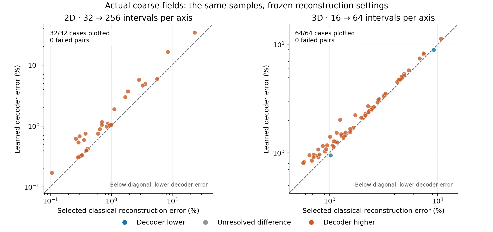

# Burgers reconstruction from the same coarse samples

This report compares classical and learned-basis reconstruction using identical coarse field samples. The numbers are final for this bounded screen after independent result review; numerical-reference and training-information qualifications remain explicit.

The 2D decoder does not pass the prespecified accuracy gate against development-selected classical reconstruction. The 3D decoder does not pass the prespecified accuracy gate against development-selected classical reconstruction.

The table below gives median errors on the coarsest actual-solver input grid in each dimension. Each entry is a percentage of the initial-field norm, after taking each case's largest evolved-time error. The decoder and selected classical settings were frozen using development cases; the three interpolation columns are fixed methods. Any failed cases are marked beside the finite-case median.

| Dimension, coarse → fine intervals | Decoder (%) | Linear (%) | Cubic (%) | Full sine (%) | Selected classical (%) |
| --- | --- | --- | --- | --- | --- |
| 2D, 32 → 256 | 0.934 | 0.7287 | 0.6786 | 0.6786 | 0.6715 |
| 3D, 16 → 64 | 2.068 | 2.606 | 1.906 | 1.917 | 1.697 |

## What is being compared

The screen uses the repository's scalar viscous Burgers families and exposed research cohorts.

Every declared method family has an available frozen selection.

Source A supplies exact samples of the stored fine-reference array. Source B supplies an actual coarse numerical solution. Every method receives the same field at the same physical time, coordinates and zero boundary values. Reconstructed fields are not advanced through time or corrected with a fine PDE solve. Sealed and out-of-distribution cohorts remain closed.

The coarse inputs use central differences and Crank–Nicolson stepping with backward-Euler startup. Historical bank training values use the inherited upwind/backward-Euler recipe. That numerical-prior mismatch is part of the inherited system tested here.

The decoder and POD have training-derived information about plausible fields. Interpolation has grid geometry and boundary information. Finer decoder evaluation does not add observations: any improvement comes from the learned representation and its regularization. Direct fitting to a fine reference is an oracle diagnostic, excluded from the reconstruction comparison.

The classical candidate pool contains exact interpolation and regularized sine reconstructions. A filtered method generally changes the supplied coarse values, so the selected classical comparator is not necessarily interpolation in the strict sense. Linear, cubic and full sine interpolation are reported separately.

Errors use the volume-weighted fine-grid norm, divided by the fixed initial-reference norm. Each case is scored by its maximum error across the evolved observation times:

$$e_i=\max_{t>0}\frac{\|\widehat u_i(t)-u_{i,\mathrm{ref}}(t)\|_{h_f}}{\|u_{i,\mathrm{ref}}(0)\|_{h_f}}.$$

## Actual coarse solutions: selected settings

| Dimension | Intervals per axis | Method family | Frozen configuration | Median error (%) | Worst error (%) | Above 1% | Failed / all | Input admitted / all | Fit (ms) | Decode (ms) | Warm query (ms) |
| --- | --- | --- | --- | --- | --- | --- | --- | --- | --- | --- | --- |
| 2 | 32 → 256 | Fine-trained decoder | `bank_base_r128_ridge0.0001` | 0.934 | 34.11 | 15 | 0/32 | 31/32 | 0.09557 | 0.1072 | 0.7841 |
| 2 | 32 → 256 | Selected classical reconstruction | `sine_smooth1` | 0.6715 | 23.34 | 9 | 0/32 | 31/32 | 0.1013 | 0.07539 | 0.7601 |
| 2 | 32 → 256 | Fine-data POD | `pod_base_r512_covridge1e-08` | 0.7082 | 75.77 | 11 | 0/32 | 31/32 | 0.09555 | 0.1514 | 0.8281 |
| 2 | 64 → 256 | Fine-trained decoder | `bank_base_r256_ridge0.0001` | 0.2184 | 7.591 | 5 | 0/32 | 32/32 | 0.09674 | 0.1229 | 0.7999 |
| 2 | 64 → 256 | Selected classical reconstruction | `sine_smooth1` | 0.1717 | 4.188 | 3 | 0/32 | 32/32 | 0.1021 | 0.07646 | 0.7613 |
| 2 | 64 → 256 | Fine-data POD | `pod_base_r512_covridge1e-10` | 0.1836 | 12.93 | 4 | 0/32 | 32/32 | 0.09733 | 0.1534 | 0.8308 |
| 2 | 128 → 256 | Fine-trained decoder | `bank_base_r384_ridge0.0001` | 0.05883 | 1.411 | 3 | 0/32 | 32/32 | 0.1041 | 0.1379 | 0.8333 |
| 2 | 128 → 256 | Coarse-trained decoder | `bank_coarse_r512_ridge0.0001` | 0.06576 | 1.29 | 2 | 0/32 | 32/32 | 0.1283 | 0.1525 | 0.8588 |
| 2 | 128 → 256 | Selected classical reconstruction | `sine_smooth1` | 0.04288 | 0.8937 | 0 | 0/32 | 32/32 | 0.1152 | 0.0865 | 0.7857 |
| 2 | 128 → 256 | Fine-data POD | `pod_base_r512_ridge0.0001` | 0.0453 | 1.07 | 1 | 0/32 | 32/32 | 0.1286 | 0.1531 | 0.8624 |
| 2 | 128 → 256 | Coarse-data POD | `pod_coarse_r512_ridge0.0001` | 0.04307 | 0.9617 | 0 | 0/32 | 32/32 | 0.1285 | 0.1527 | 0.8646 |
| 3 | 16 → 64 | Learned decoder | `bank_q2_r256_ridge0.01` | 2.068 | 11.38 | 54 | 0/64 | 64/64 | 0.09682 | 0.2056 | 1.32 |
| 3 | 16 → 64 | Selected classical reconstruction | `sine_smooth1` | 1.697 | 10.75 | 50 | 0/64 | 64/64 | 0.1155 | 0.08955 | 1.229 |
| 3 | 16 → 64 | POD, matched observations | `pod_matched_q2_r512_covridge1e-06` | 2.007 | 9.912 | 53 | 0/64 | 64/64 | 0.09769 | 0.3186 | 1.438 |
| 3 | 16 → 64 | POD, extra fine samples | `pod_stronger_q2_r512_covridge1e-06` | 1.965 | 9.963 | 53 | 0/64 | 64/64 | 0.09761 | 0.3188 | 1.437 |
| 3 | 32 → 64 | Learned decoder | `bank_q2_r1024_ridge0.0001` | 0.4721 | 3.394 | 13 | 0/64 | 64/64 | 0.1704 | 0.5439 | 1.774 |
| 3 | 32 → 64 | Selected classical reconstruction | `sine_smooth1` | 0.4643 | 3.256 | 13 | 0/64 | 64/64 | 0.1217 | 0.09076 | 1.259 |
| 3 | 32 → 64 | POD, matched observations | `pod_matched_q2_r1024_covridge1e-08` | 0.5026 | 3.031 | 13 | 0/64 | 64/64 | 0.1708 | 0.5432 | 1.772 |
| 3 | 32 → 64 | POD, extra fine samples | `pod_stronger_q2_r1024_covridge1e-08` | 0.4955 | 2.938 | 13 | 0/64 | 64/64 | 0.1702 | 0.5431 | 1.766 |

When any fit fails, displayed error summaries describe finite cases only; the failure column preserves the full denominator, and the full-cohort improvement ratio is unavailable. An unadmitted coarse input still permits a same-input accuracy comparison, but its error cannot be attributed cleanly to spatial discretization alone.

## Paired comparisons with selected classical reconstruction

Each point is one case. Colors use the conditional numerical-reference resolution rule; they do not indicate statistical significance. The diagonal marks equal error.

| Dimension | Coarse intervals | Source | Method family | Median error ratio | Max reference ε (%) | Wins | Ties | Losses | Failed pairs / all | Time check stable / checked / all |
| --- | --- | --- | --- | --- | --- | --- | --- | --- | --- | --- |
| 2 | 32 | A | Fine-trained decoder | 754.5 | — | 0 | 0 | 32 | 0/32 | — |
| 2 | 32 | A | Fine-data POD | 291.1 | — | 0 | 0 | 32 | 0/32 | — |
| 2 | 32 | B | Fine-trained decoder | 1.391 | 0.000952 | 0 | 0 | 32 | 0/32 | 32/32/32 |
| 2 | 32 | B | Fine-data POD | 1.055 | 0.000952 | 0 | 0 | 32 | 0/32 | 32/32/32 |
| 2 | 64 | A | Fine-trained decoder | 3065 | — | 0 | 0 | 32 | 0/32 | — |
| 2 | 64 | A | Fine-data POD | 1277 | — | 0 | 0 | 32 | 0/32 | — |
| 2 | 64 | B | Fine-trained decoder | 1.272 | 0.000952 | 3 | 3 | 26 | 0/32 | 32/32/32 |
| 2 | 64 | B | Fine-data POD | 1.069 | 0.000952 | 0 | 7 | 25 | 0/32 | 31/32/32 |
| 2 | 128 | A | Fine-trained decoder | 3.381e+04 | — | 0 | 0 | 32 | 0/32 | — |
| 2 | 128 | A | Coarse-trained decoder | 5.832e+04 | — | 0 | 0 | 32 | 0/32 | — |
| 2 | 128 | A | Fine-data POD | 7034 | — | 0 | 0 | 32 | 0/32 | — |
| 2 | 128 | A | Coarse-data POD | 3737 | — | 0 | 0 | 32 | 0/32 | — |
| 2 | 128 | B | Fine-trained decoder | 1.372 | 0.000952 | 3 | 5 | 24 | 0/32 | 32/32/32 |
| 2 | 128 | B | Coarse-trained decoder | 1.534 | 0.000952 | 0 | 0 | 32 | 0/32 | 32/32/32 |
| 2 | 128 | B | Fine-data POD | 1.057 | 0.000952 | 13 | 3 | 16 | 0/32 | 32/32/32 |
| 2 | 128 | B | Coarse-data POD | 1.005 | 0.000952 | 13 | 5 | 14 | 0/32 | 32/32/32 |
| 3 | 16 | A | Learned decoder | 3.11 | — | 12 | 0 | 52 | 0/64 | — |
| 3 | 16 | A | POD, matched observations | 5.01 | — | 8 | 0 | 56 | 0/64 | — |
| 3 | 16 | A | POD, extra fine samples | 1.879 | — | 19 | 0 | 45 | 0/64 | — |
| 3 | 16 | B | Learned decoder | 1.219 | 0.01159 | 2 | 0 | 62 | 0/64 | 64/64/64 |
| 3 | 16 | B | POD, matched observations | 1.183 | 0.01159 | 4 | 0 | 60 | 0/64 | 64/64/64 |
| 3 | 16 | B | POD, extra fine samples | 1.158 | 0.01159 | 4 | 0 | 60 | 0/64 | 64/64/64 |
| 3 | 32 | A | Learned decoder | 98.17 | — | 0 | 0 | 64 | 0/64 | — |
| 3 | 32 | A | POD, matched observations | 172.6 | — | 0 | 0 | 64 | 0/64 | — |
| 3 | 32 | A | POD, extra fine samples | 84.28 | — | 0 | 0 | 64 | 0/64 | — |
| 3 | 32 | B | Learned decoder | 1.017 | 0.01159 | 0 | 16 | 48 | 0/64 | 64/64/64 |
| 3 | 32 | B | POD, matched observations | 1.083 | 0.01159 | 1 | 1 | 62 | 0/64 | 64/64/64 |
| 3 | 32 | B | POD, extra fine samples | 1.067 | 0.01159 | 1 | 1 | 62 | 0/64 | 64/64/64 |

The ratio is method median error divided by the selected classical method's median error; smaller is better. It is not the median of paired ratios. Source A wins describe completion of fixed numerical arrays, with a numerical tie tolerance. Source B wins exceed twice the stored reference uncertainty estimate. That estimate is a conditional numerical resolution rule, not a certified physical-error bound or a statistical confidence interval.

The time check repeats each frozen reconstruction map on the preceding coarse-solver time-step level and asks whether its paired win/tie/loss classification changes. Missing diagnostics do not count as stable checks.

## Holding the reconstruction map fixed

| Dimension | Coarse intervals | B-selected family | Frozen configuration | A median error (%) | B median error (%) | A worst error (%) | B worst error (%) | A / B failed cases |
| --- | --- | --- | --- | --- | --- | --- | --- | --- |
| 2 | 32 | Fine-trained decoder | `bank_base_r128_ridge0.0001` | 0.5874 | 0.934 | 5.171 | 34.11 | 0 / 0 |
| 2 | 32 | Selected classical reconstruction | `sine_smooth1` | 0.04021 | 0.6715 | 4.577 | 23.34 | 0 / 0 |
| 2 | 32 | Fine-data POD | `pod_base_r512_covridge1e-08` | 0.2267 | 0.7082 | 4.052 | 75.77 | 0 / 0 |
| 2 | 64 | Fine-trained decoder | `bank_base_r256_ridge0.0001` | 0.08104 | 0.2184 | 2.243 | 7.591 | 0 / 0 |
| 2 | 64 | Selected classical reconstruction | `sine_smooth1` | 0.002376 | 0.1717 | 0.5874 | 4.188 | 0 / 0 |
| 2 | 64 | Fine-data POD | `pod_base_r512_covridge1e-10` | 0.03361 | 0.1836 | 2.256 | 12.93 | 0 / 0 |
| 2 | 128 | Fine-trained decoder | `bank_base_r384_ridge0.0001` | 0.03071 | 0.05883 | 1.388 | 1.411 | 0 / 0 |
| 2 | 128 | Coarse-trained decoder | `bank_coarse_r512_ridge0.0001` | 0.05141 | 0.06576 | 1.066 | 1.29 | 0 / 0 |
| 2 | 128 | Selected classical reconstruction | `sine_smooth1` | 0.0001439 | 0.04288 | 0.04075 | 0.8937 | 0 / 0 |
| 2 | 128 | Fine-data POD | `pod_base_r512_ridge0.0001` | 0.01202 | 0.0453 | 0.6697 | 1.07 | 0 / 0 |
| 2 | 128 | Coarse-data POD | `pod_coarse_r512_ridge0.0001` | 0.009563 | 0.04307 | 0.6473 | 0.9617 | 0 / 0 |
| 3 | 16 | Learned decoder | `bank_q2_r256_ridge0.01` | 1.002 | 2.068 | 5.027 | 11.38 | 0 / 0 |
| 3 | 16 | Selected classical reconstruction | `sine_smooth1` | 0.4862 | 1.697 | 3.49 | 10.75 | 0 / 0 |
| 3 | 16 | POD, matched observations | `pod_matched_q2_r512_covridge1e-06` | 0.5931 | 2.007 | 4.963 | 9.912 | 0 / 0 |
| 3 | 16 | POD, extra fine samples | `pod_stronger_q2_r512_covridge1e-06` | 0.5354 | 1.965 | 4.935 | 9.963 | 0 / 0 |
| 3 | 32 | Learned decoder | `bank_q2_r1024_ridge0.0001` | 0.0368 | 0.4721 | 1.639 | 3.394 | 0 / 0 |
| 3 | 32 | Selected classical reconstruction | `sine_smooth1` | 0.02913 | 0.4643 | 0.5947 | 3.256 | 0 / 0 |
| 3 | 32 | POD, matched observations | `pod_matched_q2_r1024_covridge1e-08` | 0.09711 | 0.5026 | 2.313 | 3.031 | 0 / 0 |
| 3 | 32 | POD, extra fine samples | `pod_stronger_q2_r1024_covridge1e-08` | 0.08225 | 0.4955 | 2.208 | 2.938 | 0 / 0 |

This table applies the same B-selected map to both input sources. It separates the effect of changing observations from changing reconstruction settings. For the fixed linear maps tested here, the error vectors obey:

$$\widehat u_B-u_{\mathrm{ref}}=(\widehat u_A-u_{\mathrm{ref}})+T(y_B-y_A).$$

Their norms do not form an additive error split. A is completion of the stored numerical array; B additionally contains coarse-solver input error, including any unresolved temporal contribution.

## Decoder comparisons with literal interpolation and POD

| Dimension | Coarse intervals | Source | Decoder configuration | Comparator | Median error ratio | Wins | Ties | Losses | Failed pairs / all |
| --- | --- | --- | --- | --- | --- | --- | --- | --- | --- |
| 2 | 32 | A | `bank_base_r128_ridge0.0001` | Linear | 0.7606 | 19 | 0 | 13 | 0/32 |
| 2 | 32 | A | `bank_base_r128_ridge0.0001` | Cubic | 28.8 | 0 | 0 | 32 | 0/32 |
| 2 | 32 | A | `bank_base_r128_ridge0.0001` | Full sine | 754.5 | 0 | 0 | 32 | 0/32 |
| 2 | 32 | A | `bank_base_r128_ridge0.0001` | Fine-data POD | 2.592 | 2 | 0 | 30 | 0/32 |
| 2 | 32 | B | `bank_base_r128_ridge0.0001` | Linear | 1.282 | 10 | 0 | 22 | 0/32 |
| 2 | 32 | B | `bank_base_r128_ridge0.0001` | Cubic | 1.376 | 2 | 1 | 29 | 0/32 |
| 2 | 32 | B | `bank_base_r128_ridge0.0001` | Full sine | 1.376 | 2 | 0 | 30 | 0/32 |
| 2 | 32 | B | `bank_base_r128_ridge0.0001` | Fine-data POD | 1.319 | 9 | 1 | 22 | 0/32 |
| 2 | 64 | A | `bank_base_r256_ridge0` | Linear | 0.4172 | 21 | 0 | 11 | 0/32 |
| 2 | 64 | A | `bank_base_r256_ridge0` | Cubic | 122.6 | 0 | 0 | 32 | 0/32 |
| 2 | 64 | A | `bank_base_r256_ridge0` | Full sine | 3065 | 0 | 0 | 32 | 0/32 |
| 2 | 64 | A | `bank_base_r256_ridge0` | Fine-data POD | 2.399 | 1 | 0 | 31 | 0/32 |
| 2 | 64 | B | `bank_base_r256_ridge0.0001` | Linear | 1.209 | 13 | 0 | 19 | 0/32 |
| 2 | 64 | B | `bank_base_r256_ridge0.0001` | Cubic | 1.259 | 4 | 3 | 25 | 0/32 |
| 2 | 64 | B | `bank_base_r256_ridge0.0001` | Full sine | 1.258 | 3 | 3 | 26 | 0/32 |
| 2 | 64 | B | `bank_base_r256_ridge0.0001` | Fine-data POD | 1.189 | 4 | 5 | 23 | 0/32 |
| 2 | 128 | A | `bank_base_r384_ridge1e-06` | Linear | 0.6404 | 22 | 0 | 10 | 0/32 |
| 2 | 128 | A | `bank_base_r384_ridge1e-06` | Cubic | 1070 | 0 | 0 | 32 | 0/32 |
| 2 | 128 | A | `bank_base_r384_ridge1e-06` | Full sine | 3.381e+04 | 0 | 0 | 32 | 0/32 |
| 2 | 128 | A | `bank_base_r384_ridge1e-06` | Fine-data POD | 4.807 | 0 | 0 | 32 | 0/32 |
| 2 | 128 | A | `bank_coarse_r512_ridge1e-06` | Linear | 1.105 | 11 | 0 | 21 | 0/32 |
| 2 | 128 | A | `bank_coarse_r512_ridge1e-06` | Cubic | 1846 | 0 | 0 | 32 | 0/32 |
| 2 | 128 | A | `bank_coarse_r512_ridge1e-06` | Full sine | 5.832e+04 | 0 | 0 | 32 | 0/32 |
| 2 | 128 | A | `bank_coarse_r512_ridge1e-06` | Coarse-data POD | 15.61 | 0 | 0 | 32 | 0/32 |
| 2 | 128 | B | `bank_base_r384_ridge0.0001` | Linear | 1.309 | 11 | 2 | 19 | 0/32 |
| 2 | 128 | B | `bank_base_r384_ridge0.0001` | Cubic | 1.369 | 3 | 6 | 23 | 0/32 |
| 2 | 128 | B | `bank_base_r384_ridge0.0001` | Full sine | 1.368 | 3 | 6 | 23 | 0/32 |
| 2 | 128 | B | `bank_base_r384_ridge0.0001` | Fine-data POD | 1.299 | 0 | 3 | 29 | 0/32 |
| 2 | 128 | B | `bank_coarse_r512_ridge0.0001` | Linear | 1.463 | 2 | 0 | 30 | 0/32 |
| 2 | 128 | B | `bank_coarse_r512_ridge0.0001` | Cubic | 1.53 | 0 | 0 | 32 | 0/32 |
| 2 | 128 | B | `bank_coarse_r512_ridge0.0001` | Full sine | 1.53 | 0 | 0 | 32 | 0/32 |
| 2 | 128 | B | `bank_coarse_r512_ridge0.0001` | Coarse-data POD | 1.527 | 0 | 0 | 32 | 0/32 |
| 3 | 16 | A | `bank_q2_r1024_ridge0.0001` | Linear | 0.02702 | 64 | 0 | 0 | 0/64 |
| 3 | 16 | A | `bank_q2_r1024_ridge0.0001` | Cubic | 0.4372 | 59 | 0 | 5 | 0/64 |
| 3 | 16 | A | `bank_q2_r1024_ridge0.0001` | Full sine | 3.24 | 12 | 0 | 52 | 0/64 |
| 3 | 16 | A | `bank_q2_r1024_ridge0.0001` | POD, matched observations | 0.6208 | 53 | 0 | 11 | 0/64 |
| 3 | 16 | A | `bank_q2_r1024_ridge0.0001` | POD, extra fine samples | 1.655 | 0 | 0 | 64 | 0/64 |
| 3 | 16 | B | `bank_q2_r256_ridge0.01` | Linear | 0.7934 | 47 | 0 | 17 | 0/64 |
| 3 | 16 | B | `bank_q2_r256_ridge0.01` | Cubic | 1.085 | 37 | 1 | 26 | 0/64 |
| 3 | 16 | B | `bank_q2_r256_ridge0.01` | Full sine | 1.079 | 38 | 1 | 25 | 0/64 |
| 3 | 16 | B | `bank_q2_r256_ridge0.01` | POD, matched observations | 1.03 | 22 | 2 | 40 | 0/64 |
| 3 | 16 | B | `bank_q2_r256_ridge0.01` | POD, extra fine samples | 1.052 | 22 | 0 | 42 | 0/64 |
| 3 | 32 | A | `bank_q2_r1024_ridge1e-10` | Linear | 0.05829 | 62 | 0 | 2 | 0/64 |
| 3 | 32 | A | `bank_q2_r1024_ridge1e-10` | Cubic | 6.577 | 0 | 0 | 64 | 0/64 |
| 3 | 32 | A | `bank_q2_r1024_ridge1e-10` | Full sine | 294.3 | 0 | 0 | 64 | 0/64 |
| 3 | 32 | A | `bank_q2_r1024_ridge1e-10` | POD, matched observations | 0.5689 | 64 | 0 | 0 | 0/64 |
| 3 | 32 | A | `bank_q2_r1024_ridge1e-10` | POD, extra fine samples | 1.165 | 14 | 0 | 50 | 0/64 |
| 3 | 32 | B | `bank_q2_r1024_ridge0.0001` | Linear | 0.7368 | 48 | 1 | 15 | 0/64 |
| 3 | 32 | B | `bank_q2_r1024_ridge0.0001` | Cubic | 0.9995 | 3 | 52 | 9 | 0/64 |
| 3 | 32 | B | `bank_q2_r1024_ridge0.0001` | Full sine | 0.9984 | 4 | 55 | 5 | 0/64 |
| 3 | 32 | B | `bank_q2_r1024_ridge0.0001` | POD, matched observations | 0.9393 | 28 | 31 | 5 | 0/64 |
| 3 | 32 | B | `bank_q2_r1024_ridge0.0001` | POD, extra fine samples | 0.9528 | 23 | 33 | 8 | 0/64 |
| 2 | 128 | A | `bank_coarse_r384_ridge0` (fixed control) | Linear | 1.152 | 11 | 0 | 21 | 0/32 |
| 2 | 128 | A | `bank_coarse_r384_ridge0` (fixed control) | Cubic | 1926 | 0 | 0 | 32 | 0/32 |
| 2 | 128 | A | `bank_coarse_r384_ridge0` (fixed control) | Full sine | 6.082e+04 | 0 | 0 | 32 | 0/32 |
| 2 | 128 | A | `bank_coarse_r384_ridge0` (fixed control) | POD fixed coarse-data control | 4.847 | 0 | 0 | 32 | 0/32 |
| 2 | 128 | B | `bank_coarse_r384_ridge0` (fixed control) | Linear | 1.519 | 3 | 1 | 28 | 0/32 |
| 2 | 128 | B | `bank_coarse_r384_ridge0` (fixed control) | Cubic | 1.589 | 0 | 0 | 32 | 0/32 |
| 2 | 128 | B | `bank_coarse_r384_ridge0` (fixed control) | Full sine | 1.588 | 0 | 0 | 32 | 0/32 |
| 2 | 128 | B | `bank_coarse_r384_ridge0` (fixed control) | POD fixed coarse-data control | 1.356 | 0 | 0 | 32 | 0/32 |

These comparisons use each fixed interpolation method and the separately frozen POD settings. They do not choose a new comparator from validation results. The fixed coarse-data decoder is paired with the fixed coarse-data POD control as well.

## Fixed ordinary methods and coarse-training control

| Dimension | Coarse intervals | Source | Method | Configuration | Median error (%) | Worst error (%) | Failed / all |
| --- | --- | --- | --- | --- | --- | --- | --- |
| 2 | 32 | A | Cubic | `cubic_notaknot` | 0.0204 | 2.051 | 0/32 |
| 2 | 32 | A | Linear | `linear` | 0.7723 | 6.669 | 0/32 |
| 2 | 32 | A | Full sine | `sine_full` | 0.0007786 | 3.604 | 0/32 |
| 2 | 32 | B | Cubic | `cubic_notaknot` | 0.6786 | 37.61 | 0/32 |
| 2 | 32 | B | Linear | `linear` | 0.7287 | 20.33 | 0/32 |
| 2 | 32 | B | Full sine | `sine_full` | 0.6786 | 32.39 | 0/32 |
| 2 | 64 | A | Cubic | `cubic_notaknot` | 0.0006578 | 0.3389 | 0/32 |
| 2 | 64 | A | Linear | `linear` | 0.1933 | 1.581 | 0/32 |
| 2 | 64 | A | Full sine | `sine_full` | 2.631e-05 | 0.3136 | 0/32 |
| 2 | 64 | B | Cubic | `cubic_notaknot` | 0.1734 | 5.236 | 0/32 |
| 2 | 64 | B | Linear | `linear` | 0.1806 | 3.206 | 0/32 |
| 2 | 64 | B | Full sine | `sine_full` | 0.1736 | 4.761 | 0/32 |
| 2 | 128 | A | Coarse-trained decoder (fixed control) | `bank_coarse_r384_ridge0` | 0.05275 | 1.202 | 0/32 |
| 2 | 128 | A | Cubic | `cubic_notaknot` | 2.74e-05 | 0.06597 | 0/32 |
| 2 | 128 | A | Linear | `linear` | 0.04579 | 0.3773 | 0/32 |
| 2 | 128 | A | Coarse-data POD (fixed control) | `pod_coarse_r384_ridge0` | 0.01088 | 1.015 | 0/32 |
| 2 | 128 | A | Full sine | `sine_full` | 8.673e-07 | 0.003255 | 0/32 |
| 2 | 128 | B | Coarse-trained decoder (fixed control) | `bank_coarse_r384_ridge0` | 0.06829 | 1.329 | 0/32 |
| 2 | 128 | B | Cubic | `cubic_notaknot` | 0.04298 | 0.9383 | 0/32 |
| 2 | 128 | B | Linear | `linear` | 0.04495 | 0.6964 | 0/32 |
| 2 | 128 | B | Coarse-data POD (fixed control) | `pod_coarse_r384_ridge0` | 0.05036 | 1.078 | 0/32 |
| 2 | 128 | B | Full sine | `sine_full` | 0.04299 | 0.9236 | 0/32 |
| 3 | 16 | A | Cubic | `cubic_notaknot` | 0.1634 | 3.215 | 0/64 |
| 3 | 16 | A | Linear | `linear` | 2.644 | 5.432 | 0/64 |
| 3 | 16 | A | Full sine | `sine_full` | 0.02205 | 2.858 | 0/64 |
| 3 | 16 | B | Cubic | `cubic_notaknot` | 1.906 | 14.01 | 0/64 |
| 3 | 16 | B | Linear | `linear` | 2.606 | 10.37 | 0/64 |
| 3 | 16 | B | Full sine | `sine_full` | 1.917 | 14.75 | 0/64 |
| 3 | 32 | A | Cubic | `cubic_notaknot` | 0.005444 | 0.4311 | 0/64 |
| 3 | 32 | A | Linear | `linear` | 0.6142 | 1.301 | 0/64 |
| 3 | 32 | A | Full sine | `sine_full` | 0.0001217 | 0.317 | 0/64 |
| 3 | 32 | B | Cubic | `cubic_notaknot` | 0.4724 | 3.743 | 0/64 |
| 3 | 32 | B | Linear | `linear` | 0.6408 | 3.11 | 0/64 |
| 3 | 32 | B | Full sine | `sine_full` | 0.4729 | 3.911 | 0/64 |

The coarse-training control uses its prespecified rank and no fitted ridge penalty. Other selected configurations use exposed development references; their selection therefore has fine-reference information. Both development and validation are exposed research cohorts, rather than sealed generalization tests. Coarse-data training refers to the solution values used in training; it does not erase the architecture's and recipe's earlier development history.

## Sensitivity to the numerical inputs

| Dimension | Coarse intervals | Source | Selected family | Max output change (%) | Max A error-vector change (%) | Complete / all |
| --- | --- | --- | --- | --- | --- | --- |
| 2 | 32 | A | Fine-trained decoder | 0.01384 | 0.006507 | 32/32 |
| 2 | 32 | A | Selected classical reconstruction | 0.0142 | 0.002826 | 32/32 |
| 2 | 32 | A | Fine-data POD | 0.01513 | 0.005266 | 32/32 |
| 2 | 32 | B | Fine-trained decoder | 0.001102 | — | 32/32 |
| 2 | 32 | B | Selected classical reconstruction | 0.0009935 | — | 32/32 |
| 2 | 32 | B | Fine-data POD | 0.001215 | — | 32/32 |
| 2 | 64 | A | Fine-trained decoder | 0.01438 | 0.005156 | 32/32 |
| 2 | 64 | A | Selected classical reconstruction | 0.01433 | 0.0004116 | 32/32 |
| 2 | 64 | A | Fine-data POD | 0.0145 | 0.006313 | 32/32 |
| 2 | 64 | B | Fine-trained decoder | 0.0009365 | — | 32/32 |
| 2 | 64 | B | Selected classical reconstruction | 0.0009386 | — | 32/32 |
| 2 | 64 | B | Fine-data POD | 0.0009402 | — | 32/32 |
| 2 | 128 | A | Fine-trained decoder | 0.01425 | 0.004141 | 32/32 |
| 2 | 128 | A | Coarse-trained decoder | 0.01427 | 0.003598 | 32/32 |
| 2 | 128 | A | Selected classical reconstruction | 0.01433 | 1.106e-05 | 32/32 |
| 2 | 128 | A | Fine-data POD | 0.01431 | 0.002752 | 32/32 |
| 2 | 128 | A | Coarse-data POD | 0.01432 | 0.002638 | 32/32 |
| 2 | 128 | B | Fine-trained decoder | 0.000967 | — | 32/32 |
| 2 | 128 | B | Coarse-trained decoder | 0.0009662 | — | 32/32 |
| 2 | 128 | B | Selected classical reconstruction | 0.0009663 | — | 32/32 |
| 2 | 128 | B | Fine-data POD | 0.0009656 | — | 32/32 |
| 2 | 128 | B | Coarse-data POD | 0.0009663 | — | 32/32 |
| 3 | 16 | A | Learned decoder | 0.2437 | 0.1981 | 64/64 |
| 3 | 16 | A | Selected classical reconstruction | 0.1864 | 0.1666 | 64/64 |
| 3 | 16 | A | POD, matched observations | 0.1577 | 0.1376 | 64/64 |
| 3 | 16 | A | POD, extra fine samples | 0.2153 | 0.1622 | 64/64 |
| 3 | 16 | B | Learned decoder | 0.0009524 | — | 64/64 |
| 3 | 16 | B | Selected classical reconstruction | 0.0009553 | — | 64/64 |
| 3 | 16 | B | POD, matched observations | 0.0009452 | — | 64/64 |
| 3 | 16 | B | POD, extra fine samples | 0.0009474 | — | 64/64 |
| 3 | 32 | A | Learned decoder | 0.1516 | 0.1003 | 64/64 |
| 3 | 32 | A | Selected classical reconstruction | 0.1814 | 0.05861 | 64/64 |
| 3 | 32 | A | POD, matched observations | 0.1456 | 0.1098 | 64/64 |
| 3 | 32 | A | POD, extra fine samples | 0.1536 | 0.09696 | 64/64 |
| 3 | 32 | B | Learned decoder | 0.0009563 | — | 64/64 |
| 3 | 32 | B | Selected classical reconstruction | 0.0009552 | — | 64/64 |
| 3 | 32 | B | POD, matched observations | 0.0009562 | — | 64/64 |
| 3 | 32 | B | POD, extra fine samples | 0.0009563 | — | 64/64 |

Source A varies both sampled inputs and targets across the saved reference levels; the error-vector change accounts for their dependence. Source B varies the coarse time-step level while keeping the fine target fixed. These are measured perturbations, not certified bounds on unknown physical error.

## Do the samples determine the representation?

| Dimension | Coarse intervals | Selected B family | Requested directions | Retained fine directions | Sampled rank | Retained-spectrum condition | Amplification | Status |
| --- | --- | --- | --- | --- | --- | --- | --- | --- |
| 2 | 32 | Fine-trained decoder | 128 | 128 | 128 | 4.934 | 4.756 | Available |
| 2 | 32 | Fine-data POD | 512 | 512 | 512 | 7.549e+04 | 12.27 | Available |
| 2 | 64 | Fine-trained decoder | 256 | 256 | 256 | 7.486 | 7.008 | Available |
| 2 | 64 | Fine-data POD | 512 | 512 | 512 | 386.9 | 33.02 | Available |
| 2 | 128 | Fine-trained decoder | 384 | 384 | 384 | 4.469 | 3.966 | Available |
| 2 | 128 | Coarse-trained decoder | 512 | 512 | 512 | 4.701 | 4.006 | Available |
| 2 | 128 | Coarse-data decoder (fixed control) | 384 | 384 | 384 | 2.204 | 2.009 | Available |
| 2 | 128 | Fine-data POD | 512 | 512 | 512 | 8.53 | 7.067 | Available |
| 2 | 128 | Coarse-data POD | 512 | 512 | 512 | 1 | 0.9999 | Available |
| 2 | 128 | Coarse-data POD (fixed control) | 384 | 384 | 384 | 1 | 1 | Available |
| 3 | 16 | Learned decoder | 256 | 256 | 256 | 1.067 | 1.05 | Available |
| 3 | 16 | POD, matched observations | 512 | 512 | 512 | 2.786 | 1.222 | Available |
| 3 | 16 | POD, extra fine samples | 512 | 512 | 512 | 1.883 | 1 | Available |
| 3 | 32 | Learned decoder | 1024 | 1024 | 1024 | 1.164 | 1.152 | Available |
| 3 | 32 | POD, matched observations | 1024 | 1024 | 1024 | 1.648 | 1.181 | Available |
| 3 | 32 | POD, extra fine samples | 1024 | 1024 | 1024 | 1.334 | 1 | Available |

The fine-grid Gram cutoff can remove nearly dependent directions before fitting. A sampled rank below the retained fine rank leaves directions unidentified by the observations. Full sampled rank alone does not imply stability: the condition and the regularized map's physical amplification quantify sensitivity at different stages.

## Fine-reference oracle limits — diagnostics only

| Dimension | Coarse-grid plan | Fine representation | Oracle median error (%) | Oracle worst error (%) | Complete / all | Status |
| --- | --- | --- | --- | --- | --- | --- |
| 2 | 32 | `bank_base_r128` | 0.3502 | 4.201 | 32/32 | Available |
| 2 | 32 | `bank_base_r256` | 0.05427 | 1.963 | 32/32 | Available |
| 2 | 32 | `bank_base_r384` | 0.02732 | 1.344 | 32/32 | Available |
| 2 | 32 | `bank_base_r512` | 0.0263 | 1.257 | 32/32 | Available |
| 2 | 32 | `pod_base_r128` | 0.3539 | 4.636 | 32/32 | Available |
| 2 | 32 | `pod_base_r256` | 0.06055 | 2.058 | 32/32 | Available |
| 2 | 32 | `pod_base_r384` | 0.01374 | 1.058 | 32/32 | Available |
| 2 | 32 | `pod_base_r512` | 0.004108 | 0.6428 | 32/32 | Available |
| 2 | 128 | `bank_base_r128` | 0.3502 | 4.201 | 32/32 | Available |
| 2 | 128 | `bank_base_r256` | 0.05427 | 1.963 | 32/32 | Available |
| 2 | 128 | `bank_base_r384` | 0.02732 | 1.344 | 32/32 | Available |
| 2 | 128 | `bank_base_r512` | 0.0263 | 1.257 | 32/32 | Available |
| 2 | 128 | `bank_coarse_r128` | 0.3345 | 4.109 | 32/32 | Available |
| 2 | 128 | `bank_coarse_r256` | 0.07255 | 1.966 | 32/32 | Available |
| 2 | 128 | `bank_coarse_r384` | 0.04001 | 1.193 | 32/32 | Available |
| 2 | 128 | `bank_coarse_r512` | 0.02963 | 1.043 | 32/32 | Available |
| 2 | 128 | `pod_base_r128` | 0.3539 | 4.636 | 32/32 | Available |
| 2 | 128 | `pod_base_r256` | 0.06055 | 2.058 | 32/32 | Available |
| 2 | 128 | `pod_base_r384` | 0.01374 | 1.058 | 32/32 | Available |
| 2 | 128 | `pod_base_r512` | 0.004108 | 0.6428 | 32/32 | Available |
| 2 | 128 | `pod_coarse_r128` | 0.3277 | 4.318 | 32/32 | Available |
| 2 | 128 | `pod_coarse_r256` | 0.05306 | 1.937 | 32/32 | Available |
| 2 | 128 | `pod_coarse_r384` | 0.01088 | 1.015 | 32/32 | Available |
| 2 | 128 | `pod_coarse_r512` | 0.003241 | 0.6473 | 32/32 | Available |
| 3 | 16 | `bank_q2_r1024` | 0.03579 | 1.639 | 64/64 | Available |
| 3 | 16 | `bank_q2_r256` | 0.5432 | 4.949 | 64/64 | Available |
| 3 | 16 | `bank_q2_r512` | 0.1506 | 2.838 | 64/64 | Available |
| 3 | 16 | `pod_matched_q2_r1024` | 0.06221 | 2.043 | 64/64 | Available |
| 3 | 16 | `pod_matched_q2_r256` | 0.7 | 5.515 | 64/64 | Available |
| 3 | 16 | `pod_matched_q2_r512` | 0.2136 | 3.159 | 64/64 | Available |
| 3 | 16 | `pod_stronger_q2_r1024` | 0.03072 | 1.672 | 64/64 | Available |
| 3 | 16 | `pod_stronger_q2_r256` | 0.5432 | 4.932 | 64/64 | Available |
| 3 | 16 | `pod_stronger_q2_r512` | 0.1505 | 2.837 | 64/64 | Available |

These projections use the full fine target and are inadmissible as reconstruction methods. They diagnose whether a representation can express the target at all. A large oracle floor limits any coefficient fit; a small floor with poor coarse reconstruction points toward identification, regularization or input error. They do not measure prediction skill.

## Qualifications and cost

POD uses recipe-reproduced training data and an approximate randomized factorization. Recipe, parameter-table and observation-coordinate agreement do not establish byte identity with archived training arrays. The matched-observation spatial extension and the stronger comparator with extra fine values are distinct. These comparisons do not by themselves isolate a causal advantage of the network architecture.

POD is uncentered, without a separately added mean field. Configurations named `covridge` use diagonal training second moments; they do not use an exact full covariance model. The approximate basis can retain off-diagonal second moments.

| 2D training data | Prefix rank | Max relative eigen residual | Training projection tail | Full-basis orthogonality max |
| --- | --- | --- | --- | --- |
| base | 128 | 2.043e-12 | 4.078e-05 | 1.021e-14 |
| base | 256 | 1.011e-10 | 1.008e-06 | 1.021e-14 |
| base | 384 | 1.648e-06 | 5.457e-08 | 1.021e-14 |
| base | 512 | 0.0106 | 4.312e-09 | 1.021e-14 |
| coarse | 128 | 8.831e-12 | 3.112e-05 | 1.11e-14 |
| coarse | 256 | 2.842e-10 | 6.232e-07 | 1.11e-14 |
| coarse | 384 | 6.817e-07 | 2.869e-08 | 1.11e-14 |
| coarse | 512 | 0.007823 | 1.975e-09 | 1.11e-14 |

| 3D coarse intervals | Source | POD family | Frozen configuration | Max q1/q2 change (%) | Consequential cases | Complete / all dev cases |
| --- | --- | --- | --- | --- | --- | --- |
| 16 | A | POD, matched observations | `pod_matched_q2_r1024_covridge1e-08` | 0.04232 | 3 | 4/4 |
| 16 | A | POD, extra fine samples | `pod_stronger_q2_r1024_covridge1e-10` | 0.1786 | 4 | 4/4 |
| 16 | B | POD, matched observations | `pod_matched_q2_r512_covridge1e-06` | 8.195e-05 | 0 | 4/4 |
| 16 | B | POD, extra fine samples | `pod_stronger_q2_r512_covridge1e-06` | 9.533e-06 | 0 | 4/4 |
| 32 | A | POD, matched observations | `pod_matched_q2_r1024_covridge1e-10` | 0.1617 | 4 | 4/4 |
| 32 | A | POD, extra fine samples | `pod_stronger_q2_r1024_ridge0` | 0.09941 | 3 | 4/4 |
| 32 | B | POD, matched observations | `pod_matched_q2_r1024_covridge1e-08` | 0.05495 | 3 | 4/4 |
| 32 | B | POD, extra fine samples | `pod_stronger_q2_r1024_covridge1e-08` | 0.01139 | 2 | 4/4 |

The q1/q2 comparison uses the two predeclared approximation levels on development cases. A case is consequential when an evolved output change exceeds either twice its reference uncertainty or the fixed normalized-field threshold 1e-05. Passing this check does not certify global POD optimality. The preparation's independent residual probes measure aggregate residual energy, without a probe-spectrum certificate.

Warm query time is the median of per-case medians for independently fitted single fields, including common host transfers. It excludes reusable basis evaluation, factorization and compilation. Accuracy and timing come from the same calls, with raw repetitions retained. Compare costs only within the same job and GPU; cross-dimensional timings are not speedup comparisons.

| Dimension | Coarse intervals | Recorded library setup (s) | Recorded scope |
| --- | --- | --- | --- |
| 2 | 32 | 33.9 | Basis/factors; query compilation separate |
| 2 | 64 | 27.9 | Basis/factors; query compilation separate |
| 2 | 128 | 65.17 | Basis/factors; query compilation separate |
| 3 | 16 | 75.8 | Basis/factors and query warm-up/compilation |
| 3 | 32 | 64.74 | Basis/factors and query warm-up/compilation |

Library setup covers the entire tested configuration sweep in that validation job, rather than the cost of deploying one selected method. Fine-coordinate basis evaluation was cached during preparation. These measurements support steady repeated-query comparisons, not a claim about total cost for a single uncached reconstruction. Separate fit/decode medians need not sum to the median end-to-end time.

No derivative-accuracy claim is made. Reference-level perturbations, coarse-time-step perturbations, coefficient observability, amplification and POD convergence diagnostics remain part of the archived evidence and independent acceptance audit.

## Prespecified larger-campaign gate

The primary actual-coarse comparison requires a median-error ratio no larger than 0.8, resolved wins in at least 75% of all declared cases, and no reference-resolved deterioration of the cohort's worst error. Ties and failed pairs do not count as wins. This is an accuracy-screen gate; training-information, conditioning and input qualifications still constrain the scientific claim. Worst-error deterioration is resolved only when the method's lower uncertainty envelope exceeds the selected classical method's upper envelope:

$$\max_i\max(0,e_{i,\mathrm{method}}-\epsilon_i)>\max_i(e_{i,\mathrm{classical}}+\epsilon_i).$$

| Dimension | Primary coarse intervals | Accuracy gate | Input admitted / all |
| --- | --- | --- | --- |
| 2 | 32 | Does not pass | 31/32 |
| 3 | 16 | Does not pass | 64/64 |

## Provenance

- 2D validation export: `/home/tahmid/Dev/Tunable-NM-ROM-Claude/worktrees/2026-10-27-burgers-recon2d/experiments/burgers-recon2d/runs/val01/output/EXPORT.json`; SHA-256 `81e01e6abe24039e44824975fe8aa84db6bfe88a2841e2e06fc3e84bda7f7ba1`.
- 3D validation export: `/home/tahmid/Dev/Tunable-NM-ROM-Claude/worktrees/2026-10-27-burgers-recon3d/experiments/burgers-recon3d/results/val01/output/EXPORT.json`; SHA-256 `2150f1fb136fb4cdc38afe079c510f4905b05e1e6037a2a6a3f9d1941000cdba`.

The [protocol and controls](DESIGN.md) specify the physical times, meshes, training information, fitting rules and prospective selection criteria.

The [independent acceptance record](ACCEPTED-SCREEN.json) binds the exports, report generator and auxiliary POD evidence used for this publication.

The companion JSON contains normalized selected-case records, full comparison pairs, runtime metadata and the gate constants used to generate these tables.

The [complete configuration table](2026-10-27-burgers-same-sample-reconstruction.configurations.csv) retains every tested setting, including failed and unselected configurations. Error summaries in that table describe finite cases and must be read beside the failure count; blank timings mean that a complete timing measurement is unavailable.

## Plain-language glossary

- **Dimension / D:** number of spatial directions.
- **Scalar / case:** one dependent field / one viscosity and initial-field choice.
- **Central differences / upwind / Crank–Nicolson / backward Euler:** spatial difference rules using neighbors on both sides / a spatial rule following the flow direction / a time rule averaging old and new rates / an implicit time rule using the new rate.
- **Intervals per axis / coarse intervals:** number of mesh cells along each direction; the full grid includes both boundary nodes.
- **Source A / B:** sampled fine-reference array / actual coarse numerical solution.
- **Decoder / learned basis:** coordinate-dependent functions learned from training fields; only their coefficients are fitted to the supplied coarse field.
- **POD:** proper orthogonal decomposition, a linear basis extracted from training snapshots.
- **Uncentered / second moments / covridge:** snapshots without mean subtraction / average coefficient products / a penalty using only the diagonal of those products.
- **Relative eigen residual / projection tail / orthogonality max:** mismatch in the approximate training covariance eigen-equation / fraction of training energy left outside the basis / largest departure of the basis inner products from an identity matrix.
- **q1/q2 / consequential cases:** two predeclared randomized-POD approximation levels / development cases where their reconstructed outputs differ beyond the registered threshold.
- **Bank q2 identifier:** bookkeeping in the saved configuration name; the learned bank is frozen and has no POD power-iteration parameter.
- **Frozen configuration:** rank, penalty and method chosen before validation was run.
- **Rank / ridge:** requested basis prefix size before numerical pruning / penalty that discourages unstable coefficients.
- **Requested directions / retained fine directions / sampled rank:** initial basis size / directions kept after removing numerical dependence / directions distinguishable on the coarse grid.
- **Retained-spectrum condition:** largest divided by smallest retained singular value of the weighted observation matrix; larger values indicate a more sensitive coefficient fit.
- **Gram cutoff / library setup:** numerical rule for removing dependent basis directions / preparing all candidate reconstruction maps before querying them.
- **Median error / worst error / above 1%:** middle case error / largest finite case error / count of finite cases whose error exceeds the stated threshold.
- **Failed / all:** unusable numerical fits and the full declared cohort size; failures are never silently dropped.
- **Input admitted:** coarse computation passed its fixed solver and time-step checks.
- **Warm query:** fitting and evaluating one field after reusable setup and GPU warm-up.
- **Wins / ties / losses:** paired comparisons using the source-specific resolution rule; failed pairs are separate.
- **Median error ratio:** method cohort median divided by the named comparator's cohort median.
- **Classical reconstruction:** geometry-based interpolation or a fixed spectral filter; its chosen regularization can use development references, but it has no learned spatial bank.
- **Full sine / cubic / linear:** boundary-compatible spectral interpolation / tensor cubic spline / tensor linear interpolation.
- **Matched observations / extra fine samples:** training observations matching the bank's recorded sampling pattern / a deliberately stronger comparator with additional fine-grid values.
- **Oracle:** a diagnostic fitted directly to fine targets, unavailable to an admissible reconstruction method.
- **Observability / amplification:** whether coarse samples identify basis coefficients / how much an input perturbation can change the reconstructed field.
- **Invalid amplification cases:** entries with non-finite or negative amplification; their configuration maximum is unavailable, rather than silently ignoring them.
- **Reference uncertainty:** estimated numerical uncertainty of the fine comparison field.
- **Max reference ε:** largest case-specific reference uncertainty in the displayed cohort; paired decisions and worst-error envelopes still use each case's own value.
- **Time check stable / checked / all:** paired classifications unchanged under the preceding coarse time-step level / pairs with complete perturbation evidence / all declared pairs.
- **Output change / error-vector change:** change in reconstructed fields / change in reconstruction-minus-reference fields when numerical inputs are perturbed.
- **Exposed / sealed / out-of-distribution:** already available for method development / reserved and unopened / outside the tested training-family conditions.
- **PDE / rollout:** partial differential equation / advancing a state through time.
