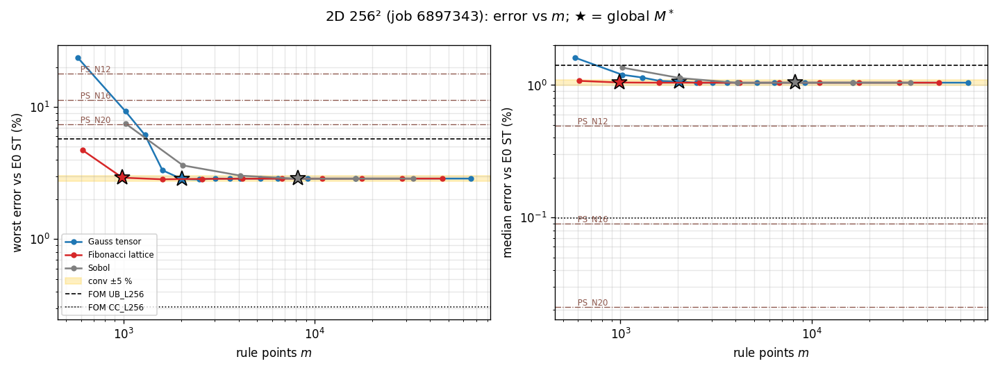
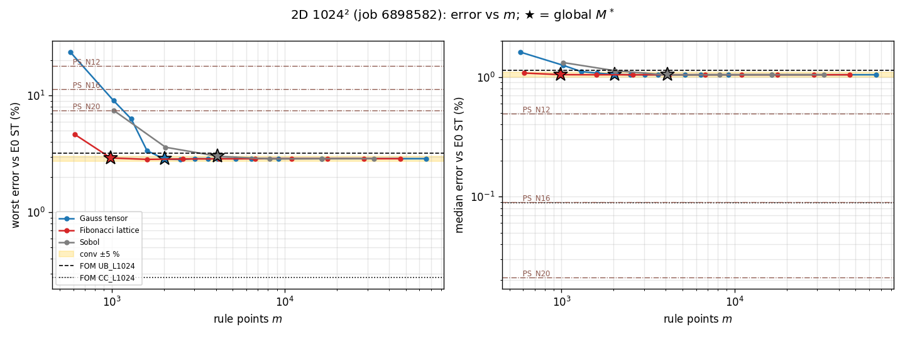
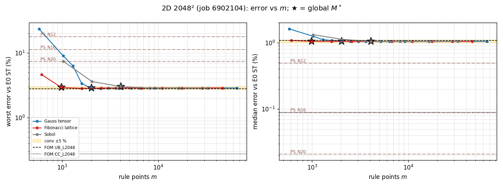
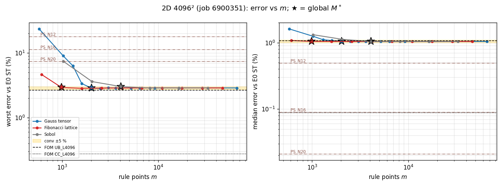
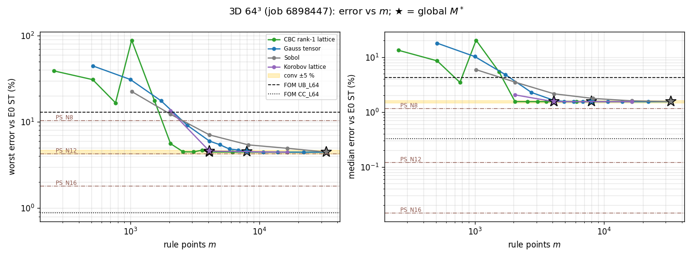
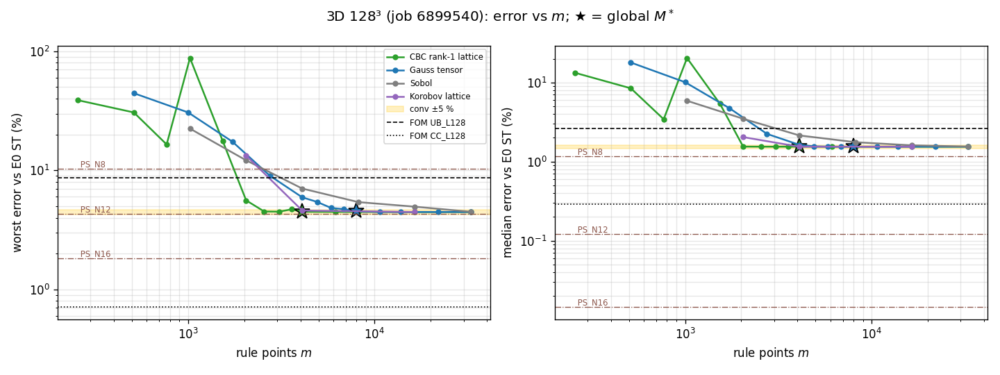
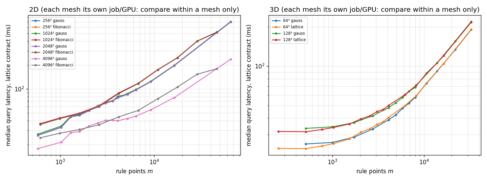

# Burgers off-mesh quadrature: where the accuracy plateau starts, against second-order references

This report re-scores the frozen Burgers 2D (`acc`, $R'=384$) and 3D ($R'=512$) off-mesh reduced models against the E0 second-order references, on a dense ladder of quadrature point counts $m$, and places the plateau against the full-order solvers with same-job timing. **Status: final for the jobs listed in §1** (held-out cohorts test64 / test32, reused from October, descriptive measurements; no sealed cohort opened). Numbers are generated by `reports/make_2026-11-05-burgers-quadrature-plateau.py` from the lane JSONs; the pre-registration is `experiments/burgers-quadrature-plateau/DESIGN.md` (amendments A1, A2; Codex design review READY).

## 1. What ran

| job | mesh | GPU | job id | elapsed (min) | wall limit (min) | state | audit |
|---|---|---|---|---|---|---|---|
| `p2d256` | 256 | a100-80G | 6897098 | 2.1 | 30 | FAILED | – |
| `p2d256b` | 256 | NVIDIA A100 80GB PCIe | 6897343 | 17.2 | 30 | COMPLETED | pass |
| `p3d65` | 65 | a100-80G | 6897571 | 0.2 | 30 | FAILED | – |
| `p3d65b` | 65 | NVIDIA A100 80GB PCIe | 6898447 | 15.0 | 30 | COMPLETED | pass |
| `p2d1024` | 1024 | NVIDIA A100 80GB PCIe | 6898582 | 19.3 | 35 | COMPLETED | pass |
| `p3d129` | 129 | NVIDIA A100 80GB PCIe | 6899540 | 21.0 | 30 | COMPLETED | pass |
| `p2d4096` | 4096 | NVIDIA H200 | 6900351 | 26.9 | 50 | COMPLETED | pass |
| `p3d257` | 257 | h200 | 6901029 | 0.4 | 60 | FAILED | – |
| `p2d2048` | 2048 | NVIDIA A100 80GB PCIe | 6902104 | 24.9 | 35 | COMPLETED | pass |
| `p3d257b` | 257 | h200 | 6902975 | 0.8 | 60 | FAILED | – |
| `p2d512` | 512 | a100-80G | 6902978 | 2.7 | 25 | RUNNING | – |
| `p3d257c` | 257 | h200 | 6903053 | 0.0 | 60 | PENDING | – |

GPU time charged: **2.17 GPU-h** of the 4.0 GPU-h cap (allocated wall time, every job above).
Not run: `p2d512`, `p3d257` (budget priority, DESIGN A1.8/A2.5).

## 2. Answers in brief

- **2D 256²** — plateau demonstrated: conv rollout worst 2.88 % / median 1.04 % (ST; S: 1.34 % / 0.047 %). Global $M^*$ (ST): Gauss tensor 2,025 (bracket 1,600–2,025]; Fibonacci lattice 987 (bracket 610–987]; Sobol 8,192 (bracket 4,096–8,192]. Same-mesh upwind FOM `UB_L256`: 5.76 % / 1.40 %.
- **2D 1024²** — plateau demonstrated: conv rollout worst 2.88 % / median 1.04 % (ST; S: 1.36 % / 0.045 %). Global $M^*$ (ST): Gauss tensor 2,025 (bracket 1,600–2,025]; Fibonacci lattice 987 (bracket 610–987]; Sobol 4,096 (bracket 2,048–4,096]. Same-mesh upwind FOM `UB_L1024`: 3.21 % / 1.13 %.
- **2D 2048²** — plateau demonstrated: conv rollout worst 2.88 % / median 1.04 % (ST; S: 1.36 % / 0.045 %). Global $M^*$ (ST): Gauss tensor 2,025 (bracket 1,600–2,025]; Fibonacci lattice 987 (bracket 610–987]; Sobol 4,096 (bracket 2,048–4,096]. Same-mesh upwind FOM `UB_L2048`: 2.81 % / 1.09 %.
- **2D 4096²** — plateau demonstrated: conv rollout worst 2.88 % / median 1.04 % (ST; S: 1.36 % / 0.045 %). Global $M^*$ (ST): Gauss tensor 2,025 (bracket 1,600–2,025]; Fibonacci lattice 987 (bracket 610–987]; Sobol 4,096 (bracket 2,048–4,096]. Same-mesh upwind FOM `UB_L4096`: 2.67 % / 1.07 %.
- **3D 64³** — plateau demonstrated: conv rollout worst 4.45 % / median 1.55 % (ST; S: 2.63 % / 0.743 %). Global $M^*$ (ST): CBC rank-1 lattice 4,096 (bracket 3,584–4,096]; optimistic 2,560 (ε_ref-unresolved rungs); Gauss tensor 8,000 (bracket 6,859–8,000]; Sobol 32,768 (bracket 16,384–32,768] (tail not demonstrated); Korobov lattice 4,093 (bracket 2,039–4,093] (tail not demonstrated). Same-mesh upwind FOM `UB_L64`: 12.97 % / 4.22 %.
- **3D 128³** — plateau demonstrated: conv rollout worst 4.47 % / median 1.55 % (ST; S: 2.65 % / 0.747 %). Global $M^*$ (ST): CBC rank-1 lattice 4,096 (bracket 3,584–4,096]; optimistic 2,560 (ε_ref-unresolved rungs); Gauss tensor 8,000 (bracket 6,859–8,000]; Sobol 32,768 (bracket 16,384–32,768] (tail not demonstrated); Korobov lattice 4,093 (bracket 2,039–4,093] (tail not demonstrated). Same-mesh upwind FOM `UB_L128`: 8.62 % / 2.63 %.

**Per-mesh summary** (ST, eligible cases; latencies are same-job confirmation-panel medians, lattice contract; "prov." = timing drift gate failed in that job, A2.4):

| mesh | plateau worst / median | cheapest plateau rule | its worst / median | ROM ms | same-mesh UB worst / median | UB ms | UB/ROM speed-up | cheapest FOM ≥ as accurate | its worst / median | FOM ms | FOM/ROM speed-up |
|---|---|---|---|---|---|---|---|---|---|---|---|
| 2D 256² | 2.88 % / 1.043 % | `fib987` ($m$=987) | 2.92 % / 1.046 % | 42.4 | 5.76 % / 1.404 % | 90.7 | 2.14× prov. | `PS_N48` | 0.583 % / 0.0025 % | 6.1 | 0.144× prov. |
| 2D 1024² | 2.88 % / 1.042 % | `fib987` ($m$=987) | 2.92 % / 1.044 % | 43.0 | 3.21 % / 1.132 % | 463.0 | 10.76× | `PS_N48` | 0.583 % / 0.0025 % | 6.7 | 0.155× |
| 2D 2048² | 2.88 % / 1.042 % | `fib987` ($m$=987) | 2.92 % / 1.044 % | 42.2 | 2.81 % / 1.088 % | 1930.9 | 45.72× | `PS_N48` | 0.583 % / 0.0025 % | 6.1 | 0.144× |
| 2D 4096² | 2.88 % / 1.042 % | `fib987` ($m$=987) | 2.92 % / 1.044 % | 27.6 | 2.67 % / 1.070 % | 3424.6 | 123.93× prov. | `PS_N48` | 0.583 % / 0.0025 % | 4.6 | 0.166× prov. |
| 3D 64³ | 4.45 % / 1.547 % | `lat4096` ($m$=4,096) | 4.47 % / 1.547 % | 40.4 | 12.97 % / 4.216 % | 91.8 | 2.27× | `PS_N12` | 4.285 % / 0.1224 % | 7.7 | 0.191× |
| 3D 128³ | 4.47 % / 1.545 % | `lat4096` ($m$=4,096) | 4.49 % / 1.545 % | 49.8 | 8.62 % / 2.629 % | 605.9 | 12.16× | `PS_N12` | 4.285 % / 0.1224 % | 7.6 | 0.153× |

- **2D plateau is mesh-independent**: conv-rollout worst error 2.88 %–2.88 % and median 1.042 %–1.043 % over 256², 1024², 2048², 4096² (ST). Against the space-only S reference the same rollouts give 1.34 %–1.36 % worst and 0.045 %–0.047 % median (S/ST ratio 0.47–0.47 worst, 0.043–0.045 median). S is backward Euler at the ROM's own Δt = 0.005, so the ST–S gap is the ROM's backward-Euler time error: it is about half of the worst-case plateau and nearly all of the median; quadrature is not what limits it.
- **2D crossover with the same-mesh upwind FOM** (worst error): UB/ROM-plateau ratio 256² 2.00, 1024² 1.11, 2048² 0.97, 4096² 0.93; the sign changes between 1024²→2048².
- **3D plateau is mesh-independent**: conv-rollout worst error 4.45 %–4.47 % and median 1.545 %–1.547 % over 64³, 128³ (ST). Against the space-only S reference the same rollouts give 2.63 %–2.65 % worst and 0.743 %–0.747 % median (S/ST ratio 0.59–0.59 worst, 0.481–0.483 median). In 3D, S is backward Euler at Δt = 0.005 while the ROM steps at Δt = 0.01, so S is not time-matched and the ST–S gap is not a clean time-error measurement; no attribution is made from it.
- **3D crossover with the same-mesh upwind FOM** (worst error): UB/ROM-plateau ratio 64³ 2.91, 128³ 1.93; no sign change inside the meshes run.

## 3. Plateau point $M^*$ per family and mesh (ST references)

Global $M^*$: smallest rung from which every larger valid rung is within 5 % of the conv rollout in both worst and median error (DESIGN §6, A1.1, A2.1). "tail" = the family's top two rungs within 1 % of the conv rollout.

| dim | mesh | anchor (conv vs check: dist, W ratio) | conv worst | conv median | family | $M^*$ (global) | tail | worst at $M^*$ | median at $M^*$ | within 5 % of own top rung from |
|---|---|---|---|---|---|---|---|---|---|---|
| 2D | 256² | 2.2e-06, 1.0000 ✓ | 2.88 % | 1.043 % | Gauss tensor | 2,025 (bracket 1,600–2,025] | yes | 2.85 % | 1.061 % | 2025 |
| 2D | 256² | 2.2e-06, 1.0000 ✓ | 2.88 % | 1.043 % | Fibonacci lattice | 987 (bracket 610–987] | yes | 2.92 % | 1.046 % | 987 |
| 2D | 256² | 2.2e-06, 1.0000 ✓ | 2.88 % | 1.043 % | Sobol | 8,192 (bracket 4,096–8,192] | yes | 2.86 % | 1.042 % | 8192 |
| 2D | 1024² | 2.2e-06, 1.0000 ✓ | 2.88 % | 1.042 % | Gauss tensor | 2,025 (bracket 1,600–2,025] | yes | 2.86 % | 1.049 % | 2025 |
| 2D | 1024² | 2.2e-06, 1.0000 ✓ | 2.88 % | 1.042 % | Fibonacci lattice | 987 (bracket 610–987] | yes | 2.92 % | 1.044 % | 987 |
| 2D | 1024² | 2.2e-06, 1.0000 ✓ | 2.88 % | 1.042 % | Sobol | 4,096 (bracket 2,048–4,096] | yes | 3.03 % | 1.038 % | 4096 |
| 2D | 2048² | 2.2e-06, 1.0000 ✓ | 2.88 % | 1.042 % | Gauss tensor | 2,025 (bracket 1,600–2,025] | yes | 2.86 % | 1.049 % | 2025 |
| 2D | 2048² | 2.2e-06, 1.0000 ✓ | 2.88 % | 1.042 % | Fibonacci lattice | 987 (bracket 610–987] | yes | 2.92 % | 1.044 % | 987 |
| 2D | 2048² | 2.2e-06, 1.0000 ✓ | 2.88 % | 1.042 % | Sobol | 4,096 (bracket 2,048–4,096] | yes | 3.03 % | 1.038 % | 4096 |
| 2D | 4096² | 2.2e-06, 1.0000 ✓ | 2.88 % | 1.042 % | Gauss tensor | 2,025 (bracket 1,600–2,025] | yes | 2.86 % | 1.049 % | 2025 |
| 2D | 4096² | 2.2e-06, 1.0000 ✓ | 2.88 % | 1.042 % | Fibonacci lattice | 987 (bracket 610–987] | yes | 2.92 % | 1.044 % | 987 |
| 2D | 4096² | 2.2e-06, 1.0000 ✓ | 2.88 % | 1.042 % | Sobol | 4,096 (bracket 2,048–4,096] | yes | 3.03 % | 1.038 % | 4096 |
| 3D | 64³ | 4.5e-05, 1.0000 ✓ | 4.45 % | 1.547 % | CBC rank-1 lattice | 4,096 (bracket 3,584–4,096]; optimistic 2,560 (ε_ref-unresolved rungs) | yes | 4.47 % | 1.547 % | 4096 |
| 3D | 64³ | 4.5e-05, 1.0000 ✓ | 4.45 % | 1.547 % | Gauss tensor | 8,000 (bracket 6,859–8,000] | yes | 4.52 % | 1.547 % | 8000 |
| 3D | 64³ | 4.5e-05, 1.0000 ✓ | 4.45 % | 1.547 % | Sobol | 32,768 (bracket 16,384–32,768] | no | 4.47 % | 1.549 % | 32768 |
| 3D | 64³ | 4.5e-05, 1.0000 ✓ | 4.45 % | 1.547 % | Korobov lattice | 4,093 (bracket 2,039–4,093] | no | 4.57 % | 1.547 % | 4093 |
| 3D | 128³ | 4.4e-05, 1.0000 ✓ | 4.47 % | 1.545 % | CBC rank-1 lattice | 4,096 (bracket 3,584–4,096]; optimistic 2,560 (ε_ref-unresolved rungs) | yes | 4.49 % | 1.545 % | 4096 |
| 3D | 128³ | 4.4e-05, 1.0000 ✓ | 4.47 % | 1.545 % | Gauss tensor | 8,000 (bracket 6,859–8,000] | yes | 4.54 % | 1.546 % | 8000 |
| 3D | 128³ | 4.4e-05, 1.0000 ✓ | 4.47 % | 1.545 % | Sobol | 32,768 (bracket 16,384–32,768] | no | 4.49 % | 1.552 % | 32768 |
| 3D | 128³ | 4.4e-05, 1.0000 ✓ | 4.47 % | 1.545 % | Korobov lattice | 4,093 (bracket 2,039–4,093] | no | 4.60 % | 1.545 % | 4093 |

## 4. Plateau point $M^*$ per family and mesh (S references)

Global $M^*$: smallest rung from which every larger valid rung is within 5 % of the conv rollout in both worst and median error (DESIGN §6, A1.1, A2.1). "tail" = the family's top two rungs within 1 % of the conv rollout.

| dim | mesh | anchor (conv vs check: dist, W ratio) | conv worst | conv median | family | $M^*$ (global) | tail | worst at $M^*$ | median at $M^*$ | within 5 % of own top rung from |
|---|---|---|---|---|---|---|---|---|---|---|
| 2D | 256² | 2.2e-06, 1.0000 ✓ | 1.34 % | 0.047 % | Gauss tensor | 3,025 (bracket 2,500–3,025] | yes | 1.35 % | 0.047 % | 3025 |
| 2D | 256² | 2.2e-06, 1.0000 ✓ | 1.34 % | 0.047 % | Fibonacci lattice | 2,584 (bracket 1,597–2,584] | yes | 1.31 % | 0.047 % | 2584 |
| 2D | 256² | 2.2e-06, 1.0000 ✓ | 1.34 % | 0.047 % | Sobol | 16,384 (bracket 8,192–16,384] | no | 1.34 % | 0.047 % | 16384 |
| 2D | 1024² | 2.2e-06, 1.0000 ✓ | 1.36 % | 0.045 % | Gauss tensor | 3,025 (bracket 2,500–3,025]; optimistic 2,500 (ε_ref-unresolved rungs) | yes | 1.37 % | 0.045 % | 3025 |
| 2D | 1024² | 2.2e-06, 1.0000 ✓ | 1.36 % | 0.045 % | Fibonacci lattice | 2,584 (bracket 1,597–2,584] | yes | 1.32 % | 0.045 % | 2584 |
| 2D | 1024² | 2.2e-06, 1.0000 ✓ | 1.36 % | 0.045 % | Sobol | 16,384 (bracket 8,192–16,384] | no | 1.36 % | 0.045 % | 16384 |
| 2D | 2048² | 2.2e-06, 1.0000 ✓ | 1.36 % | 0.045 % | Gauss tensor | 3,025 (bracket 2,500–3,025]; optimistic 2,500 (ε_ref-unresolved rungs) | yes | 1.37 % | 0.045 % | 3025 |
| 2D | 2048² | 2.2e-06, 1.0000 ✓ | 1.36 % | 0.045 % | Fibonacci lattice | 2,584 (bracket 1,597–2,584] | yes | 1.32 % | 0.045 % | 2584 |
| 2D | 2048² | 2.2e-06, 1.0000 ✓ | 1.36 % | 0.045 % | Sobol | 16,384 (bracket 8,192–16,384] | no | 1.36 % | 0.045 % | 16384 |
| 2D | 4096² | 2.2e-06, 1.0000 ✓ | 1.36 % | 0.045 % | Gauss tensor | 3,025 (bracket 2,500–3,025]; optimistic 2,500 (ε_ref-unresolved rungs) | yes | 1.37 % | 0.045 % | 3025 |
| 2D | 4096² | 2.2e-06, 1.0000 ✓ | 1.36 % | 0.045 % | Fibonacci lattice | 2,584 (bracket 1,597–2,584] | yes | 1.32 % | 0.045 % | 2584 |
| 2D | 4096² | 2.2e-06, 1.0000 ✓ | 1.36 % | 0.045 % | Sobol | 16,384 (bracket 8,192–16,384] | no | 1.36 % | 0.045 % | 16384 |
| 3D | 64³ | 4.5e-05, 1.0000 ✓ | 2.63 % | 0.743 % | CBC rank-1 lattice | 4,096 (bracket 3,584–4,096] | yes | 2.64 % | 0.743 % | 4096 |
| 3D | 64³ | 4.5e-05, 1.0000 ✓ | 2.63 % | 0.743 % | Gauss tensor | 8,000 (bracket 6,859–8,000] | yes | 2.67 % | 0.744 % | 8000 |
| 3D | 64³ | 4.5e-05, 1.0000 ✓ | 2.63 % | 0.743 % | Sobol | not reached | no | – | – | 32768 |
| 3D | 64³ | 4.5e-05, 1.0000 ✓ | 2.63 % | 0.743 % | Korobov lattice | 4,093 (bracket 2,039–4,093] | no | 2.74 % | 0.748 % | 4093 |
| 3D | 128³ | 4.4e-05, 1.0000 ✓ | 2.65 % | 0.747 % | CBC rank-1 lattice | 4,096 (bracket 3,584–4,096] | yes | 2.66 % | 0.746 % | 4096 |
| 3D | 128³ | 4.4e-05, 1.0000 ✓ | 2.65 % | 0.747 % | Gauss tensor | 8,000 (bracket 6,859–8,000] | yes | 2.68 % | 0.750 % | 8000 |
| 3D | 128³ | 4.4e-05, 1.0000 ✓ | 2.65 % | 0.747 % | Sobol | not reached | no | – | – | 32768 |
| 3D | 128³ | 4.4e-05, 1.0000 ✓ | 2.65 % | 0.747 % | Korobov lattice | 4,093 (bracket 2,039–4,093] | no | 2.76 % | 0.756 % | 4093 |

## 5. Error against $m$ (worst / median over eligible cases, ST)

**2D 256²** (job 6897343, NVIDIA A100 80GB PCIe; 63 eligible ST cases)

| family | rule | $m$ | worst ST | median ST | worst S | median S | max dist to conv | valid | lattice-contract ms |
|---|---|---|---|---|---|---|---|---|---|
| control | `ctrl_smolyak8` | 1025 | 45.13 % | 6.204 % | 43.61 % | 6.712 % | 4.4e-01 | yes | 33.1 |
| fibonacci | `fib610` | 610 | 4.72 % | 1.076 % | 4.29 % | 0.144 % | 4.3e-02 | yes | 35.8 |
| fibonacci | `fib987` | 987 | 2.92 % | 1.046 % | 1.38 % | 0.052 % | 1.3e-02 | yes | 42.5 |
| fibonacci | `fib1597` | 1597 | 2.84 % | 1.042 % | 1.25 % | 0.047 % | 3.9e-03 | yes | 48.4 |
| fibonacci | `fib2584` | 2584 | 2.86 % | 1.043 % | 1.31 % | 0.047 % | 2.1e-03 | yes | 59.9 |
| fibonacci | `fib4181` | 4181 | 2.87 % | 1.043 % | 1.32 % | 0.047 % | 1.0e-03 | yes | 87.3 |
| fibonacci | `fib6765` | 6765 | 2.87 % | 1.043 % | 1.34 % | 0.047 % | 4.3e-04 | yes | 116.7 |
| fibonacci | `fib10946` | 10946 | 2.87 % | 1.043 % | 1.34 % | 0.047 % | 1.2e-04 | yes | 173.8 |
| fibonacci | `fib17711` | 17711 | 2.88 % | 1.043 % | 1.34 % | 0.047 % | 1.8e-05 | yes | 248.1 |
| fibonacci | `fib28657` | 28657 | 2.88 % | 1.043 % | 1.34 % | 0.047 % | 4.9e-06 | yes | 399.5 |
| fibonacci | `fib46368` | 46368 | 2.88 % | 1.043 % | 1.34 % | 0.047 % | 2.2e-06 | yes | 517.0 |
| gauss | `gauss24` | 576 | 23.71 % | 1.614 % | 21.77 % | 1.178 % | 2.2e-01 | yes | 26.1 |
| gauss | `gauss32` | 1024 | 9.30 % | 1.195 % | 7.39 % | 0.659 % | 7.2e-02 | yes | 33.0 |
| gauss | `gauss36` | 1296 | 6.14 % | 1.141 % | 4.75 % | 0.348 % | 4.4e-02 | yes | 44.5 |
| gauss | `gauss40` | 1600 | 3.32 % | 1.075 % | 1.73 % | 0.135 % | 1.5e-02 | yes | 46.6 |
| gauss | `gauss45` | 2025 | 2.85 % | 1.061 % | 1.13 % | 0.054 % | 5.0e-03 | yes | 53.3 |
| gauss | `gauss50` | 2500 | 2.83 % | 1.041 % | 1.27 % | 0.049 % | 1.5e-03 | yes | 60.9 |
| gauss | `gauss55` | 3025 | 2.88 % | 1.042 % | 1.35 % | 0.047 % | 7.0e-04 | yes | 66.1 |
| gauss | `gauss60` | 3600 | 2.87 % | 1.042 % | 1.33 % | 0.047 % | 7.6e-04 | yes | 70.3 |
| gauss | `gauss64` | 4096 | 2.88 % | 1.042 % | 1.34 % | 0.047 % | 5.5e-04 | yes | 80.8 |
| gauss | `gauss72` | 5184 | 2.87 % | 1.042 % | 1.33 % | 0.047 % | 2.0e-04 | yes | 85.1 |
| gauss | `gauss80` | 6400 | 2.88 % | 1.043 % | 1.34 % | 0.047 % | 1.9e-04 | yes | 97.3 |
| gauss | `gauss96` | 9216 | 2.88 % | 1.043 % | 1.34 % | 0.047 % | 1.7e-04 | yes | 123.8 |
| gauss | `gauss128` | 16384 | 2.88 % | 1.043 % | 1.34 % | 0.047 % | 4.1e-05 | yes | 196.8 |
| gauss | `gauss256` | 65536 | 2.88 % | 1.043 % | 1.34 % | 0.047 % | – | yes | 701.7 |
| sobol | `sobol1024` | 1024 | 7.51 % | 1.353 % | 5.76 % | 0.787 % | 5.7e-02 | yes | 33.8 |
| sobol | `sobol2048` | 2048 | 3.62 % | 1.129 % | 1.92 % | 0.469 % | 1.6e-02 | yes | 50.6 |
| sobol | `sobol4096` | 4096 | 3.03 % | 1.039 % | 1.41 % | 0.135 % | 9.1e-03 | yes | 78.8 |
| sobol | `sobol8192` | 8192 | 2.86 % | 1.042 % | 1.30 % | 0.061 % | 3.5e-03 | yes | 112.5 |
| sobol | `sobol16384` | 16384 | 2.87 % | 1.043 % | 1.34 % | 0.047 % | 1.6e-03 | yes | 196.5 |
| sobol | `sobol32768` | 32768 | 2.88 % | 1.042 % | 1.35 % | 0.045 % | 7.2e-04 | yes | 366.8 |

**2D 1024²** (job 6898582, NVIDIA A100 80GB PCIe; 63 eligible ST cases)

| family | rule | $m$ | worst ST | median ST | worst S | median S | max dist to conv | valid | lattice-contract ms |
|---|---|---|---|---|---|---|---|---|---|
| control | `ctrl_smolyak8` | 1025 | 45.02 % | 6.229 % | 43.49 % | 6.682 % | 4.3e-01 | yes | 34.0 |
| fibonacci | `fib610` | 610 | 4.66 % | 1.077 % | 4.22 % | 0.139 % | 4.2e-02 | yes | 36.5 |
| fibonacci | `fib987` | 987 | 2.92 % | 1.044 % | 1.36 % | 0.051 % | 1.3e-02 | yes | 43.0 |
| fibonacci | `fib1597` | 1597 | 2.84 % | 1.042 % | 1.26 % | 0.046 % | 4.0e-03 | yes | 49.5 |
| fibonacci | `fib2584` | 2584 | 2.87 % | 1.042 % | 1.32 % | 0.045 % | 2.2e-03 | yes | 61.3 |
| fibonacci | `fib4181` | 4181 | 2.87 % | 1.042 % | 1.34 % | 0.045 % | 1.0e-03 | yes | 88.9 |
| fibonacci | `fib6765` | 6765 | 2.88 % | 1.042 % | 1.35 % | 0.045 % | 4.4e-04 | yes | 117.9 |
| fibonacci | `fib10946` | 10946 | 2.88 % | 1.042 % | 1.35 % | 0.045 % | 1.2e-04 | yes | 175.2 |
| fibonacci | `fib17711` | 17711 | 2.88 % | 1.042 % | 1.36 % | 0.045 % | 1.7e-05 | yes | 247.6 |
| fibonacci | `fib28657` | 28657 | 2.88 % | 1.042 % | 1.36 % | 0.045 % | 4.9e-06 | yes | 400.5 |
| fibonacci | `fib46368` | 46368 | 2.88 % | 1.042 % | 1.36 % | 0.045 % | 2.2e-06 | yes | 519.3 |
| gauss | `gauss24` | 576 | 23.64 % | 1.614 % | 21.70 % | 1.159 % | 2.2e-01 | yes | 26.9 |
| gauss | `gauss32` | 1024 | 9.07 % | 1.249 % | 7.15 % | 0.667 % | 7.1e-02 | yes | 34.1 |
| gauss | `gauss36` | 1296 | 6.32 % | 1.110 % | 5.04 % | 0.284 % | 4.6e-02 | yes | 45.6 |
| gauss | `gauss40` | 1600 | 3.37 % | 1.076 % | 1.82 % | 0.138 % | 1.5e-02 | yes | 47.8 |
| gauss | `gauss45` | 2025 | 2.86 % | 1.049 % | 1.22 % | 0.052 % | 6.1e-03 | yes | 53.7 |
| gauss | `gauss50` | 2500 | 2.84 % | 1.041 % | 1.29 % | 0.047 % | 1.7e-03 | yes | 61.4 |
| gauss | `gauss55` | 3025 | 2.88 % | 1.042 % | 1.37 % | 0.045 % | 7.0e-04 | yes | 67.3 |
| gauss | `gauss60` | 3600 | 2.88 % | 1.042 % | 1.34 % | 0.045 % | 7.6e-04 | yes | 71.3 |
| gauss | `gauss64` | 4096 | 2.89 % | 1.042 % | 1.36 % | 0.045 % | 5.4e-04 | yes | 77.9 |
| gauss | `gauss72` | 5184 | 2.88 % | 1.042 % | 1.35 % | 0.045 % | 2.0e-04 | yes | 87.5 |
| gauss | `gauss80` | 6400 | 2.88 % | 1.042 % | 1.36 % | 0.045 % | 1.9e-04 | yes | 98.6 |
| gauss | `gauss96` | 9216 | 2.88 % | 1.042 % | 1.36 % | 0.045 % | 1.7e-04 | yes | 124.9 |
| gauss | `gauss128` | 16384 | 2.88 % | 1.042 % | 1.36 % | 0.045 % | 4.2e-05 | yes | 198.9 |
| gauss | `gauss256` | 65536 | 2.88 % | 1.042 % | 1.36 % | 0.045 % | – | yes | 707.9 |
| sobol | `sobol1024` | 1024 | 7.49 % | 1.317 % | 5.74 % | 0.786 % | 5.6e-02 | yes | 34.3 |
| sobol | `sobol2048` | 2048 | 3.61 % | 1.125 % | 1.91 % | 0.466 % | 1.6e-02 | yes | 51.7 |
| sobol | `sobol4096` | 4096 | 3.03 % | 1.038 % | 1.41 % | 0.133 % | 9.0e-03 | yes | 75.8 |
| sobol | `sobol8192` | 8192 | 2.87 % | 1.042 % | 1.32 % | 0.060 % | 3.5e-03 | yes | 115.4 |
| sobol | `sobol16384` | 16384 | 2.88 % | 1.043 % | 1.36 % | 0.045 % | 1.6e-03 | yes | 198.8 |
| sobol | `sobol32768` | 32768 | 2.88 % | 1.042 % | 1.37 % | 0.044 % | 7.1e-04 | yes | 368.0 |

**2D 2048²** (job 6902104, NVIDIA A100 80GB PCIe; 63 eligible ST cases)

| family | rule | $m$ | worst ST | median ST | worst S | median S | max dist to conv | valid | lattice-contract ms |
|---|---|---|---|---|---|---|---|---|---|
| control | `ctrl_smolyak8` | 1025 | 45.02 % | 6.231 % | 43.49 % | 6.681 % | 4.3e-01 | yes | 33.2 |
| fibonacci | `fib610` | 610 | 4.66 % | 1.077 % | 4.22 % | 0.139 % | 4.2e-02 | yes | 35.7 |
| fibonacci | `fib987` | 987 | 2.92 % | 1.044 % | 1.36 % | 0.052 % | 1.3e-02 | yes | 42.3 |
| fibonacci | `fib1597` | 1597 | 2.85 % | 1.042 % | 1.26 % | 0.046 % | 4.0e-03 | yes | 48.8 |
| fibonacci | `fib2584` | 2584 | 2.87 % | 1.042 % | 1.32 % | 0.045 % | 2.2e-03 | yes | 59.9 |
| fibonacci | `fib4181` | 4181 | 2.87 % | 1.042 % | 1.34 % | 0.045 % | 1.0e-03 | yes | 87.7 |
| fibonacci | `fib6765` | 6765 | 2.88 % | 1.042 % | 1.35 % | 0.045 % | 4.4e-04 | yes | 117.0 |
| fibonacci | `fib10946` | 10946 | 2.88 % | 1.042 % | 1.35 % | 0.045 % | 1.2e-04 | yes | 174.5 |
| fibonacci | `fib17711` | 17711 | 2.88 % | 1.042 % | 1.36 % | 0.045 % | 1.7e-05 | yes | 246.5 |
| fibonacci | `fib28657` | 28657 | 2.88 % | 1.042 % | 1.36 % | 0.045 % | 4.9e-06 | yes | 398.8 |
| fibonacci | `fib46368` | 46368 | 2.88 % | 1.042 % | 1.36 % | 0.045 % | 2.2e-06 | yes | 514.9 |
| gauss | `gauss24` | 576 | 23.64 % | 1.614 % | 21.70 % | 1.161 % | 2.2e-01 | yes | 26.0 |
| gauss | `gauss32` | 1024 | 9.07 % | 1.248 % | 7.14 % | 0.666 % | 7.1e-02 | yes | 32.7 |
| gauss | `gauss36` | 1296 | 6.31 % | 1.109 % | 5.03 % | 0.284 % | 4.6e-02 | yes | 44.5 |
| gauss | `gauss40` | 1600 | 3.37 % | 1.076 % | 1.82 % | 0.138 % | 1.5e-02 | yes | 47.6 |
| gauss | `gauss45` | 2025 | 2.86 % | 1.049 % | 1.22 % | 0.052 % | 6.1e-03 | yes | 53.3 |
| gauss | `gauss50` | 2500 | 2.84 % | 1.041 % | 1.29 % | 0.047 % | 1.7e-03 | yes | 60.6 |
| gauss | `gauss55` | 3025 | 2.88 % | 1.042 % | 1.37 % | 0.045 % | 7.0e-04 | yes | 66.1 |
| gauss | `gauss60` | 3600 | 2.88 % | 1.042 % | 1.34 % | 0.045 % | 7.6e-04 | yes | 70.3 |
| gauss | `gauss64` | 4096 | 2.89 % | 1.042 % | 1.36 % | 0.045 % | 5.4e-04 | yes | 77.3 |
| gauss | `gauss72` | 5184 | 2.88 % | 1.042 % | 1.35 % | 0.045 % | 2.0e-04 | yes | 85.4 |
| gauss | `gauss80` | 6400 | 2.88 % | 1.042 % | 1.36 % | 0.045 % | 1.9e-04 | yes | 97.5 |
| gauss | `gauss96` | 9216 | 2.88 % | 1.042 % | 1.36 % | 0.045 % | 1.7e-04 | yes | 123.4 |
| gauss | `gauss128` | 16384 | 2.88 % | 1.042 % | 1.36 % | 0.045 % | 4.2e-05 | yes | 197.3 |
| gauss | `gauss256` | 65536 | 2.88 % | 1.042 % | 1.36 % | 0.045 % | – | yes | 700.1 |
| sobol | `sobol1024` | 1024 | 7.49 % | 1.317 % | 5.74 % | 0.786 % | 5.6e-02 | yes | 33.7 |
| sobol | `sobol2048` | 2048 | 3.61 % | 1.124 % | 1.91 % | 0.466 % | 1.6e-02 | yes | 50.6 |
| sobol | `sobol4096` | 4096 | 3.03 % | 1.038 % | 1.41 % | 0.133 % | 9.0e-03 | yes | 74.8 |
| sobol | `sobol8192` | 8192 | 2.87 % | 1.042 % | 1.32 % | 0.060 % | 3.5e-03 | yes | 113.4 |
| sobol | `sobol16384` | 16384 | 2.88 % | 1.043 % | 1.36 % | 0.045 % | 1.6e-03 | yes | 197.3 |
| sobol | `sobol32768` | 32768 | 2.88 % | 1.042 % | 1.37 % | 0.044 % | 7.1e-04 | yes | 365.2 |

**2D 4096²** (job 6900351, NVIDIA H200; 63 eligible ST cases)

| family | rule | $m$ | worst ST | median ST | worst S | median S | max dist to conv | valid | lattice-contract ms |
|---|---|---|---|---|---|---|---|---|---|
| control | `ctrl_smolyak8` | 1025 | 45.02 % | 6.231 % | 43.49 % | 6.681 % | 4.3e-01 | yes | 21.5 |
| fibonacci | `fib610` | 610 | 4.66 % | 1.077 % | 4.22 % | 0.139 % | 4.2e-02 | yes | 24.3 |
| fibonacci | `fib987` | 987 | 2.92 % | 1.044 % | 1.36 % | 0.052 % | 1.3e-02 | yes | 27.7 |
| fibonacci | `fib1597` | 1597 | 2.85 % | 1.042 % | 1.26 % | 0.046 % | 4.0e-03 | yes | 30.8 |
| fibonacci | `fib2584` | 2584 | 2.87 % | 1.042 % | 1.32 % | 0.045 % | 2.2e-03 | yes | 35.4 |
| fibonacci | `fib4181` | 4181 | 2.87 % | 1.042 % | 1.34 % | 0.045 % | 1.0e-03 | yes | 44.4 |
| fibonacci | `fib6765` | 6765 | 2.88 % | 1.042 % | 1.35 % | 0.045 % | 4.4e-04 | yes | 53.6 |
| fibonacci | `fib10946` | 10946 | 2.88 % | 1.042 % | 1.35 % | 0.045 % | 1.2e-04 | yes | 75.3 |
| fibonacci | `fib17711` | 17711 | 2.88 % | 1.042 % | 1.36 % | 0.045 % | 1.7e-05 | yes | 105.8 |
| fibonacci | `fib28657` | 28657 | 2.88 % | 1.042 % | 1.36 % | 0.045 % | 4.9e-06 | yes | 153.0 |
| fibonacci | `fib46368` | 46368 | 2.88 % | 1.042 % | 1.36 % | 0.045 % | 2.2e-06 | yes | 179.5 |
| gauss | `gauss24` | 576 | 23.63 % | 1.614 % | 21.70 % | 1.161 % | 2.2e-01 | yes | 17.7 |
| gauss | `gauss32` | 1024 | 9.07 % | 1.248 % | 7.14 % | 0.666 % | 7.1e-02 | yes | 21.4 |
| gauss | `gauss36` | 1296 | 6.31 % | 1.109 % | 5.03 % | 0.284 % | 4.6e-02 | yes | 28.1 |
| gauss | `gauss40` | 1600 | 3.37 % | 1.076 % | 1.82 % | 0.138 % | 1.5e-02 | yes | 29.1 |
| gauss | `gauss45` | 2025 | 2.86 % | 1.049 % | 1.22 % | 0.052 % | 6.1e-03 | yes | 34.2 |
| gauss | `gauss50` | 2500 | 2.84 % | 1.041 % | 1.29 % | 0.047 % | 1.7e-03 | yes | 37.2 |
| gauss | `gauss55` | 3025 | 2.88 % | 1.042 % | 1.37 % | 0.045 % | 7.0e-04 | yes | 40.2 |
| gauss | `gauss60` | 3600 | 2.88 % | 1.042 % | 1.34 % | 0.045 % | 7.6e-04 | yes | 40.5 |
| gauss | `gauss64` | 4096 | 2.89 % | 1.042 % | 1.36 % | 0.045 % | 5.4e-04 | yes | 39.7 |
| gauss | `gauss72` | 5184 | 2.88 % | 1.042 % | 1.35 % | 0.045 % | 2.0e-04 | yes | 42.4 |
| gauss | `gauss80` | 6400 | 2.88 % | 1.042 % | 1.36 % | 0.045 % | 1.9e-04 | yes | 45.5 |
| gauss | `gauss96` | 9216 | 2.88 % | 1.042 % | 1.36 % | 0.045 % | 1.7e-04 | yes | 54.7 |
| gauss | `gauss128` | 16384 | 2.88 % | 1.042 % | 1.36 % | 0.045 % | 4.2e-05 | yes | 77.7 |
| gauss | `gauss256` | 65536 | 2.88 % | 1.042 % | 1.36 % | 0.045 % | – | yes | 237.2 |
| sobol | `sobol1024` | 1024 | 7.49 % | 1.317 % | 5.74 % | 0.786 % | 5.6e-02 | yes | 21.6 |
| sobol | `sobol2048` | 2048 | 3.61 % | 1.124 % | 1.91 % | 0.466 % | 1.6e-02 | yes | 30.1 |
| sobol | `sobol4096` | 4096 | 3.03 % | 1.038 % | 1.41 % | 0.133 % | 9.0e-03 | yes | 38.5 |
| sobol | `sobol8192` | 8192 | 2.87 % | 1.042 % | 1.32 % | 0.060 % | 3.5e-03 | yes | 50.9 |
| sobol | `sobol16384` | 16384 | 2.88 % | 1.043 % | 1.36 % | 0.045 % | 1.6e-03 | yes | 77.5 |
| sobol | `sobol32768` | 32768 | 2.88 % | 1.042 % | 1.37 % | 0.044 % | 7.1e-04 | yes | 130.2 |

**3D 64³** (job 6898447, NVIDIA A100 80GB PCIe; 32 eligible ST cases)

| family | rule | $m$ | worst ST | median ST | worst S | median S | max dist to conv | valid | lattice-contract ms |
|---|---|---|---|---|---|---|---|---|---|
| control | `ctrl_smol8` | 2559 | 43.09 % | 23.242 % | 42.29 % | 23.245 % | 4.2e-01 | NO | 38.8 |
| gauss | `gl8` | 512 | 44.50 % | 17.971 % | 43.46 % | 17.512 % | 4.2e-01 | yes | 25.3 |
| gauss | `gl10` | 1000 | 30.97 % | 10.248 % | 29.58 % | 9.859 % | 2.8e-01 | yes | 26.0 |
| gauss | `gl12` | 1728 | 17.53 % | 4.794 % | 16.21 % | 4.276 % | 1.5e-01 | yes | 28.6 |
| gauss | `gl14` | 2744 | 9.17 % | 2.273 % | 7.95 % | 1.769 % | 7.2e-02 | yes | 33.0 |
| gauss | `gl16` | 4096 | 5.97 % | 1.632 % | 4.31 % | 0.897 % | 3.2e-02 | yes | 38.8 |
| gauss | `gl17` | 4913 | 5.44 % | 1.557 % | 3.56 % | 0.801 % | 1.9e-02 | yes | 42.3 |
| gauss | `gl18` | 5832 | 4.84 % | 1.548 % | 2.99 % | 0.769 % | 1.4e-02 | yes | 47.6 |
| gauss | `gl19` | 6859 | 4.70 % | 1.547 % | 2.83 % | 0.744 % | 8.3e-03 | yes | 52.1 |
| gauss | `gl20` | 8000 | 4.52 % | 1.547 % | 2.67 % | 0.744 % | 6.0e-03 | yes | 57.6 |
| gauss | `gl22` | 10648 | 4.46 % | 1.547 % | 2.63 % | 0.743 % | 2.4e-03 | yes | 74.0 |
| gauss | `gl24` | 13824 | 4.45 % | 1.547 % | 2.63 % | 0.743 % | 8.9e-04 | yes | 91.4 |
| gauss | `gl28` | 21952 | 4.45 % | 1.547 % | 2.63 % | 0.743 % | 2.0e-04 | yes | 133.9 |
| gauss | `gl32` | 32768 | 4.45 % | 1.547 % | 2.63 % | 0.743 % | 4.5e-05 | yes | 190.7 |
| korobov | `kor2039` | 2039 | 13.49 % | 2.057 % | 12.63 % | 1.600 % | 1.2e-01 | yes | 30.0 |
| korobov | `kor4093` | 4093 | 4.57 % | 1.547 % | 2.74 % | 0.748 % | 9.4e-03 | yes | 39.7 |
| korobov | `kor16381` | 16381 | 4.45 % | 1.547 % | 2.63 % | 0.743 % | 1.5e-04 | yes | 108.6 |
| lattice | `lat256` | 256 | 38.95 % | 13.371 % | 37.86 % | 12.942 % | 3.7e-01 | yes | 23.4 |
| lattice | `lat512` | 512 | 30.81 % | 8.563 % | 29.63 % | 7.990 % | 2.9e-01 | yes | 23.4 |
| lattice | `lat768` | 768 | 16.61 % | 3.463 % | 15.32 % | 3.065 % | 1.4e-01 | yes | 24.5 |
| lattice | `lat1024` | 1024 | 88.28 % | 20.346 % | 87.89 % | 20.151 % | 8.8e-01 | yes | 25.5 |
| lattice | `lat1536` | 1536 | 17.64 % | 5.452 % | 16.96 % | 5.115 % | 1.6e-01 | yes | 27.7 |
| lattice | `lat2048` | 2048 | 5.58 % | 1.550 % | 4.03 % | 0.792 % | 3.2e-02 | yes | 31.3 |
| lattice | `lat2560` | 2560 | 4.49 % | 1.547 % | 2.67 % | 0.744 % | 9.7e-03 | yes | 33.1 |
| lattice | `lat3072` | 3072 | 4.48 % | 1.546 % | 2.75 % | 0.743 % | 1.2e-02 | yes | 35.8 |
| lattice | `lat3584` | 3584 | 4.69 % | 1.547 % | 2.88 % | 0.770 % | 1.1e-02 | yes | 37.5 |
| lattice | `lat4096` | 4096 | 4.47 % | 1.547 % | 2.64 % | 0.743 % | 2.4e-03 | yes | 40.4 |
| lattice | `lat6144` | 6144 | 4.46 % | 1.546 % | 2.64 % | 0.743 % | 3.1e-03 | yes | 49.7 |
| lattice | `lat8192` | 8192 | 4.45 % | 1.547 % | 2.63 % | 0.743 % | 4.0e-04 | yes | 59.3 |
| lattice | `lat16384` | 16384 | 4.45 % | 1.547 % | 2.63 % | 0.743 % | 1.8e-05 | yes | 104.6 |
| lattice | `lat32768` | 32768 | 4.45 % | 1.547 % | 2.63 % | 0.743 % | – | yes | 191.4 |
| sobol | `sob1024` | 1024 | 22.49 % | 5.915 % | 21.53 % | 5.702 % | 2.1e-01 | yes | 25.5 |
| sobol | `sob2048` | 2048 | 12.23 % | 3.508 % | 11.07 % | 3.248 % | 1.0e-01 | yes | 30.1 |
| sobol | `sob4096` | 4096 | 7.05 % | 2.150 % | 6.20 % | 1.684 % | 5.7e-02 | yes | 38.6 |
| sobol | `sob8192` | 8192 | 5.40 % | 1.769 % | 3.92 % | 1.007 % | 2.7e-02 | yes | 56.8 |
| sobol | `sob16384` | 16384 | 4.93 % | 1.602 % | 3.17 % | 0.854 % | 1.5e-02 | yes | 101.7 |
| sobol | `sob32768` | 32768 | 4.47 % | 1.549 % | 2.68 % | 0.780 % | 6.1e-03 | yes | 188.0 |
| tensor | `tensor` | mesh | 12.96 % | 4.216 % | 11.70 % | 3.870 % | 1.1e-01 | yes | 104.2 |

**3D 128³** (job 6899540, NVIDIA A100 80GB PCIe; 32 eligible ST cases)

| family | rule | $m$ | worst ST | median ST | worst S | median S | max dist to conv | valid | lattice-contract ms |
|---|---|---|---|---|---|---|---|---|---|
| control | `ctrl_smol8` | 2559 | 42.99 % | 23.351 % | 42.19 % | 23.442 % | 4.1e-01 | NO | 47.4 |
| gauss | `gl8` | 512 | 44.47 % | 17.891 % | 43.42 % | 17.431 % | 4.2e-01 | yes | 33.4 |
| gauss | `gl10` | 1000 | 30.67 % | 10.098 % | 29.28 % | 9.709 % | 2.8e-01 | yes | 34.3 |
| gauss | `gl12` | 1728 | 17.43 % | 4.742 % | 16.11 % | 4.223 % | 1.5e-01 | yes | 36.9 |
| gauss | `gl14` | 2744 | 9.02 % | 2.246 % | 7.88 % | 1.742 % | 7.1e-02 | yes | 41.6 |
| gauss | `gl16` | 4096 | 5.93 % | 1.631 % | 4.27 % | 0.882 % | 3.2e-02 | yes | 48.0 |
| gauss | `gl17` | 4913 | 5.44 % | 1.562 % | 3.56 % | 0.807 % | 1.9e-02 | yes | 52.3 |
| gauss | `gl18` | 5832 | 4.84 % | 1.549 % | 2.99 % | 0.774 % | 1.3e-02 | yes | 57.5 |
| gauss | `gl19` | 6859 | 4.72 % | 1.546 % | 2.85 % | 0.751 % | 8.0e-03 | yes | 64.1 |
| gauss | `gl20` | 8000 | 4.54 % | 1.546 % | 2.68 % | 0.750 % | 5.9e-03 | yes | 68.8 |
| gauss | `gl22` | 10648 | 4.48 % | 1.545 % | 2.64 % | 0.747 % | 2.4e-03 | yes | 88.6 |
| gauss | `gl24` | 13824 | 4.47 % | 1.545 % | 2.65 % | 0.747 % | 9.0e-04 | yes | 105.5 |
| gauss | `gl28` | 21952 | 4.47 % | 1.545 % | 2.65 % | 0.747 % | 2.0e-04 | yes | 155.7 |
| gauss | `gl32` | 32768 | 4.47 % | 1.545 % | 2.65 % | 0.747 % | 4.4e-05 | yes | 219.9 |
| korobov | `kor2039` | 2039 | 13.39 % | 2.045 % | 12.52 % | 1.568 % | 1.2e-01 | yes | 38.4 |
| korobov | `kor4093` | 4093 | 4.60 % | 1.545 % | 2.76 % | 0.756 % | 9.2e-03 | yes | 48.6 |
| korobov | `kor16381` | 16381 | 4.47 % | 1.545 % | 2.65 % | 0.747 % | 1.4e-04 | yes | 124.9 |
| lattice | `lat256` | 256 | 38.88 % | 13.311 % | 37.78 % | 12.880 % | 3.7e-01 | yes | 31.6 |
| lattice | `lat512` | 512 | 30.66 % | 8.452 % | 29.47 % | 7.909 % | 2.8e-01 | yes | 31.4 |
| lattice | `lat768` | 768 | 16.51 % | 3.435 % | 15.22 % | 3.037 % | 1.4e-01 | yes | 32.7 |
| lattice | `lat1024` | 1024 | 87.79 % | 20.407 % | 87.41 % | 20.219 % | 8.7e-01 | yes | 33.9 |
| lattice | `lat1536` | 1536 | 17.55 % | 5.408 % | 16.87 % | 5.081 % | 1.6e-01 | yes | 36.1 |
| lattice | `lat2048` | 2048 | 5.60 % | 1.548 % | 4.05 % | 0.793 % | 3.1e-02 | yes | 39.4 |
| lattice | `lat2560` | 2560 | 4.52 % | 1.545 % | 2.68 % | 0.750 % | 9.5e-03 | yes | 41.6 |
| lattice | `lat3072` | 3072 | 4.50 % | 1.545 % | 2.78 % | 0.748 % | 1.1e-02 | yes | 44.9 |
| lattice | `lat3584` | 3584 | 4.71 % | 1.546 % | 2.89 % | 0.777 % | 1.1e-02 | yes | 46.6 |
| lattice | `lat4096` | 4096 | 4.49 % | 1.545 % | 2.66 % | 0.746 % | 2.4e-03 | yes | 49.9 |
| lattice | `lat6144` | 6144 | 4.48 % | 1.545 % | 2.65 % | 0.746 % | 3.0e-03 | yes | 60.3 |
| lattice | `lat8192` | 8192 | 4.47 % | 1.545 % | 2.65 % | 0.746 % | 3.9e-04 | yes | 71.2 |
| lattice | `lat16384` | 16384 | 4.47 % | 1.545 % | 2.65 % | 0.747 % | 1.7e-05 | yes | 120.1 |
| lattice | `lat32768` | 32768 | 4.47 % | 1.545 % | 2.65 % | 0.747 % | – | yes | 217.1 |
| sobol | `sob1024` | 1024 | 22.42 % | 5.882 % | 21.46 % | 5.669 % | 2.1e-01 | yes | 33.8 |
| sobol | `sob2048` | 2048 | 12.15 % | 3.483 % | 10.98 % | 3.220 % | 1.0e-01 | yes | 38.8 |
| sobol | `sob4096` | 4096 | 7.03 % | 2.144 % | 6.16 % | 1.668 % | 5.6e-02 | yes | 47.7 |
| sobol | `sob8192` | 8192 | 5.41 % | 1.760 % | 3.92 % | 1.010 % | 2.7e-02 | yes | 68.6 |
| sobol | `sob16384` | 16384 | 4.96 % | 1.609 % | 3.18 % | 0.848 % | 1.5e-02 | yes | 117.9 |
| sobol | `sob32768` | 32768 | 4.49 % | 1.552 % | 2.69 % | 0.783 % | 6.1e-03 | yes | 212.2 |
| tensor | `tensor` | mesh | 8.68 % | 2.630 % | 7.29 % | 2.194 % | 6.0e-02 | yes | 117.2 |

## 6. October first-order numbers against the E0 re-score (same rules, same cohort)

October values are read from the October summaries (2D `checks/t<L>-summary.json` of quadrature-study, 3D `results/refined-ho.json` of quadrature-burgers3d; first-order refined references, all 64 / 32 cases). New values: E0 ST, eligible cases (and all cases).

| dim | mesh | rule | October worst | October median | E0 ST worst (eligible) | E0 ST median | E0 ST worst (all cases) |
|---|---|---|---|---|---|---|---|
| 2D | 256² | `gauss32` | 9.04 % | 1.160 % | 9.30 % | 1.195 % | 9.30 % |
| 2D | 256² | `gauss64` | 2.64 % | 0.976 % | 2.88 % | 1.042 % | 2.88 % |
| 2D | 256² | `gauss96` | 2.64 % | 0.976 % | 2.88 % | 1.043 % | 2.88 % |
| 2D | 256² | `gauss128` | 2.64 % | 0.976 % | 2.88 % | 1.043 % | 2.88 % |
| 2D | 256² | `gauss256` | 2.64 % | 0.976 % | 2.88 % | 1.043 % | 2.88 % |
| 2D | 256² | `fib1597` | 2.60 % | 0.976 % | 2.84 % | 1.042 % | 2.84 % |
| 2D | 256² | `fib6765` | 2.64 % | 0.976 % | 2.87 % | 1.043 % | 2.87 % |
| 2D | 256² | `fib17711` | 2.64 % | 0.976 % | 2.88 % | 1.043 % | 2.88 % |
| 2D | 256² | `fib46368` | 2.64 % | 0.976 % | 2.88 % | 1.043 % | 2.88 % |
| 2D | 256² | `sobol4096` | 2.78 % | 0.963 % | 3.03 % | 1.039 % | 3.03 % |
| 2D | 1024² | `gauss32` | 8.81 % | 1.224 % | 9.07 % | 1.249 % | 9.07 % |
| 2D | 1024² | `gauss64` | 2.65 % | 0.975 % | 2.89 % | 1.042 % | 2.89 % |
| 2D | 1024² | `gauss96` | 2.65 % | 0.975 % | 2.88 % | 1.042 % | 2.88 % |
| 2D | 1024² | `gauss128` | 2.65 % | 0.975 % | 2.88 % | 1.042 % | 2.88 % |
| 2D | 1024² | `gauss256` | 2.65 % | 0.975 % | 2.88 % | 1.042 % | 2.88 % |
| 2D | 1024² | `fib1597` | 2.60 % | 0.976 % | 2.84 % | 1.042 % | 2.84 % |
| 2D | 1024² | `fib6765` | 2.65 % | 0.975 % | 2.88 % | 1.042 % | 2.88 % |
| 2D | 1024² | `fib17711` | 2.65 % | 0.975 % | 2.88 % | 1.042 % | 2.88 % |
| 2D | 1024² | `fib46368` | 2.65 % | 0.975 % | 2.88 % | 1.042 % | 2.88 % |
| 2D | 1024² | `sobol4096` | 2.78 % | 0.961 % | 3.03 % | 1.038 % | 3.03 % |
| 2D | 4096² | `gauss32` | 8.81 % | 1.224 % | 9.07 % | 1.248 % | 9.07 % |
| 2D | 4096² | `gauss64` | 2.65 % | 0.975 % | 2.89 % | 1.042 % | 2.89 % |
| 2D | 4096² | `gauss96` | 2.65 % | 0.975 % | 2.88 % | 1.042 % | 2.88 % |
| 2D | 4096² | `gauss128` | 2.65 % | 0.975 % | 2.88 % | 1.042 % | 2.88 % |
| 2D | 4096² | `gauss256` | 2.65 % | 0.975 % | 2.88 % | 1.042 % | 2.88 % |
| 2D | 4096² | `fib1597` | 2.60 % | 0.976 % | 2.85 % | 1.042 % | 2.85 % |
| 2D | 4096² | `fib6765` | 2.65 % | 0.975 % | 2.88 % | 1.042 % | 2.88 % |
| 2D | 4096² | `fib17711` | 2.65 % | 0.975 % | 2.88 % | 1.042 % | 2.88 % |
| 2D | 4096² | `fib46368` | 2.65 % | 0.975 % | 2.88 % | 1.042 % | 2.88 % |
| 2D | 4096² | `sobol4096` | 2.78 % | 0.961 % | 3.03 % | 1.038 % | 3.03 % |
| 3D | 64³ | `lat256` | 37.28 % | 12.91 % | 38.95 % | 13.37 % | 38.95 % |
| 3D | 64³ | `lat4096` | 2.83 % | 1.08 % | 4.47 % | 1.55 % | 4.47 % |
| 3D | 64³ | `lat8192` | 2.83 % | 1.08 % | 4.45 % | 1.55 % | 4.45 % |
| 3D | 64³ | `lat16384` | 2.83 % | 1.08 % | 4.45 % | 1.55 % | 4.45 % |
| 3D | 64³ | `lat32768` | 2.83 % | 1.08 % | 4.45 % | 1.55 % | 4.45 % |
| 3D | 64³ | `kor16381` | 2.83 % | 1.08 % | 4.45 % | 1.55 % | 4.45 % |
| 3D | 64³ | `gl16` | 4.31 % | 1.18 % | 5.97 % | 1.63 % | 5.97 % |
| 3D | 64³ | `gl24` | 2.83 % | 1.08 % | 4.45 % | 1.55 % | 4.45 % |
| 3D | 64³ | `gl32` | 2.83 % | 1.08 % | 4.45 % | 1.55 % | 4.45 % |
| 3D | 64³ | `sob16384` | 3.26 % | 1.19 % | 4.93 % | 1.60 % | 4.93 % |
| 3D | 64³ | `tensor` | 10.46 % | 3.52 % | 12.96 % | 4.22 % | 12.96 % |
| 3D | 128³ | `lat256` | 37.21 % | 12.85 % | 38.88 % | 13.31 % | 38.88 % |
| 3D | 128³ | `lat4096` | 2.84 % | 1.08 % | 4.49 % | 1.55 % | 4.49 % |
| 3D | 128³ | `lat8192` | 2.83 % | 1.08 % | 4.47 % | 1.55 % | 4.47 % |
| 3D | 128³ | `lat16384` | 2.83 % | 1.08 % | 4.47 % | 1.55 % | 4.47 % |
| 3D | 128³ | `lat32768` | 2.83 % | 1.08 % | 4.47 % | 1.55 % | 4.47 % |
| 3D | 128³ | `kor16381` | 2.83 % | 1.08 % | 4.47 % | 1.55 % | 4.47 % |
| 3D | 128³ | `gl16` | 4.27 % | 1.17 % | 5.93 % | 1.63 % | 5.93 % |
| 3D | 128³ | `gl24` | 2.83 % | 1.08 % | 4.47 % | 1.55 % | 4.47 % |
| 3D | 128³ | `gl32` | 2.83 % | 1.08 % | 4.47 % | 1.55 % | 4.47 % |
| 3D | 128³ | `sob16384` | 3.27 % | 1.18 % | 4.96 % | 1.61 % | 4.96 % |
| 3D | 128³ | `tensor` | 6.09 % | 1.92 % | 8.68 % | 2.63 % | 8.68 % |

## 7. Full-order solvers, the crossover, and same-job cost

FOM accuracy on the same eligible cases (ST) and its same-job median latency (lattice contract). "ROM ≤ FOM" uses the ε_ref envelopes (A2.3). $m_\times$: smallest rung of the family from which the ROM is at least as accurate as that FOM in worst and median error.

**2D 256²**

| FOM | worst ST | median ST | converged all | ms | conv/FOM worst | conv ≤ FOM (W, T) | $m_\times$ Gauss tensor | $m_\times$ Fibonacci lattice | $m_\times$ Sobol |
|---|---|---|---|---|---|---|---|---|---|
| `PS_N12` | 17.908 % | 0.4949 % | yes | 4.9 | 0.16 | pass, fail | none | none | none |
| `PS_N16` | 11.347 % | 0.0903 % | yes | 5.6 | 0.25 | pass, fail | none | none | none |
| `PS_N20` | 7.422 % | 0.0212 % | yes | 5.6 | 0.39 | pass, fail | none | none | none |
| `PS_N48` | 0.583 % | 0.0025 % | yes | 6.1 | 4.93 | fail, fail | none | none | none |
| `PS_N24` | 4.978 % | 0.0064 % | yes | 6.3 | 0.58 | pass, fail | none | none | none |
| `PS_N32` | 2.354 % | 0.0027 % | yes | 6.5 | 1.22 | fail, fail | none | none | none |
| `PS_N64` | 0.157 % | 0.0030 % | yes | 6.8 | 18.34 | fail, fail | none | none | none |
| `CC_L32` | 18.456 % | 0.7296 % | yes | 53.2 | 0.16 | pass, fail | none | none | none |
| `CC_L64` | 3.683 % | 0.2393 % | yes | 59.4 | 0.78 | pass, fail | none | none | none |
| `CC_L128` | 0.693 % | 0.1270 % | yes | 70.9 | 4.15 | fail, fail | none | none | none |
| `CC_L256` | 0.308 % | 0.0990 % | yes | 78.4 | 9.35 | fail, fail | none | none | none |
| `UB_L128` | 8.778 % | 1.9655 % | yes | 79.6 | 0.33 | pass, pass | 1,296 | 610 | 1,024 |
| `UB_L256` | 5.757 % | 1.4045 % | yes | 90.6 | 0.50 | pass, pass | 1,600 | 610 | 2,048 |

Cheapest plateau rule: `fib987` ($m$ = 987), worst 2.92 % / median 1.046 %, confirmation-panel latency 42.4 ms (main panel 42.5 ms) — PROVISIONAL (A2.4). Same-mesh upwind FOM `UB_L256` 5.76 % / 1.404 %, 90.7 ms: speed-up **2.14×** (ROM more accurate in worst error). Cheapest FOM at least as accurate as that rule: `PS_N48` (0.583 % / 0.0025 %), 6.1 ms: speed-up **0.144×**.

**2D 1024²**

| FOM | worst ST | median ST | converged all | ms | conv/FOM worst | conv ≤ FOM (W, T) | $m_\times$ Gauss tensor | $m_\times$ Fibonacci lattice | $m_\times$ Sobol |
|---|---|---|---|---|---|---|---|---|---|
| `PS_N12` | 17.908 % | 0.4949 % | yes | 5.8 | 0.16 | pass, fail | none | none | none |
| `PS_N20` | 7.422 % | 0.0212 % | yes | 6.2 | 0.39 | pass, fail | none | none | none |
| `PS_N16` | 11.347 % | 0.0903 % | yes | 6.2 | 0.25 | pass, fail | none | none | none |
| `PS_N48` | 0.583 % | 0.0025 % | yes | 6.8 | 4.94 | fail, fail | none | none | none |
| `PS_N24` | 4.978 % | 0.0064 % | yes | 6.9 | 0.58 | pass, fail | none | none | none |
| `PS_N32` | 2.354 % | 0.0027 % | yes | 7.0 | 1.22 | fail, fail | none | none | none |
| `PS_N64` | 0.157 % | 0.0030 % | yes | 7.4 | 18.39 | fail, fail | none | none | none |
| `CC_L32` | 18.456 % | 0.7296 % | yes | 57.5 | 0.16 | pass, fail | none | none | none |
| `CC_L64` | 3.683 % | 0.2393 % | yes | 61.3 | 0.78 | pass, fail | none | none | none |
| `CC_L128` | 0.693 % | 0.1270 % | yes | 73.1 | 4.16 | fail, fail | none | none | none |
| `UB_L128` | 8.778 % | 1.9655 % | yes | 82.7 | 0.33 | pass, pass | 1,296 | 610 | 1,024 |
| `CC_L1024` | 0.278 % | 0.0885 % | yes | 383.2 | 10.39 | fail, fail | none | none | none |
| `UB_L1024` | 3.205 % | 1.1316 % | yes | 461.9 | 0.90 | pass, pass | 2,025 | 987 | 4,096 |

Cheapest plateau rule: `fib987` ($m$ = 987), worst 2.92 % / median 1.044 %, confirmation-panel latency 43.0 ms (main panel 43.0 ms). Same-mesh upwind FOM `UB_L1024` 3.21 % / 1.132 %, 463.0 ms: speed-up **10.76×** (ROM more accurate in worst error). Cheapest FOM at least as accurate as that rule: `PS_N48` (0.583 % / 0.0025 %), 6.7 ms: speed-up **0.155×**.

**2D 2048²**

| FOM | worst ST | median ST | converged all | ms | conv/FOM worst | conv ≤ FOM (W, T) | $m_\times$ Gauss tensor | $m_\times$ Fibonacci lattice | $m_\times$ Sobol |
|---|---|---|---|---|---|---|---|---|---|
| `PS_N12` | 17.908 % | 0.4949 % | yes | 5.1 | 0.16 | pass, fail | none | none | none |
| `PS_N20` | 7.422 % | 0.0212 % | yes | 5.7 | 0.39 | pass, fail | none | none | none |
| `PS_N16` | 11.347 % | 0.0903 % | yes | 5.8 | 0.25 | pass, fail | none | none | none |
| `PS_N48` | 0.583 % | 0.0025 % | yes | 6.1 | 4.94 | fail, fail | none | none | none |
| `PS_N24` | 4.978 % | 0.0064 % | yes | 6.4 | 0.58 | pass, fail | none | none | none |
| `PS_N32` | 2.354 % | 0.0027 % | yes | 6.4 | 1.22 | fail, fail | none | none | none |
| `PS_N64` | 0.157 % | 0.0030 % | yes | 6.8 | 18.39 | fail, fail | none | none | none |
| `CC_L32` | 18.456 % | 0.7296 % | yes | 55.1 | 0.16 | pass, fail | none | none | none |
| `CC_L64` | 3.683 % | 0.2393 % | yes | 59.1 | 0.78 | pass, fail | none | none | none |
| `CC_L128` | 0.693 % | 0.1270 % | yes | 70.7 | 4.16 | fail, fail | none | none | none |
| `UB_L128` | 8.778 % | 1.9655 % | yes | 79.7 | 0.33 | pass, pass | 1,296 | 610 | 1,024 |
| `CC_L2048` | 0.276 % | 0.0879 % | yes | 1564.8 | 10.44 | fail, fail | none | none | none |
| `UB_L2048` | 2.806 % | 1.0881 % | yes | 1931.2 | 1.03 | fail, pass | none | none | none |

Cheapest plateau rule: `fib987` ($m$ = 987), worst 2.92 % / median 1.044 %, confirmation-panel latency 42.2 ms (main panel 42.3 ms). Same-mesh upwind FOM `UB_L2048` 2.81 % / 1.088 %, 1930.9 ms: speed-up **45.72×** (ROM less accurate in worst error). Cheapest FOM at least as accurate as that rule: `PS_N48` (0.583 % / 0.0025 %), 6.1 ms: speed-up **0.144×**.

**2D 4096²**

| FOM | worst ST | median ST | converged all | ms | conv/FOM worst | conv ≤ FOM (W, T) | $m_\times$ Gauss tensor | $m_\times$ Fibonacci lattice | $m_\times$ Sobol |
|---|---|---|---|---|---|---|---|---|---|
| `PS_N12` | 17.908 % | 0.4949 % | yes | 4.1 | 0.16 | pass, fail | none | none | none |
| `PS_N16` | 11.347 % | 0.0903 % | yes | 4.2 | 0.25 | pass, fail | none | none | none |
| `PS_N20` | 7.422 % | 0.0212 % | yes | 4.3 | 0.39 | pass, fail | none | none | none |
| `PS_N48` | 0.583 % | 0.0025 % | yes | 4.7 | 4.94 | fail, fail | none | none | none |
| `PS_N24` | 4.978 % | 0.0064 % | yes | 4.7 | 0.58 | pass, fail | none | none | none |
| `PS_N32` | 2.354 % | 0.0027 % | yes | 4.9 | 1.22 | fail, fail | none | none | none |
| `PS_N64` | 0.157 % | 0.0030 % | yes | 5.0 | 18.39 | fail, fail | none | none | none |
| `CC_L32` | 18.456 % | 0.7296 % | yes | 39.8 | 0.16 | pass, fail | none | none | none |
| `CC_L64` | 3.683 % | 0.2393 % | yes | 41.5 | 0.78 | pass, fail | none | none | none |
| `CC_L128` | 0.693 % | 0.1270 % | yes | 48.2 | 4.16 | fail, fail | none | none | none |
| `UB_L128` | 8.778 % | 1.9655 % | yes | 53.7 | 0.33 | pass, pass | 1,296 | 610 | 1,024 |
| `CC_L4096` | 0.276 % | 0.0879 % | yes | 2756.9 | 10.45 | fail, fail | none | none | none |
| `UB_L4096` | 2.670 % | 1.0700 % | yes | 3425.5 | 1.08 | fail, pass | none | none | none |

Cheapest plateau rule: `fib987` ($m$ = 987), worst 2.92 % / median 1.044 %, confirmation-panel latency 27.6 ms (main panel 27.7 ms) — PROVISIONAL (A2.4). Same-mesh upwind FOM `UB_L4096` 2.67 % / 1.070 %, 3424.6 ms: speed-up **123.93×** (ROM less accurate in worst error). Cheapest FOM at least as accurate as that rule: `PS_N48` (0.583 % / 0.0025 %), 4.6 ms: speed-up **0.166×**.

**3D 64³**

| FOM | worst ST | median ST | converged all | ms | conv/FOM worst | conv ≤ FOM (W, T) | $m_\times$ CBC rank-1 lattice | $m_\times$ Gauss tensor | $m_\times$ Sobol | $m_\times$ Korobov lattice |
|---|---|---|---|---|---|---|---|---|---|---|
| `PS_N12` | 4.285 % | 0.1224 % | yes | 7.7 | 1.04 | fail, fail | none | none | none | none |
| `PS_N8` | 10.346 % | 1.1608 % | yes | 8.4 | 0.43 | pass, fail | none | none | none | none |
| `PS_N16` | 1.821 % | 0.0146 % | yes | 8.7 | 2.44 | fail, fail | none | none | none | none |
| `PS_N20` | 0.838 % | 0.0032 % | yes | 8.7 | 5.31 | fail, fail | none | none | none | none |
| `PS_N24` | 0.397 % | 0.0028 % | yes | 10.7 | 11.21 | fail, fail | none | none | none | none |
| `hist_dt0.025` | 14.474 % | 5.1104 % | yes | 11.0 | 0.31 | pass, pass | 2,048 | 2,744 | 2,048 | 2,039 |
| `PS_N32` | 0.103 % | 0.0022 % | yes | 17.1 | 43.36 | fail, fail | none | none | none | none |
| `hist_dt0.01` | 12.926 % | 4.1244 % | yes | 18.8 | 0.34 | pass, pass | 2,048 | 2,744 | 2,048 | 4,093 |
| `hist_dt0.005` | 12.379 % | 3.6017 % | yes | 27.3 | 0.36 | pass, pass | 2,048 | 2,744 | 2,048 | 4,093 |
| `CC_L64` | 0.883 % | 0.3247 % | yes | 84.7 | 5.04 | fail, fail | none | none | none | none |
| `UB_L64` | 12.966 % | 4.2158 % | yes | 91.9 | 0.34 | pass, pass | 2,048 | 2,744 | 2,048 | 4,093 |

Cheapest plateau rule: `lat4096` ($m$ = 4,096), worst 4.47 % / median 1.547 %, confirmation-panel latency 40.4 ms (main panel 40.4 ms). Same-mesh upwind FOM `UB_L64` 12.97 % / 4.216 %, 91.8 ms: speed-up **2.27×** (ROM more accurate in worst error). Cheapest FOM at least as accurate as that rule: `PS_N12` (4.285 % / 0.1224 %), 7.7 ms: speed-up **0.191×**.

**3D 128³**

| FOM | worst ST | median ST | converged all | ms | conv/FOM worst | conv ≤ FOM (W, T) | $m_\times$ CBC rank-1 lattice | $m_\times$ Gauss tensor | $m_\times$ Sobol | $m_\times$ Korobov lattice |
|---|---|---|---|---|---|---|---|---|---|---|
| `PS_N12` | 4.285 % | 0.1224 % | yes | 7.6 | 1.04 | fail, fail | none | none | none | none |
| `PS_N8` | 10.346 % | 1.1608 % | yes | 8.4 | 0.43 | pass, fail | none | none | none | none |
| `PS_N20` | 0.838 % | 0.0032 % | yes | 8.7 | 5.34 | fail, fail | none | none | none | none |
| `PS_N16` | 1.821 % | 0.0146 % | yes | 8.7 | 2.46 | fail, fail | none | none | none | none |
| `PS_N24` | 0.397 % | 0.0028 % | yes | 10.7 | 11.26 | fail, fail | none | none | none | none |
| `PS_N32` | 0.103 % | 0.0022 % | yes | 17.3 | 43.58 | fail, fail | none | none | none | none |
| `hist_dt0.025` | 10.883 % | 3.8833 % | yes | 66.8 | 0.41 | pass, pass | 2,048 | 2,744 | 4,096 | 4,093 |
| `CC_L64` | 0.883 % | 0.3247 % | yes | 85.1 | 5.06 | fail, fail | none | none | none | none |
| `hist_dt0.01` | 8.615 % | 2.5352 % | yes | 110.6 | 0.52 | pass, pass | 2,048 | 4,096 | 4,096 | 4,093 |
| `hist_dt0.005` | 7.839 % | 1.7970 % | yes | 151.1 | 0.57 | pass, pass | 2,048 | 4,096 | 8,192 | 4,093 |
| `CC_L128` | 0.715 % | 0.2912 % | yes | 515.3 | 6.26 | fail, fail | none | none | none | none |
| `UB_L128` | 8.621 % | 2.6291 % | yes | 605.3 | 0.52 | pass, pass | 2,048 | 4,096 | 4,096 | 4,093 |

Cheapest plateau rule: `lat4096` ($m$ = 4,096), worst 4.49 % / median 1.545 %, confirmation-panel latency 49.8 ms (main panel 49.9 ms). Same-mesh upwind FOM `UB_L128` 8.62 % / 2.629 %, 605.9 ms: speed-up **12.16×** (ROM more accurate in worst error). Cheapest FOM at least as accurate as that rule: `PS_N12` (4.285 % / 0.1224 %), 7.6 ms: speed-up **0.153×**.

**Crossover mesh, same-mesh upwind FOM vs the ROM plateau** (worst error, ST):

| dim | mesh | ROM conv worst | same-mesh UB worst | UB/ROM | ROM conv median | UB median |
|---|---|---|---|---|---|---|
| 2D | 256² | 2.88 % | 5.76 % | 2.00 | 1.043 % | 1.404 % |
| 2D | 1024² | 2.88 % | 3.21 % | 1.11 | 1.042 % | 1.132 % |
| 2D | 2048² | 2.88 % | 2.81 % | 0.97 | 1.042 % | 1.088 % |
| 2D | 4096² | 2.88 % | 2.67 % | 0.93 | 1.042 % | 1.070 % |
| 3D | 64³ | 4.45 % | 12.97 % | 2.91 | 1.547 % | 4.216 % |
| 3D | 128³ | 4.47 % | 8.62 % | 1.93 | 1.545 % | 2.629 % |

## 8. Gates and audits

| job | G-coh | G-ref | G-R | G-lat (max rel) | G-time outputs / drift | G-score vs refstore | G-fin | G-fom non-converged | G-audit (NumPy, max rel) | G-par (October parity, max rel) | fault injections |
|---|---|---|---|---|---|---|---|---|---|---|---|
| `p2d256b` | True | True | True | 3.4e-15 | True / 1.102 | 0.0e+00 | 0 non-finite | none | 0.0e+00 | 7.2e-14 (24) | True |
| `p2d1024` | True | True | True | 5.6e-15 | True / 1.060 | 0.0e+00 | 0 non-finite | none | 0.0e+00 | 7.4e-15 (24) | True |
| `p2d2048` | True | True | True | 3.4e-15 | True / 1.056 | 0.0e+00 | 0 non-finite | none | 0.0e+00 | n/a | True |
| `p2d4096` | True | True | True | 3.1e-15 | True / 1.170 | 0.0e+00 | 0 non-finite | none | 0.0e+00 | 6.4e-15 (24) | True |
| `p3d65b` | True | True | True | 0.0e+00 | True / 1.027 | 0.0e+00 | 0 non-finite | none | 4.5e-15 | 3.9e-15 (384) | True |
| `p3d129` | True | True | True | 0.0e+00 | True / 1.051 | 0.0e+00 | 0 non-finite | none | 3.4e-15 | 1.3e-14 (384) | True |

## 9. Failures, deviations and caveats

- `p2d256` (job 6897098, 2.1 min charged): stopped at gate G-R: Gauss rules differ from the local manifest in the last bits (cluster NumPy 2.5.0 vs local 2.4.4); amendment A3 (round-off tolerance).
- `p3d65` (job 6897571, 0.2 min charged): stopped at gate G-coh: 3D table fingerprint differs from October's (s_star bits depend on the JAX/NumPy build); amendment A4.
- `p3d257` (job 6901029, 0.4 min charged): stopped at gate G-coh on an H200 (fingerprint = October's, not E0's; nu differs by 1 ulp); amendment A5 (tolerance vs E0 descriptors).
- `p3d257b` (job 6902975, 0.8 min charged): out of GPU memory building the 257-node bank rows as one 512-column block (68 GB); rerun with the October two-block layout (code change only).
- `p2d512` (job 6902978, 2.7 min charged): RUNNING.
- `p3d257c` (job 6903053, 0.0 min charged): PENDING.
- `p2d256b`: timing drift gate failed (worst block drift 1.102 > 1.10) on `fom|PS_N48`; every speed-up at that mesh is printed provisional (A2.4).
- `p2d4096`: timing drift gate failed (worst block drift 1.170 > 1.10) on ; every speed-up at that mesh is printed provisional (A2.4).
- The cohorts are the October held-out cohorts, reused; $M^*$ and the crossover are measured on them (descriptive, not a confirmation). No sealed or OOD cohort was read.
- Cross-mesh latencies come from different jobs and GPU types (A100 vs H200) and must not be compared; only within-mesh ratios are claims.
- The ROM query includes the projection of the initial field on the mesh; the PS FOM latency excludes the host-side sine-coefficient quadrature of the initial field (recorded per case in the FOM rows).
- 3D S references are backward Euler at Δt = 0.005, half the 3D ROM step, so 3D S errors are not a space-only measure.

## Glossary

- **$m$** — number of points of the classical quadrature rule used for the off-mesh advection term.
- **rule families** — Gauss tensor ($n^2$ or $p^3$ Gauss–Legendre points), Fibonacci lattice (2D rank-1 lattice with a Fibonacci number of points), CBC rank-1 lattice (3D lattice with a component-by-component generating vector), Korobov lattice, scrambled Sobol (quasi-random), Smolyak (sparse grid; the known-failing control).
- **conv rollout / anchor** — the largest rule (2D Gauss $256^2$, 3D CBC 32768) taken as the converged limit; it is validated against an independent family (2D Fibonacci 46368, 3D Gauss $32^3$).
- **E0 ST / S references** — second-order full-order references from lane `jcp-references`: ST = central differences + Crank–Nicolson (space and time refined), S = central differences + backward Euler at the ROM's time step (isolates space error).
- **worst / median** — maximum / median over the eligible cases of each case's error $e_c=\max_{k\ge1}\lVert f(t_k)-R(t_k)\rVert/\lVert R(t_0)\rVert$ on the scoring lattice.
- **eligible** — cases whose E0 reference is accepted and rankable (2D test64: 63/64 ST, 55/64 S; 3D: 32/32).
- **$M^*$ (global)** — smallest rung from which the worst and median error of that rung and every larger valid rung stay within 5 % of the conv rollout. Bracket: the interval between the last failing rung and $M^*$.
- **tail demonstrated** — the family's top two rungs are within 1 % of the conv rollout; without it an $M^*$ is not called a plateau.
- **valid rung** — every rollout finite and ≤ 1 % non-converged LM steps, no damping-limit exit.
- **ε_ref envelope** — every case's error shifted by ± its reference uncertainty; a decision that flips is "unresolved".
- **lattice contract** — timed query = prepared initial field → six output fields on the scoring lattice; for the ROM it includes the projection/initial fit and the LM solve.
- **UB / CC / PS / hist** — full-order solvers: UB upwind + backward Euler, CC central + Crank–Nicolson (second order), PS sine pseudo-spectral ETDRK4 with $N$ modes, hist the October Newton–BiCGStab upwind solver (3D); `L` is the FOM grid.
- **$m_\times$** — smallest rung of a family from which the ROM is at least as accurate as a given FOM (worst and median).
- **speed-up** — FOM median latency / ROM median latency in the same job (confirmation panel); < 1 means the FOM is faster.
- **G-… gates** — pre-registered integrity checks (DESIGN §9, A1, A2); G-par compares rollouts with the October lanes' saved rollouts.
