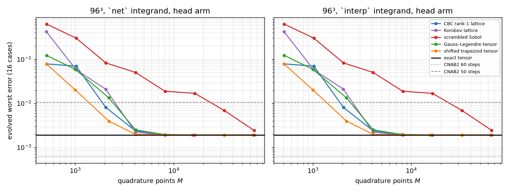
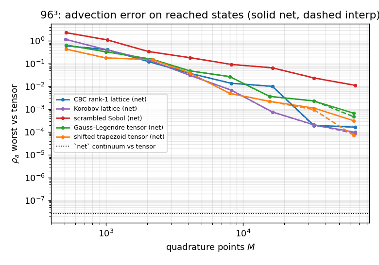
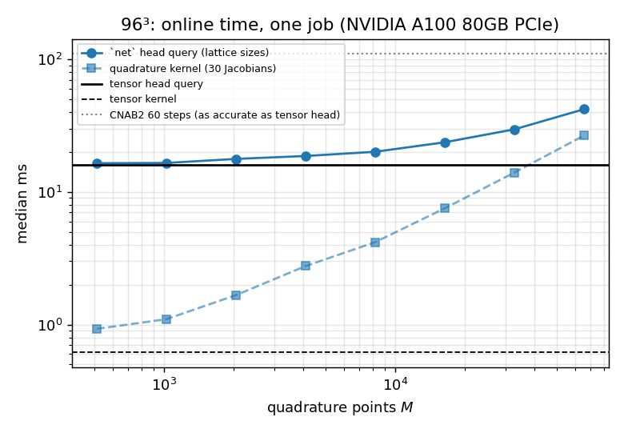
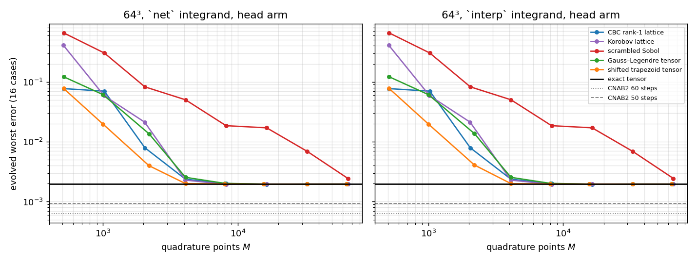
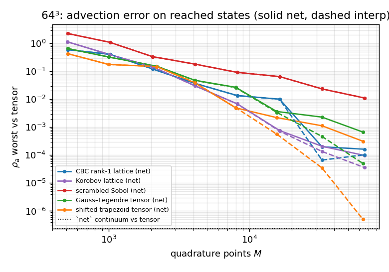
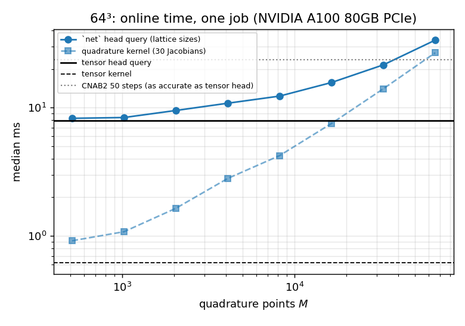
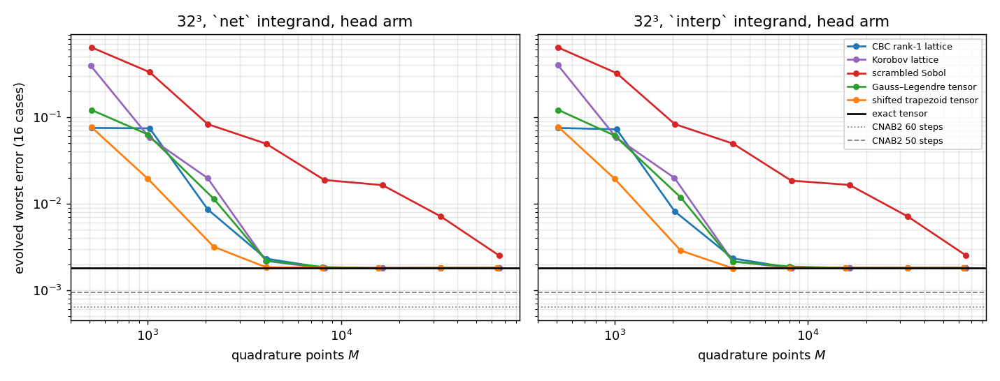
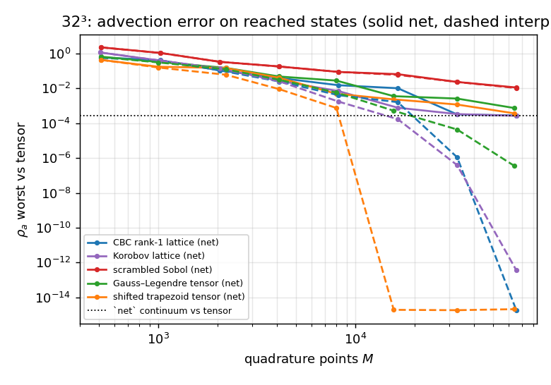
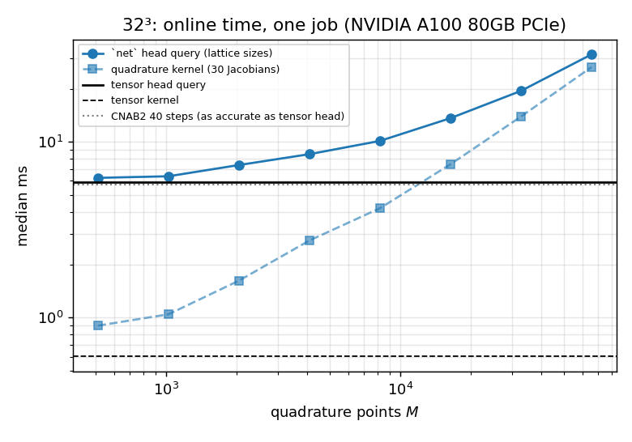

# NS 3D: off-mesh quadrature of the advection term against the exact tensor

Lane `exp/2026-11-05-ns3d-offmesh-quadrature` (pre-registration `experiments/ns3d-offmesh-quadrature/DESIGN.md`, amendments §A*; ledger `experiments/ns3d-offmesh-quadrature/LEDGER.md`). The frozen R=64 coordinate-network bank and k=8 heads of `exp/2026-11-03-ns3d-pod-match` (bank job 6850341), with the ROM's exact precomputed advection tensor replaced by off-mesh quadrature rules, on the 16 development cases (seed 202609202) at 96³, 64³, 32³. **Numbers are final for this lane** (development cohort only; no test cohort opened; nothing retrained). Generated by `reports/build_2026-11-05-ns3d-offmesh-quadrature.py` from the pulled run JSONs; no number is typed by hand.

## Answers

1. **Step 0.** The development ROM (`experiments/ns3d-coordnet/rom_mesh.py`, jobs 6859541/6858038/6858031) computes the advection with an exact precomputed Petrov–Galerkin tensor $T_{mjk}=\langle\phi_m, G_j\times\nabla_h\times G_k\rangle$ of shape $292\times64\times64$ (292 solenoidal Fourier tests), built on the grid by FFT; no quadrature or EQ. The domain is the periodic unit torus (Fourier pseudo-spectral FOM with 2/3 dealiasing), so off-mesh rules apply without boundary treatment (DESIGN §0).
2. **96³, `net` integrand, head arm — $M^\ast$ per family:** lat 8192, kor 8191, sob not reached, gl 8000, trap 4096. Tensor head: worst 0.194 %, median 0.115 %.
2. **64³, `net` integrand, head arm — $M^\ast$ per family:** lat 8192, kor 8191, sob not reached, gl 8000, trap 4096. Tensor head: worst 0.197 %, median 0.114 %.
2. **32³, `net` integrand, head arm — $M^\ast$ per family:** lat 8192, kor 8191, sob not reached, gl 8000, trap 4096. Tensor head: worst 0.181 %, median 0.109 %.
3. **Cost: quadrature at $M^\ast$ is not cheaper than the tensor at $R=64$, at any mesh.** Same-job median query times (head arm, `net` integrand) and the advection-kernel time alone (30 Jacobian contractions):

| mesh | tensor head ms | lattice $M^\ast$ | its ms (× tensor) | cheapest family at $M^\ast$ | its ms (× tensor) | tensor kernel ms | lattice $M^\ast$ kernel ms (× tensor) | smallest lattice kernel ms ($M$=512) | tensor head speedup vs CNAB2 | quadrature head at cheapest $M^\ast$ speedup vs CNAB2 |
|---|---|---|---|---|---|---|---|---|---|---|
| 96³ | 16.07 | `lat8192` | 20.08 (1.25×) | `trap16` | 18.79 (1.17×) | 0.616 | 4.182 (6.8×) | 0.929 | 6.84× (CNAB2 60 steps) | 5.85× (CNAB2 60 steps) |
| 64³ | 7.90 | `lat8192` | 12.30 (1.56×) | `trap16` | 10.86 (1.37×) | 0.616 | 4.228 (6.9×) | 0.918 | 3.00× (CNAB2 50 steps) | 2.18× (CNAB2 50 steps) |
| 32³ | 5.92 | `lat8192` | 10.13 (1.71×) | `trap16` | 8.49 (1.43×) | 0.601 | 4.195 (7.0×) | 0.900 | 0.96× (CNAB2 40 steps) | 0.67× (CNAB2 40 steps) |

The flop model of DESIGN §5 predicted this: one quadrature Jacobian costs about $6M\,M_tR$ flop against $2M_tR^2$ for the tensor, so quadrature can only win below $M\approx R/3$ points. Even the smallest rule on the ladder is slower than the tensor in the kernel. The query-level gap is smaller than the kernel gap because the grid-bound parts of a query (initial projection and centring, decoding the five output fields) dominate at 96³.

4. **Accuracy against CNAB2.** At $M^\ast$ the quadrature ROM carries the tensor ROM's accuracy, which §2 places between CNAB2 settings on each mesh; the speedup column above uses the parent lane's rule (fastest stable CNAB2 setting at least as accurate).
5. **The plateau is set by the test functions, not by the mesh.** For the head arm, $M^\ast$ is the same at 32³, 64³ and 96³ for every family, and the `net` and `interp` integrands give the same $M^\ast$ (§4): the 292 tests see only $|k_i|\le 3$, so the network/interpolant difference (large pointwise at 32³) barely reaches the tested advection (see the `net` continuum vs tensor column of §1).

**Caveats.** (i) The span64 arm amplifies advection error (its $\delta_T$ is of the order of $\rho_a$ or larger, while the head damps it), so span64 errors below the tensor's at some $M$ are trajectory perturbations, not gains from quadrature; its $M^\ast_\delta$ is never reached. (ii) The `net` continuum target agrees between $p=128$ and $p=96$ to 1.4e-09 (96³), 1.4e-09 (64³), 1.4e-09 (32³), above the registered $10^{-10}$ (flag); the continuum column of §3 is therefore resolved only to that level, far below every $\rho_a$ it is compared with. (iii) $M^\ast$ is specific to this ladder and these rule seeds (one shift/scramble per rule). (iv) Development cohort only; the k=8 heads are the frozen ns3d-pod-match development heads (trained there on training seed 202609201), unchanged here.

## 1. Gates and controls

| mesh | job | GPU | G1 driver parity (head / span64) | G1 reproduction vs ns3d-pod-match | G2 NUDFT vs FFT | G2 $\rho_a$ / $\rho_J$ worst | G2 head $\delta_T$ | G3 `lat64` $\rho_a$ (net / interp) | G4 curl vs FD | G4 div / grad | timing gate | timed-output agreement | status |
|---|---|---|---|---|---|---|---|---|---|---|---|---|---|
| 96³ | 6896984 | NVIDIA A100 80GB PCIe | 0.0e+00 / 0.0e+00 | 1.3e-15 | 2.9e-12 | 2.3e-15 / 2.6e-15 | 1.3e-15 | 3.9e+00 / 3.9e+00 | 4.3e-08 | 1.2e-13 | pass | 4.2e-16 | final |
| 64³ | 6897000 | NVIDIA A100 80GB PCIe | 0.0e+00 / 0.0e+00 | 1.2e-15 | 1.5e-12 | 1.9e-15 / 4.0e-15 | 2.5e-15 | 3.9e+00 / 3.8e+00 | 4.3e-08 | 1.3e-13 | pass | 4.6e-16 | final |
| 32³ | 6897410 | NVIDIA A100 80GB PCIe | 0.0e+00 / 0.0e+00 | 5.5e-16 | 1.8e-12 | 1.7e-15 / 5.0e-15 | 1.3e-15 | 3.9e+00 / 3.8e+00 | 6.1e-08 | 2.0e-13 | pass | 4.2e-16 | final |

**The two integrands differ, and by how much.** The `net` integrand evaluates the network itself; the ROM's state lives in the mesh bank, whose continuous extension is the trigonometric interpolant (`interp`). Pointwise gap at random off-grid points, and the gap between the converged `net` continuum integral and the exact tensor on the reached states:

| mesh | pre-Löwdin deviation (ns3d-pod-match statistic) | $\lVert u_{net}-u_{interp}\rVert/\lVert u_{interp}\rVert$ | same for the curl | `net` continuum vs tensor $\rho_a$ worst (median) | continuum target converged ($p$=128 vs 96) |
|---|---|---|---|---|---|
| 96³ | 3.1e-04 | 1.2e-03 | 6.6e-03 | 2.6e-08 (1.4e-10) | 1.4e-09 (NO) |
| 64³ | 7.0e-05 | 5.8e-03 | 2.1e-02 | 2.3e-07 (3.4e-09) | 1.4e-09 (NO) |
| 32³ | 6.1e-01 | 3.5e-01 | 8.1e-01 | 2.8e-04 (7.1e-06) | 1.4e-09 (NO) |

## 2. Tensor ROM and CNAB2 on the same cases

| mesh | tensor head worst | tensor head median | tensor span64 worst | CNAB2 200 steps | CNAB2 100 steps | CNAB2 80 steps | CNAB2 70 steps | CNAB2 60 steps | CNAB2 50 steps | CNAB2 40 steps | CNAB2 20 steps | CNAB2 10 steps |
|---|---|---|---|---|---|---|---|---|---|---|---|---|
| 96³ | 0.194 % | 0.115 % | 1.284 % | 0.000 % | 0.019 % | 0.033 % | 0.044 % | 0.063 % | 1.048 % | 21.106 % | unstable | unstable |
| 64³ | 0.197 % | 0.114 % | 1.284 % | 0.000 % | 0.019 % | 0.033 % | 0.044 % | 0.063 % | 0.093 % | 0.382 % | unstable | unstable |
| 32³ | 0.181 % | 0.109 % | 0.758 % | 0.000 % | 0.019 % | 0.033 % | 0.045 % | 0.063 % | 0.094 % | 0.152 % | 0.788 % | 76.694 % |

Errors are evolved worst over the 16 cases (per-case maximum over the five output times) of $\lVert u-u_{ref}\rVert/\lVert u_0\rVert$, against CNAB2 at $\Delta t=10^{-3}$ on the same mesh.

## 3. The point ladder

### 96³, `net` integrand

| family | rule | $M$ | $\rho_a$ vs tensor worst | $\rho_J$ worst | head worst | head median | head $\delta_T$ | span64 worst | span64 $\delta_T$ | $\rho_a$ vs `net` continuum |
|---|---|---|---|---|---|---|---|---|---|---|
| lat | `lat64` | 64 | 3.9e+00 | 1.4e+01 | 51.664 % | 42.027 % | 5.2e-01 | 143.169 % | 1.4e+00 | 3.9e+00 |
| lat | `lat512` | 512 | 6.0e-01 | 4.5e+00 | 7.835 % | 6.202 % | 7.9e-02 | 68.545 % | 6.9e-01 | 6.0e-01 |
| lat | `lat1024` | 1024 | 4.1e-01 | 3.4e+00 | 6.968 % | 4.334 % | 7.0e-02 | 53.556 % | 5.4e-01 | 4.1e-01 |
| lat | `lat2048` | 2048 | 1.2e-01 | 2.1e+00 | 0.810 % | 0.313 % | 7.9e-03 | 3.273 % | 3.2e-02 | 1.2e-01 |
| lat | `lat4096` | 4096 | 3.7e-02 | 6.7e-01 | 0.238 % | 0.128 % | 2.0e-03 | 1.836 % | 1.7e-02 | 3.7e-02 |
| lat | `lat8192` | 8192 | 1.4e-02 | 2.4e-01 | 0.197 % | 0.121 % | 4.5e-04 | 0.855 % | 1.1e-02 | 1.4e-02 |
| lat | `lat16384` | 16384 | 1.0e-02 | 1.6e-01 | 0.193 % | 0.111 % | 3.2e-04 | 0.860 % | 1.1e-02 | 1.0e-02 |
| lat | `lat32768` | 32768 | 2.0e-04 | 3.3e-03 | 0.194 % | 0.115 % | 5.1e-06 | 1.294 % | 5.1e-04 | 2.0e-04 |
| lat | `lat65536` | 65536 | 1.6e-04 | 3.4e-03 | 0.194 % | 0.115 % | 7.0e-06 | 1.311 % | 5.7e-04 | 1.6e-04 |
| kor | `kor509` | 509 | 1.2e+00 | 5.3e+00 | 42.275 % | 28.749 % | 4.2e-01 | 92.511 % | 9.3e-01 | 1.2e+00 |
| kor | `kor1021` | 1021 | 4.0e-01 | 2.8e+00 | 5.787 % | 4.215 % | 5.8e-02 | 38.543 % | 3.9e-01 | 4.0e-01 |
| kor | `kor2039` | 2039 | 1.5e-01 | 1.5e+00 | 2.106 % | 1.258 % | 2.1e-02 | 21.197 % | 2.1e-01 | 1.5e-01 |
| kor | `kor4093` | 4093 | 3.1e-02 | 7.0e-01 | 0.223 % | 0.130 % | 2.0e-03 | 2.168 % | 2.2e-02 | 3.1e-02 |
| kor | `kor8191` | 8191 | 6.9e-03 | 1.3e-01 | 0.192 % | 0.116 % | 1.4e-04 | 0.777 % | 1.1e-02 | 6.9e-03 |
| kor | `kor16381` | 16381 | 7.6e-04 | 2.6e-02 | 0.194 % | 0.115 % | 5.3e-05 | 1.281 % | 2.7e-03 | 7.6e-04 |
| kor | `kor32749` | 32749 | 2.1e-04 | 4.6e-03 | 0.194 % | 0.115 % | 1.9e-05 | 1.298 % | 9.0e-04 | 2.1e-04 |
| kor | `kor65521` | 65521 | 9.8e-05 | 2.7e-03 | 0.194 % | 0.115 % | 5.4e-06 | 1.276 % | 4.5e-04 | 9.8e-05 |
| sob | `sob512` | 512 | 2.3e+00 | 6.0e+00 | 62.443 % | 49.474 % | 6.2e-01 | 108.720 % | 1.1e+00 | 2.3e+00 |
| sob | `sob1024` | 1024 | 1.1e+00 | 3.4e+00 | 30.032 % | 24.023 % | 3.0e-01 | 80.076 % | 8.0e-01 | 1.1e+00 |
| sob | `sob2048` | 2048 | 3.4e-01 | 2.0e+00 | 8.255 % | 5.363 % | 8.3e-02 | 28.563 % | 2.9e-01 | 3.4e-01 |
| sob | `sob4096` | 4096 | 1.8e-01 | 1.0e+00 | 5.032 % | 3.255 % | 5.0e-02 | 35.795 % | 3.6e-01 | 1.8e-01 |
| sob | `sob8192` | 8192 | 9.2e-02 | 7.2e-01 | 1.880 % | 1.029 % | 1.9e-02 | 13.935 % | 1.4e-01 | 9.2e-02 |
| sob | `sob16384` | 16384 | 6.5e-02 | 4.3e-01 | 1.691 % | 1.167 % | 1.7e-02 | 13.613 % | 1.3e-01 | 6.5e-02 |
| sob | `sob32768` | 32768 | 2.4e-02 | 1.9e-01 | 0.690 % | 0.511 % | 6.6e-03 | 5.800 % | 5.7e-02 | 2.4e-02 |
| sob | `sob65536` | 65536 | 1.1e-02 | 1.2e-01 | 0.245 % | 0.157 % | 2.0e-03 | 3.310 % | 3.8e-02 | 1.1e-02 |
| gl | `gl8` | 512 | 6.6e-01 | 2.7e+00 | 12.234 % | 8.790 % | 1.2e-01 | 44.120 % | 4.4e-01 | 6.6e-01 |
| gl | `gl10` | 1000 | 3.3e-01 | 2.1e+00 | 5.917 % | 3.844 % | 5.9e-02 | 34.988 % | 3.5e-01 | 3.3e-01 |
| gl | `gl13` | 2197 | 1.5e-01 | 1.4e+00 | 1.338 % | 0.548 % | 1.3e-02 | 5.743 % | 5.6e-02 | 1.5e-01 |
| gl | `gl16` | 4096 | 4.8e-02 | 7.5e-01 | 0.252 % | 0.135 % | 2.4e-03 | 2.154 % | 2.1e-02 | 4.8e-02 |
| gl | `gl20` | 8000 | 2.7e-02 | 3.2e-01 | 0.198 % | 0.117 % | 5.8e-04 | 0.862 % | 1.2e-02 | 2.7e-02 |
| gl | `gl25` | 15625 | 3.7e-03 | 6.9e-02 | 0.194 % | 0.116 % | 1.0e-04 | 1.146 % | 9.3e-03 | 3.7e-03 |
| gl | `gl32` | 32768 | 2.3e-03 | 3.4e-02 | 0.193 % | 0.115 % | 2.3e-05 | 1.455 % | 5.4e-03 | 2.3e-03 |
| gl | `gl40` | 64000 | 6.7e-04 | 7.8e-03 | 0.194 % | 0.115 % | 5.3e-06 | 1.319 % | 1.8e-03 | 6.7e-04 |
| trap | `trap8` | 512 | 4.3e-01 | 4.8e+00 | 7.770 % | 6.158 % | 7.7e-02 | 77.621 % | 7.8e-01 | 4.3e-01 |
| trap | `trap10` | 1000 | 1.8e-01 | 2.7e+00 | 2.028 % | 1.224 % | 2.0e-02 | 11.853 % | 1.2e-01 | 1.8e-01 |
| trap | `trap13` | 2197 | 1.5e-01 | 1.7e+00 | 0.398 % | 0.168 % | 3.7e-03 | 2.365 % | 2.6e-02 | 1.5e-01 |
| trap | `trap16` | 4096 | 3.9e-02 | 5.3e-01 | 0.199 % | 0.118 % | 7.7e-04 | 0.914 % | 1.2e-02 | 3.9e-02 |
| trap | `trap20` | 8000 | 4.9e-03 | 8.8e-02 | 0.195 % | 0.116 % | 2.1e-04 | 1.131 % | 7.8e-03 | 4.9e-03 |
| trap | `trap25` | 15625 | 2.2e-03 | 3.6e-02 | 0.193 % | 0.115 % | 4.3e-05 | 1.389 % | 4.9e-03 | 2.2e-03 |
| trap | `trap32` | 32768 | 1.1e-03 | 2.6e-02 | 0.194 % | 0.115 % | 2.2e-05 | 1.275 % | 2.6e-03 | 1.1e-03 |
| trap | `trap40` | 64000 | 3.1e-04 | 7.6e-03 | 0.194 % | 0.115 % | 6.8e-06 | 1.229 % | 9.5e-04 | 3.1e-04 |

### 96³, `interp` integrand

| family | rule | $M$ | $\rho_a$ vs tensor worst | $\rho_J$ worst | head worst | head median | head $\delta_T$ | span64 worst | span64 $\delta_T$ |
|---|---|---|---|---|---|---|---|---|---|
| lat | `lat64` | 64 | 3.9e+00 | 1.4e+01 | 51.662 % | 42.027 % | 5.2e-01 | 143.044 % | 1.4e+00 |
| lat | `lat512` | 512 | 6.0e-01 | 4.5e+00 | 7.836 % | 6.203 % | 7.9e-02 | 68.682 % | 6.9e-01 |
| lat | `lat1024` | 1024 | 4.1e-01 | 3.4e+00 | 6.968 % | 4.334 % | 7.0e-02 | 53.312 % | 5.3e-01 |
| lat | `lat2048` | 2048 | 1.2e-01 | 2.1e+00 | 0.810 % | 0.313 % | 7.9e-03 | 3.270 % | 3.2e-02 |
| lat | `lat4096` | 4096 | 3.8e-02 | 6.8e-01 | 0.238 % | 0.128 % | 2.0e-03 | 1.839 % | 1.7e-02 |
| lat | `lat8192` | 8192 | 1.4e-02 | 2.4e-01 | 0.197 % | 0.120 % | 4.4e-04 | 0.856 % | 1.1e-02 |
| lat | `lat16384` | 16384 | 1.0e-02 | 1.6e-01 | 0.193 % | 0.111 % | 3.3e-04 | 0.862 % | 1.1e-02 |
| lat | `lat32768` | 32768 | 1.9e-04 | 3.0e-03 | 0.194 % | 0.115 % | 4.7e-06 | 1.288 % | 4.6e-04 |
| lat | `lat65536` | 65536 | 1.6e-04 | 3.4e-03 | 0.194 % | 0.115 % | 7.0e-06 | 1.312 % | 5.8e-04 |
| kor | `kor509` | 509 | 1.2e+00 | 5.3e+00 | 42.278 % | 28.750 % | 4.2e-01 | 92.527 % | 9.3e-01 |
| kor | `kor1021` | 1021 | 4.0e-01 | 2.8e+00 | 5.787 % | 4.215 % | 5.8e-02 | 38.687 % | 3.9e-01 |
| kor | `kor2039` | 2039 | 1.5e-01 | 1.5e+00 | 2.106 % | 1.258 % | 2.1e-02 | 21.144 % | 2.1e-01 |
| kor | `kor4093` | 4093 | 3.1e-02 | 7.0e-01 | 0.223 % | 0.130 % | 2.0e-03 | 2.169 % | 2.2e-02 |
| kor | `kor8191` | 8191 | 6.9e-03 | 1.3e-01 | 0.192 % | 0.116 % | 1.4e-04 | 0.774 % | 1.1e-02 |
| kor | `kor16381` | 16381 | 7.4e-04 | 2.5e-02 | 0.194 % | 0.115 % | 4.8e-05 | 1.277 % | 3.4e-03 |
| kor | `kor32749` | 32749 | 2.1e-04 | 4.6e-03 | 0.194 % | 0.115 % | 1.9e-05 | 1.307 % | 9.4e-04 |
| kor | `kor65521` | 65521 | 8.6e-05 | 1.2e-03 | 0.194 % | 0.115 % | 2.5e-06 | 1.279 % | 2.2e-04 |
| sob | `sob512` | 512 | 2.3e+00 | 6.0e+00 | 62.448 % | 49.476 % | 6.2e-01 | 108.617 % | 1.1e+00 |
| sob | `sob1024` | 1024 | 1.1e+00 | 3.4e+00 | 30.032 % | 24.024 % | 3.0e-01 | 81.528 % | 8.2e-01 |
| sob | `sob2048` | 2048 | 3.4e-01 | 2.0e+00 | 8.256 % | 5.363 % | 8.3e-02 | 28.520 % | 2.9e-01 |
| sob | `sob4096` | 4096 | 1.8e-01 | 1.0e+00 | 5.032 % | 3.255 % | 5.0e-02 | 35.819 % | 3.6e-01 |
| sob | `sob8192` | 8192 | 9.2e-02 | 7.2e-01 | 1.880 % | 1.029 % | 1.9e-02 | 13.885 % | 1.4e-01 |
| sob | `sob16384` | 16384 | 6.5e-02 | 4.3e-01 | 1.692 % | 1.167 % | 1.7e-02 | 13.572 % | 1.3e-01 |
| sob | `sob32768` | 32768 | 2.4e-02 | 1.9e-01 | 0.690 % | 0.511 % | 6.6e-03 | 5.796 % | 5.7e-02 |
| sob | `sob65536` | 65536 | 1.1e-02 | 1.2e-01 | 0.245 % | 0.157 % | 2.0e-03 | 3.337 % | 3.9e-02 |
| gl | `gl8` | 512 | 6.6e-01 | 2.7e+00 | 12.233 % | 8.790 % | 1.2e-01 | 44.158 % | 4.4e-01 |
| gl | `gl10` | 1000 | 3.3e-01 | 2.1e+00 | 5.917 % | 3.844 % | 5.9e-02 | 34.859 % | 3.5e-01 |
| gl | `gl13` | 2197 | 1.5e-01 | 1.4e+00 | 1.337 % | 0.548 % | 1.3e-02 | 5.721 % | 5.6e-02 |
| gl | `gl16` | 4096 | 4.8e-02 | 7.5e-01 | 0.252 % | 0.135 % | 2.4e-03 | 2.153 % | 2.1e-02 |
| gl | `gl20` | 8000 | 2.7e-02 | 3.1e-01 | 0.198 % | 0.117 % | 5.8e-04 | 0.861 % | 1.2e-02 |
| gl | `gl25` | 15625 | 3.6e-03 | 7.1e-02 | 0.194 % | 0.116 % | 1.0e-04 | 1.145 % | 9.3e-03 |
| gl | `gl32` | 32768 | 2.3e-03 | 3.4e-02 | 0.194 % | 0.115 % | 2.3e-05 | 1.462 % | 5.3e-03 |
| gl | `gl40` | 64000 | 4.7e-04 | 1.0e-02 | 0.194 % | 0.115 % | 8.9e-06 | 1.352 % | 1.7e-03 |
| trap | `trap8` | 512 | 4.3e-01 | 4.8e+00 | 7.770 % | 6.158 % | 7.7e-02 | 77.548 % | 7.8e-01 |
| trap | `trap10` | 1000 | 1.8e-01 | 2.7e+00 | 2.028 % | 1.224 % | 2.0e-02 | 11.867 % | 1.2e-01 |
| trap | `trap13` | 2197 | 1.5e-01 | 1.6e+00 | 0.398 % | 0.168 % | 3.7e-03 | 2.365 % | 2.6e-02 |
| trap | `trap16` | 4096 | 3.9e-02 | 5.3e-01 | 0.198 % | 0.118 % | 7.7e-04 | 0.914 % | 1.2e-02 |
| trap | `trap20` | 8000 | 4.9e-03 | 8.9e-02 | 0.195 % | 0.116 % | 2.1e-04 | 1.126 % | 7.9e-03 |
| trap | `trap25` | 15625 | 2.2e-03 | 3.6e-02 | 0.193 % | 0.115 % | 4.3e-05 | 1.392 % | 5.0e-03 |
| trap | `trap32` | 32768 | 9.6e-04 | 2.1e-02 | 0.194 % | 0.115 % | 1.7e-05 | 1.266 % | 3.0e-03 |
| trap | `trap40` | 64000 | 7.2e-05 | 1.8e-03 | 0.194 % | 0.115 % | 8.6e-07 | 1.294 % | 1.6e-04 |

### 64³, `net` integrand

| family | rule | $M$ | $\rho_a$ vs tensor worst | $\rho_J$ worst | head worst | head median | head $\delta_T$ | span64 worst | span64 $\delta_T$ | $\rho_a$ vs `net` continuum |
|---|---|---|---|---|---|---|---|---|---|---|
| lat | `lat64` | 64 | 3.9e+00 | 1.4e+01 | 55.119 % | 46.075 % | 5.5e-01 | 143.165 % | 1.4e+00 | 3.9e+00 |
| lat | `lat512` | 512 | 6.0e-01 | 4.5e+00 | 7.712 % | 6.213 % | 7.7e-02 | 68.545 % | 6.9e-01 | 6.0e-01 |
| lat | `lat1024` | 1024 | 4.1e-01 | 3.4e+00 | 6.999 % | 4.304 % | 7.0e-02 | 53.556 % | 5.4e-01 | 4.1e-01 |
| lat | `lat2048` | 2048 | 1.2e-01 | 2.1e+00 | 0.793 % | 0.315 % | 7.7e-03 | 3.273 % | 3.2e-02 | 1.2e-01 |
| lat | `lat4096` | 4096 | 3.7e-02 | 6.8e-01 | 0.237 % | 0.128 % | 2.0e-03 | 1.836 % | 1.7e-02 | 3.7e-02 |
| lat | `lat8192` | 8192 | 1.4e-02 | 2.4e-01 | 0.201 % | 0.120 % | 4.6e-04 | 0.855 % | 1.1e-02 | 1.4e-02 |
| lat | `lat16384` | 16384 | 1.0e-02 | 1.6e-01 | 0.195 % | 0.111 % | 3.3e-04 | 0.860 % | 1.1e-02 | 1.0e-02 |
| lat | `lat32768` | 32768 | 2.0e-04 | 3.3e-03 | 0.197 % | 0.114 % | 5.1e-06 | 1.294 % | 5.1e-04 | 2.0e-04 |
| lat | `lat65536` | 65536 | 1.6e-04 | 3.4e-03 | 0.197 % | 0.114 % | 7.1e-06 | 1.311 % | 5.7e-04 | 1.6e-04 |
| kor | `kor509` | 509 | 1.2e+00 | 5.3e+00 | 40.764 % | 27.872 % | 4.1e-01 | 92.510 % | 9.3e-01 | 1.2e+00 |
| kor | `kor1021` | 1021 | 4.0e-01 | 2.8e+00 | 5.875 % | 4.267 % | 5.9e-02 | 38.542 % | 3.9e-01 | 4.0e-01 |
| kor | `kor2039` | 2039 | 1.5e-01 | 1.5e+00 | 2.127 % | 1.280 % | 2.2e-02 | 21.197 % | 2.1e-01 | 1.5e-01 |
| kor | `kor4093` | 4093 | 3.1e-02 | 7.0e-01 | 0.229 % | 0.129 % | 2.0e-03 | 2.168 % | 2.2e-02 | 3.1e-02 |
| kor | `kor8191` | 8191 | 6.9e-03 | 1.3e-01 | 0.195 % | 0.115 % | 1.4e-04 | 0.777 % | 1.1e-02 | 6.9e-03 |
| kor | `kor16381` | 16381 | 7.6e-04 | 2.6e-02 | 0.197 % | 0.114 % | 5.2e-05 | 1.281 % | 2.7e-03 | 7.6e-04 |
| kor | `kor32749` | 32749 | 2.1e-04 | 4.6e-03 | 0.197 % | 0.114 % | 1.9e-05 | 1.298 % | 9.0e-04 | 2.1e-04 |
| kor | `kor65521` | 65521 | 9.7e-05 | 2.7e-03 | 0.197 % | 0.114 % | 5.4e-06 | 1.276 % | 4.5e-04 | 9.8e-05 |
| sob | `sob512` | 512 | 2.3e+00 | 6.0e+00 | 65.640 % | 51.908 % | 6.6e-01 | 108.719 % | 1.1e+00 | 2.3e+00 |
| sob | `sob1024` | 1024 | 1.1e+00 | 3.4e+00 | 30.336 % | 24.165 % | 3.0e-01 | 80.076 % | 8.0e-01 | 1.1e+00 |
| sob | `sob2048` | 2048 | 3.4e-01 | 2.0e+00 | 8.251 % | 5.359 % | 8.3e-02 | 28.563 % | 2.9e-01 | 3.4e-01 |
| sob | `sob4096` | 4096 | 1.8e-01 | 1.0e+00 | 5.024 % | 3.280 % | 5.0e-02 | 35.795 % | 3.6e-01 | 1.8e-01 |
| sob | `sob8192` | 8192 | 9.2e-02 | 7.2e-01 | 1.856 % | 0.989 % | 1.9e-02 | 13.935 % | 1.4e-01 | 9.2e-02 |
| sob | `sob16384` | 16384 | 6.5e-02 | 4.3e-01 | 1.709 % | 1.183 % | 1.8e-02 | 13.612 % | 1.3e-01 | 6.5e-02 |
| sob | `sob32768` | 32768 | 2.4e-02 | 1.9e-01 | 0.691 % | 0.512 % | 6.6e-03 | 5.799 % | 5.7e-02 | 2.4e-02 |
| sob | `sob65536` | 65536 | 1.1e-02 | 1.2e-01 | 0.245 % | 0.158 % | 1.9e-03 | 3.309 % | 3.8e-02 | 1.1e-02 |
| gl | `gl8` | 512 | 6.6e-01 | 2.7e+00 | 12.154 % | 8.805 % | 1.2e-01 | 44.120 % | 4.4e-01 | 6.6e-01 |
| gl | `gl10` | 1000 | 3.3e-01 | 2.1e+00 | 6.130 % | 3.991 % | 6.1e-02 | 34.988 % | 3.5e-01 | 3.3e-01 |
| gl | `gl13` | 2197 | 1.5e-01 | 1.4e+00 | 1.360 % | 0.563 % | 1.3e-02 | 5.743 % | 5.6e-02 | 1.5e-01 |
| gl | `gl16` | 4096 | 4.8e-02 | 7.5e-01 | 0.255 % | 0.136 % | 2.4e-03 | 2.154 % | 2.1e-02 | 4.8e-02 |
| gl | `gl20` | 8000 | 2.7e-02 | 3.2e-01 | 0.202 % | 0.117 % | 5.8e-04 | 0.862 % | 1.2e-02 | 2.7e-02 |
| gl | `gl25` | 15625 | 3.7e-03 | 6.9e-02 | 0.196 % | 0.116 % | 1.0e-04 | 1.146 % | 9.3e-03 | 3.7e-03 |
| gl | `gl32` | 32768 | 2.3e-03 | 3.4e-02 | 0.196 % | 0.114 % | 2.4e-05 | 1.455 % | 5.4e-03 | 2.3e-03 |
| gl | `gl40` | 64000 | 6.7e-04 | 7.8e-03 | 0.197 % | 0.114 % | 5.3e-06 | 1.319 % | 1.8e-03 | 6.7e-04 |
| trap | `trap8` | 512 | 4.3e-01 | 4.8e+00 | 7.739 % | 6.134 % | 7.7e-02 | 77.621 % | 7.8e-01 | 4.3e-01 |
| trap | `trap10` | 1000 | 1.8e-01 | 2.7e+00 | 1.976 % | 1.224 % | 2.0e-02 | 11.853 % | 1.2e-01 | 1.8e-01 |
| trap | `trap13` | 2197 | 1.5e-01 | 1.7e+00 | 0.398 % | 0.171 % | 3.7e-03 | 2.365 % | 2.6e-02 | 1.5e-01 |
| trap | `trap16` | 4096 | 3.9e-02 | 5.3e-01 | 0.200 % | 0.117 % | 7.8e-04 | 0.914 % | 1.2e-02 | 3.9e-02 |
| trap | `trap20` | 8000 | 4.9e-03 | 8.8e-02 | 0.198 % | 0.116 % | 2.2e-04 | 1.131 % | 7.8e-03 | 4.9e-03 |
| trap | `trap25` | 15625 | 2.2e-03 | 3.6e-02 | 0.196 % | 0.115 % | 4.3e-05 | 1.389 % | 4.9e-03 | 2.2e-03 |
| trap | `trap32` | 32768 | 1.1e-03 | 2.6e-02 | 0.196 % | 0.114 % | 2.1e-05 | 1.275 % | 2.6e-03 | 1.1e-03 |
| trap | `trap40` | 64000 | 3.1e-04 | 7.6e-03 | 0.197 % | 0.114 % | 6.7e-06 | 1.229 % | 9.5e-04 | 3.1e-04 |

### 64³, `interp` integrand

| family | rule | $M$ | $\rho_a$ vs tensor worst | $\rho_J$ worst | head worst | head median | head $\delta_T$ | span64 worst | span64 $\delta_T$ |
|---|---|---|---|---|---|---|---|---|---|
| lat | `lat64` | 64 | 3.8e+00 | 1.4e+01 | 55.116 % | 46.097 % | 5.5e-01 | 144.289 % | 1.4e+00 |
| lat | `lat512` | 512 | 6.0e-01 | 4.5e+00 | 7.709 % | 6.213 % | 7.7e-02 | 68.811 % | 6.9e-01 |
| lat | `lat1024` | 1024 | 4.1e-01 | 3.4e+00 | 6.997 % | 4.304 % | 7.0e-02 | 54.083 % | 5.4e-01 |
| lat | `lat2048` | 2048 | 1.2e-01 | 2.1e+00 | 0.791 % | 0.315 % | 7.7e-03 | 3.304 % | 3.2e-02 |
| lat | `lat4096` | 4096 | 3.7e-02 | 6.7e-01 | 0.237 % | 0.128 % | 2.0e-03 | 1.836 % | 1.7e-02 |
| lat | `lat8192` | 8192 | 1.3e-02 | 2.4e-01 | 0.200 % | 0.119 % | 4.5e-04 | 0.877 % | 1.1e-02 |
| lat | `lat16384` | 16384 | 1.0e-02 | 1.6e-01 | 0.196 % | 0.111 % | 3.3e-04 | 0.863 % | 1.1e-02 |
| lat | `lat32768` | 32768 | 6.6e-05 | 1.1e-03 | 0.197 % | 0.114 % | 4.9e-06 | 1.287 % | 1.7e-04 |
| lat | `lat65536` | 65536 | 1.0e-04 | 3.0e-03 | 0.197 % | 0.114 % | 1.3e-06 | 1.291 % | 2.3e-04 |
| kor | `kor509` | 509 | 1.2e+00 | 5.3e+00 | 40.757 % | 27.868 % | 4.1e-01 | 93.406 % | 9.3e-01 |
| kor | `kor1021` | 1021 | 4.0e-01 | 2.8e+00 | 5.876 % | 4.267 % | 5.9e-02 | 38.925 % | 3.9e-01 |
| kor | `kor2039` | 2039 | 1.5e-01 | 1.5e+00 | 2.126 % | 1.279 % | 2.2e-02 | 20.502 % | 2.1e-01 |
| kor | `kor4093` | 4093 | 3.1e-02 | 7.1e-01 | 0.229 % | 0.129 % | 2.0e-03 | 2.183 % | 2.1e-02 |
| kor | `kor8191` | 8191 | 6.9e-03 | 1.3e-01 | 0.194 % | 0.115 % | 1.3e-04 | 0.780 % | 1.1e-02 |
| kor | `kor16381` | 16381 | 7.2e-04 | 2.4e-02 | 0.197 % | 0.114 % | 4.5e-05 | 1.264 % | 3.1e-03 |
| kor | `kor32749` | 32749 | 1.4e-04 | 3.0e-03 | 0.197 % | 0.114 % | 9.5e-06 | 1.306 % | 7.1e-04 |
| kor | `kor65521` | 65521 | 3.6e-05 | 8.1e-04 | 0.197 % | 0.114 % | 5.8e-07 | 1.285 % | 7.9e-05 |
| sob | `sob512` | 512 | 2.3e+00 | 6.0e+00 | 65.653 % | 51.920 % | 6.6e-01 | 108.221 % | 1.1e+00 |
| sob | `sob1024` | 1024 | 1.1e+00 | 3.4e+00 | 30.336 % | 24.166 % | 3.0e-01 | 80.416 % | 8.0e-01 |
| sob | `sob2048` | 2048 | 3.4e-01 | 2.0e+00 | 8.252 % | 5.358 % | 8.3e-02 | 28.440 % | 2.8e-01 |
| sob | `sob4096` | 4096 | 1.8e-01 | 1.0e+00 | 5.026 % | 3.281 % | 5.0e-02 | 35.376 % | 3.5e-01 |
| sob | `sob8192` | 8192 | 9.2e-02 | 7.2e-01 | 1.856 % | 0.989 % | 1.9e-02 | 13.634 % | 1.4e-01 |
| sob | `sob16384` | 16384 | 6.5e-02 | 4.3e-01 | 1.709 % | 1.183 % | 1.8e-02 | 13.376 % | 1.3e-01 |
| sob | `sob32768` | 32768 | 2.4e-02 | 1.9e-01 | 0.691 % | 0.512 % | 6.6e-03 | 5.680 % | 5.6e-02 |
| sob | `sob65536` | 65536 | 1.1e-02 | 1.2e-01 | 0.245 % | 0.158 % | 1.9e-03 | 3.387 % | 3.9e-02 |
| gl | `gl8` | 512 | 6.6e-01 | 2.7e+00 | 12.151 % | 8.806 % | 1.2e-01 | 45.566 % | 4.6e-01 |
| gl | `gl10` | 1000 | 3.3e-01 | 2.1e+00 | 6.125 % | 3.990 % | 6.1e-02 | 34.219 % | 3.4e-01 |
| gl | `gl13` | 2197 | 1.5e-01 | 1.4e+00 | 1.366 % | 0.564 % | 1.3e-02 | 5.689 % | 5.6e-02 |
| gl | `gl16` | 4096 | 4.7e-02 | 7.5e-01 | 0.255 % | 0.136 % | 2.4e-03 | 2.164 % | 2.2e-02 |
| gl | `gl20` | 8000 | 2.6e-02 | 3.1e-01 | 0.202 % | 0.116 % | 5.5e-04 | 0.870 % | 1.2e-02 |
| gl | `gl25` | 15625 | 3.4e-03 | 5.5e-02 | 0.196 % | 0.115 % | 6.4e-05 | 1.112 % | 7.0e-03 |
| gl | `gl32` | 32768 | 4.7e-04 | 1.0e-02 | 0.197 % | 0.114 % | 6.6e-06 | 1.365 % | 1.7e-03 |
| gl | `gl40` | 64000 | 5.0e-05 | 1.1e-03 | 0.197 % | 0.114 % | 2.3e-07 | 1.292 % | 1.7e-04 |
| trap | `trap8` | 512 | 4.3e-01 | 4.8e+00 | 7.740 % | 6.138 % | 7.7e-02 | 78.282 % | 7.8e-01 |
| trap | `trap10` | 1000 | 1.8e-01 | 2.7e+00 | 1.978 % | 1.224 % | 2.0e-02 | 11.713 % | 1.2e-01 |
| trap | `trap13` | 2197 | 1.5e-01 | 1.7e+00 | 0.409 % | 0.170 % | 3.7e-03 | 2.373 % | 2.7e-02 |
| trap | `trap16` | 4096 | 4.0e-02 | 5.3e-01 | 0.200 % | 0.117 % | 7.6e-04 | 0.906 % | 1.2e-02 |
| trap | `trap20` | 8000 | 5.0e-03 | 8.6e-02 | 0.198 % | 0.116 % | 2.1e-04 | 1.079 % | 7.9e-03 |
| trap | `trap25` | 15625 | 5.7e-04 | 1.5e-02 | 0.197 % | 0.114 % | 1.0e-05 | 1.276 % | 1.5e-03 |
| trap | `trap32` | 32768 | 3.5e-05 | 8.3e-04 | 0.197 % | 0.114 % | 5.6e-07 | 1.284 % | 9.4e-05 |
| trap | `trap40` | 64000 | 5.0e-07 | 1.7e-05 | 0.197 % | 0.114 % | 6.8e-09 | 1.284 % | 1.8e-06 |

### 32³, `net` integrand

| family | rule | $M$ | $\rho_a$ vs tensor worst | $\rho_J$ worst | head worst | head median | head $\delta_T$ | span64 worst | span64 $\delta_T$ | $\rho_a$ vs `net` continuum |
|---|---|---|---|---|---|---|---|---|---|---|
| lat | `lat64` | 64 | 3.9e+00 | 1.8e+01 | 51.527 % | 44.847 % | 5.2e-01 | 138.819 % | 1.4e+00 | 3.9e+00 |
| lat | `lat512` | 512 | 6.0e-01 | 5.8e+00 | 7.498 % | 6.006 % | 7.5e-02 | 68.354 % | 6.8e-01 | 6.0e-01 |
| lat | `lat1024` | 1024 | 4.2e-01 | 4.6e+00 | 7.425 % | 4.436 % | 7.4e-02 | 53.411 % | 5.4e-01 | 4.2e-01 |
| lat | `lat2048` | 2048 | 1.1e-01 | 2.9e+00 | 0.856 % | 0.338 % | 8.8e-03 | 3.242 % | 3.1e-02 | 1.1e-01 |
| lat | `lat4096` | 4096 | 4.0e-02 | 1.3e+00 | 0.232 % | 0.127 % | 1.6e-03 | 1.781 % | 1.7e-02 | 4.0e-02 |
| lat | `lat8192` | 8192 | 1.5e-02 | 4.5e-01 | 0.182 % | 0.110 % | 2.2e-04 | 0.629 % | 5.5e-03 | 1.5e-02 |
| lat | `lat16384` | 16384 | 1.0e-02 | 3.3e-01 | 0.181 % | 0.108 % | 7.6e-05 | 0.615 % | 6.1e-03 | 1.0e-02 |
| lat | `lat32768` | 32768 | 3.2e-04 | 1.1e-02 | 0.181 % | 0.109 % | 6.6e-06 | 0.763 % | 5.4e-04 | 2.2e-04 |
| lat | `lat65536` | 65536 | 2.8e-04 | 1.3e-02 | 0.181 % | 0.109 % | 3.3e-06 | 0.769 % | 4.7e-04 | 1.9e-04 |
| kor | `kor509` | 509 | 1.2e+00 | 6.6e+00 | 39.142 % | 27.014 % | 3.9e-01 | 89.568 % | 9.0e-01 | 1.2e+00 |
| kor | `kor1021` | 1021 | 4.0e-01 | 3.6e+00 | 5.815 % | 4.164 % | 5.8e-02 | 37.724 % | 3.8e-01 | 4.0e-01 |
| kor | `kor2039` | 2039 | 1.4e-01 | 1.8e+00 | 1.980 % | 1.251 % | 2.0e-02 | 20.830 % | 2.1e-01 | 1.4e-01 |
| kor | `kor4093` | 4093 | 2.7e-02 | 9.0e-01 | 0.218 % | 0.127 % | 2.0e-03 | 1.943 % | 2.0e-02 | 2.7e-02 |
| kor | `kor8191` | 8191 | 7.1e-03 | 2.4e-01 | 0.180 % | 0.110 % | 8.9e-05 | 0.565 % | 6.3e-03 | 7.0e-03 |
| kor | `kor16381` | 16381 | 7.8e-04 | 4.1e-02 | 0.181 % | 0.109 % | 4.2e-05 | 0.769 % | 1.7e-03 | 7.5e-04 |
| kor | `kor32749` | 32749 | 3.4e-04 | 1.3e-02 | 0.181 % | 0.109 % | 1.7e-05 | 0.756 % | 5.1e-04 | 2.1e-04 |
| kor | `kor65521` | 65521 | 2.7e-04 | 1.1e-02 | 0.181 % | 0.109 % | 8.2e-06 | 0.748 % | 3.6e-04 | 1.0e-04 |
| sob | `sob512` | 512 | 2.3e+00 | 7.7e+00 | 64.122 % | 51.033 % | 6.4e-01 | 106.842 % | 1.1e+00 | 2.3e+00 |
| sob | `sob1024` | 1024 | 1.1e+00 | 4.5e+00 | 33.098 % | 25.483 % | 3.3e-01 | 79.789 % | 8.0e-01 | 1.1e+00 |
| sob | `sob2048` | 2048 | 3.4e-01 | 3.2e+00 | 8.288 % | 5.419 % | 8.3e-02 | 28.490 % | 2.9e-01 | 3.4e-01 |
| sob | `sob4096` | 4096 | 1.8e-01 | 1.3e+00 | 4.933 % | 3.209 % | 4.9e-02 | 35.031 % | 3.5e-01 | 1.8e-01 |
| sob | `sob8192` | 8192 | 8.9e-02 | 9.4e-01 | 1.880 % | 1.003 % | 1.9e-02 | 13.819 % | 1.4e-01 | 8.9e-02 |
| sob | `sob16384` | 16384 | 6.6e-02 | 5.9e-01 | 1.639 % | 1.152 % | 1.7e-02 | 13.075 % | 1.3e-01 | 6.6e-02 |
| sob | `sob32768` | 32768 | 2.4e-02 | 2.6e-01 | 0.712 % | 0.520 % | 6.9e-03 | 4.945 % | 4.6e-02 | 2.4e-02 |
| sob | `sob65536` | 65536 | 1.1e-02 | 1.7e-01 | 0.252 % | 0.156 % | 2.0e-03 | 2.219 % | 2.3e-02 | 1.1e-02 |
| gl | `gl8` | 512 | 6.7e-01 | 3.9e+00 | 12.118 % | 8.657 % | 1.2e-01 | 43.812 % | 4.4e-01 | 6.7e-01 |
| gl | `gl10` | 1000 | 3.3e-01 | 3.4e+00 | 6.326 % | 3.953 % | 6.3e-02 | 34.859 % | 3.5e-01 | 3.3e-01 |
| gl | `gl13` | 2197 | 1.5e-01 | 2.6e+00 | 1.139 % | 0.528 % | 1.1e-02 | 5.608 % | 5.6e-02 | 1.5e-01 |
| gl | `gl16` | 4096 | 4.9e-02 | 1.5e+00 | 0.219 % | 0.128 % | 1.7e-03 | 2.106 % | 2.1e-02 | 4.9e-02 |
| gl | `gl20` | 8000 | 2.8e-02 | 6.6e-01 | 0.186 % | 0.108 % | 1.9e-04 | 0.611 % | 6.6e-03 | 2.8e-02 |
| gl | `gl25` | 15625 | 3.6e-03 | 1.5e-01 | 0.179 % | 0.107 % | 1.1e-04 | 0.822 % | 5.6e-03 | 3.6e-03 |
| gl | `gl32` | 32768 | 2.6e-03 | 7.4e-02 | 0.181 % | 0.110 % | 4.8e-05 | 0.829 % | 3.4e-03 | 2.6e-03 |
| gl | `gl40` | 64000 | 7.5e-04 | 1.9e-02 | 0.181 % | 0.109 % | 1.1e-05 | 0.763 % | 9.1e-04 | 7.0e-04 |
| trap | `trap8` | 512 | 4.3e-01 | 5.6e+00 | 7.668 % | 5.807 % | 7.6e-02 | 77.462 % | 7.7e-01 | 4.3e-01 |
| trap | `trap10` | 1000 | 1.8e-01 | 3.6e+00 | 1.951 % | 1.216 % | 1.9e-02 | 11.658 % | 1.2e-01 | 1.8e-01 |
| trap | `trap13` | 2197 | 1.5e-01 | 3.3e+00 | 0.318 % | 0.149 % | 3.6e-03 | 2.330 % | 2.4e-02 | 1.5e-01 |
| trap | `trap16` | 4096 | 4.1e-02 | 1.1e+00 | 0.184 % | 0.114 % | 5.1e-04 | 0.755 % | 6.7e-03 | 4.1e-02 |
| trap | `trap20` | 8000 | 4.9e-03 | 1.8e-01 | 0.182 % | 0.109 % | 5.8e-05 | 0.719 % | 4.8e-03 | 5.0e-03 |
| trap | `trap25` | 15625 | 2.4e-03 | 7.3e-02 | 0.181 % | 0.109 % | 3.3e-05 | 0.791 % | 3.9e-03 | 2.3e-03 |
| trap | `trap32` | 32768 | 1.2e-03 | 5.6e-02 | 0.181 % | 0.110 % | 6.6e-05 | 0.753 % | 1.8e-03 | 1.1e-03 |
| trap | `trap40` | 64000 | 3.7e-04 | 1.6e-02 | 0.181 % | 0.109 % | 9.4e-06 | 0.748 % | 8.9e-04 | 3.1e-04 |

### 32³, `interp` integrand

| family | rule | $M$ | $\rho_a$ vs tensor worst | $\rho_J$ worst | head worst | head median | head $\delta_T$ | span64 worst | span64 $\delta_T$ |
|---|---|---|---|---|---|---|---|---|---|
| lat | `lat64` | 64 | 3.8e+00 | 1.3e+01 | 55.436 % | 47.984 % | 5.5e-01 | 113.330 % | 1.1e+00 |
| lat | `lat512` | 512 | 5.7e-01 | 4.3e+00 | 7.493 % | 5.991 % | 7.5e-02 | 91.563 % | 9.2e-01 |
| lat | `lat1024` | 1024 | 4.1e-01 | 3.1e+00 | 7.245 % | 4.445 % | 7.3e-02 | 62.489 % | 6.3e-01 |
| lat | `lat2048` | 2048 | 1.1e-01 | 2.0e+00 | 0.813 % | 0.343 % | 8.0e-03 | 3.040 % | 3.1e-02 |
| lat | `lat4096` | 4096 | 2.5e-02 | 4.1e-01 | 0.233 % | 0.126 % | 1.8e-03 | 1.926 % | 1.8e-02 |
| lat | `lat8192` | 8192 | 4.1e-03 | 8.3e-02 | 0.181 % | 0.111 % | 1.6e-04 | 0.762 % | 3.1e-03 |
| lat | `lat16384` | 16384 | 1.6e-03 | 3.1e-02 | 0.181 % | 0.108 % | 1.0e-04 | 0.758 % | 1.3e-03 |
| lat | `lat32768` | 32768 | 1.1e-06 | 5.8e-05 | 0.181 % | 0.109 % | 6.6e-09 | 0.758 % | 1.4e-06 |
| lat | `lat65536` | 65536 | 1.7e-15 | 9.7e-15 | 0.181 % | 0.109 % | 1.2e-15 | 0.758 % | 6.4e-15 |
| kor | `kor509` | 509 | 1.2e+00 | 5.0e+00 | 40.025 % | 27.184 % | 4.0e-01 | 78.082 % | 7.8e-01 |
| kor | `kor1021` | 1021 | 4.0e-01 | 2.6e+00 | 5.788 % | 4.172 % | 5.8e-02 | 34.926 % | 3.5e-01 |
| kor | `kor2039` | 2039 | 1.4e-01 | 1.4e+00 | 1.986 % | 1.249 % | 2.0e-02 | 19.988 % | 2.0e-01 |
| kor | `kor4093` | 4093 | 2.6e-02 | 6.1e-01 | 0.215 % | 0.127 % | 1.9e-03 | 2.632 % | 2.7e-02 |
| kor | `kor8191` | 8191 | 1.8e-03 | 5.1e-02 | 0.181 % | 0.109 % | 6.9e-05 | 0.762 % | 1.3e-03 |
| kor | `kor16381` | 16381 | 1.7e-04 | 6.3e-03 | 0.181 % | 0.109 % | 7.8e-06 | 0.758 % | 2.4e-04 |
| kor | `kor32749` | 32749 | 3.9e-07 | 1.4e-05 | 0.181 % | 0.109 % | 9.3e-09 | 0.758 % | 3.1e-07 |
| kor | `kor65521` | 65521 | 3.5e-13 | 3.2e-12 | 0.181 % | 0.109 % | 8.2e-14 | 0.758 % | 1.2e-12 |
| sob | `sob512` | 512 | 2.3e+00 | 5.9e+00 | 63.617 % | 50.862 % | 6.4e-01 | 106.238 % | 1.1e+00 |
| sob | `sob1024` | 1024 | 1.1e+00 | 3.2e+00 | 32.244 % | 25.161 % | 3.2e-01 | 83.612 % | 8.4e-01 |
| sob | `sob2048` | 2048 | 3.4e-01 | 1.7e+00 | 8.302 % | 5.398 % | 8.3e-02 | 38.257 % | 3.8e-01 |
| sob | `sob4096` | 4096 | 1.8e-01 | 1.0e+00 | 4.944 % | 3.205 % | 5.0e-02 | 30.812 % | 3.1e-01 |
| sob | `sob8192` | 8192 | 8.9e-02 | 7.1e-01 | 1.847 % | 0.993 % | 1.9e-02 | 15.399 % | 1.5e-01 |
| sob | `sob16384` | 16384 | 6.0e-02 | 3.9e-01 | 1.646 % | 1.154 % | 1.7e-02 | 11.720 % | 1.2e-01 |
| sob | `sob32768` | 32768 | 2.3e-02 | 1.7e-01 | 0.712 % | 0.520 % | 6.9e-03 | 6.246 % | 6.2e-02 |
| sob | `sob65536` | 65536 | 1.1e-02 | 1.2e-01 | 0.252 % | 0.157 % | 2.0e-03 | 1.942 % | 2.1e-02 |
| gl | `gl8` | 512 | 6.3e-01 | 2.4e+00 | 12.107 % | 8.633 % | 1.2e-01 | 66.156 % | 6.6e-01 |
| gl | `gl10` | 1000 | 3.1e-01 | 1.7e+00 | 6.129 % | 3.826 % | 6.1e-02 | 35.342 % | 3.5e-01 |
| gl | `gl13` | 2197 | 1.3e-01 | 8.0e-01 | 1.182 % | 0.530 % | 1.1e-02 | 6.090 % | 6.0e-02 |
| gl | `gl16` | 4096 | 3.1e-02 | 3.5e-01 | 0.214 % | 0.127 % | 1.6e-03 | 2.278 % | 2.2e-02 |
| gl | `gl20` | 8000 | 5.8e-03 | 6.3e-02 | 0.188 % | 0.111 % | 3.4e-04 | 0.857 % | 8.0e-03 |
| gl | `gl25` | 15625 | 5.2e-04 | 7.8e-03 | 0.181 % | 0.109 % | 1.1e-05 | 0.760 % | 2.2e-04 |
| gl | `gl32` | 32768 | 4.4e-05 | 1.6e-03 | 0.181 % | 0.109 % | 6.4e-07 | 0.757 % | 4.5e-05 |
| gl | `gl40` | 64000 | 3.5e-07 | 1.1e-05 | 0.181 % | 0.109 % | 2.8e-09 | 0.758 % | 3.7e-07 |
| trap | `trap8` | 512 | 4.4e-01 | 5.0e+00 | 7.698 % | 5.865 % | 7.7e-02 | 53.632 % | 5.4e-01 |
| trap | `trap10` | 1000 | 1.6e-01 | 2.6e+00 | 1.942 % | 1.213 % | 1.9e-02 | 11.360 % | 1.1e-01 |
| trap | `trap13` | 2197 | 6.1e-02 | 7.9e-01 | 0.287 % | 0.133 % | 2.9e-03 | 2.355 % | 2.3e-02 |
| trap | `trap16` | 4096 | 9.2e-03 | 1.1e-01 | 0.179 % | 0.108 % | 3.8e-04 | 0.750 % | 9.1e-03 |
| trap | `trap20` | 8000 | 7.5e-04 | 1.4e-02 | 0.181 % | 0.109 % | 3.8e-05 | 0.760 % | 6.8e-04 |
| trap | `trap25` | 15625 | 1.9e-15 | 9.8e-15 | 0.181 % | 0.109 % | 1.3e-15 | 0.758 % | 4.6e-15 |
| trap | `trap32` | 32768 | 1.8e-15 | 9.9e-15 | 0.181 % | 0.109 % | 1.3e-15 | 0.758 % | 3.4e-15 |
| trap | `trap40` | 64000 | 2.1e-15 | 1.0e-14 | 0.181 % | 0.109 % | 1.3e-15 | 0.758 % | 5.1e-15 |

## 4. Plateau sizes $M^\ast$

$M^\ast$: smallest ladder size that, together with every larger size, has evolved worst ≤ 1.05× and evolved median ≤ 1.05× the tensor ROM's in the same job. $M^\ast_\delta$: the same with $\delta_T \le 10^{-4}$ (the ROM stays within $10^{-4}\lVert u_0\rVert$ of the tensor ROM). Recomputed here from the error arrays and checked against the in-job values. † = reached only at the largest ladder size: endpoint reached, plateau unconfirmed (amendment §A2). $M^\ast$ is specific to this ladder and these rule seeds.

| mesh | integrand | arm | lat $M^\ast$ (worst at $M^\ast$) | kor $M^\ast$ (worst at $M^\ast$) | sob $M^\ast$ (worst at $M^\ast$) | gl $M^\ast$ (worst at $M^\ast$) | trap $M^\ast$ (worst at $M^\ast$) | lat $M^\ast_\delta$ | kor $M^\ast_\delta$ | sob $M^\ast_\delta$ | gl $M^\ast_\delta$ | trap $M^\ast_\delta$ |
|---|---|---|---|---|---|---|---|---|---|---|---|---|
| 96³ | `net` | head | 8192 (0.197 %) | 8191 (0.192 %) | not reached | 8000 (0.198 %) | 4096 (0.199 %) | 32768 | 16381 | not reached | 32768 | 15625 |
| 96³ | `net` | span64 | 8192 (0.855 %) | 8191 (0.777 %) | not reached | 64000 (1.319 %)† | 32768 (1.275 %) | not reached | not reached | not reached | not reached | not reached |
| 96³ | `interp` | head | 8192 (0.197 %) | 8191 (0.192 %) | not reached | 8000 (0.198 %) | 4096 (0.198 %) | 32768 | 16381 | not reached | 32768 | 15625 |
| 96³ | `interp` | span64 | 8192 (0.856 %) | 8191 (0.774 %) | not reached | not reached | 32768 (1.266 %) | not reached | not reached | not reached | not reached | not reached |
| 64³ | `net` | head | 8192 (0.201 %) | 8191 (0.195 %) | not reached | 8000 (0.202 %) | 4096 (0.200 %) | 32768 | 16381 | not reached | 32768 | 15625 |
| 64³ | `net` | span64 | 8192 (0.855 %) | 8191 (0.777 %) | not reached | 64000 (1.319 %)† | 32768 (1.275 %) | not reached | not reached | not reached | not reached | not reached |
| 64³ | `interp` | head | 8192 (0.200 %) | 8191 (0.194 %) | not reached | 8000 (0.202 %) | 4096 (0.200 %) | 32768 | 16381 | not reached | 15625 | 15625 |
| 64³ | `interp` | span64 | 8192 (0.877 %) | 8191 (0.780 %) | not reached | 64000 (1.292 %)† | 4096 (0.906 %) | not reached | 65521 | not reached | not reached | 32768 |
| 32³ | `net` | head | 8192 (0.182 %) | 8191 (0.180 %) | not reached | 8000 (0.186 %) | 4096 (0.184 %) | 16384 | 8191 | not reached | 32768 | 8000 |
| 32³ | `net` | span64 | 8192 (0.629 %) | 8191 (0.565 %) | not reached | 64000 (0.763 %)† | 8000 (0.719 %) | not reached | not reached | not reached | not reached | not reached |
| 32³ | `interp` | head | 8192 (0.181 %) | 8191 (0.181 %) | not reached | 8000 (0.188 %) | 4096 (0.179 %) | 32768 | 8191 | not reached | 15625 | 8000 |
| 32³ | `interp` | span64 | 8192 (0.762 %) | 8191 (0.762 %) | not reached | 15625 (0.760 %) | 8000 (0.760 %) | 32768 | 32749 | not reached | 32768 | 15625 |

## 5. Online cost, same job, same GPU

### 96³ (NVIDIA A100 80GB PCIe, job 6896984)

| arm | $M$ | median query ms | min–max ms | evolved worst | fastest CNAB2 at least as accurate | its ms | speedup vs that CNAB2 | kernel ms (30 Jacobians) |
|---|---|---|---|---|---|---|---|---|
| tensor head | — | 16.07 | 15.92–16.96 | 0.194 % | CNAB2 60 steps (0.063 %) | 109.95 | 6.84× | 0.616 |
| `net` head `lat512` | 512 | 16.46 | 16.32–17.49 | 7.835 % | CNAB2 50 steps (1.048 %) | 92.39 | 5.61× | 0.929 |
| `net` head `lat1024` | 1024 | 16.53 | 16.06–17.92 | 6.968 % | CNAB2 50 steps (1.048 %) | 92.39 | 5.59× | 1.098 |
| `net` head `lat2048` | 2048 | 17.74 | 17.52–18.57 | 0.810 % | CNAB2 60 steps (0.063 %) | 109.95 | 6.20× | 1.667 |
| `net` head `lat4096` | 4096 | 18.65 | 18.50–18.97 | 0.238 % | CNAB2 60 steps (0.063 %) | 109.95 | 5.89× | 2.761 |
| `net` head `lat8192` | 8192 | 20.08 | 19.94–21.06 | 0.197 % | CNAB2 60 steps (0.063 %) | 109.95 | 5.48× | 4.182 |
| `net` head `lat16384` | 16384 | 23.67 | 23.29–24.35 | 0.193 % | CNAB2 60 steps (0.063 %) | 109.95 | 4.65× | 7.529 |
| `net` head `lat32768` | 32768 | 29.64 | 29.25–30.47 | 0.194 % | CNAB2 60 steps (0.063 %) | 109.95 | 3.71× | 13.996 |
| `net` head `lat65536` | 65536 | 42.02 | 41.79–42.78 | 0.194 % | CNAB2 60 steps (0.063 %) | 109.95 | 2.62× | 26.620 |
| `net` head `kor8191` | 8191 | 21.12 | 20.87–22.51 | 0.192 % | CNAB2 60 steps (0.063 %) | 109.95 | 5.21× | — |
| `net` head `gl20` | 8000 | 20.14 | 20.02–21.82 | 0.198 % | CNAB2 60 steps (0.063 %) | 109.95 | 5.46× | — |
| `net` head `trap16` | 4096 | 18.79 | 18.30–19.70 | 0.199 % | CNAB2 60 steps (0.063 %) | 109.95 | 5.85× | — |
| tensor span64 | — | 15.87 | 15.29–16.31 | 1.284 % | CNAB2 50 steps (1.048 %) | 92.39 | 5.82× | — |
| `net` span64 `lat512` | 512 | 16.19 | 15.82–16.62 | 68.545 % | CNAB2 40 steps (21.106 %) | 74.91 | 4.63× | — |
| `net` span64 `lat1024` | 1024 | 16.20 | 16.00–17.12 | 53.556 % | CNAB2 40 steps (21.106 %) | 74.91 | 4.62× | — |
| `net` span64 `lat2048` | 2048 | 17.34 | 17.22–17.87 | 3.273 % | CNAB2 50 steps (1.048 %) | 92.39 | 5.33× | — |
| `net` span64 `lat4096` | 4096 | 18.44 | 18.29–19.29 | 1.836 % | CNAB2 50 steps (1.048 %) | 92.39 | 5.01× | — |
| `net` span64 `lat8192` | 8192 | 19.80 | 19.59–20.45 | 0.855 % | CNAB2 60 steps (0.063 %) | 109.95 | 5.55× | — |
| `net` span64 `lat16384` | 16384 | 23.27 | 23.01–23.86 | 0.860 % | CNAB2 60 steps (0.063 %) | 109.95 | 4.72× | — |
| `net` span64 `lat32768` | 32768 | 29.15 | 28.85–29.68 | 1.294 % | CNAB2 50 steps (1.048 %) | 92.39 | 3.17× | — |
| `net` span64 `lat65536` | 65536 | 41.76 | 41.47–42.43 | 1.311 % | CNAB2 50 steps (1.048 %) | 92.39 | 2.21× | — |

CNAB2 ladder in the same block: 200 steps 354.43 ms, 100 steps 179.85 ms, 80 steps 144.89 ms, 70 steps 127.52 ms, 60 steps 109.95 ms, 50 steps 92.39 ms, 40 steps 74.91 ms, 20 steps 39.99 ms, 10 steps 22.50 ms.
Flop model per Gauss–Newton sweep: tensor 2,392,064; quadrature 113,664 per point. Offline: tensor build 8.5 s.

### 64³ (NVIDIA A100 80GB PCIe, job 6897000)

| arm | $M$ | median query ms | min–max ms | evolved worst | fastest CNAB2 at least as accurate | its ms | speedup vs that CNAB2 | kernel ms (30 Jacobians) |
|---|---|---|---|---|---|---|---|---|
| tensor head | — | 7.90 | 7.80–8.70 | 0.197 % | CNAB2 50 steps (0.093 %) | 23.70 | 3.00× | 0.616 |
| `net` head `lat512` | 512 | 8.25 | 8.21–9.02 | 7.712 % | CNAB2 40 steps (0.382 %) | 19.29 | 2.34× | 0.918 |
| `net` head `lat1024` | 1024 | 8.37 | 8.29–9.70 | 6.999 % | CNAB2 40 steps (0.382 %) | 19.29 | 2.30× | 1.079 |
| `net` head `lat2048` | 2048 | 9.50 | 9.28–10.61 | 0.793 % | CNAB2 40 steps (0.382 %) | 19.29 | 2.03× | 1.642 |
| `net` head `lat4096` | 4096 | 10.82 | 10.72–11.40 | 0.237 % | CNAB2 50 steps (0.093 %) | 23.70 | 2.19× | 2.806 |
| `net` head `lat8192` | 8192 | 12.30 | 12.17–13.23 | 0.201 % | CNAB2 50 steps (0.093 %) | 23.70 | 1.93× | 4.228 |
| `net` head `lat16384` | 16384 | 15.69 | 15.58–16.37 | 0.195 % | CNAB2 50 steps (0.093 %) | 23.70 | 1.51× | 7.521 |
| `net` head `lat32768` | 32768 | 21.53 | 21.35–22.57 | 0.197 % | CNAB2 50 steps (0.093 %) | 23.70 | 1.10× | 14.029 |
| `net` head `lat65536` | 65536 | 33.57 | 33.33–34.19 | 0.197 % | CNAB2 50 steps (0.093 %) | 23.70 | 0.71× | 26.763 |
| `net` head `kor8191` | 8191 | 13.05 | 12.99–14.65 | 0.195 % | CNAB2 50 steps (0.093 %) | 23.70 | 1.82× | — |
| `net` head `gl20` | 8000 | 12.31 | 12.12–13.78 | 0.202 % | CNAB2 50 steps (0.093 %) | 23.70 | 1.93× | — |
| `net` head `trap16` | 4096 | 10.86 | 10.58–11.77 | 0.200 % | CNAB2 50 steps (0.093 %) | 23.70 | 2.18× | — |
| tensor span64 | — | 7.57 | 7.44–7.81 | 1.284 % | CNAB2 40 steps (0.382 %) | 19.29 | 2.55× | — |
| `net` span64 `lat512` | 512 | 7.91 | 7.78–8.72 | 68.545 % | CNAB2 40 steps (0.382 %) | 19.29 | 2.44× | — |
| `net` span64 `lat1024` | 1024 | 7.99 | 7.87–8.70 | 53.556 % | CNAB2 40 steps (0.382 %) | 19.29 | 2.41× | — |
| `net` span64 `lat2048` | 2048 | 9.27 | 9.05–9.58 | 3.273 % | CNAB2 40 steps (0.382 %) | 19.29 | 2.08× | — |
| `net` span64 `lat4096` | 4096 | 10.62 | 10.41–11.35 | 1.836 % | CNAB2 40 steps (0.382 %) | 19.29 | 1.82× | — |
| `net` span64 `lat8192` | 8192 | 12.05 | 11.86–12.40 | 0.855 % | CNAB2 40 steps (0.382 %) | 19.29 | 1.60× | — |
| `net` span64 `lat16384` | 16384 | 15.29 | 15.22–15.92 | 0.860 % | CNAB2 40 steps (0.382 %) | 19.29 | 1.26× | — |
| `net` span64 `lat32768` | 32768 | 20.94 | 20.82–21.79 | 1.294 % | CNAB2 40 steps (0.382 %) | 19.29 | 0.92× | — |
| `net` span64 `lat65536` | 65536 | 33.14 | 33.05–34.23 | 1.311 % | CNAB2 40 steps (0.382 %) | 19.29 | 0.58× | — |

CNAB2 ladder in the same block: 200 steps 89.79 ms, 100 steps 46.81 ms, 80 steps 37.09 ms, 70 steps 32.79 ms, 60 steps 28.06 ms, 50 steps 23.70 ms, 40 steps 19.29 ms, 20 steps 10.41 ms, 10 steps 5.69 ms.
Flop model per Gauss–Newton sweep: tensor 2,392,064; quadrature 113,664 per point. Offline: tensor build 5.8 s.

### 32³ (NVIDIA A100 80GB PCIe, job 6897410)

| arm | $M$ | median query ms | min–max ms | evolved worst | fastest CNAB2 at least as accurate | its ms | speedup vs that CNAB2 | kernel ms (30 Jacobians) |
|---|---|---|---|---|---|---|---|---|
| tensor head | — | 5.92 | 5.79–6.56 | 0.181 % | CNAB2 40 steps (0.152 %) | 5.71 | 0.96× | 0.601 |
| `net` head `lat512` | 512 | 6.24 | 6.16–6.95 | 7.498 % | CNAB2 20 steps (0.788 %) | 3.06 | 0.49× | 0.900 |
| `net` head `lat1024` | 1024 | 6.37 | 6.29–7.27 | 7.425 % | CNAB2 20 steps (0.788 %) | 3.06 | 0.48× | 1.045 |
| `net` head `lat2048` | 2048 | 7.39 | 7.31–8.38 | 0.856 % | CNAB2 20 steps (0.788 %) | 3.06 | 0.41× | 1.624 |
| `net` head `lat4096` | 4096 | 8.52 | 8.34–8.83 | 0.232 % | CNAB2 40 steps (0.152 %) | 5.71 | 0.67× | 2.749 |
| `net` head `lat8192` | 8192 | 10.13 | 9.83–11.24 | 0.182 % | CNAB2 40 steps (0.152 %) | 5.71 | 0.56× | 4.195 |
| `net` head `lat16384` | 16384 | 13.65 | 13.44–14.20 | 0.181 % | CNAB2 40 steps (0.152 %) | 5.71 | 0.42× | 7.459 |
| `net` head `lat32768` | 32768 | 19.52 | 19.36–20.33 | 0.181 % | CNAB2 40 steps (0.152 %) | 5.71 | 0.29× | 13.943 |
| `net` head `lat65536` | 65536 | 31.47 | 31.15–32.04 | 0.181 % | CNAB2 40 steps (0.152 %) | 5.71 | 0.18× | 26.640 |
| `net` head `kor8191` | 8191 | 10.93 | 10.79–12.17 | 0.180 % | CNAB2 40 steps (0.152 %) | 5.71 | 0.52× | — |
| `net` head `gl20` | 8000 | 10.08 | 9.95–11.12 | 0.186 % | CNAB2 40 steps (0.152 %) | 5.71 | 0.57× | — |
| `net` head `trap16` | 4096 | 8.49 | 8.29–9.38 | 0.184 % | CNAB2 40 steps (0.152 %) | 5.71 | 0.67× | — |
| tensor span64 | — | 5.51 | 5.39–6.49 | 0.758 % | CNAB2 40 steps (0.152 %) | 5.71 | 1.04× | — |
| `net` span64 `lat512` | 512 | 5.87 | 5.69–6.27 | 68.354 % | CNAB2 20 steps (0.788 %) | 3.06 | 0.52× | — |
| `net` span64 `lat1024` | 1024 | 5.94 | 5.84–6.41 | 53.411 % | CNAB2 20 steps (0.788 %) | 3.06 | 0.52× | — |
| `net` span64 `lat2048` | 2048 | 7.13 | 7.01–7.68 | 3.242 % | CNAB2 20 steps (0.788 %) | 3.06 | 0.43× | — |
| `net` span64 `lat4096` | 4096 | 8.18 | 8.06–8.77 | 1.781 % | CNAB2 20 steps (0.788 %) | 3.06 | 0.37× | — |
| `net` span64 `lat8192` | 8192 | 9.65 | 9.44–10.04 | 0.629 % | CNAB2 40 steps (0.152 %) | 5.71 | 0.59× | — |
| `net` span64 `lat16384` | 16384 | 13.42 | 13.22–13.82 | 0.615 % | CNAB2 40 steps (0.152 %) | 5.71 | 0.42× | — |
| `net` span64 `lat32768` | 32768 | 19.11 | 18.75–19.20 | 0.763 % | CNAB2 40 steps (0.152 %) | 5.71 | 0.30× | — |
| `net` span64 `lat65536` | 65536 | 31.24 | 30.81–31.97 | 0.769 % | CNAB2 40 steps (0.152 %) | 5.71 | 0.18× | — |

CNAB2 ladder in the same block: 200 steps 26.03 ms, 100 steps 13.67 ms, 80 steps 10.95 ms, 70 steps 9.45 ms, 60 steps 8.22 ms, 50 steps 6.80 ms, 40 steps 5.71 ms, 20 steps 3.06 ms, 10 steps 1.83 ms.
Flop model per Gauss–Newton sweep: tensor 2,392,064; quadrature 113,664 per point. Offline: tensor build 4.6 s.

## 6. Figures

## Provenance

- 96³: job 6896984, commit `79520f9d48fa39d0f3df25ae43211ad70d8c7aaa`, NVIDIA A100 80GB PCIe, GPU-d881b2b0-b08f-83e6-0f3d-e646626625cc, 81920 MiB, precision `highest`, summary sha256 `0a5cc42da66119d0…`, elapsed 7.4 min.
- 64³: job 6897000, commit `79520f9d48fa39d0f3df25ae43211ad70d8c7aaa`, NVIDIA A100 80GB PCIe, GPU-23d3e7ad-ac8a-e90e-6fe4-8862db75d1e4, 81920 MiB, precision `highest`, summary sha256 `4182721399801909…`, elapsed 5.7 min.
- 32³: job 6897410, commit `7a0efa618cf3b8b4272a678446a7a01dac114048`, NVIDIA A100 80GB PCIe, GPU-23d3e7ad-ac8a-e90e-6fe4-8862db75d1e4, 81920 MiB, precision `highest`, summary sha256 `00dbd2fa07c1e654…`, elapsed 5.0 min.

## Glossary

- **Advection term.** The nonlinear part of the Navier–Stokes equations, here in rotational form $u\times\omega$ with vorticity $\omega=\nabla\times u$.
- **Exact tensor (tensor ROM).** The incumbent: the three-index array $T_{mjk}$ ($292\times64\times64$) that gives the tested advection of any bank combination exactly, precomputed on the mesh.
- **Off-mesh quadrature.** Approximating the tested advection integral by a weighted sum over $M$ points $x_q$ that need not be mesh nodes.
- **$M$.** Number of quadrature points. **$M_t$** = 292 is the number of test fields; **$R$** = 64 the bank rank.
- **Rule families.** `lat`: rank-1 lattice with a CBC-searched generating vector; `kor`: Korobov lattice (prime size); `sob`: scrambled Sobol points with equal weights; `gl`: tensor Gauss–Legendre $p^3$; `trap`: tensor periodic trapezoid $p^3$ with a random shift. All have weights summing to one.
- **`net` integrand.** Bank columns and their curls evaluated from the coordinate network itself at the points (mesh-free).
- **`interp` integrand.** Bank columns evaluated from the exact trigonometric interpolant of the mesh bank; its infinite-$M$ limit is exactly the tensor.
- **Continuum target.** The `net` integral with a very fine shifted trapezoid rule ($128^3$ points), checked against $96^3$.
- **$\rho_a$, $\rho_J$.** Relative error of the quadrature advection (and of its Jacobian) against the tensor, over the 320 reached states (mid-step coefficients of the tensor head and span64 rollouts).
- **head / span64.** The two reduced models: the frozen k=8 nonlinear head over the bank (primary), and the full linear R=64 span (secondary).
- **Evolved worst / median.** For each of the 16 cases take the largest relative error over the five output times after $t=0$; then the worst case, or the median case.
- **$\delta_T$.** Largest difference between the quadrature ROM fields and the tensor ROM fields, relative to $\lVert u_0\rVert$.
- **$M^\ast$, $M^\ast_\delta$.** Plateau sizes defined in §4.
- **CNAB2.** The full-order solver: Crank–Nicolson for diffusion, second-order Adams–Bashforth for advection, pseudo-spectral on the same mesh; "$N$ steps" is the number of steps over the horizon 0.2.
- **Reference.** CNAB2 with 200 steps ($\Delta t=10^{-3}$) on the same mesh; it is why "CNAB2 200 steps" reads ≈0.
- **G1–G5.** Pre-registered gates (DESIGN §6): reproduction, positive control, must-fail control, off-grid derivatives, timing.
- **Kernel time.** A jitted loop of 30 Jacobian contractions (one query's Gauss–Newton sweeps), isolating the advection cost from the grid-bound parts of a query.
- **Speedup.** Median time of the fastest stable CNAB2 setting at least as accurate as the arm, divided by the arm's median time, both in the same timing block.

