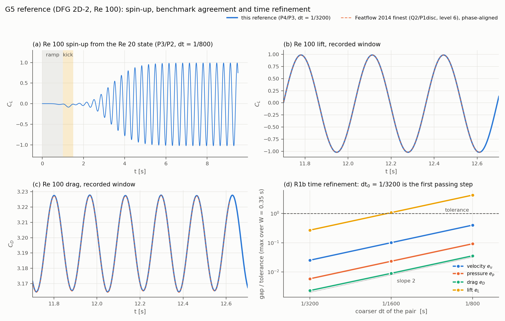
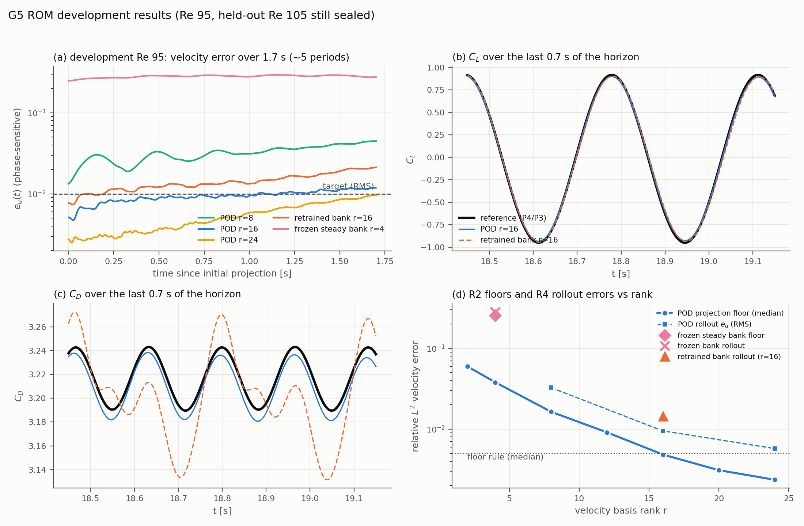
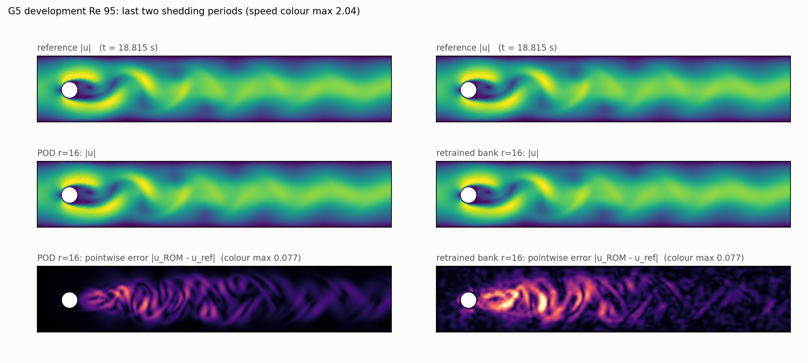

# Unsteady flow past a cylinder (DFG 2D-2, Re ≈ 100): neural bank versus POD

This report covers gate G5 of the obstacle-flow campaign: a time-dependent finite-element reference for vortex shedding, and reduced models built from it. **Status: final for this campaign.** Every number in the tables is generated by `make_report.py` from saved JSON/NPZ evidence in the three G5 lanes. The design and its amendments were fixed before the results they govern (`DESIGN-G5.md` in `exp/2026-11-03-cylinder-unsteady`). The retrained-bank ranking carries a qualification (§5).

## 1. Summary in plain language

- **The reference works and is admitted.** The time-dependent FE solver reproduces the published DFG 2D-2 benchmark well inside every predeclared tolerance (§3). It passes time refinement, space refinement and population checks, and an independent audit of the saved arrays.
- **The neural bank from the steady campaign does not transfer.** The four learned velocity modes cannot represent vortex shedding: the best approximation leaves roughly a quarter of the velocity field unexplained. Rolled out, it fails every target.
- **Retraining the bank on shedding data with the same recipe works, but less well than POD.** At the same dimension (16 velocity modes plus the same pressure and stabilization spaces) the retrained bank's rollout error is larger than POD's. It misses the velocity target that POD meets, on both the development and the held-out Reynolds number. Its velocity field is also far less divergence-free, and its drag history is distorted.
- **POD-Galerkin at rank 16 meets every accuracy target** on development and held-out data. Rank 24 is more accurate still.
- **Cost:** in the same allocation and on the same CPU cores, a reduced rollout advances the flow about three orders of magnitude faster than the FE solver once its operators are built. Building the operators also takes far less time than the FE run (§6). That measures speed against the production reference configuration only. No cheaper, accuracy-matched FE setting was tested.
- **What failed along the way** is listed in §7. It includes the explicit time scheme, the P3/P2 divergence gate, two settle caps, the first refinement attempt and the quadrature cross-check.
- **What remains unproven:** generalization beyond Re 90–110; longer horizons than about five periods; any advantage of the neural bank over POD; speed against an accuracy-matched FE solver; and 3D.

## 2. Setup (fixed in advance)

DFG 2D-2 channel and cylinder, mean inflow 1, kinematic viscosity 0.1/Re, gradient-form outlet. The primary Re 100 trajectory starts from the admitted Re 20 steady state, with a sin² inflow ramp and a one-off asymmetric kick. Reference: curved P4/P3 Taylor–Hood elements on the admitted steady mesh, with second-order BDF2 time stepping (frozen-Oseen variant). Population: train Re 90, 100, 110; development Re 95; held-out Re 105, opened once at the end. Each trajectory has a recorded window of 1.7 s (about five shedding periods), saved every 1/400 s.

Reduced models share everything except the velocity basis:
- the same lift (mean training velocity);
- the same pressure basis (constant plus pressure POD);
- one supremizer per pressure mode;
- the same order-12 quadrature;
- the same fully implicit BDF2 Galerkin rollout at the reference time step.

Arms: POD at ranks 8, 16 and 24; the frozen steady bank (4 modes); and the bank retrained on transient POD modes (16 modes).

## 3. Reference results

Time and space refinement, maximum over a one-period window from the common start state. Production time step: dt₀ = 1/{dt0}.

{ladder}

Re 100 against the published benchmark (Featflow 2014 finest level; statistics are means over every complete cycle of the recorded window):

{dfg}

The original 1996 ranges contain our drag maximum, Strouhal number and pressure difference. The 1996 lift range was declared non-gating before any results, because the high-accuracy reference itself lies outside it. All five trajectories pass the population checks: completion, coverage, hashes, divergence, mass and solver residuals. The heuristic reference uncertainty over the 1.7 s horizon is {unc_u} for velocity and {unc_p} for pressure. Both are below one fifth of the ROM targets, so ROM comparisons are "resolved under the linear-propagation estimate". This is an estimate, not a bound.

## 4. Representation (R2) and retraining (R3)

Best-approximation velocity error on development Re 95 (681 states):

{floors}

The frozen bank fails the predeclared floor, so the bank was retrained at the smallest POD rank that passes (16). Training stopped at its predeclared iteration limits, which is not convergence. Final parent objective {parent}; child objective {child}, which includes the divergence and traction terms.

## 5. Rollouts (R4 development, R5 held-out)

Development Re 95 (phase-sensitive errors over the full horizon):

{dev}

Held-out Re 105, opened once with frozen settings:

{ho}

Animation of the last two development periods: `figures/g5_rom_dev_anim.gif` (reference, ROM and pointwise vector error). Still frame:

**Quadrature qualification failed, so the ranking above is formally "unresolved under the quadrature check".** The order-12 versus order-14 cross-check changed every floor and every rollout metric by far less than its tolerance. However, the operator criterion failed for every arm, through a single operator: the lift's tested divergence vector `BL`. That vector vanishes in exact arithmetic for Taylor–Hood fields. Its norm is {bl12} (order 12) and {bl14} (order 14), against {blB} for the divergence operator. A relative change of a near-zero vector is ill-conditioned. The predeclared rule nevertheless applies unchanged.

{qtable}

## 6. Cost (R5, one allocation, CPU, 16 threads)

Workload: 0.1 s of held-out flow at dt₀ from the first recorded state. Both methods produce the same outputs: forces and probes every step, and the state at every save. Seven paired repetitions in alternating order, with a warm-up immediately before each timed invocation. Persistence is excluded symmetrically.

{timing}

"Cold" adds construction: mesh, spaces and factorization for the FE solver; operator and tensor build for a ROM. Reconstructing the full velocity field at every save is reported separately and costs more than the reduced rollout itself, so a ROM's advantage is largest when only coefficients, forces or probes are needed. The FE repetitions are not bitwise identical: thread-order roundoff gives differences of order 1e-13 in forces. Every repetition reproduces the recorded reference to roundoff, as the witness column shows. The ROM repetitions are bitwise identical. Offline costs are not included in the per-query time. They comprise reference trajectories (several GPU-hours each), POD, supremizers, export, and bank training (§4). The scope is speed against the production reference configuration only.

## 7. Failures and retractions (all retained in the evidence)

1. The explicit-convection BDF2 scheme was unstable at full inflow speed. The Oseen-BDF2 GMRES variant missed its linear tolerance and was too slow. The frozen-Oseen BDF2 scheme replaced both (amendments A1, A2).
2. P3/P2 failed the divergence gate (about 3e-3 against 1e-3). The user chose P4/P3 production and a reduced population (A3).
3. Two settles hit the original 4 s cap. The user raised the cap to 6 s, a post-failure extension that qualifies only the amended protocol (A4).
4. The first R1b attempt was stopped by the embedding check (projection roundoff 5e-10). It was repaired by exact coefficient injection.
5. Budget: the R1b result (dt₀ = 1/3200) doubled record cost. The user raised the ceiling to 42 GPU-h (A6). Used: {gpu_h:.2f} GPU-h over {njobs} allocations.
6. Quadrature check, attempt 1, refused at its identity guard (independently recomputed modes differ at roundoff). Attempt 2 failed the operator criterion through `BL` (§5).
7. The retrained bank misses the velocity RMS target on both development and held-out data. Its divergence is about two orders of magnitude worse than POD's.
8. Codex review was unavailable for a day because of a usage limit. Grok substituted for the smoke and spin-up, with the user's consent. All later gates passed Codex review; several reviewer-found bugs were fixed before data (review files in `reviews/`).

## 8. Provenance

Lanes (unmerged; mirrors `codeonly/exp/…`): `exp/2026-11-03-cylinder-unsteady` (design, sources, reviews, figures), `exp/2026-11-03-cylinder-unsteady-ref` (reference code, artifacts, job ledger), `exp/2026-11-03-cylinder-unsteady-rom` (ROM code, artifacts). Forked from obstacle lanes `f463a08ec`, `091afa488` and `57680db12`. Snapshots (about 17 GB) are retained both locally and on the cluster share, with SHA-256 manifests. Every allocation is in `job-ledger.json`. Reviews: Grok 01–04, Codex design 02–05, Codex ROM 01–04, Codex R1f audit.

## Glossary

- **FE / reference:** the full finite-element solver whose solution the ROMs try to reproduce.
- **ROM:** reduced-order model, solving for a few coefficients of fixed spatial functions.
- **POD:** proper orthogonal decomposition. Spatial modes ranked by how much snapshot energy they capture.
- **Neural bank:** spatial functions given by a trained neural network instead of POD.
- **Frozen bank:** the bank trained on steady flow, used unchanged.
- **Retrained bank:** the same architecture and recipe retrained on shedding data.
- **r:** number of velocity modes.
- **Unknowns (vel + p):** velocity coefficients (modes plus supremizers) plus pressure coefficients.
- **Supremizer:** an extra velocity function that keeps the reduced pressure stable.
- **e_u, e_p:** relative velocity error and pressure error at each saved time. "Phase-sensitive" means compared at the same time, so a shift in the shedding phase counts as error.
- **RMS / max:** root-mean-square and maximum over the horizon.
- **Floor:** the best possible error of a basis (projection), before any time stepping.
- **St:** Strouhal number, the shedding frequency × diameter / velocity.
- **C_D, C_L:** drag and lift coefficients.
- **Δp:** pressure difference between the front and back of the cylinder.
- **dt₀:** production time step.
- **R1b/R1c/R1d/R1e/R1f:** reference gates for time refinement, space refinement, benchmark agreement, population checks and independent audit.
- **Held-out:** a Reynolds number never used for any decision before the final test.
- **Warm/cold time:** per-query time without, or with, one-off setup.
- **GPU-hours:** allocated cluster time. FE kernels run on CPU but the allocation counts.
- **Divergence:** how far the velocity is from mass-conserving, normalized.
- **Unresolved:** a comparison that the predeclared rules do not allow us to rank.
