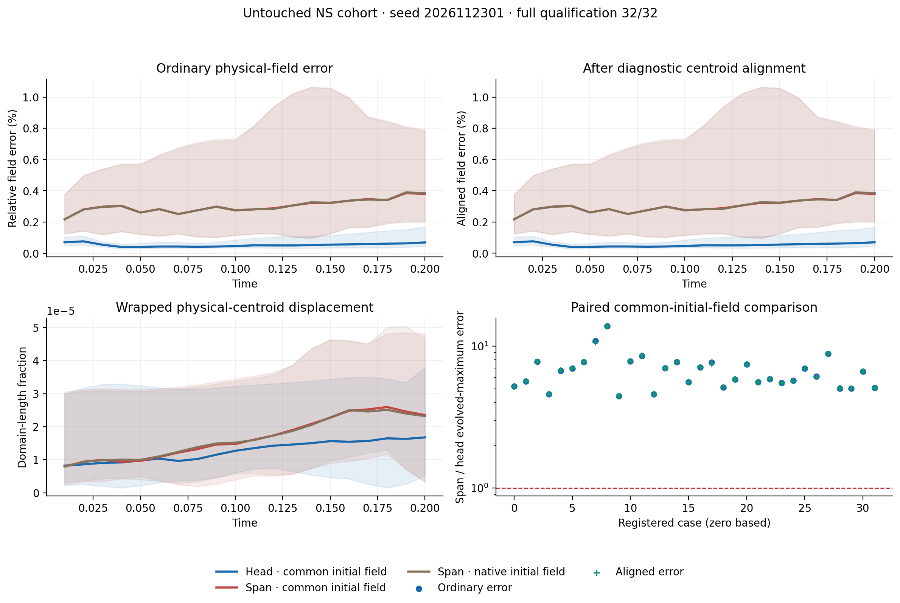

# JCP consolidation and Navier–Stokes initializer confirmation

This report records the authorized branch consolidation, the initializer repair, and its frozen validation on previously untouched original-family cases. The retained numerical results and independent audits are final for this registered configuration; broader accuracy–cost and generalization claims remain open.

The revised initializer **passes** all registered untouched-case checks, and the fresh phase/shape campaign **passes** its complete numerical contract. No case fails the complete phase contract. There are no new timing or speedup claims.

## One consolidated JCP branch

The working branch is `exp/2026-11-23-jcp-consolidated`, backed up through `origin/codeonly/exp/2026-11-23-jcp-consolidated`. All 1023 scientific Git files from the merged lanes match their original contents; their earlier unsuccessful results remain part of the record.

Final experiment source: `e34631ed1024f2b34ad44daeb2c1efedd99cb0a7`. Verified code-only backup: `daf56aff82eff040e258d60a293ef213c98ec958`. All 3448 eligible initializer-experiment files match byte for byte, including all 3262 raw result-manifest files across the attempts.

| Merged branch | Original head | Scientific files | Content audit |
| --- | --- | --- | --- |
| exp/2026-11-19-jcp-phase-confirm | `8394b33cb3c2` | 412 | Unchanged |
| exp/2026-11-19-jcp-width-deploy | `d049dda2ab0e` | 464 | Unchanged |
| exp/2026-11-19-jcp-cost-confirm | `040fb32c1e0b` | 147 | Unchanged |

The frozen implementation source is `346467d02715bceab7d84bff3d85acbeb3c9b124`; the accepted development solver source is `d173150171b429524fb4dc8280262f2310213ada`. The confirmation allocation used package commit `5d8966a6216d29730465090eee47cabb182b8f6f`, which adds the frozen manifest and cohort registration without changing the frozen implementation. [Merge audit](2026-11-23-jcp-ns-initializer-assets/merge-audit.json), [freeze audit](2026-11-23-jcp-ns-initializer-assets/freeze-audit.json) and [registered protocol](2026-11-23-jcp-ns-initializer-assets/evidence/protocol.md) preserve the exact contracts. The original large cost arrays retain their previously documented local/archive scope; consolidation does not turn them into new GitHub-hosted numerical evidence.

## What changed in the initializer

The head, coordinate bank, training data, physical family, starting-code identities and original stationarity tolerances are unchanged. The first attempt added bounded QR and SVD corrections to the original solver and failed full qualification. Those outcomes remain visible below.

The accepted revision combines both legacy endpoint implementations with a fixed-anchor evaluation of the same mathematical residual. With a fixed code $z_*$, it evaluates

$$r(z)=H(z_*)-a_0+\Delta H(z_*,z-z_*).$$

Here $H$ is the frozen head, $a_0$ is the projected target coefficient vector, and $z$ is the head code.

Stable algebraic increments reduce cancellation near a fitted endpoint; the anchor is chosen once per fit and is never updated during polishing. Both ordinary-direct and anchored gradients must satisfy the original stationarity test. Separate higher-precision evaluations of the original small network check objective differences against the original objective band. They are arithmetic diagnostics on stored parameters, separate from the primary double-precision GPU solves.

This is a prospectively registered arithmetic amendment. Ordinary-direct objective-ranking flags remain failures of that older arithmetic comparison. They are neither erased nor described as passing the old contract. The revision changes multiple ingredients, so this campaign does not isolate the benefit of stable evaluation from adding the second legacy endpoint set.

| Cohort / method | Selected fits | Core failures | Full qualification | Largest old/new physical gap |
| --- | --- | --- | --- | --- |
| Development: QR/SVD | 384 | 19 | 324/384 | 3.73262e-12 |
| Development: fixed anchor | 384 | 0 | 384/384 | 4.1399e-12 |
| Untouched: fixed anchor | 384 | 0 | 384/384 | 6.29399e-12 |

Physical gaps are relative to the original initial-field norm. A small gap shows that the repair changes certification at nearly the same physical initial state; it does not by itself establish trajectory accuracy.

For 8 records in the unsuccessful first attempt, the raw-minimum phase-control residual/Jacobian arrays were not separately saved; that comparator's audit uses retained codes, freshly recorded objective values and source review. The accepted revision and new-case invocations retain every control's arrays. This limitation does not turn the first attempt into a qualified result.

| Fixed-anchor cohort | Ordinary all-control objective flags | Ordinary phase-comparator flags | Decimal audits |
| --- | --- | --- | --- |
| Development fixed anchor | 187 | 157 | 187 |
| Untouched fixed anchor | 195 | 149 | 195 |

These counts concern selected-fit records, including repeated input paths and tolerances on the same physical cases; they are not counts of distinct independent cases.

## Untouched-case protocol and actual evolution

Seed `2026112301` defines 32 cases. Exact and rounded parameter comparisons found no overlap with the registered training, development and previously exposed cohorts. Source, configuration and cohort hashes were frozen before physical outcomes were generated. Historical sealed test cohorts remain closed.

The initialization matrix covers learned and POD heads, phase and query input paths, and every registered gradient tolerance. The trajectory comparison uses the learned coordinate bank; POD is covered by initializer checks only. The phase run independently audits its own 64 actual initial-fit invocations rather than borrowing an initializer pass from another run. The common head/span comparison starts from the same reconstructed physical field; the native span starts from its own linear projection.

Those actual trajectory initializer calls separately retain 24 ordinary-direct objective flags and 24 Decimal audits, all passing the amended independent objective contract. These are repeated invocations on the same cohort, not additional independent cases.

Before new physical cases were generated, a fixed exposed-case integration fixture passed: the shared initializer returned the same code through the phase and complete-query interfaces, and their trajectories agreed within the declared bound. That fixture is not a new cost measurement or a fresh POD rollout validation.

The trajectory setting is $N=64$, bank rank $R=64$, head dimension $k=8$, scalar weak-test rows $M=584$, $\Delta t=0.01$ and horizon $0.2$. Both head and span also solve for 3 frame variables: 11 versus 67 total online unknowns. The same-grid CNAB2 references use steps $0.000125$ and $6.25\times10^{-5}$. These are discrete time-refinement checks, without spatial-refinement or continuum-error claims. All 3840 trajectory steps are retained. Jacobian-action checks apply to the tighter trajectory tolerance only.

| Phase check | Passing cases | Registered cases | Failed case IDs |
| --- | --- | --- | --- |
| Initializer | 32 | 32 | None |
| Matched initial fields | 32 | 32 | None |
| Weak operators | 32 | 32 | None |
| Trajectory solver | 32 | 32 | None |
| Jacobian actions | 32 | 32 | None |
| Solver refinement | 32 | 32 | None |
| Reference refinement | 32 | 32 | None |

## What the new phase/shape results support

Each entry below starts from a maximum over evolved times for each case; time-zero fit errors are reported separately in the plot data. The ratio is the median of paired span/head ratios, not a ratio of medians. No failed case is removed.

These ratios compare the head and linear-span trajectory methods. The initializer's old/new physical differences are reported separately above.

| Metric | Head median | Head worst | Common-span median | Common-span worst | Median paired span/head | Cases with lower head error |
| --- | --- | --- | --- | --- | --- | --- |
| Ordinary field error (%) | 0.0799628 | 0.168582 | 0.545889 | 1.06438 | 6.36172 | 32 |
| Centroid-aligned field error (%) | 0.0797221 | 0.167514 | 0.545772 | 1.0644 | 6.34811 | 32 |
| Centroid displacement (domain fraction) | 1.82254e-05 | 3.78617e-05 | 2.77723e-05 | 4.84172e-05 | 1.45707 | 28 |

The declared alignment translates fields using a physical energy centroid; it does not fit a translation to minimize error. Phase displacement uses wrapped domain fractions. The smallest recorded centroid concentration is 0.655026, against the registered descriptive ambiguity threshold 0.1; this threshold is not part of the trajectory qualification gate. The ordinary and aligned errors answer different questions: trajectory position and remaining shape both matter. The qualified median head advantage survives this declared alignment. This comparison does not establish a unique causal mechanism for drift.

## Figures and manuscript placement

Use the new phase/shape comparison with its qualification table in the main numerical-results section. Put initializer stationarity, field agreement, objective-arithmetic diagnostics and every-case panels in the solver-validation section or supplement. PNG, SVG and PDF versions and the plotted records are retained together.

- [Initializer field agreement (d01)](2026-11-23-jcp-ns-initializer-assets/figures/d01/initializer-field-agreement.png)
- [Initializer objective diagnostics (d01)](2026-11-23-jcp-ns-initializer-assets/figures/d01/initializer-objective-diagnostics.png)
- [Initializer qualification matrix (d01)](2026-11-23-jcp-ns-initializer-assets/figures/d01/initializer-qualification-matrix.png)
- [Initializer stationarity (1e-07) (d01)](2026-11-23-jcp-ns-initializer-assets/figures/d01/initializer-stationarity-1e-07.png)
- [Initializer stationarity (1e-09) (d01)](2026-11-23-jcp-ns-initializer-assets/figures/d01/initializer-stationarity-1e-09.png)
- [Initializer stationarity (1e-11) (d01)](2026-11-23-jcp-ns-initializer-assets/figures/d01/initializer-stationarity-1e-11.png)
- [Initializer field agreement (d02)](2026-11-23-jcp-ns-initializer-assets/figures/d02/initializer-field-agreement.png)
- [Initializer objective diagnostics (d02)](2026-11-23-jcp-ns-initializer-assets/figures/d02/initializer-objective-diagnostics.png)
- [Initializer objective roundoff (d02)](2026-11-23-jcp-ns-initializer-assets/figures/d02/initializer-objective-roundoff.png)
- [Initializer qualification matrix (d02)](2026-11-23-jcp-ns-initializer-assets/figures/d02/initializer-qualification-matrix.png)
- [Initializer stationarity (1e-07) (d02)](2026-11-23-jcp-ns-initializer-assets/figures/d02/initializer-stationarity-1e-07.png)
- [Initializer stationarity (1e-09) (d02)](2026-11-23-jcp-ns-initializer-assets/figures/d02/initializer-stationarity-1e-09.png)
- [Initializer stationarity (1e-11) (d02)](2026-11-23-jcp-ns-initializer-assets/figures/d02/initializer-stationarity-1e-11.png)
- [Initializer field agreement (f01/initializers)](2026-11-23-jcp-ns-initializer-assets/figures/f01/initializers/initializer-field-agreement.png)
- [Initializer objective diagnostics (f01/initializers)](2026-11-23-jcp-ns-initializer-assets/figures/f01/initializers/initializer-objective-diagnostics.png)
- [Initializer objective roundoff (f01/initializers)](2026-11-23-jcp-ns-initializer-assets/figures/f01/initializers/initializer-objective-roundoff.png)
- [Initializer qualification matrix (f01/initializers)](2026-11-23-jcp-ns-initializer-assets/figures/f01/initializers/initializer-qualification-matrix.png)
- [Initializer stationarity (1e-07) (f01/initializers)](2026-11-23-jcp-ns-initializer-assets/figures/f01/initializers/initializer-stationarity-1e-07.png)
- [Initializer stationarity (1e-09) (f01/initializers)](2026-11-23-jcp-ns-initializer-assets/figures/f01/initializers/initializer-stationarity-1e-09.png)
- [Initializer stationarity (1e-11) (f01/initializers)](2026-11-23-jcp-ns-initializer-assets/figures/f01/initializers/initializer-stationarity-1e-11.png)
- [Fresh all cases ordinary (f01/phase)](2026-11-23-jcp-ns-initializer-assets/figures/f01/phase/fresh-all-cases-ordinary.png)
- [Fresh all cases shape (f01/phase)](2026-11-23-jcp-ns-initializer-assets/figures/f01/phase/fresh-all-cases-shape.png)
- [Fresh initial error centroid concentration (f01/phase)](2026-11-23-jcp-ns-initializer-assets/figures/f01/phase/fresh-initial-error-centroid-concentration.png)
- [Fresh phase displacement pairs (f01/phase)](2026-11-23-jcp-ns-initializer-assets/figures/f01/phase/fresh-phase-displacement-pairs.png)
- [Fresh phase shape (f01/phase)](2026-11-23-jcp-ns-initializer-assets/figures/f01/phase/fresh-phase-shape.png)
- [Fresh trajectory qualification (f01/phase)](2026-11-23-jcp-ns-initializer-assets/figures/f01/phase/fresh-trajectory-qualification.png)

The [earlier measured JCP report](2026-11-19-jcp-physical-diagnostics-and-confirmation.md) still supplies the derivative-error, Burgers width–test and original accuracy–cost figures. Those datasets have not changed and must retain their historical qualifications. This report supersedes neither their measurements nor their failed gates.

## What still needs an experiment

- A complete-query accuracy–cost comparison using the revised initializer, paired against eligible classical and POD baselines in the same allocation. All initialization, physical output and audit work must be included. Historical POD rollout, reference and accuracy-target failures need their own resolution.
- A repaired sparse deployment that first passes admission, including the cold start and actual stencil closure. An initial-fit fix does not demonstrate sparse online scaling.
- A separate extension if the paper claims broader parameter ranges, longer horizons, or a causal mechanism: these fresh cases belong to the original family and use the registered horizon. Optional manifold-distance, tangent and reset studies were not repeated here.
- An ablation if the paper attributes the repair specifically to stable increments: the current accepted revision also includes both legacy endpoint sets.

These are distinct from the requested initializer confirmation. The strongest current manuscript argument is numerical qualification plus measured physical error, with cost claims restricted to their own valid evidence.

## Execution and retention

| Run | Cluster job | GPU | Scheduler state | Allocated GPU-seconds |
| --- | --- | --- | --- | --- |
| d01 | 7477604 | NVIDIA L40S | COMPLETED | 154 |
| d02 | 7478133 | NVIDIA L40S | COMPLETED | 289 |
| f01 | 7478826 | NVIDIA A100-PCIE-40GB | COMPLETED | 786 |

The campaign used 1229 allocated GPU-seconds in total. These are resource-accounting figures, not cross-job performance comparisons. Raw outputs and source archives pass exact hash verification, and archived source files match the recorded Git commits. Owned remote-directory cleanup is complete in the retained closeout records. Large aggregate archives have local retention and hashes; individual result-file coverage is verified separately against the code-only backup.

## Reproducibility and glossary

[Initializer audit](2026-11-23-jcp-ns-initializer-assets/fresh-initializer-audit.json), [phase audit](2026-11-23-jcp-ns-initializer-assets/fresh-phase-audit.json), [independent reviews](2026-11-23-jcp-ns-initializer-assets/independent-review.json), [backup and cleanup verification](2026-11-23-jcp-ns-initializer-assets/backup-audit.json), [data-source hashes](2026-11-23-jcp-ns-initializer-assets/sources.json), and [machine-readable report values](2026-11-23-jcp-ns-initializer-assets/measured-values.json) link every table to retained records. The report builder and independent audit scripts live beside this report. No measured value is manually entered into the report.

- **Head / learned head:** the trained low-dimensional nonlinear map into coefficients of the coordinate bank; its latent dimension is $k$.
- **Bank / rank $R$:** the fixed collection of spatial basis functions and its number of columns. **POD** is the data-derived orthogonal basis used by the comparator.
- **Span / common span / native span:** all linear combinations of a bank; the common span uses the head's initial field, while the native span uses its own initial linear projection.
- **Frame variables:** the 3 translation coordinates evolved together with the head code or span coefficients; they describe the moving spatial frame.
- **Initializer / selected fit:** the optimization that maps an input physical field to a head code; one returned solution per case, bank, input path and tolerance is counted.
- **Phase / query input:** the original physical initial field versus the complete-query path's additional spectral projection.
- **Exposed / untouched cohort:** cases available during development versus cases whose physical outcomes were generated only after source and protocol freeze. Repeated tolerances are checks on the same cases, not independent samples.
- **Stationarity / gradient tolerance / core failure:** a sufficiently small normalized residual gradient, its acceptance threshold, and failure of the core numerical solver's gradient/objective checks.
- **QR / SVD / LM:** numerical linear-algebra factorizations and the damped least-squares solver; rank truncation alone does not certify convergence.
- **Fixed anchor / ordinary direct / amended arithmetic:** a frozen nearby code used for stable residual increments, the original direct residual calculation, and the prospectively specified revised evaluation contract.
- **Objective flag / Decimal audit:** a recorded failed cost-ranking comparison, and a separate high-precision original-network calculation used to check differences hidden by floating-point rounding.
- **Objective / allowance / endpoint:** the least-squares fit cost, its permitted numerical comparison difference, and a candidate returned code being compared.
- **Full qualification / phase check / passing cases:** conjunction of all declared numerical checks, an individual trajectory campaign gate, and the number of cases satisfying it. Integrity verification checks record consistency and is separate from scientific qualification.
- **Old/new physical gap:** relative difference between reconstructed initial fields before and after the repair; it is not their error against truth.
- **$N$, $M$, $\Delta t$, horizon:** spatial points per direction, number of weak test functions, trajectory time step, and final evolution time. **Weak tests** project the PDE residual onto prescribed smooth functions.
- **CNAB2 / reference / refinement:** the reference time-stepping scheme, its same-grid trajectory, and agreement under a finer step or tighter solve. No continuum truth is asserted.
- **Ordinary / aligned error:** field mismatch before or after the declared centroid translation. **Centroid concentration** measures whether that periodic centroid has a stable direction.
- **Median / worst / paired span/head / lower-error cases:** the middle case value, largest case value, casewise error ratio followed by its median, and the count where head error is smaller. **Evolved maximum** excludes time zero.
- **Jacobian action / operator / common state:** derivative consistency in a test direction, assembled weak operators, and agreement of reconstructed initial fields for the matched comparison.
- **Sparse admission / stencil closure / cold start:** checks allowing reduced spatial evaluation, every spatial site needed by its discretization, and work to form the initial state. **Complete query** includes initialization, evolution and requested output.
- **Commit / mirror / source hash:** recorded source version, its code-only remote backup, and a content fingerprint used to verify exact identity.
- **Scheduler state / allocated GPU-seconds:** whether the cluster job finished successfully, and its allocation duration times allocated GPU count. These include setup and validation and are not per-query speed measurements.
