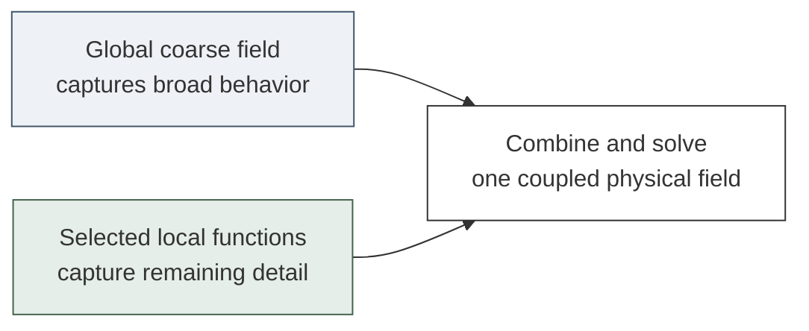
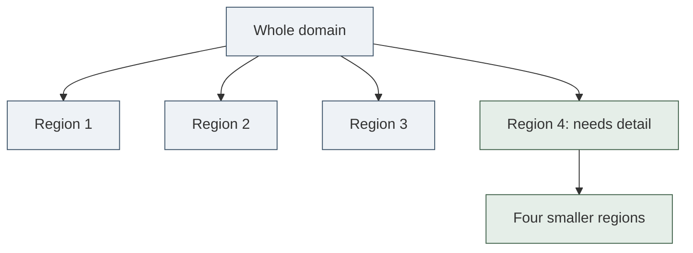
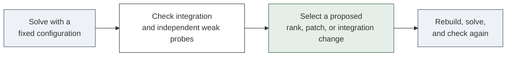

# Learning where—and how—to add detail

## A visual guide to a research proposal

**Research question:** Can a tree of reusable learned functions make repeated PDE solves cheaper at the same physical accuracy?

**Status:** Proposed research, not a demonstrated speedup. This guide explains the idea and supplies a proposal draft. The detailed literature review remains the supporting reference.

### Start with a physical picture

Imagine heat flowing through a material containing a small difficult region. The whole domain needs a coarse solution, but only some regions may need extra detail. A local source can still affect the whole domain: we retain a global component.

**The tree chooses where to spend effort. The learned functions determine how efficiently we represent the solution there.**

A conventional adaptive solver already has the first capability. Our research must demonstrate added value from the second, and from a practical rule for selecting it.

**Reading route:** understand the existing bank → add local detail → solve the physics → design a fair experiment → write the proposal.

<!-- PAGE -->

# 1. What does our current bank do?

A bank is a library of functions. A solution is built by choosing how much of each function to use:

$$u_r(x;c)=u_{\mathrm{bc}}(x)+\sum_{j=1}^{r}c_j\phi_j(x).$$

| Symbol | Read it as |
|---|---|
| $x$ | A position in the physical domain. |
| $u_r(x;c)$ | Our approximate physical field, such as temperature. |
| $u_{\mathrm{bc}}$ | A field supplying the prescribed boundary values. |
| $\phi_j(x)$ | The $j$th reusable function in the frozen bank. |
| $c_j$ | The unknown weight of that function, solved for a new problem. |
| $r$ | The number of active functions: the reduced dimension. |

### What is learned, and what is solved?

**Offline:** learn the functions from related solutions. **Online:** keep those functions fixed and solve for their coefficients. Increasing $r$ exposes more functions from the ordered bank. If $c_j=0$, that function contributes nothing; changing its sign reverses its contribution.

### Why consider a tree?

A global bank can require additional coefficients to represent difficult local behavior. We want to investigate whether adding detail only in selected regions is cheaper. This is a hypothesis; some features remain best represented globally.

**Boundary condition:** the correction functions must preserve the prescribed boundary values. Adding arbitrary functions can break that property.

**Implementation meaning:** retain the existing coarse bank and its coefficient solve. Add a mechanism for evaluating and activating local corrections.

<!-- PAGE -->

# 2. What changes when we add a tree?

A **quadtree** splits a two-dimensional region into four children. An **octree** splits a three-dimensional region into eight. We begin in two dimensions so the mechanism is easier to inspect.

The proposed representation is:

$$u(x)=u_{\mathrm{bc}}(x)+B_0(x)c_0+
\sum_{K\in\mathcal A}\sum_{j=1}^{r_K}c_{Kj}\psi_{Kj}(x).$$

**Read left to right:** boundary values + global coarse field + local corrections in selected regions.

| New symbol | Meaning |
|---|---|
| $B_0c_0$ | The retained global bank and its coefficients. |
| $\mathcal A$ | The set of currently active tree regions. |
| $K$ and $r_K$ | One region and its number of active local functions. |
| $\psi_{Kj}$ | A function supported near that region. |

There are two different ways to add approximation detail: **increase $r_K$** to add functions in the same region, or **split $K$** to use smaller regions. The research problem includes deciding which action is worth its cost.

**Important:** an active region may retain its parent’s functions. We are enriching a hierarchy, not automatically replacing parents with children.

<!-- PAGE -->

# 3. How do local functions fit together?

We can map a reusable local function into a physical patch and multiply it by a smooth window:

$$\psi_{Kj}(x)=\chi_K(x)\,\widehat\phi_j(T_K^{-1}x).$$

**$T_K^{-1}$** maps the physical patch into local coordinates. **$\widehat\phi_j$** is a learned local shape. **$\chi_K$** smoothly turns that shape off outside its patch. Boundary patches need compatible windows or specially constrained functions.

### Why the window matters

Unconnected patch predictions can disagree at their edges. Smooth, overlapping functions let us assemble one continuous field. The coefficients must still be solved together because the PDE couples the regions.

### Derivatives must include both factors

$$\nabla\psi_{Kj}
=(\nabla\chi_K)\widehat\phi_j
+\chi_K H_K^{-T}\nabla_{\xi}\widehat\phi_j,$$

where $T_K(\xi)=x_K+H_K\xi$. The matrix $H_K$ describes the patch scale and shape. The first term differentiates the window; the second differentiates the mapped learned shape.

**Implementation meaning:** differentiating the neural function alone gives the wrong physical gradient.

### A safe first enrichment rule

Keep existing functions and windows fixed. Add new child functions with zero coefficients. The represented field then remains unchanged at insertion; the next coupled solve decides whether to use them.

Renormalizing old windows or deleting parents can change the field immediately. Coarsening therefore requires a separate transfer-and-check procedure.

<!-- PAGE -->

# 4. How do the coefficients obey physics?

Start with steady diffusion, a model of conduction:

$$-\nabla\!\cdot\big(a(x)\nabla u(x)\big)=f(x).$$

Here $a(x)>0$ is conductivity and $f(x)$ is a source. The gradient $\nabla u$ describes spatial change; heat flux $-a\nabla u$ flows down that gradient. Divergence $\nabla\!\cdot$ measures net outflow. For the first prototype, prescribe the boundary field and use test functions $v_i$ that vanish on the boundary.

Multiplying by $v_i$ and integrating by parts gives the **weak equation**:

$$\int_\Omega a\nabla u\cdot\nabla v_i\,dx
=\int_\Omega f v_i\,dx.$$

**Plain meaning:** each smooth test function checks a weighted balance of the PDE across a region. We avoid differentiating the approximate field twice pointwise.

Substitute the coarse-plus-local representation. For linear diffusion, the residual becomes:

$$R_i(c)=\sum_{j=1}^{r}A_{ij}c_j-b_i,
\qquad c^*=\underset{c}{\operatorname{argmin}}\,\|W(Ac-b)\|_2^2.$$

**$A_{ij}$** integrates the conductivity times the gradients of trial function $j$ and test function $i$. **$b_i$** contains the source and boundary-lift contributions. **$W$** scales the test equations consistently. The symbol $\operatorname{argmin}$ means “choose coefficients that make the weighted mismatch as small as possible.” Here $r$ counts all active coefficients; use comfortably more tests $M$ than coefficients.

**Implementation meaning:** assemble and solve an overdetermined coefficient problem. Hold the selected functions and integration rule fixed during each solve.

A small residual only means these tested equations fit well. It does **not** by itself certify the physical solution error.

<!-- PAGE -->

# 5. What should adapt—and when?

Keep three objects separate:

| Object | Its job | Refining it changes… |
|---|---|---|
| Reference mesh | Provide an accurate conventional solution or final correction. | The underlying full-order discretization. |
| Trial-function tree | Choose local functions and ranks. | What our approximate solution can represent. |
| Integration tree | Evaluate the weak integrals. | How accurately and cheaply we evaluate the chosen equations. |

**More integration points cannot repair a bank that cannot represent the solution.** Conversely, adding functions cannot compensate reliably for inaccurate integration.

### A practical first policy

Use a deterministic, capped enrichment policy before attempting a learned selector. Compare independent local weak probes and parent-versus-child integration estimates. Test whether candidate actions improve the checked solution enough to justify their cost.

These are indicators, not automatic error bounds. If checks fail or enrichment becomes too expensive, return to the validated conventional solver.

**First deployment:** use the reduced solution as a warm start for that solver. A successful warm start saves more conventional work than its preparation and checking cost.

<!-- PAGE -->

# 6. Where could an improvement come from?

| Comparison | Possible gain | What could erase it? |
|---|---|---|
| Current global bank | Concentrate extra approximation work in selected regions. | Many regions need detail, or selection is expensive. |
| Adaptive polynomial/spline solver | Represent recurring local patterns with fewer coefficients. | Dense reduced algebra and assembly outweigh the reduction. |
| Per-problem neural training | Reuse frozen functions and solve only coefficients. | New problems lie outside the learned family. |
| Local POD | A better representation for this particular family. | POD represents it equally well or more cheaply. |

### The quantity that decides success

$$T_{\mathrm{new}}=T_{\mathrm{prepare}}+T_{\mathrm{coefficients}}
+T_{\mathrm{check}}+T_{\mathrm{correction}}+T_{\mathrm{output}}.$$

Preparation includes selection, transfer, and assembly. Correction includes the remaining conventional solve or fallback. Report offline learning cost separately and how many queries are required to amortize it.

**We need lower complete cost at the same physical accuracy and requested output.** A smaller coefficient count is a mechanism to investigate, not a performance result.

### Limits to expect

Overlapping local functions can become nearly dependent. Moving features can cause frequent adaptation. Three-dimensional trees increase bookkeeping and local work. Producing a dense output field still costs work proportional to the requested output size.

The project’s completed comparisons establish no general bank speed advantage. This proposal investigates a different allocation of work; it does not overturn those findings.

<!-- PAGE -->

# 7. What experiments would make this convincing?

## Aim 1 — Establish representation headroom

Use saved accurate fields first. Under the same physical weights, compare global POD, local POD, hierarchical polynomial detail, and candidate learned features. Fix the tree for the controlled comparison; then investigate adaptive selection separately.

**Measure:** projection error versus active dimension, stored dictionary size, and selection cost. Truth-assisted selection is diagnostic only. A fixed global POD basis is optimal for its training mean-square projection objective at a fixed total dimension; adaptive selection from a larger dictionary changes the resource budget.

## Aim 2 — Build a faithful weak solver

Use a bounded family of two-dimensional heterogeneous diffusion problems. Verify boundary handling, window/map derivatives, assembly, and reference convergence. Begin with classical composite quadrature and fixed local spaces.

**Compare:** tuned adaptive FEM with reuse, the global bank, and same-tree polynomial/local-POD/learned alternatives. Isolate integration changes on the same bank before combining interventions.

## Aim 3 — Test adaptation and useful deployment

Add patch/rank selection, then measure complete reduced warm starts plus conventional correction. Separate training, development, and held-out locations or scales. Freeze the selection settings before the final evaluation.

**Measure:** physical field and energy error, complete runtime, median and tail behavior, failures, fallback frequency, and amortization. Compare on the same hardware with warmup and preserved timing repetitions.

**Decision rule:** proceed to octrees only if the two-dimensional mechanism improves accepted solution cost against the strong controls. Otherwise identify which component erased the benefit and narrow or stop the claim.

<!-- PAGE -->

# 8. A research proposal you can build on

## Working title

**Adaptive local learned spaces for efficient repeated PDE solves**

### Motivation and gap

Adaptive spatial trees concentrate numerical resolution where a solution needs detail. Reduced models instead seek a compact representation of a family of solutions. Prior work already combines trees with conventional solvers, model reduction, neural integration, and forecasting. What remains to establish for our system is whether reusable learned local functions, coupled to practical patch and rank selection, offer additional computational value over equally equipped classical and local-POD alternatives.

### Central hypothesis

For a bounded family with localized, reusable approximation detail, retaining a global coarse space and selectively activating learned local functions can reduce the complete cost of an accepted solution. The hypothesis is conditional on the reduction in solve work exceeding selection, assembly, integration, verification, and training-amortization costs.

### Proposed approach

We will first measure approximation headroom using saved solution fields. We will then construct a weak coefficient solver for heterogeneous diffusion, using smooth local functions organized by a quadtree and an independently controlled integration rule. Finally, we will evaluate a capped adaptation policy and deploy its solution as a warm start for a validated conventional solver.

### Evaluation and expected contribution

Controlled comparisons will hold the tree, physical accuracy requirements, and numerical machinery fixed while changing the local representation. Complete runtime, physical error, failure behavior, and reuse costs will determine success. A positive outcome would establish an effective selection/enrichment method and the regime in which it helps. A negative outcome would identify whether approximation, conditioning, integration, or overhead prevents a useful advantage.

**Claim discipline:** the exact algorithm and its novelty remain to be established. The proposal promises an investigation, not a speedup or a first-ever tree-based neural method.

<!-- PAGE -->

# Sources and plain-language glossary

## Four anchors for the proposal

**[1] Kazhdan & Hoppe (2019), adaptive multigrid.** Classical trees already support continuous local splines and weak coefficient solves.
https://hhoppe.com/adaptivemultigrid.pdf

**[2] Rodopoulos et al. (2025), tree-integrated VPINNs.** Direct precedent for quadtree weak neural integration; neural weights are optimized per problem.
https://arxiv.org/html/2506.23357v1

**[3] Lu et al. (2026), octree electromagnetic model reduction.** Actual octree discretization plus Krylov reduced solving. Our verification covered the publisher’s abstract and introduction.
https://academic.oup.com/jge/article/23/3/1078/8566305

**[4] Smetana & Taddei, localized training and enrichment.** Adjacent prior art for local reduced spaces and enrichment; not evidence that our exact neural/tree algorithm is new.
https://arxiv.org/abs/2202.09872

See the [full literature review](/home/tahmid/Dev/Tunable-NM-ROM-Claude/reports/2026-10-26-adaptive-trees-for-coordinate-roms.md) for the complete inventory, source limits, and repository evidence. The equations here describe the proposed design, not new measured results.

## Glossary

**PDE:** an equation relating a physical field to its spatial or temporal changes. **ROM:** reduced-order model, solving with a smaller set of unknowns. **Bank / dictionary:** stored reusable functions. **Coefficient:** a function’s adjustable weight. **Rank / reduced dimension:** number of active coefficients.

**POD:** proper orthogonal decomposition, a standard way to learn linear spaces from solution snapshots. **FEM:** finite-element method, a conventional PDE discretization. **Weak form:** equations tested through integrals. **Quadrature:** approximation of those integrals using points and weights. **Residual:** mismatch in the tested equations.

**Patch:** a local spatial region. **Enrichment:** adding functions. **Warm start:** an initial guess for another solver. **Energy error:** an error measure weighting gradient mismatch by conductivity. **Held-out:** excluded from training and parameter tuning. **Amortization:** spreading one-time preparation cost over repeated uses. **Fallback:** using the validated conventional method when the reduced route is unsuitable. **Krylov space:** a linear space constructed using an equation’s operator. **VPINN:** a neural PDE method trained using a weak variational residual.
